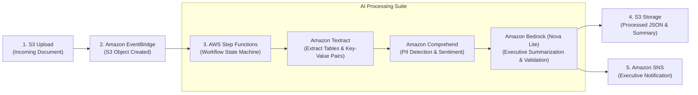

# Tutorial 03: Automated Document Intelligence Pipeline

> **Architecture Build Tutorial:** `Tutorial_03_Automated_Document_Intelligence_Pipeline.md`  
> **Course:** AWS Certified AI Practitioner (`AIF-C01`)  
> **Services Integrated:** Amazon S3, Amazon EventBridge, AWS Step Functions, Amazon Textract, Amazon Comprehend, Amazon Bedrock (Nova Lite/Claude), Amazon SNS  
> **Level:** Production-Grade Serverless Pipeline

---

## 🏛️ Architecture Overview

Organizations ingest thousands of scanned PDF invoices, contracts, and medical forms daily. This tutorial builds an automated, event-driven document processing and intelligence pipeline. 



---

## 🛠️ Step-by-Step Implementation Guide

### Step 1: Create the Source and Destination S3 Buckets
```bash
aws s3api create-bucket \
    --bucket doc-intelligence-incoming-corp \
    --region eu-north-1 \
    --create-bucket-configuration LocationConstraint=eu-north-1

aws s3api create-bucket \
    --bucket doc-intelligence-processed-corp \
    --region eu-north-1 \
    --create-bucket-configuration LocationConstraint=eu-north-1

# Enable EventBridge notifications on incoming bucket
aws s3api put-bucket-notification-configuration \
    --bucket doc-intelligence-incoming-corp \
    --notification-configuration '{"EventBridgeConfiguration": {}}'
```

### Step 2: Configure the Step Functions State Machine
The workflow coordinates document extraction, entity detection, and generative summarization.
Author `document_processing_workflow.json`:
```json
{
  "Comment": "Automated Document Processing Pipeline with Textract, Comprehend, and Bedrock",
  "StartAt": "ExtractDocumentText",
  "States": {
    "ExtractDocumentText": {
      "Type": "Task",
      "Resource": "arn:aws:states:::aws-sdk:textract:analyzeDocument",
      "Parameters": {
        "Document": {
          "S3Object": {
            "Bucket.$": "$.detail.bucket.name",
            "Name.$": "$.detail.object.key"
          }
        },
        "FeatureTypes": ["TABLES", "FORMS"]
      },
      "ResultPath": "$.TextractResult",
      "Next": "DetectEntitiesAndPII"
    },
    "DetectEntitiesAndPII": {
      "Type": "Task",
      "Resource": "arn:aws:states:::aws-sdk:comprehend:detectPiiEntities",
      "Parameters": {
        "LanguageCode": "en",
        "Text.$": "$.TextractResult.Blocks[0].Text"
      },
      "ResultPath": "$.ComprehendPII",
      "Next": "GenerateExecutiveSummary"
    },
    "GenerateExecutiveSummary": {
      "Type": "Task",
      "Resource": "arn:aws:states:::bedrock:invokeModel",
      "Parameters": {
        "ModelId": "arn:aws:bedrock:eu-north-1::foundation-model/amazon.nova-lite-v1:0",
        "Body": {
          "messages": [
            {
              "role": "user",
              "content": [
                {
                  "text": "Summarize the key contractual obligations and monetary values in this extracted text: \n\n"
                }
              ]
            }
          ]
        }
      },
      "ResultPath": "$.BedrockSummary",
      "Next": "SaveProcessedResult"
    },
    "SaveProcessedResult": {
      "Type": "Task",
      "Resource": "arn:aws:states:::aws-sdk:s3:putObject",
      "Parameters": {
        "Bucket": "doc-intelligence-processed-corp",
        "Key.$": "States.Format('{}-summary.json', $.detail.object.key)",
        "Body.$": "$.BedrockSummary"
      },
      "End": true
    }
  }
}
```

Deploy the state machine:
```bash
aws stepfunctions create-state-machine \
    --name EnterpriseDocumentIntelligencePipeline \
    --definition file://document_processing_workflow.json \
    --role-arn arn:aws:iam::123456789012:role/StepFunctionsProcessingRole \
    --region eu-north-1
```

### Step 3: EventBridge Rule for S3 Upload Trigger
```bash
aws events put-rule \
    --name TriggerDocPipelineOnUpload \
    --event-pattern '{
        "source": ["aws.s3"],
        "detail-type": ["Object Created"],
        "detail": {
            "bucket": {
                "name": ["doc-intelligence-incoming-corp"]
            }
        }
    }' \
    --region eu-north-1

aws events put-targets \
    --rule TriggerDocPipelineOnUpload \
    --targets "Id"="1","Arn"="arn:aws:states:eu-north-1:123456789012:stateMachine:EnterpriseDocumentIntelligencePipeline","RoleArn"="arn:aws:iam::123456789012:role/EventBridgeInvokeStepFunctionsRole" \
    --region eu-north-1
```

---

## 🔍 Architecture Benefits
1. **Fully Serverless:** Scales automatically with zero idle compute costs.
2. **Specialized Synergy:** Textract extracts high-accuracy optical tables; Comprehend audits for sensitive PII; Bedrock synthesizes natural language executive briefs.
3. **Resilience:** Step Functions automatically retries on transient API rate limits and routes failed documents to a Dead-Letter Queue (DLQ).


---

## 4. 🎯 Authentic Architecture Exam Practice
> Practice real-world scenarios tested on official AWS examinations that directly apply the architectural patterns built in this tutorial.

### Scenario Practice 1: AIF-C01-ET-Q005
**Question:**  
A company has developed a generative text summarization model by using Amazon Bedrock. The company will use Amazon Bedrock automatic model evaluation capabilities.

Which metric should the company use to evaluate the accuracy of the model?

**Options:**
- A) Area Under the ROC Curve (AUC) score
- B) F1 score
- C) BERTScore
- D) Real world knowledge (RWK) score

<details>
<summary><b>View Verified Answer & Solution Analysis</b></summary>

**Correct Answer:** `C`  
**Peer Consensus:** `100%` agreement.  

**Architectural Breakdown & Distractor Analysis:**  
Community Most Voted: C (100%). Contributor Answer: C.

Community Rationale & Discussion:
Selected Answer: C
BERTScore: This metric leverages the capabilities of a pre-trained BERT model to assess the semantic similarity between the generated summaries and the reference text, providing a more accurate evaluation of the model's ability to capture the key points of the original text, which is crucial for text summarization.
---
Selected Answer: C
The correct answer is C. BERTScore is specifically designed for evaluating text generation quality.
---
Selected Answer: C
BERTScore is the most appropriate metric for evaluating the accuracy of a generative text summarization model because it compares semantic similarity in a manner that aligns well with the goal of text summarization.

</details>

### Scenario Practice 2: AIF-C01-ET-Q008
**Question:**  
A company’s employees provide product descriptions and recommendations to customers when customers call the customer service center. These recommendations are based on where the customers are located. The company wants to use foundation models (FMs) to automate this process.

Which AWS service meets these requirements?

**Options:**
- A) Amazon Macie
- B) Amazon Transcribe
- C) Amazon Bedrock
- D) Amazon Textract

<details>
<summary><b>View Verified Answer & Solution Analysis</b></summary>

**Correct Answer:** `C`  
**Peer Consensus:** `100%` agreement.  

**Architectural Breakdown & Distractor Analysis:**  
Community Most Voted: C (100%). Contributor Answer: C.

Community Rationale & Discussion:
Selected Answer: C
Amazon Bedrock

Amazon Bedrock is a fully managed service that provides access to a variety of foundation models (FMs) from leading AI companies. It allows you to build and scale generative AI applications, such as automating product recommendations and descriptions, by leveraging the capabilities of these models.
---
Selected Answer: C
C. Amazon Bedrock

</details>
