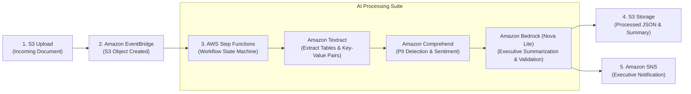
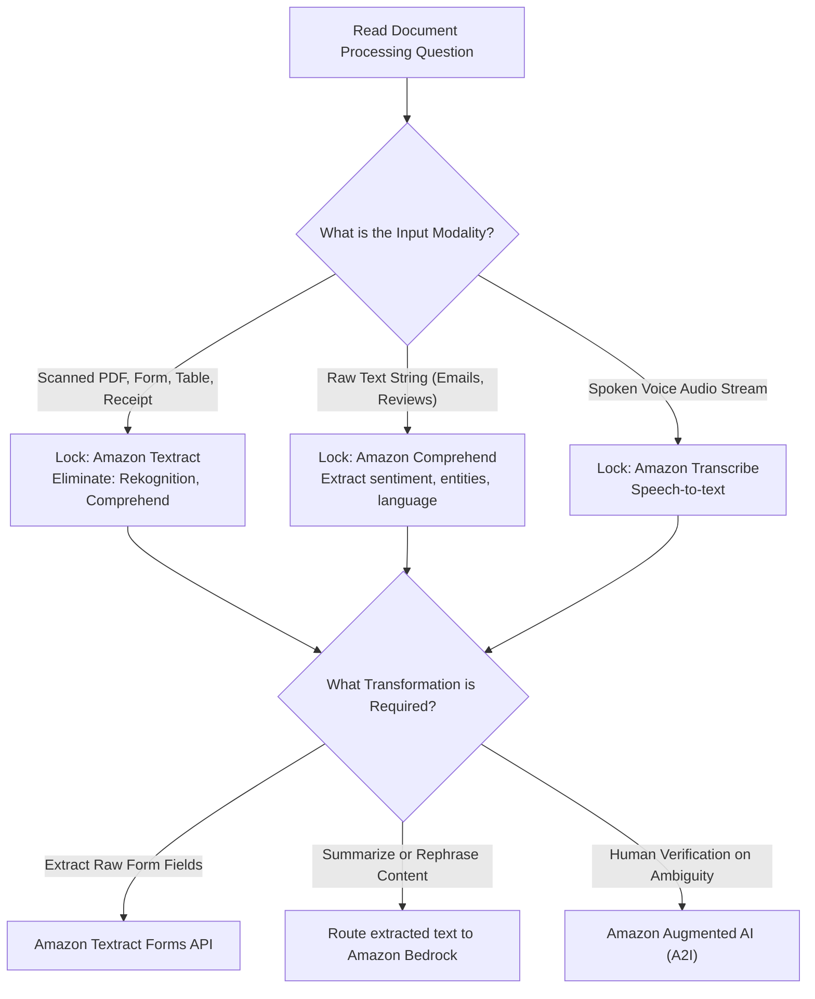
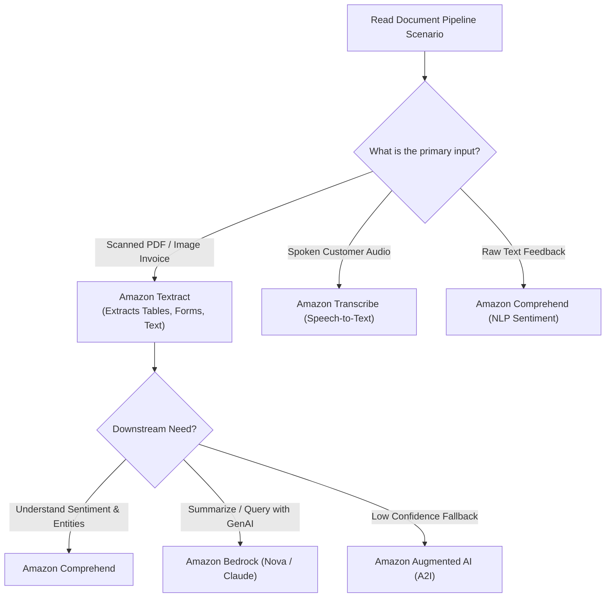

# Tutorial 03: Automated Document Intelligence Pipeline

> **Architecture Build Tutorial:** `Tutorial_03_Automated_Document_Intelligence_Pipeline.md`  
> **Course:** AWS Certified AI Practitioner (`AIF-C01`)  
> **Services Integrated:** Amazon S3, Amazon EventBridge, AWS Step Functions, Amazon Textract, Amazon Comprehend, Amazon Bedrock (Nova Lite/Claude), Amazon SNS  
> **Level:** Production-Grade Serverless Pipeline

---

## 🏛️ Architecture Overview

Organizations ingest thousands of scanned PDF invoices, contracts, and medical forms daily. This tutorial builds an automated, event-driven document processing and intelligence pipeline. 



---

## 🛠️ Step-by-Step Implementation Guide

### Step 1: Create the Source and Destination S3 Buckets
```bash
aws s3api create-bucket \
    --bucket doc-intelligence-incoming-corp \
    --region eu-north-1 \
    --create-bucket-configuration LocationConstraint=eu-north-1

aws s3api create-bucket \
    --bucket doc-intelligence-processed-corp \
    --region eu-north-1 \
    --create-bucket-configuration LocationConstraint=eu-north-1

# Enable EventBridge notifications on incoming bucket
aws s3api put-bucket-notification-configuration \
    --bucket doc-intelligence-incoming-corp \
    --notification-configuration '{"EventBridgeConfiguration": {}}'
```

### Step 2: Configure the Step Functions State Machine
The workflow coordinates document extraction, entity detection, and generative summarization.
Author `document_processing_workflow.json`:
```json
{
  "Comment": "Automated Document Processing Pipeline with Textract, Comprehend, and Bedrock",
  "StartAt": "ExtractDocumentText",
  "States": {
    "ExtractDocumentText": {
      "Type": "Task",
      "Resource": "arn:aws:states:::aws-sdk:textract:analyzeDocument",
      "Parameters": {
        "Document": {
          "S3Object": {
            "Bucket.$": "$.detail.bucket.name",
            "Name.$": "$.detail.object.key"
          }
        },
        "FeatureTypes": ["TABLES", "FORMS"]
      },
      "ResultPath": "$.TextractResult",
      "Next": "DetectEntitiesAndPII"
    },
    "DetectEntitiesAndPII": {
      "Type": "Task",
      "Resource": "arn:aws:states:::aws-sdk:comprehend:detectPiiEntities",
      "Parameters": {
        "LanguageCode": "en",
        "Text.$": "$.TextractResult.Blocks[0].Text"
      },
      "ResultPath": "$.ComprehendPII",
      "Next": "GenerateExecutiveSummary"
    },
    "GenerateExecutiveSummary": {
      "Type": "Task",
      "Resource": "arn:aws:states:::bedrock:invokeModel",
      "Parameters": {
        "ModelId": "arn:aws:bedrock:eu-north-1::foundation-model/amazon.nova-lite-v1:0",
        "Body": {
          "messages": [
            {
              "role": "user",
              "content": [
                {
                  "text": "Summarize the key contractual obligations and monetary values in this extracted text: \n\n"
                }
              ]
            }
          ]
        }
      },
      "ResultPath": "$.BedrockSummary",
      "Next": "SaveProcessedResult"
    },
    "SaveProcessedResult": {
      "Type": "Task",
      "Resource": "arn:aws:states:::aws-sdk:s3:putObject",
      "Parameters": {
        "Bucket": "doc-intelligence-processed-corp",
        "Key.$": "States.Format('{}-summary.json', $.detail.object.key)",
        "Body.$": "$.BedrockSummary"
      },
      "End": true
    }
  }
}
```

Deploy the state machine:
```bash
aws stepfunctions create-state-machine \
    --name EnterpriseDocumentIntelligencePipeline \
    --definition file://document_processing_workflow.json \
    --role-arn arn:aws:iam::123456789012:role/StepFunctionsProcessingRole \
    --region eu-north-1
```

### Step 3: EventBridge Rule for S3 Upload Trigger
```bash
aws events put-rule \
    --name TriggerDocPipelineOnUpload \
    --event-pattern '{
        "source": ["aws.s3"],
        "detail-type": ["Object Created"],
        "detail": {
            "bucket": {
                "name": ["doc-intelligence-incoming-corp"]
            }
        }
    }' \
    --region eu-north-1

aws events put-targets \
    --rule TriggerDocPipelineOnUpload \
    --targets "Id"="1","Arn"="arn:aws:states:eu-north-1:123456789012:stateMachine:EnterpriseDocumentIntelligencePipeline","RoleArn"="arn:aws:iam::123456789012:role/EventBridgeInvokeStepFunctionsRole" \
    --region eu-north-1
```

---

## 🔍 Architecture Benefits
1. **Fully Serverless:** Scales automatically with zero idle compute costs.
2. **Specialized Synergy:** Textract extracts high-accuracy optical tables; Comprehend audits for sensitive PII; Bedrock synthesizes natural language executive briefs.
3. **Resilience:** Step Functions automatically retries on transient API rate limits and routes failed documents to a Dead-Letter Queue (DLQ).


---

## 4. 🎯 Authentic Architecture Exam Practice
> Practice real-world scenarios tested on official AWS examinations that directly apply the architectural patterns built in this tutorial.

### Scenario Practice 1: AIF-C01-U1326
**Question:**  
How does Amazon Textract assist in automated document processing workflows?

**Options:**
- A) By translating text between different human languages
- B) By detecting emotional sentiment and tone in customer text
- C) By converting written text into lifelike spoken speech
- D) By extracting printed text, form key-value pairs, and structured tables from scanned documents and PDFs

<details>
<summary><b>View Verified Answer & Solution Analysis</b></summary>

**Correct Answer:** `D`  
**Peer Consensus:** `100%` agreement.  

**Architectural Breakdown & Distractor Analysis:**
- **Option A is INCORRECT:** Text translation across natural human languages is handled by Amazon Translate.
- **Option B is INCORRECT:** Sentiment analysis, tone detection, and named entity recognition in text are handled by Amazon Comprehend.
- **Option C is INCORRECT:** Text-to-speech synthesis converting written text into lifelike audio is handled by Amazon Polly.
- **Option D is CORRECT:** **Amazon Textract** is a machine learning service that goes beyond simple optical character recognition (OCR) by understanding document layout, extracting printed and handwritten text, identifying key-value form fields, and parsing tabular rows and columns without manual configuration.

</details>

### Scenario Practice 2: AIF-C01-ET-Q008
**Question:**  
A company’s employees provide product descriptions and recommendations to customers when customers call the customer service center. These recommendations are based on where the customers are located. The company wants to use foundation models (FMs) to automate this process.

Which AWS service meets these requirements?

**Options:**
- A) Amazon Macie
- B) Amazon Transcribe
- C) Amazon Bedrock
- D) Amazon Textract

<details>
<summary><b>View Verified Answer & Solution Analysis</b></summary>

**Correct Answer:** `C`  
**Peer Consensus:** `100%` agreement.  

**Architectural Breakdown & Distractor Analysis:**
- **Option A is INCORRECT:** Amazon Macie is a data security service that uses pattern matching and ML to discover and protect sensitive PII in Amazon S3 buckets.
- **Option B is INCORRECT:** Amazon Transcribe converts spoken audio into written text transcripts; it does not synthesize new text descriptions or recommendations.
- **Option C is CORRECT:** **Amazon Bedrock** is the managed foundation model service that provides API access to leading generative AI models (Amazon Nova, Anthropic Claude) to generate context-aware product descriptions and personalized recommendations.
- **Option D is INCORRECT:** Amazon Textract extracts text, forms, and tables from scanned documents; it cannot generate creative or personalized recommendations.

</details>

---

## 🎓 Master Architecture MCQ Blueprint: Intelligent Document Processing (IDP)

> Pattern recognition rules mined from the master question bank to solve Textract, Comprehend, Rekognition, and Bedrock document intelligence questions in under 15 seconds.

### Layer 1: "Clue-to-Service" Linguistic Decryption Matrix

| If Scenario Text Mentions... | Target Architecture / Service | Why (The Core Mechanism) | Decoy Trap to Avoid |
| :--- | :--- | :--- | :--- |
| **"Extract tables and key-value forms from scanned PDF receipts"** | **Amazon Textract** | Layout-aware document OCR extracting forms, tables, queries, and signatures. | Amazon Rekognition (computer vision for images/videos; no document layout awareness). |
| **"Analyze customer sentiment, syntax, and extract entities from text"** | **Amazon Comprehend** | Managed NLP analyzing sentiment (Positive/Negative), key phrases, and PII in text. | Amazon Lex (conversational chatbot dialog engine). |
| **"Convert spoken audio (MP3/WAV) call recordings into text"** | **Amazon Transcribe** | Automatic Speech Recognition (ASR) converting speech audio to text with speaker labels. | Amazon Polly (converts written text into spoken audio). |
| **"Summarize 50-page financial prospectus into executive briefing"** | **Amazon Bedrock (Nova / Claude)** | Generative foundation models performing abstractive text summarization. | Amazon Textract alone (extracts raw text; cannot summarize or synthesize). |
| **"Human review for low-confidence document extractions"** | **Amazon Augmented AI (A2I)** | Routes low-confidence Textract or Rekognition predictions to human review workteams. | AWS Step Functions alone (requires building custom review UIs). |

---

### Layer 2: 3-Step Rapid Elimination Heuristic



1. **Step 1: Check Input Modality:**
   - Scanned image/PDF with tables? → **Amazon Textract**.
   - Text strings needing sentiment/entity analysis? → **Amazon Comprehend**.
   - Spoken audio files? → **Amazon Transcribe**.
2. **Step 2: Check Processing Goal:**
   - Extraction of existing facts? → **Textract**.
   - Synthesis of new summaries or answers? → **Bedrock**.
3. **Step 3: Human Oversight Trigger:**
   - Mentions low-confidence predictions or compliance audit? → **Amazon A2I**.

---

### Layer 3: High-Frequency Decoy Autopsy

#### Decoy Trap: Amazon Textract vs. Amazon Rekognition
* **The Exam Trap:** A logistics company wants an automated system to extract shipping line items, quantities, and totals arranged in tabular columns from scanned bills of lading.
* **The Decoy:** Option A: "Use Amazon Rekognition to detect text in the document images."
* **The Fatal Flaw:** Amazon Rekognition detects text (`DetectText`) as isolated, disconnected bounding boxes. It has **zero awareness of tabular geometry**, cannot associate column headers with row cells, and cannot extract key-value relationships.
* **The Correct Choice:** **Amazon Textract** is specifically trained on document typography to extract structured tables (`TABLES` feature) and form key-value pairs (`FORMS` feature).

---

### Layer 4: 10-Second Visual Decision Flowchart


