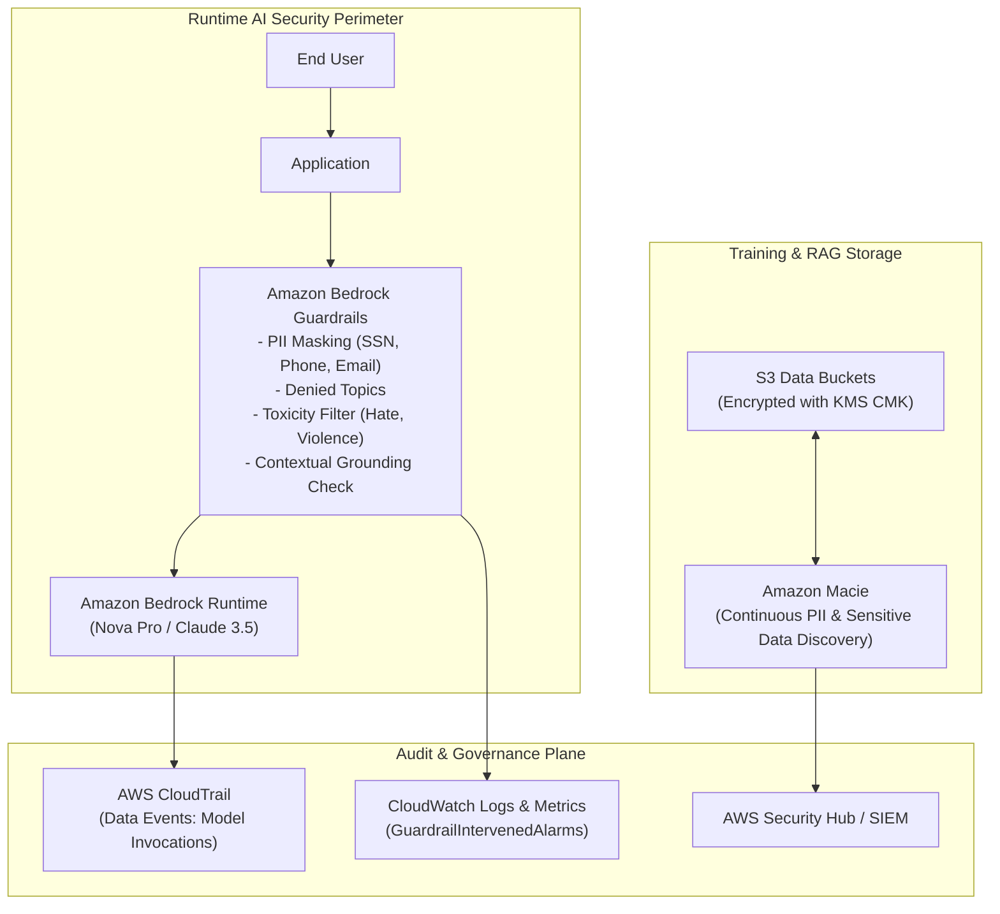

# Tutorial 04: Enterprise Responsible AI & PII Governance Pipeline

> **Architecture Build Tutorial:** `Tutorial_04_Enterprise_Responsible_AI_and_PII_Governance_Pipeline.md`  
> **Course:** AWS Certified AI Practitioner (`AIF-C01`)  
> **Services Integrated:** Amazon Bedrock Guardrails, Amazon Macie, AWS KMS, AWS CloudTrail, Amazon CloudWatch  
> **Level:** Enterprise Security, Compliance & Governance

---

## 🏛️ Architecture Overview

Enterprise deployments of Generative AI require rigorous guardrails against toxic content, hallucinations, and accidental leaks of Personally Identifiable Information (PII). This tutorial builds an automated Responsible AI governance pipeline combining **Amazon Bedrock Guardrails**, sensitive data discovery with **Amazon Macie**, cryptographic enforcement with **AWS KMS**, and continuous audit logging with **AWS CloudTrail**.



---

## 🛠️ Step-by-Step Implementation Guide

### Step 1: Create a KMS Customer Managed Key (CMK)
```bash
aws kms create-key \
    --description "Key for Bedrock Guardrails & Model Governance" \
    --region eu-north-1
```
Record the resulting Key ARN (e.g., `arn:aws:kms:eu-north-1:123456789012:key/abcd-1234`).

### Step 2: Configure Amazon Bedrock Guardrail
Create the guardrail configuration file `guardrail_policy.json`:
```json
{
  "name": "EnterpriseEnterpriseCustomerServiceGuardrail",
  "description": "Enforces strict PII masking and blocks off-topic advice and toxic content.",
  "topicPolicyConfig": {
    "topicsConfig": [
      {
        "name": "FinancialAndLegalAdvice",
        "definition": "Providing binding financial planning, investment suggestions, or formal legal advice.",
        "examples": [
          "Which mutual fund should I invest my pension in?",
          "Can you write a legal waiver for my business contract?"
        ],
        "type": "DENY"
      }
    ]
  },
  "contentPolicyConfig": {
    "filtersConfig": [
      {"type": "HATE", "inputStrength": "HIGH", "outputStrength": "HIGH"},
      {"type": "INSULTS", "inputStrength": "MEDIUM", "outputStrength": "HIGH"},
      {"type": "SEXUAL", "inputStrength": "HIGH", "outputStrength": "HIGH"},
      {"type": "VIOLENCE", "inputStrength": "HIGH", "outputStrength": "HIGH"}
    ]
  },
  "sensitiveInformationPolicyConfig": {
    "piiEntitiesConfig": [
      {"type": "NAME", "action": "ANONYMIZE"},
      {"type": "EMAIL", "action": "ANONYMIZE"},
      {"type": "PHONE", "action": "ANONYMIZE"},
      {"type": "US_SOCIAL_SECURITY_NUMBER", "action": "BLOCK"},
      {"type": "CREDIT_DEBIT_CARD_NUMBER", "action": "BLOCK"}
    ],
    "regexesConfig": [
      {
        "name": "CorpEmployeeBadgeID",
        "description": "Internal employee badge formatted as EMP-XXXXX",
        "pattern": "EMP-\\d{5}",
        "action": "ANONYMIZE"
      }
    ]
  },
  "contextualGroundingPolicyConfig": {
    "filtersConfig": [
      {"type": "GROUNDING", "threshold": 0.75},
      {"type": "RELEVANCE", "threshold": 0.70}
    ]
  },
  "blockedInputMessaging": "Your request violates corporate acceptable use policies and cannot be processed.",
  "blockedOutputsMessaging": "The generated response was withheld due to compliance restrictions."
}
```

Deploy the guardrail via the AWS CLI:
```bash
aws bedrock create-guardrail \
    --cli-input-json file://guardrail_policy.json \
    --region eu-north-1

# Create a published version of the guardrail
aws bedrock create-guardrail-version \
    --guardrail-identifier YOUR_GUARDRAIL_ID \
    --description "v1.0 Production Guardrail" \
    --region eu-north-1
```

### Step 3: Test Runtime Invocation with Guardrail Enforcement
Use the Bedrock Converse API with the Guardrail configuration attached:
```bash
aws bedrock-runtime converse \
    --model-id arn:aws:bedrock:eu-north-1::foundation-model/amazon.nova-pro-v1:0 \
    --guardrail-config '{"guardrailIdentifier": "YOUR_GUARDRAIL_ID", "guardrailVersion": "1", "trace": "ENABLED"}' \
    --messages '[
        {
            "role": "user",
            "content": [{"text": "Hello, my name is John Doe and my badge is EMP-94812. Can you suggest which stocks to buy?"}]
        }
    ]' \
    --region eu-north-1
```
*Expected Behavior:*
1. The **FinancialAndLegalAdvice** topic filter triggers immediately.
2. The model returns the `blockedInputMessaging` string.
3. The names and badge IDs are scrubbed from telemetry traces.

### Step 4: Configure Amazon Macie Automated Discovery
1. Enable Amazon Macie in `eu-north-1`.
2. Configure a Sensitive Data Discovery Job targeting S3 RAG document buckets.
3. Set alert notifications to route findings to AWS Security Hub if unmasked credit cards or passport numbers are detected in raw source files.

### Step 5: Enable CloudTrail Data Event Auditing
```bash
aws cloudtrail put-event-selectors \
    --trail-name BedrockGovernanceAuditTrail \
    --event-selectors '[{
        "ReadWriteType": "All",
        "IncludeManagementEvents": true,
        "DataResources": [{
            "Type": "AWS::Bedrock::Guardrail",
            "Values": ["arn:aws:bedrock:eu-north-1:123456789012:guardrail/*"]
        }]
    }]' \
    --region eu-north-1
```

---

## 🔒 Production Security Takeaways
* **Independent Defense:** Guardrails prevent prompt injection and data leaks even if an attacker attempts sophisticated hypothetical roleplay.
* **Contextual Grounding:** Eliminates hallucinations in customer-facing support portals by validating responses against reference sources.


---

## 4. 🎯 Authentic Architecture Exam Practice
> Practice real-world scenarios tested on official AWS examinations that directly apply the architectural patterns built in this tutorial.

### Scenario Practice 1: AIF-C01-ET-Q053
**Question:**  
Which functionality does Amazon SageMaker Clarify provide?

**Options:**
- A) Integrates a Retrieval Augmented Generation (RAG) workflow
- B) Monitors the quality of ML models in production
- C) Documents critical details about ML models
- D) Identifies potential bias during data preparation

<details>
<summary><b>View Verified Answer & Solution Analysis</b></summary>

**Correct Answer:** `D`  
**Peer Consensus:** `100%` agreement.  

**Architectural Breakdown & Distractor Analysis:**  
Community Most Voted: D (100%). Contributor Answer: D.

Community Rationale & Discussion:
Selected Answer: D
Amazon SageMaker Clarify provides functionality to detect and identify potential bias in data both before and after training, helping teams uncover imbalances in datasets that might lead to biased model predictions. This is essential for ensuring fairness and compliance, especially in sensitive applications.

Why Not the Other Options?
A. Integrates a Retrieval Augmented Generation (RAG) workflow: RAG workflows are used for combining retrieved documents with model outputs, typically in language models, but this is not a function of SageMaker Clarify.
B. Monitors the quality of ML models in production: Monitoring model quality in production is handled by SageMaker Model Monitor, not SageMaker Clarify.
C. Documents critical details about ML models: This functionality is part of Amazon SageMaker Model Cards, which documents model details for transparency and compliance.
---
Selected Answer: D
Explicação:
O Amazon SageMaker Clarify é uma ferramenta que auxilia na detecção de vieses e na explicabilidade de modelos de machine learning (ML). Ele oferece funcionalidades como:

Detecção de vieses: Ajuda a identificar possíveis vieses nos dados durante a preparação e também nos modelos após o treinamento. 

Explicabilidade de modelos: Fornece insights sobre como os modelos de ML fazem previsões, aumentando a transparência
---
Selected Answer: D
Identifies potential bias during data preparation: This is the core functionality of Amazon SageMaker Clarify. It helps data scientists and AI practitioners detect bias in training data, providing insights into how the data might introduce bi

</details>

### Scenario Practice 2: AIF-C01-ET-Q004
**Question:**  
A company is developing an ML model to make loan approvals. The company must implement a solution to detect bias in the model. The company must also be able to explain the model's predictions.

Which solution will meet these requirements?

**Options:**
- A) Amazon SageMaker Clarify
- B) Amazon SageMaker Data Wrangler
- C) Amazon SageMaker Model Cards
- D) AWS AI Service Cards

<details>
<summary><b>View Verified Answer & Solution Analysis</b></summary>

**Correct Answer:** `A`  
**Peer Consensus:** `100%` agreement.  

**Architectural Breakdown & Distractor Analysis:**  
Community Most Voted: A (100%). Contributor Answer: A.

Community Rationale & Discussion:
Selected Answer: A
The solution that meets the requirements of detecting bias and explaining model predictions in a loan approval scenario is A. Amazon SageMaker Clarify
---
Selected Answer: A
The correct answer is A. SageMaker Clarify provides both bias detection and model explainability features.
---
Selected Answer: A
Amazon SageMaker Clarify provides both bias detection and model explainability features, making it the most suitable choice for detecting bias in a loan approval model and explaining its predictions.

</details>
