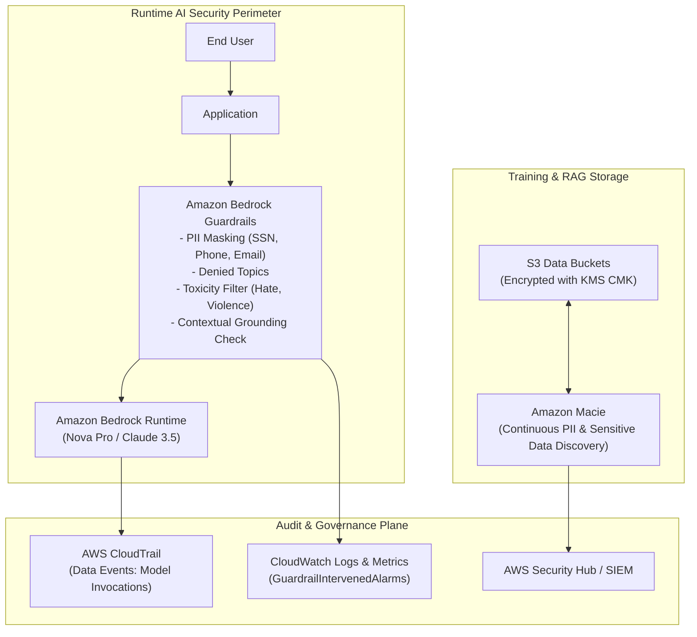
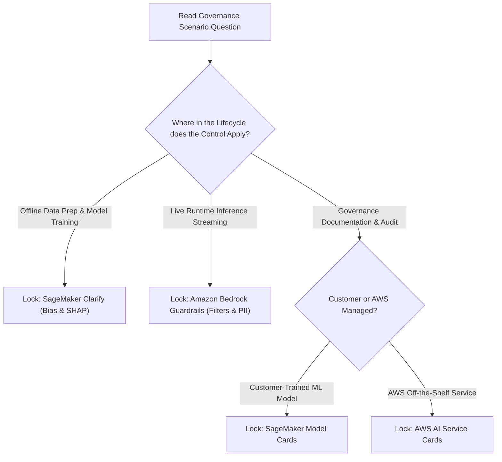
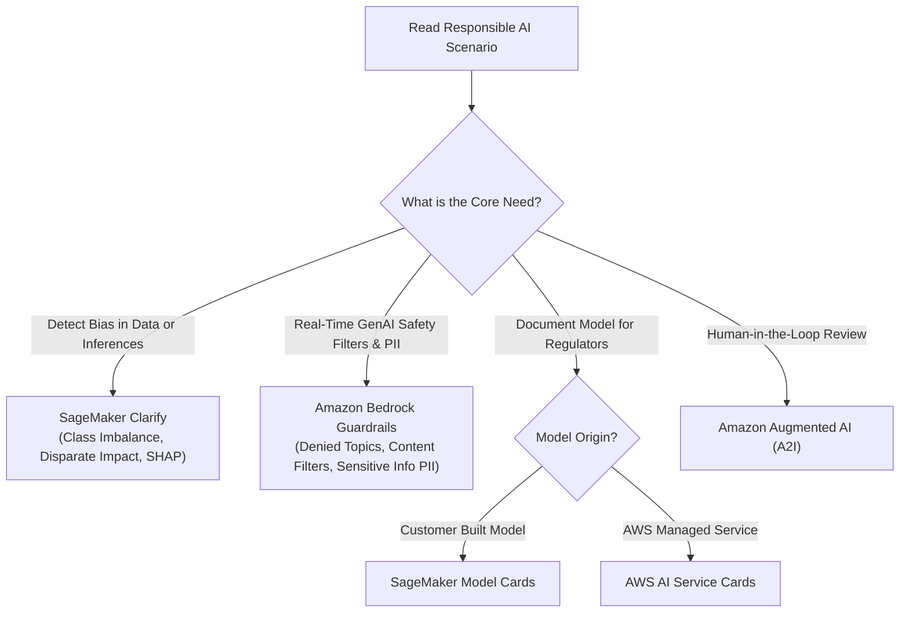

# Tutorial 04: Enterprise Responsible AI & PII Governance Pipeline

> **Architecture Build Tutorial:** `Tutorial_04_Enterprise_Responsible_AI_and_PII_Governance_Pipeline.md`  
> **Course:** AWS Certified AI Practitioner (`AIF-C01`)  
> **Services Integrated:** Amazon Bedrock Guardrails, Amazon Macie, AWS KMS, AWS CloudTrail, Amazon CloudWatch  
> **Level:** Enterprise Security, Compliance & Governance

---

## 🏛️ Architecture Overview

Enterprise deployments of Generative AI require rigorous guardrails against toxic content, hallucinations, and accidental leaks of Personally Identifiable Information (PII). This tutorial builds an automated Responsible AI governance pipeline combining **Amazon Bedrock Guardrails**, sensitive data discovery with **Amazon Macie**, cryptographic enforcement with **AWS KMS**, and continuous audit logging with **AWS CloudTrail**.



---

## 🛠️ Step-by-Step Implementation Guide

### Step 1: Create a KMS Customer Managed Key (CMK)
```bash
aws kms create-key \
    --description "Key for Bedrock Guardrails & Model Governance" \
    --region eu-north-1
```
Record the resulting Key ARN (e.g., `arn:aws:kms:eu-north-1:123456789012:key/abcd-1234`).

### Step 2: Configure Amazon Bedrock Guardrail
Create the guardrail configuration file `guardrail_policy.json`:
```json
{
  "name": "EnterpriseEnterpriseCustomerServiceGuardrail",
  "description": "Enforces strict PII masking and blocks off-topic advice and toxic content.",
  "topicPolicyConfig": {
    "topicsConfig": [
      {
        "name": "FinancialAndLegalAdvice",
        "definition": "Providing binding financial planning, investment suggestions, or formal legal advice.",
        "examples": [
          "Which mutual fund should I invest my pension in?",
          "Can you write a legal waiver for my business contract?"
        ],
        "type": "DENY"
      }
    ]
  },
  "contentPolicyConfig": {
    "filtersConfig": [
      {"type": "HATE", "inputStrength": "HIGH", "outputStrength": "HIGH"},
      {"type": "INSULTS", "inputStrength": "MEDIUM", "outputStrength": "HIGH"},
      {"type": "SEXUAL", "inputStrength": "HIGH", "outputStrength": "HIGH"},
      {"type": "VIOLENCE", "inputStrength": "HIGH", "outputStrength": "HIGH"}
    ]
  },
  "sensitiveInformationPolicyConfig": {
    "piiEntitiesConfig": [
      {"type": "NAME", "action": "ANONYMIZE"},
      {"type": "EMAIL", "action": "ANONYMIZE"},
      {"type": "PHONE", "action": "ANONYMIZE"},
      {"type": "US_SOCIAL_SECURITY_NUMBER", "action": "BLOCK"},
      {"type": "CREDIT_DEBIT_CARD_NUMBER", "action": "BLOCK"}
    ],
    "regexesConfig": [
      {
        "name": "CorpEmployeeBadgeID",
        "description": "Internal employee badge formatted as EMP-XXXXX",
        "pattern": "EMP-\\d{5}",
        "action": "ANONYMIZE"
      }
    ]
  },
  "contextualGroundingPolicyConfig": {
    "filtersConfig": [
      {"type": "GROUNDING", "threshold": 0.75},
      {"type": "RELEVANCE", "threshold": 0.70}
    ]
  },
  "blockedInputMessaging": "Your request violates corporate acceptable use policies and cannot be processed.",
  "blockedOutputsMessaging": "The generated response was withheld due to compliance restrictions."
}
```

Deploy the guardrail via the AWS CLI:
```bash
aws bedrock create-guardrail \
    --cli-input-json file://guardrail_policy.json \
    --region eu-north-1

# Create a published version of the guardrail
aws bedrock create-guardrail-version \
    --guardrail-identifier YOUR_GUARDRAIL_ID \
    --description "v1.0 Production Guardrail" \
    --region eu-north-1
```

### Step 3: Test Runtime Invocation with Guardrail Enforcement
Use the Bedrock Converse API with the Guardrail configuration attached:
```bash
aws bedrock-runtime converse \
    --model-id arn:aws:bedrock:eu-north-1::foundation-model/amazon.nova-pro-v1:0 \
    --guardrail-config '{"guardrailIdentifier": "YOUR_GUARDRAIL_ID", "guardrailVersion": "1", "trace": "ENABLED"}' \
    --messages '[
        {
            "role": "user",
            "content": [{"text": "Hello, my name is John Doe and my badge is EMP-94812. Can you suggest which stocks to buy?"}]
        }
    ]' \
    --region eu-north-1
```
*Expected Behavior:*
1. The **FinancialAndLegalAdvice** topic filter triggers immediately.
2. The model returns the `blockedInputMessaging` string.
3. The names and badge IDs are scrubbed from telemetry traces.

### Step 4: Configure Amazon Macie Automated Discovery
1. Enable Amazon Macie in `eu-north-1`.
2. Configure a Sensitive Data Discovery Job targeting S3 RAG document buckets.
3. Set alert notifications to route findings to AWS Security Hub if unmasked credit cards or passport numbers are detected in raw source files.

### Step 5: Enable CloudTrail Data Event Auditing
```bash
aws cloudtrail put-event-selectors \
    --trail-name BedrockGovernanceAuditTrail \
    --event-selectors '[{
        "ReadWriteType": "All",
        "IncludeManagementEvents": true,
        "DataResources": [{
            "Type": "AWS::Bedrock::Guardrail",
            "Values": ["arn:aws:bedrock:eu-north-1:123456789012:guardrail/*"]
        }]
    }]' \
    --region eu-north-1
```

---

## 🔒 Production Security Takeaways
* **Independent Defense:** Guardrails prevent prompt injection and data leaks even if an attacker attempts sophisticated hypothetical roleplay.
* **Contextual Grounding:** Eliminates hallucinations in customer-facing support portals by validating responses against reference sources.


---

## 4. 🎯 Authentic Architecture Exam Practice
> Practice real-world scenarios tested on official AWS examinations that directly apply the architectural patterns built in this tutorial.

### Scenario Practice 1: AIF-C01-ET-Q053
**Question:**  
Which functionality does Amazon SageMaker Clarify provide?

**Options:**
- A) Integrates a Retrieval Augmented Generation (RAG) workflow
- B) Monitors the quality of ML models in production
- C) Documents critical details about ML models
- D) Identifies potential bias during data preparation

<details>
<summary><b>View Verified Answer & Solution Analysis</b></summary>

**Correct Answer:** `D`  
**Peer Consensus:** `100%` agreement.  

**Architectural Breakdown & Distractor Analysis:**
- **Option A is INCORRECT:** Retrieval Augmented Generation (RAG) is orchestrated through Amazon Bedrock Knowledge Bases and vector stores, not SageMaker Clarify.
- **Option B is INCORRECT:** Monitoring production models for data drift, concept drift, and model quality degradation over time is performed by **Amazon SageMaker Model Monitor**.
- **Option C is INCORRECT:** Documenting model intended uses, risk ratings, and evaluation benchmarks is the primary function of **Amazon SageMaker Model Cards**.
- **Option D is CORRECT:** **Amazon SageMaker Clarify** calculates pre-training statistical bias metrics (such as Class Imbalance and Difference in Positive Proportions in Labels) during the data preparation phase to detect sampling disparities before model training.

</details>

### Scenario Practice 2: AIF-C01-ET-Q004
**Question:**  
A company is developing an ML model to make loan approvals. The company must implement a solution to detect bias in the model. The company must also be able to explain the model's predictions.

Which solution will meet these requirements?

**Options:**
- A) Amazon SageMaker Clarify
- B) Amazon SageMaker Data Wrangler
- C) Amazon SageMaker Model Cards
- D) AWS AI Service Cards

<details>
<summary><b>View Verified Answer & Solution Analysis</b></summary>

**Correct Answer:** `A`  
**Peer Consensus:** `100%` agreement.  

**Architectural Breakdown & Distractor Analysis:**
- **Option A is CORRECT:** **Amazon SageMaker Clarify** provides both pre/post-training demographic bias detection and model explainability by calculating SHAP (Shapley Additive exPlanations) values to quantify individual feature contributions to loan predictions.
- **Option B is INCORRECT:** SageMaker Data Wrangler cleans, visualizes, and transforms raw tabular and image datasets; it does not compute post-training explainability (SHAP).
- **Option C is INCORRECT:** SageMaker Model Cards record metadata, audit evaluations, and governance notes, but do not compute algorithmic bias metrics or generate live SHAP explanations.
- **Option D is INCORRECT:** AWS AI Service Cards are public documentation sheets published by AWS for their off-the-shelf managed AI services, not customer-trained machine learning models.

</details>

---

## 🎓 Master Architecture MCQ Blueprint: Responsible AI, Guardrails & Governance

> Pattern recognition rules mined from the master question bank to solve Clarify, Bedrock Guardrails, Model Cards, and PII masking questions in under 15 seconds.

### Layer 1: "Clue-to-Service" Linguistic Decryption Matrix

| If Scenario Text Mentions... | Target Architecture / Service | Why (The Core Mechanism) | Decoy Trap to Avoid |
| :--- | :--- | :--- | :--- |
| **"Detect dataset bias and explain individual loan/medical decisions"** | **Amazon SageMaker Clarify** | Evaluates pre/post-training demographic bias; computes KernelSHAP feature attributions. | SageMaker Canvas (builds models; does not provide standalone bias governance). |
| **"Real-time safety filter, prompt injection defense, PII masking"** | **Amazon Bedrock Guardrails** | Multi-layer content filters, denied topics, PII redaction, and grounding checks. | AWS WAF (inspects HTTP headers; unaware of semantic LLM prompts). |
| **"Verify LLM response is factually grounded in reference documents"** | **Contextual Grounding Checks (Guardrails)** | Measures mathematical grounding and relevance scores to block hallucinations. | Adjusting temperature alone (reduces randomness but cannot verify grounding). |
| **"Document customer-trained model purpose, risks, and training data"** | **Amazon SageMaker Model Cards** | Standardized governance fact sheets capturing model lineage and evaluation metrics. | AWS AI Service Cards (published by AWS for AWS managed services). |
| **"Public AWS documentation on capabilities/limits of Rekognition/Textract"** | **AWS AI Service Cards** | AWS-published transparency documentation for off-the-shelf managed AI services. | SageMaker Model Cards (created by customers for their own models). |
| **"Human review for low-confidence model predictions"** | **Amazon Augmented AI (A2I)** | Built-in human review routing for Textract, Rekognition, and SageMaker. | AWS Step Functions alone (requires custom UI engineering). |

---

### Layer 2: 3-Step Rapid Elimination Heuristic



1. **Step 1: Check Lifecycle Placement:**
   - Training dataset audit or feature importance? → **SageMaker Clarify**.
   - Real-time conversation filtering, toxic blocking, PII masking? → **Amazon Bedrock Guardrails**.
   - Model lineage and documentation for compliance auditors? → **SageMaker Model Cards**.
2. **Step 2: Check Customer vs. AWS Ownership:**
   - Documenting a company's in-house model? → **Model Cards**.
   - Reviewing AWS's commercial terms for Rekognition? → **AI Service Cards**.
3. **Step 3: Check Human Oversight:**
   - Need human review on uncertain predictions? → **Amazon A2I**.

---

### Layer 3: High-Frequency Decoy Autopsy

#### Decoy Trap: SageMaker Clarify vs. Amazon Bedrock Guardrails
* **The Exam Trap:** An application needs to prevent customer service chatbots from responding to toxic prompts and ensure customer phone numbers are masked in real-time chat transcripts.
* **The Decoy:** Option A: "Configure Amazon SageMaker Clarify to monitor the chatbot."
* **The Fatal Flaw:** SageMaker Clarify is an offline bias auditing and explainability tool used during model training and evaluation. It **cannot intercept real-time streaming inference** to block profanity or redact regex PII patterns.
* **The Correct Choice:** **Amazon Bedrock Guardrails** provides real-time, bi-directional input/output content filtering and automated PII masking.

---

### Layer 4: 10-Second Visual Decision Flowchart


