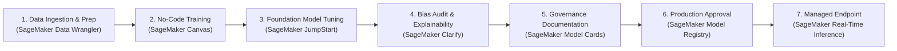
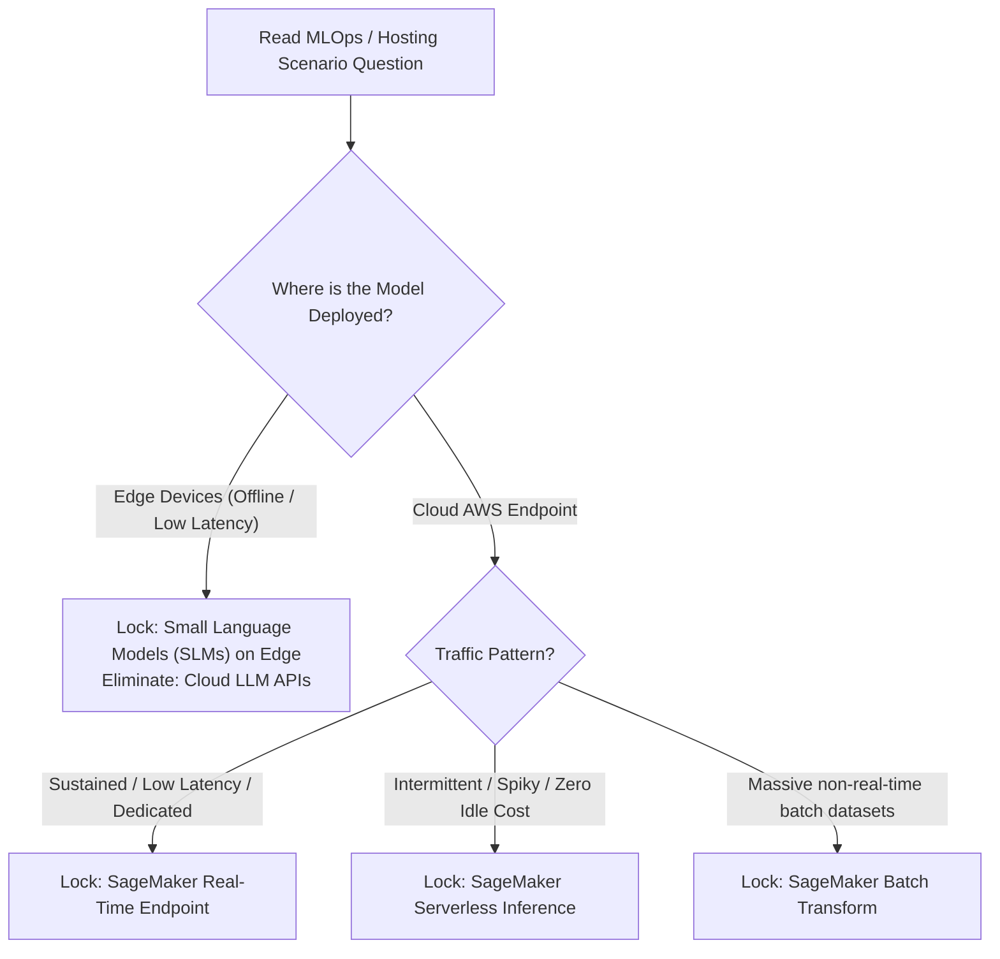
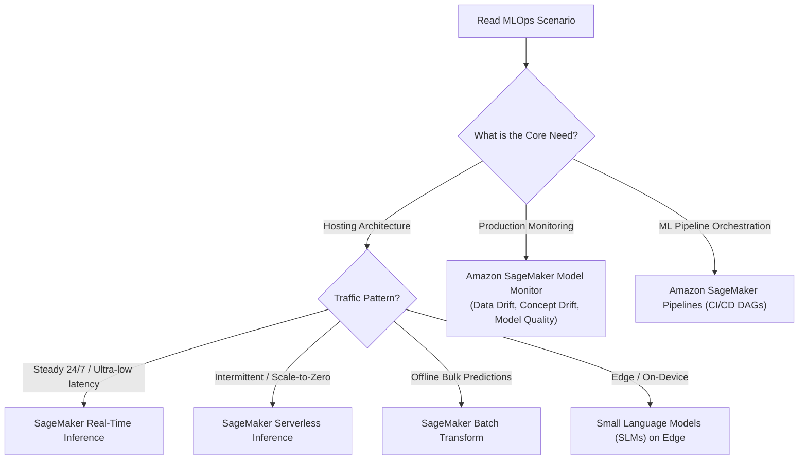

# Tutorial 05: Complete Machine Learning Lifecycle with SageMaker AI

> **Architecture Build Tutorial:** `Tutorial_05_Complete_Machine_Learning_Lifecycle_with_SageMaker_AI.md`  
> **Course:** AWS Certified AI Practitioner (`AIF-C01`)  
> **Services Integrated:** Amazon SageMaker Studio, Canvas, JumpStart, Clarify, Model Cards, Model Registry, Amazon S3  
> **Level:** Comprehensive Predictive ML Lifecycle & Governance

---

## 🏛️ Architecture Overview

Building and governing production ML models requires an integrated toolchain that spans data preparation, no-code experimentation, pre-trained model deployment, bias auditing, explainability, and lifecycle governance. This tutorial walks through the complete end-to-end ML lifecycle using the **Amazon SageMaker AI** suite.



---

## 🛠️ Step-by-Step Implementation Guide

### Step 1: Visual Data Prep with SageMaker Data Wrangler
1. In **Amazon SageMaker Studio**, navigate to **Data** > **Data Wrangler**.
2. Import a raw customer credit dataset from Amazon S3.
3. Apply built-in transformation steps:
   * **Handle Missing Values:** Impute numeric missing values with median; drop unrecoverable rows.
   * **Categorical Encoding:** Apply One-Hot Encoding on `EmploymentStatus` and `HousingStatus`.
   * **Balance Data:** Inspect class distributions between loan approval (`1`) vs rejection (`0`).
4. Export the curated feature pipeline directly to SageMaker Feature Store or S3.

### Step 2: No-Code Model Training with SageMaker Canvas
1. In SageMaker Studio, launch **SageMaker Canvas**.
2. Select **New Model** > **Predictive Analysis**.
3. Choose the curated dataset from Step 1.
4. Set the target column to `LoanApproved`. Canvas automatically detects a **Binary Classification** problem.
5. Review the automated feature impact preview:
   * Note top predictive features (e.g., `CreditScore`, `DebtToIncomeRatio`).
6. Run a **Standard Build** (takes 1–2 hours; tests multiple algorithms including XGBoost, LightGBM, and Deep Learning models).
7. Review the resulting model metrics: Accuracy, F1-Score, AUC-ROC, and Confusion Matrix.

### Step 3: Foundation Model Deployment with SageMaker JumpStart
For generative tasks or open-weights foundation models:
1. Navigate to **SageMaker Studio** > **JumpStart**.
2. Browse the model catalog and select **Meta Llama 3 8B Instruct**.
3. Review the model card, licensing terms, and default instance type (`ml.g5.2xlarge`).
4. Click **Deploy**: SageMaker provisions an isolated, secure HTTPS endpoint behind a private VPC endpoint.

### Step 4: Bias Detection and Explainability with SageMaker Clarify
Execute a SageMaker Clarify processing job to audit for pre-training and post-training bias:

```python
import sagemaker
from sagemaker import clarify

session = sagemaker.Session()
role = sagemaker.get_execution_role()

clarify_processor = clarify.SageMakerClarifyProcessor(
    role=role,
    instance_count=1,
    instance_type='ml.c5.xlarge',
    sagemaker_session=session
)

# Configure data and bias parameters
data_config = clarify.DataConfig(
    s3_data_input_path='s3://corp-ml-datasets/credit_test.csv',
    s3_output_path='s3://corp-ml-datasets/clarify_output/',
    label='LoanApproved',
    dataset_type='text/csv'
)

# Check bias across demographic facet 'Gender'
bias_config = clarify.BiasConfig(
    label_values_or_threshold=[1],
    facet_name='Gender',
    facet_values_or_threshold=['Female']
)

# Execute Pre-training and Post-training bias analysis
clarify_processor.run_pre_training_bias(
    data_config=data_config,
    data_bias_config=bias_config,
    methods=["CI", "DPL"]
)
```

### Step 5: Documenting with SageMaker Model Cards
1. In SageMaker Studio, navigate to **Governance** > **Model Cards** > **Create model card**.
2. Fill out governance metadata:
   * **Model Details:** Purpose, intended audience, architecture (XGBoost Classifier v1).
   * **Intended Use:** Automated pre-qualification for consumer personal loans.
   * **Out-of-Scope Use:** Commercial mortgages, automated rejection without human appeal.
   * **Evaluation Results:** Attach Clarify bias metrics (CI, DPL) and SHAP explainability plots.
   * **Risk Assessment:** High risk tier (financial impact); sign-off required by Chief Risk Officer.

### Step 6: Registration and Gated Approval in Model Registry
1. Push the trained model artifact to **SageMaker Model Registry**:
   ```bash
   aws sagemaker create-model-package \
       --model-package-group-name LoanUnderwritingGroup \
       --model-package-description "v1.0 Candidate Model" \
       --inference-specification file://inference_spec.json
   ```
2. Navigate to Model Registry in Studio.
3. Review the model card attachment and Clarify findings.
4. Update the status from `PendingManualApproval` to `Approved`.
5. Trigger automated CI/CD deployment to the production endpoint.

---

## ⚖️ Governance Takeaways
* **Auditable Provenance:** Every step—from raw data transformation in Data Wrangler to final sign-off in Model Registry—is tracked with cryptographically verifiable lineage.
* **Algorithmic Accountability:** Regulators can review the exact SHAP feature attributions and Clarify reports embedded within the SageMaker Model Card.


---

## 4. 🎯 Authentic Architecture Exam Practice
> Practice real-world scenarios tested on official AWS examinations that directly apply the architectural patterns built in this tutorial.

### Scenario Practice 1: AIF-C01-ET-Q001
**Question:**  
A company makes forecasts each quarter to decide how to optimize operations to meet expected demand. The company uses ML models to make these forecasts.
An AI practitioner is writing a report about the trained ML models to provide transparency and explainability to company stakeholders.
What should the AI practitioner include in the report to meet the transparency and explainability requirements?

**Options:**
- A) Code for model training
- B) Partial dependence plots (PDPs)
- C) Sample data for training
- D) Model convergence tables

<details>
<summary><b>View Verified Answer & Solution Analysis</b></summary>

**Correct Answer:** `B`  
**Peer Consensus:** `100%` agreement.  

**Architectural Breakdown & Distractor Analysis:**
- **Option A is INCORRECT:** Raw Python or PyTorch training scripts provide implementation code, but do not provide visual, intuitive explainability to business stakeholders.
- **Option B is CORRECT:** **Partial Dependence Plots (PDPs)** graphically illustrate the marginal effect of one or two predictive features on the predicted target outcome, holding all other features constant, providing intuitive interpretability for stakeholders.
- **Option C is INCORRECT:** Raw data samples show example rows, but do not explain how the trained mathematical model weights interpret feature signals.
- **Option D is INCORRECT:** Convergence loss tables evaluate optimization mathematical efficiency during backpropagation, not operational feature explainability.

</details>

### Scenario Practice 2: AIF-C01-ET-Q002
**Question:**  
A company wants to use language models to create an application for inference on edge devices. The inference must have the lowest latency possible.
Which solution will meet these requirements?

**Options:**
- A) Deploy optimized small language models (SLMs) on edge devices.
- B) Deploy optimized large language models (LLMs) on edge devices.
- C) Incorporate a centralized small language model (SLM) API for asynchronous communication with edge devices.
- D) Incorporate a centralized large language model (LLM) API for asynchronous communication with edge devices.

<details>
<summary><b>View Verified Answer & Solution Analysis</b></summary>

**Correct Answer:** `A`  
**Peer Consensus:** `92%` agreement.  

**Architectural Breakdown & Distractor Analysis:**
- **Option A is CORRECT:** **Small Language Models (SLMs)** (quantized and distilled to 1B–3B parameters) can execute directly on edge hardware (smartphones, robotics, edge controllers) with minimal RAM/compute footprint, delivering sub-second response times with zero network latency.
- **Option B is INCORRECT:** Full Large Language Models (LLMs) require massive multi-GPU memory bandwidth and tens of gigabytes of VRAM, making them physically impossible to run on edge mobile or embedded hardware.
- **Option C is INCORRECT:** Centralized cloud APIs require network round-trips over the internet, incurring variable latency and failing when internet connectivity drops.
- **Option D is INCORRECT:** Centralized cloud LLMs maximize latency compared to on-device localized edge inference.

</details>

---

## 🎓 Master Architecture MCQ Blueprint: End-to-End MLOps & Model Hosting

> Pattern recognition rules mined from the master question bank to solve SageMaker training, inference endpoints, drift monitoring, and edge deployment questions in under 15 seconds.

### Layer 1: "Clue-to-Service" Linguistic Decryption Matrix

| If Scenario Text Mentions... | Target Architecture / Service | Why (The Core Mechanism) | Decoy Trap to Avoid |
| :--- | :--- | :--- | :--- |
| **"Sub-second real-time inference on edge devices with no internet"** | **Small Language Models (SLMs) on Edge** | Compact, quantized models execute locally on CPU/NPU without cloud latency. | Centralized cloud LLM APIs (incurs network round-trips). |
| **"Visual plots showing feature impact on predictions for stakeholders"** | **Partial Dependence Plots (PDPs) / SHAP** | Illustrates the marginal effect of varying a feature while holding others constant. | Raw Python training code (syntax; not explainability). |
| **"Track model accuracy decay and data drift over time in production"** | **Amazon SageMaker Model Monitor** | Automatically compares live inference baselines against training data to detect drift. | CloudWatch alone (monitors CPU/memory, not statistical distribution drift). |
| **"Automate multi-step data prep, training, and registry workflow"** | **Amazon SageMaker Pipelines** | CI/CD workflow orchestration for machine learning with dependency DAGs. | AWS Step Functions alone (requires writing custom SageMaker API integrations). |
| **"Host a model with unpredictable, intermittent traffic at zero idle cost"** | **SageMaker Serverless Inference** | Automatically scales compute from 0; charges only for invocation compute time. | Real-Time Endpoints (charges 24/7 for dedicated EC2 instances). |

---

### Layer 2: 3-Step Rapid Elimination Heuristic



1. **Step 1: Check Deployment Location:**
   - On-device, vehicle, mobile, offline? → **Small Language Models (SLMs) on Edge**.
   - Cloud API? → Evaluate SageMaker endpoint types.
2. **Step 2: Check Inference Traffic Pattern:**
   - 24/7 steady traffic → **Real-Time Endpoints**.
   - Spiky/idle traffic → **Serverless Inference**.
   - Large daily offline files → **Batch Transform**.
3. **Step 3: Check Governance & Drift:**
   - Statistical distribution shift → **SageMaker Model Monitor**.
   - Visualizing feature influence → **PDPs / SHAP**.

---

### Layer 3: High-Frequency Decoy Autopsy

#### Decoy Trap: Real-Time vs. Serverless Inference
* **The Exam Trap:** A startup deploys an ML model that receives inference requests only during business hours (9 AM–5 PM), remaining completely idle at night and on weekends. Management mandates minimizing idle infrastructure costs.
* **The Decoy:** Option A: "Deploy to a SageMaker Real-Time Inference endpoint on a `c5.xlarge` instance."
* **The Fatal Flaw:** Real-Time endpoints run dedicated EC2 instances 24/7, billing continuously whether requests arrive or not.
* **The Correct Choice:** Deploy to **Amazon SageMaker Serverless Inference**, which provisions compute on demand and scales to zero when traffic stops, incurring zero cost during idle periods.

---

### Layer 4: 10-Second Visual Decision Flowchart


