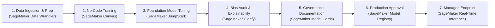

# Tutorial 05: Complete Machine Learning Lifecycle with SageMaker AI

> **Architecture Build Tutorial:** `Tutorial_05_Complete_Machine_Learning_Lifecycle_with_SageMaker_AI.md`  
> **Course:** AWS Certified AI Practitioner (`AIF-C01`)  
> **Services Integrated:** Amazon SageMaker Studio, Canvas, JumpStart, Clarify, Model Cards, Model Registry, Amazon S3  
> **Level:** Comprehensive Predictive ML Lifecycle & Governance

---

## 🏛️ Architecture Overview

Building and governing production ML models requires an integrated toolchain that spans data preparation, no-code experimentation, pre-trained model deployment, bias auditing, explainability, and lifecycle governance. This tutorial walks through the complete end-to-end ML lifecycle using the **Amazon SageMaker AI** suite.



---

## 🛠️ Step-by-Step Implementation Guide

### Step 1: Visual Data Prep with SageMaker Data Wrangler
1. In **Amazon SageMaker Studio**, navigate to **Data** > **Data Wrangler**.
2. Import a raw customer credit dataset from Amazon S3.
3. Apply built-in transformation steps:
   * **Handle Missing Values:** Impute numeric missing values with median; drop unrecoverable rows.
   * **Categorical Encoding:** Apply One-Hot Encoding on `EmploymentStatus` and `HousingStatus`.
   * **Balance Data:** Inspect class distributions between loan approval (`1`) vs rejection (`0`).
4. Export the curated feature pipeline directly to SageMaker Feature Store or S3.

### Step 2: No-Code Model Training with SageMaker Canvas
1. In SageMaker Studio, launch **SageMaker Canvas**.
2. Select **New Model** > **Predictive Analysis**.
3. Choose the curated dataset from Step 1.
4. Set the target column to `LoanApproved`. Canvas automatically detects a **Binary Classification** problem.
5. Review the automated feature impact preview:
   * Note top predictive features (e.g., `CreditScore`, `DebtToIncomeRatio`).
6. Run a **Standard Build** (takes 1–2 hours; tests multiple algorithms including XGBoost, LightGBM, and Deep Learning models).
7. Review the resulting model metrics: Accuracy, F1-Score, AUC-ROC, and Confusion Matrix.

### Step 3: Foundation Model Deployment with SageMaker JumpStart
For generative tasks or open-weights foundation models:
1. Navigate to **SageMaker Studio** > **JumpStart**.
2. Browse the model catalog and select **Meta Llama 3 8B Instruct**.
3. Review the model card, licensing terms, and default instance type (`ml.g5.2xlarge`).
4. Click **Deploy**: SageMaker provisions an isolated, secure HTTPS endpoint behind a private VPC endpoint.

### Step 4: Bias Detection and Explainability with SageMaker Clarify
Execute a SageMaker Clarify processing job to audit for pre-training and post-training bias:

```python
import sagemaker
from sagemaker import clarify

session = sagemaker.Session()
role = sagemaker.get_execution_role()

clarify_processor = clarify.SageMakerClarifyProcessor(
    role=role,
    instance_count=1,
    instance_type='ml.c5.xlarge',
    sagemaker_session=session
)

# Configure data and bias parameters
data_config = clarify.DataConfig(
    s3_data_input_path='s3://corp-ml-datasets/credit_test.csv',
    s3_output_path='s3://corp-ml-datasets/clarify_output/',
    label='LoanApproved',
    dataset_type='text/csv'
)

# Check bias across demographic facet 'Gender'
bias_config = clarify.BiasConfig(
    label_values_or_threshold=[1],
    facet_name='Gender',
    facet_values_or_threshold=['Female']
)

# Execute Pre-training and Post-training bias analysis
clarify_processor.run_pre_training_bias(
    data_config=data_config,
    data_bias_config=bias_config,
    methods=["CI", "DPL"]
)
```

### Step 5: Documenting with SageMaker Model Cards
1. In SageMaker Studio, navigate to **Governance** > **Model Cards** > **Create model card**.
2. Fill out governance metadata:
   * **Model Details:** Purpose, intended audience, architecture (XGBoost Classifier v1).
   * **Intended Use:** Automated pre-qualification for consumer personal loans.
   * **Out-of-Scope Use:** Commercial mortgages, automated rejection without human appeal.
   * **Evaluation Results:** Attach Clarify bias metrics (CI, DPL) and SHAP explainability plots.
   * **Risk Assessment:** High risk tier (financial impact); sign-off required by Chief Risk Officer.

### Step 6: Registration and Gated Approval in Model Registry
1. Push the trained model artifact to **SageMaker Model Registry**:
   ```bash
   aws sagemaker create-model-package \
       --model-package-group-name LoanUnderwritingGroup \
       --model-package-description "v1.0 Candidate Model" \
       --inference-specification file://inference_spec.json
   ```
2. Navigate to Model Registry in Studio.
3. Review the model card attachment and Clarify findings.
4. Update the status from `PendingManualApproval` to `Approved`.
5. Trigger automated CI/CD deployment to the production endpoint.

---

## ⚖️ Governance Takeaways
* **Auditable Provenance:** Every step—from raw data transformation in Data Wrangler to final sign-off in Model Registry—is tracked with cryptographically verifiable lineage.
* **Algorithmic Accountability:** Regulators can review the exact SHAP feature attributions and Clarify reports embedded within the SageMaker Model Card.


---

## 4. 🎯 Authentic Architecture Exam Practice
> Practice real-world scenarios tested on official AWS examinations that directly apply the architectural patterns built in this tutorial.

### Scenario Practice 1: AIF-C01-ET-Q001
**Question:**  
A company makes forecasts each quarter to decide how to optimize operations to meet expected demand. The company uses ML models to make these forecasts.
An AI practitioner is writing a report about the trained ML models to provide transparency and explainability to company stakeholders.
What should the AI practitioner include in the report to meet the transparency and explainability requirements?

**Options:**
- A) Code for model training
- B) Partial dependence plots (PDPs)
- C) Sample data for training
- D) Model convergence tables

<details>
<summary><b>View Verified Answer & Solution Analysis</b></summary>

**Correct Answer:** `B`  
**Peer Consensus:** `100%` agreement.  

**Architectural Breakdown & Distractor Analysis:**  
Community Most Voted: B (100%). Contributor Answer: B.

Community Rationale & Discussion:
Selected Answer: B
B. Partial Dependence Plots (PDPs)

Explanation:
Partial Dependence Plots (PDPs) are useful tools for understanding the relationship between specific features and the model's predictions, making it easier to see how changes in input variables affect the forecast. PDPs are particularly helpful for stakeholders because they visually show the impact of individual features on predictions without requiring a deep understanding of the model's inner workings.
---
Selected Answer: B
B is the answer Thanks to
---
Selected Answer: B
Explicação:Gráficos de dependência parcial (Partial Dependence Plots - PDPs) são usados para mostrar como uma variável de entrada afeta a previsão do modelo, mantendo as outras variáveis constantes.São ferramentas poderosas de explicabilidade e transparência, especialmente para partes interessadas não técnicas. Eles ajudam a visualizar a relação entre características importantes e as previsões do modelo, respondendo perguntas como:
"Se aumentarmos o orçamento em marketing, o que acontece com a demanda prevista?"

</details>

### Scenario Practice 2: AIF-C01-ET-Q002
**Question:**  
A company wants to use language models to create an application for inference on edge devices. The inference must have the lowest latency possible.
Which solution will meet these requirements?

**Options:**
- A) Deploy optimized small language models (SLMs) on edge devices.
- B) Deploy optimized large language models (LLMs) on edge devices.
- C) Incorporate a centralized small language model (SLM) API for asynchronous communication with edge devices.
- D) Incorporate a centralized large language model (LLM) API for asynchronous communication with edge devices.

<details>
<summary><b>View Verified Answer & Solution Analysis</b></summary>

**Correct Answer:** `A`  
**Peer Consensus:** `92%` agreement.  

**Architectural Breakdown & Distractor Analysis:**  
Community Most Voted: A (92%). Contributor Answer: A.

Community Rationale & Discussion:
Selected Answer: U
Quando o objetivo é inferência com a menor latência possível, a melhor abordagem é executar o modelo diretamente no dispositivo de borda (edge).
SLMs (Small Language Models) são projetados para serem leves, rápidos e eficientes, o que os torna ideais para: Dispositivos com recursos limitados
Tempo de resposta imediato . Execução offline ou com pouca conectividade
---
Selected Answer: A
Optimized small language models (SLMs) are specifically designed to run efficiently on edge devices with limited resources (such as memory and processing power). Deploying smaller, optimized models directly on the edge devices allows for near-instantaneous inference with minimal latency, as the data doesn't need to travel to a central server for processing.
---
Selected Answer: A
A: Deploy optimized small language models (SLMs) on edge devices.

Explanation:
Deploying optimized small language models (SLMs) on edge devices ensures low latency because the inference happens directly on the device without relying on cloud communication. Small language models are lightweight and designed to run efficiently on devices with limited resources, making them ideal for edge computing.

</details>
