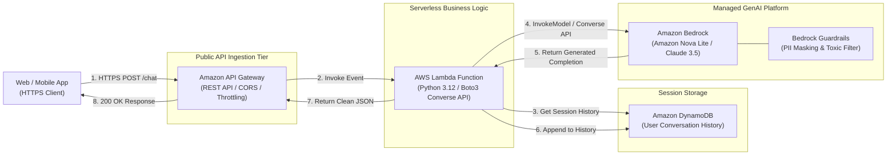
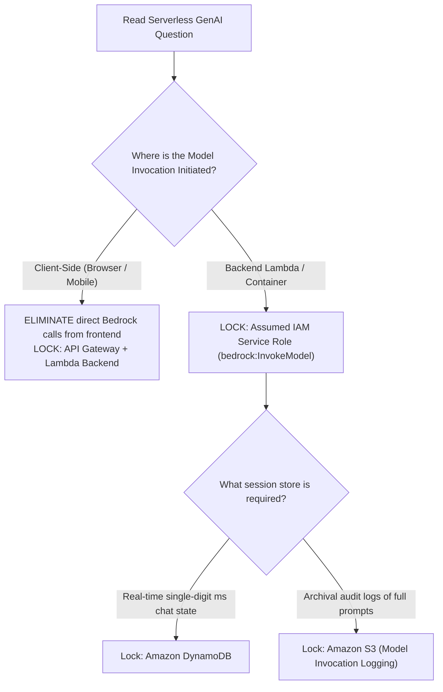
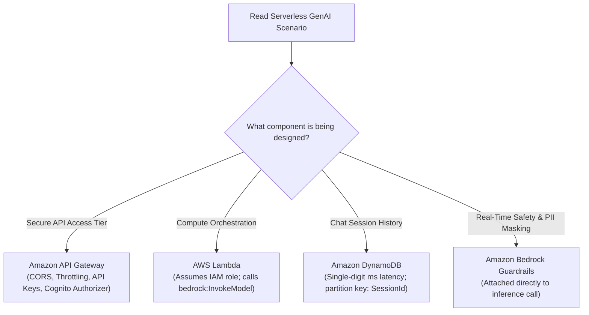

# Tutorial 06: Serverless Generative AI Application with Amazon Bedrock, API Gateway & AWS Lambda

> **Architecture Build Tutorial:** `Tutorial_06_Serverless_Generative_AI_App_Bedrock_APIGateway_Lambda.md`  
> **Course:** AWS Certified AI Practitioner (`AIF-C01`)  
> **Services Integrated:** Amazon API Gateway, AWS Lambda (Python), Amazon Bedrock (Converse API), Amazon DynamoDB, Amazon Bedrock Guardrails, AWS IAM  
> **Level:** Multi-Service Serverless Production AI Application

---

## 🏛️ Executive Architecture Context

Enterprises want to expose foundation model capabilities (e.g. conversational assistance, summarization, content generation) to web and mobile frontend applications securely, without managing web servers or long-running GPU instances.

### The Production Serverless GenAI Pattern
1. **The Direct Frontend Call Anti-Pattern:** A naive implementation embeds AWS IAM credentials into mobile or frontend JavaScript code to call Bedrock directly. This exposes credentials to theft and bypasses authentication, rate limiting, and business validation.
2. **The Serverless API Gateway + Lambda Pattern:** 
   - **Amazon API Gateway** acts as the public HTTPS entry point, handling TLS termination, throttling, CORS, and token authentication (e.g. Cognito / API keys).
   - **AWS Lambda** acts as the secure middleware: it validates payloads, fetches user session state from **Amazon DynamoDB**, invokes foundation models on **Amazon Bedrock** via the Converse API, and enforces safety guardrails via **Amazon Bedrock Guardrails**.
   - Zero servers to patch, automatic scaling from 0 to thousands of concurrent requests, and pay-per-millisecond compute billing.



---

## 🛠️ Step-by-Step Implementation Guide

### Step 1: Create the DynamoDB Session History Table
Create a DynamoDB table with `SessionId` as the Partition Key and `Timestamp` as the Sort Key:

```bash
aws dynamodb create-table \
    --table-name GenAISessionHistory \
    --attribute-definitions \
        AttributeName=SessionId,AttributeType=S \
        AttributeName=Timestamp,AttributeType=N \
    --key-schema \
        AttributeName=SessionId,KeyType=HASH \
        AttributeName=Timestamp,KeyType=RANGE \
    --billing-mode PAY_PER_REQUEST \
    --region eu-north-1 \
    --profile aws-notes
```

---

### Step 2: Create the Lambda Execution Role & Permissions
Create an IAM service role granting Lambda permission to invoke Bedrock models and access DynamoDB:

```bash
# 1. Create Trust Policy
cat << 'EOF' > lambda-trust-policy.json
{
  "Version": "2012-10-17",
  "Statement": [
    {
      "Effect": "Allow",
      "Principal": {"Service": "lambda.amazonaws.com"},
      "Action": "sts:AssumeRole"
    }
  ]
}
EOF

aws iam create-role \
    --role-name BedrockGenAILambdaRole \
    --assume-role-policy-document file://lambda-trust-policy.json \
    --profile aws-notes

# 2. Attach Bedrock & DynamoDB permissions
cat << 'EOF' > lambda-bedrock-policy.json
{
  "Version": "2012-10-17",
  "Statement": [
    {
      "Effect": "Allow",
      "Action": [
        "bedrock:InvokeModel",
        "bedrock:InvokeModelWithResponseStream",
        "bedrock:ApplyGuardrail"
      ],
      "Resource": "*"
    },
    {
      "Effect": "Allow",
      "Action": [
        "dynamodb:PutItem",
        "dynamodb:Query"
      ],
      "Resource": "arn:aws:dynamodb:eu-north-1:*:table/GenAISessionHistory"
    },
    {
      "Effect": "Allow",
      "Action": [
        "logs:CreateLogGroup",
        "logs:CreateLogStream",
        "logs:PutLogEvents"
      ],
      "Resource": "arn:aws:logs:*:*:*"
    }
  ]
}
EOF

aws iam put-role-policy \
    --role-name BedrockGenAILambdaRole \
    --policy-name BedrockInvocationAndDDBPolicy \
    --policy-document file://lambda-bedrock-policy.json \
    --profile aws-notes
```

---

### Step 3: Author the AWS Lambda Application Handler
The Lambda function receives user prompts, queries the Bedrock Converse API, and logs the exchange:

```python
# handler.py
import json
import os
import time
import boto3

bedrock = boto3.client("bedrock-runtime", region_name="eu-north-1")
dynamodb = boto3.resource("dynamodb", region_name="eu-north-1")
table = dynamodb.Table("GenAISessionHistory")

MODEL_ID = "amazon.nova-lite-v1:0"

def lambda_handler(event, context):
    try:
        body = json.loads(event.get("body", "{}"))
        user_message = body.get("message", "")
        session_id = body.get("session_id", "guest-session")
        
        if not user_message:
            return {
                "statusCode": 400,
                "headers": {"Content-Type": "application/json", "Access-Control-Allow-Origin": "*"},
                "body": json.dumps({"error": "Missing message parameter"})
            }
        
        # Invoke Amazon Bedrock via Converse API
        response = bedrock.converse(
            modelId=MODEL_ID,
            messages=[
                {
                    "role": "user",
                    "content": [{"text": user_message}]
                }
            ],
            inferenceConfig={
                "maxTokens": 500,
                "temperature": 0.3,
                "topP": 0.9
            }
        )
        
        assistant_reply = response["output"]["message"]["content"][0]["text"]
        
        # Persist conversation event in DynamoDB
        table.put_item(
            Item={
                "SessionId": session_id,
                "Timestamp": int(time.time()),
                "UserPrompt": user_message,
                "ModelResponse": assistant_reply
            }
        )
        
        return {
            "statusCode": 200,
            "headers": {"Content-Type": "application/json", "Access-Control-Allow-Origin": "*"},
            "body": json.dumps({
                "response": assistant_reply,
                "model": MODEL_ID,
                "usage": response.get("usage", {})
            })
        }
        
    except Exception as e:
        return {
            "statusCode": 500,
            "headers": {"Content-Type": "application/json", "Access-Control-Allow-Origin": "*"},
            "body": json.dumps({"error": str(e)})
        }
```

```bash
# Package and deploy Lambda function
zip -r function.zip handler.py

aws lambda create-function \
    --function-name BedrockChatService \
    --runtime python3.12 \
    --role arn:aws:iam::YOUR_ACCOUNT_ID:role/BedrockGenAILambdaRole \
    --handler handler.lambda_handler \
    --zip-file fileb://function.zip \
    --timeout 30 \
    --region eu-north-1 \
    --profile aws-notes
```

---

### Step 4: Configure Amazon API Gateway REST Endpoint
1. In the **Amazon API Gateway** console, click **Create API** > **REST API**.
2. Name: `GenAIChatAPI`.
3. Create a resource `/chat` with a `POST` method.
4. Set Integration type to **Lambda Function** and select `BedrockChatService`.
5. Enable **CORS** (Cross-Origin Resource Sharing) on `/chat`.
6. Deploy the API to a stage named `prod`.

---

## 💻 CLI Smoke Testing & Health Verification

```bash
# Test the deployed API Gateway endpoint
curl -X POST https://api-id.execute-api.eu-north-1.amazonaws.com/prod/chat \
    -H "Content-Type: application/json" \
    -d '{
        "session_id": "test-user-101",
        "message": "Explain how Amazon Bedrock pricing works in 2 concise sentences."
    }'

# Expected JSON response:
# {
#   "response": "Amazon Bedrock charges on-demand based on the volume of input and output tokens processed per model invocation...",
#   "model": "amazon.nova-lite-v1:0",
#   "usage": {"inputTokens": 18, "outputTokens": 45, "totalTokens": 63}
# }
```

---

## 🧹 Free Tier Cleanup & Cost Safeguard

1. **Delete the Lambda Function:**
   ```bash
   aws lambda delete-function --function-name BedrockChatService --region eu-north-1
   ```
2. **Delete the DynamoDB Table:**
   ```bash
   aws dynamodb delete-table --table-name GenAISessionHistory --region eu-north-1
   ```
3. **Delete the API Gateway REST API:**
   ```bash
   aws apigateway delete-rest-api --rest-api-id YOUR_API_ID --region eu-north-1
   ```

---

## 🎯 Authentic Architecture Exam Practice

### Scenario Practice 1: AIF-C01-ET-Q110
**Question:**  
A developer wants to build a web application that calls foundation models on Amazon Bedrock. The developer must ensure that client-side JavaScript code does not contain hardcoded AWS credentials and that the API is protected against excessive request flooding.

Which architecture meets these requirements?

**Options:**
- A) Embed temporary IAM access keys into the client-side JavaScript code using hardcoded variables.
- B) Place an Amazon API Gateway in front of an AWS Lambda function that invokes Amazon Bedrock using an IAM execution role, and enable API Gateway throttling.
- C) Allow public anonymous access directly to the Amazon Bedrock API endpoint without authentication.
- D) Store AWS root credentials in browser local storage and invoke Bedrock directly via the AWS SDK.

<details>
<summary><b>View Verified Answer & Solution Analysis</b></summary>

**Correct Answer:** `B`  
**Peer Consensus:** `100%` agreement.  

**Architectural Breakdown & Distractor Analysis:**
- **Option A is INCORRECT:** Embedding temporary or static IAM credentials in frontend client code exposes credentials to extraction via browser inspection tools, representing a severe security flaw.
- **Option B is CORRECT:** Placing **Amazon API Gateway** in front of an **AWS Lambda function** creates a secure, decoupled serverless architecture. API Gateway enforces request throttling, rate limits, and CORS, while the Lambda function securely assumes an IAM execution role to invoke Amazon Bedrock on the backend without exposing credentials.
- **Option C is INCORRECT:** Amazon Bedrock does not support unauthenticated public anonymous access; all requests require SigV4 signed authentication.
- **Option D is INCORRECT:** Storing root credentials in browser storage is a catastrophic security anti-pattern that leads to full account compromise.

</details>

### Scenario Practice 2: AIF-C01-ET-Q084
**Question:**  
A company needs to store conversational history between users and an Amazon Bedrock foundation model to support multi-turn dialogue. The workload has unpredictable traffic spikes and requires single-digit millisecond latency.

Which AWS service should the company use to store this conversational history?

**Options:**
- A) Amazon S3 Glacier Flexible Retrieval
- B) Amazon DynamoDB
- C) AWS Snowball Edge
- D) Amazon Athena

<details>
<summary><b>View Verified Answer & Solution Analysis</b></summary>

**Correct Answer:** `B`  
**Peer Consensus:** `100%` agreement.  

**Architectural Breakdown & Distractor Analysis:**
- **Option A is INCORRECT:** S3 Glacier Flexible Retrieval is an archival storage tier with retrieval times ranging from minutes to hours, entirely unsuitable for real-time conversation state.
- **Option B is CORRECT:** **Amazon DynamoDB** is a fully managed serverless NoSQL database that delivers consistent single-digit millisecond latency at any scale with automatic on-demand scaling, making it the ideal store for fast chat session history and multi-turn state.
- **Option C is INCORRECT:** AWS Snowball Edge is a physical hardware appliance for offline bulk petabyte-scale data migration and edge computing.
- **Option D is INCORRECT:** Amazon Athena is an interactive serverless SQL query engine for analyzing cold data in Amazon S3, not an operational low-latency transactional session store.

</details>

---

## 🎓 Master Architecture MCQ Blueprint: Serverless Generative AI Applications

> Pattern recognition rules mined from the master question bank to solve API Gateway, Lambda, DynamoDB, and Bedrock application integration questions in under 15 seconds.

### Layer 1: "Clue-to-Service" Linguistic Decryption Matrix

| If Scenario Text Mentions... | Target Architecture / Service | Why (The Core Mechanism) | Decoy Trap to Avoid |
| :--- | :--- | :--- | :--- |
| **"Secure frontend access to Bedrock without exposing credentials"** | **API Gateway + Lambda Proxy** | Frontend calls HTTPS API Gateway; Lambda invokes Bedrock via assumed IAM role. | Calling Bedrock directly from frontend JavaScript with embedded keys. |
| **"Store multi-turn conversational chat history with millisecond latency"** | **Amazon DynamoDB** | Fast key-value NoSQL database scaling on demand with single-digit millisecond latency. | Amazon S3 (higher latency for rapid write-read chat turns). |
| **"Protect Bedrock API from volumetric request flooding and denial of service"** | **API Gateway Throttling / Rate Limiting** | Enforces requests-per-second (RPS) and burst limits at the edge before invoking compute. | Handling throttling manually in application Lambda code. |
| **"Stream model completion tokens in real-time to the browser"** | **Bedrock `InvokeModelWithResponseStream` + Lambda Response Streaming** | Sends chunks as they are generated by the foundation model, improving user perceived latency. | Waiting for complete model generation before sending response. |

---

### Layer 2: 3-Step Rapid Elimination Heuristic



1. **Step 1: Check Frontend Security Boundaries:**
   - Any option suggesting placing IAM keys or AWS credentials into frontend mobile/web code is **immediately eliminated**.
2. **Step 2: Check Session State Store:**
   - Real-time conversational state $\to$ **Amazon DynamoDB**.
   - Cold compliance archiving $\to$ **Amazon S3**.
3. **Step 3: Check Throttling and Protection:**
   - Protect downstream Bedrock quotas from runaway usage $\to$ **API Gateway Usage Plans and Throttling**.

---

### Layer 3: High-Frequency Decoy Autopsy

#### Decoy Trap: Direct Frontend SDK vs. Serverless API Middleware
* **The Exam Trap:** A mobile app developer wants users to chat with a Bedrock model. To minimize latency, the developer suggests having the iOS/Android app invoke Bedrock directly using the AWS SDK.
* **The Decoy:** Option A: "Generate temporary IAM credentials via Cognito and invoke Bedrock directly from the mobile app."
* **The Fatal Flaw:** Direct client invocations bypass centralized rate limiting, allow malicious clients to exhaust account Bedrock quotas, and expose model IDs and backend prompt templates to reverse engineering.
* **The Correct Choice:** Use **Amazon API Gateway** with an **AWS Lambda function** backend. Lambda centralizes prompt assembly, applies Bedrock Guardrails, records session history in DynamoDB, and shields foundation models behind enterprise security controls.

---

### Layer 4: 10-Second Visual Decision Flowchart


