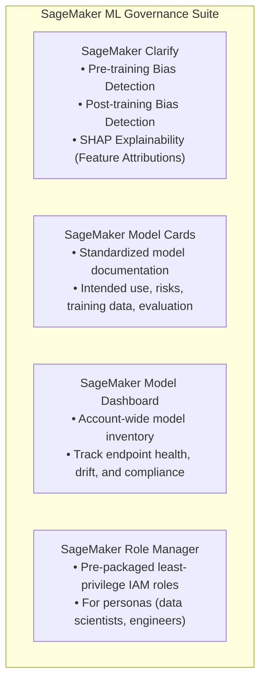

# Amazon SageMaker AI Ecosystem & MLOps

> **Service Category:** Machine Learning Platform (Domain 1.1, Domain 3.2)  
> **Relevant Certifications:** [AIF-C01](../01_Syllabus/AIF-C01_Exam_Guide_and_Blueprint.md), [CLF-C02](../../../../Cloud/Practitioner/CLF-C02/01_Syllabus/CLF-C02_Master_Blueprint.md), AWS Machine Learning Specialty  
> **Tags:** `#aws/services` `#aws/ml` `#sagemaker` `#mlops` `#aif-c01`

---

## 1. Overview of the SageMaker Ecosystem

**Amazon SageMaker AI** is a fully managed machine learning service that provides every developer and data scientist with the tools to build, train, tune, deploy, and govern custom machine learning and deep learning models at scale.

```mermaid
graph TD
    subgraph DataPrep ["1. Data Preparation & Engineering"]
        DW["SageMaker Data Wrangler\n(Visual data cleaning & transforms)"]
        GT["SageMaker Ground Truth\n(Human-in-the-loop data labeling)"]
        FS["SageMaker Feature Store\n(Centralized ML feature repository)"]
    end

    subgraph BuildTrain ["2. Model Building & Training"]
        Studio["SageMaker Studio\n(Unified web-based ML IDE)"]
        Canvas["SageMaker Canvas\n(No-code visual ML for analysts)"]
        Auto["SageMaker Autopilot\n(AutoML for tabular data)"]
        JS["SageMaker JumpStart\n(Pre-trained open-source FMs & ML models)"]
        AMT["Automatic Model Tuning\n(Hyperparameter optimization)"]
    end

    subgraph DeployHost ["3. Deployment & Inference"]
        RT["Real-Time Inference\n(Persistent, low-latency endpoints)"]
        SL["Serverless Inference\n(Auto-scaling down to zero for spiky traffic)"]
        BT["Batch Transform\n(Offline bulk batch scoring from S3)"]
        Async["Asynchronous Inference\n(Large payloads & long processing times)"]
    end

    subgraph MLOpsGov ["4. Governance, Monitoring & MLOps"]
        Clarify["SageMaker Clarify\n(Pre/post-training bias & SHAP explainability)"]
        MC["SageMaker Model Cards\n(Standardized model documentation)"]
        MD["SageMaker Model Dashboard\n(Centralized inventory & health audit)"]
        MM["SageMaker Model Monitor\n(Drift & quality anomaly detection)"]
        Pipe["SageMaker Pipelines\n(CI/CD workflow orchestration for ML)"]
    end

    DataPrep --> BuildTrain --> DeployHost --> MLOpsGov
```

---

## 2. SageMaker Features Cheat Sheet (By Lifecycle Phase)

### Phase 1: Data Preparation & Labeling
* **SageMaker Data Wrangler:**
  * Visual data preparation and feature engineering tool.
  * Over 300+ built-in transformations without writing boilerplate code.
  * Detects data quality issues, outliers, and missing values; exports directly to Python, Pipelines, or Feature Store.
* **SageMaker Ground Truth:**
  * Fully managed data labeling service with human-in-the-loop workflows.
  * Workforce choices:
    1. *Private workforce:* Internal employees or contractors.
    2. *Amazon Mechanical Turk:* Large, crowdsourced 24/7 public workforce.
    3. *Vendor workforce:* Pre-screened third-party data annotation firms.
  * Uses active learning (automated labeling) to label easy examples automatically and send difficult examples to humans.
* **SageMaker Feature Store:**
  * Centralized repository to ingest, curate, store, and share ML features.
  * Supports *Online Store* (low-latency lookup for real-time inference) and *Offline Store* (S3-based historical storage for model training).

### Phase 2: Model Development & Training
* **SageMaker Studio:**
  * The single, web-based integrated development environment (IDE) for ML. Includes JupyterLab, Code Editor, and unified tool navigation.
* **SageMaker Canvas:**
  * **No-code ML tool** designed for business analysts and non-coders.
  * Allows users to upload tabular data, train models visually, generate predictions, and explore what-if scenarios without writing Python.
* **SageMaker Autopilot:**
  * Automated machine learning (AutoML) for tabular datasets (CSV/Parquet).
  * Automatically explores multiple algorithm candidates, performs feature engineering, tunes hyperparameters, and outputs full transparent Python notebooks.
* **SageMaker JumpStart:**
  * ML hub providing one-click access to hundreds of pre-trained open-source models (Hugging Face, Llama, Stable Diffusion) and end-to-end industry solution templates.

---

## 3. SageMaker Model Deployment Options (Critical Exam Comparison)

Choosing the correct inference option based on traffic patterns, latency, and payload size is heavily tested:

| Inference Option | Ideal Use Case | Traffic Pattern | Scaling Behavior | Max Payload | Processing Time | Cost Structure |
|---|---|---|---|---|---|---|
| **Real-Time Inference** | Interactive web/mobile apps requiring immediate sub-second responses. | Sustained, predictable, continuous traffic. | Auto-scales instances based on CloudWatch metrics (CPU/GPU, invocation count). | 6 MB | $\le 60\text{ seconds}$ | Billed per instance-hour running 24/7. |
| **Serverless Inference** | Microservices or APIs with sporadic, intermittent, or unpredictable traffic. | Spiky traffic with prolonged idle periods. | Automatically scales down to **zero** when idle; scales up on demand. Note: May incur **cold starts**. | 4 MB | $\le 60\text{ seconds}$ | Billed per compute second and data processed. |
| **Batch Transform** | Scoring offline datasets; generating weekly risk ratings or daily recommendations. | Bulk offline batches; no real-time interactive user waiting. | Provisions compute instances, processes the entire S3 dataset, writes output to S3, and shuts down compute. | Gigabytes (splits files) | Hours to Days | Billed only for the duration of the transform job. |
| **Asynchronous Inference** | Workloads with large payloads (high-res images, video, audio) or long-running inference tasks (up to 1 hour). | Heavy processing requirements; queuing requests. | Incoming requests placed in an Amazon SQS queue. Scales down to zero when queue is empty. | 1 GB | Up to 15 minutes (or 1 hour) | Billed per instance-hour active; zero when idle. |

### Decision Guide:
* *"Sub-second response for customer credit card validation"* $\rightarrow$ **Real-Time Inference**.
* *"Sporadic endpoint used during business hours with overnight silence"* $\rightarrow$ **Serverless Inference**.
* *"Score 50 million customer records every Sunday night"* $\rightarrow$ **Batch Transform**.
* *"Process a 500 MB video file for deepfake analysis that takes 8 minutes"* $\rightarrow$ **Asynchronous Inference**.

---

## 4. Governance, Explainability & MLOps

### SageMaker Clarify
* **Bias Detection:** Analyzes datasets prior to training (e.g., class imbalance) and evaluates model predictions across demographic facets (e.g., disparate impact).
* **Model Explainability:** Uses **SHAP (SHapley Additive exPlanations)** values to quantify the contribution of each input feature to the final prediction.

### SageMaker Model Cards
* Provides a single source of truth for model metadata: intended use case, assumptions, limitations, evaluation metrics, and risk tier.
* Can be exported as PDF reports for regulatory auditors.

### SageMaker Model Monitor
* Monitors live production endpoints to detect:
  1. *Data Drift:* Input features deviate from the distribution of the training data.
  2. *Concept Drift:* The relationship between input features and target labels changes over time.
  3. *Model Quality Drift:* Prediction accuracy degrades against ground truth.
  4. *Bias Drift:* Predictions become unfairly skewed toward protected groups.
