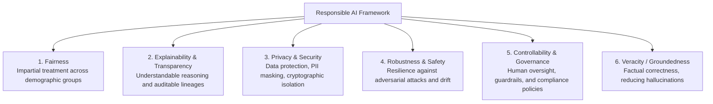
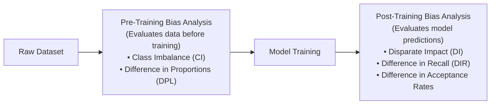
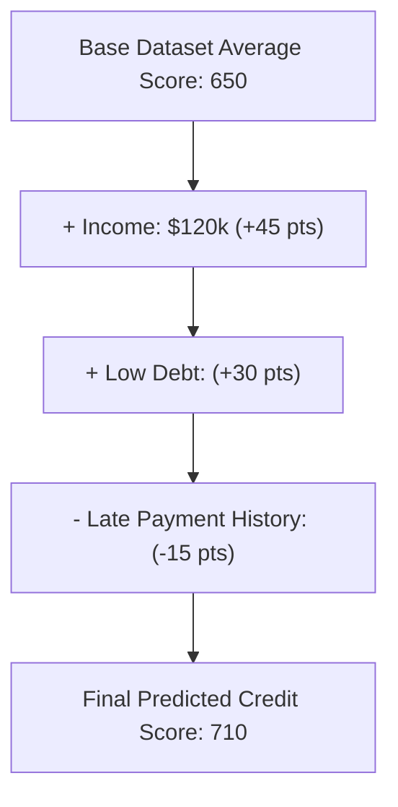

# Responsible AI, Bias Types & Ethical Governance

> **Category:** [Conceptual Architecture](../../../../Cloud/Practitioner/CLF-C02/09_Notes_and_Cheatsheets/README.md)  
> **Relevant Certifications:** [AIF-C01](../01_Syllabus/AIF-C01_Exam_Guide_and_Blueprint.md), AWS Machine Learning Specialty  
> **Tags:** `#aws/concepts` `#aws/responsible-ai` `#governance` `#bias` `#aif-c01`

---

## 1. The Core Pillars of Responsible AI

Responsible AI refers to designing, developing, and deploying artificial intelligence systems in a manner that is fair, ethical, transparent, and accountable. AWS structures Responsible AI around six core dimensions:

---

## 2. Common Types of Bias in Machine Learning

Bias can infiltrate an AI system at every stage of the lifecycle—from raw data collection to model inference:

| Bias Type | Definition | Real-World Example | Mitigation Strategy |
|---|---|---|---|
| **Sampling Bias / Selection Bias** | Training dataset is not representative of the target production population. | Training a credit scoring model solely on urban customers, causing failure on rural applicants. | Stratified random sampling; expanding diverse data collection. |
| **Measurement Bias** | Systematic distortion introduced by the instruments, sensors, or categorization methods used to collect data. | Using a phone app with microphone compression that distorts speech recognition for certain accents. | Calibrating data capture tools; multi-device validation. |
| **Observer Bias** | Preexisting expectations, stereotypes, or beliefs of researchers or data annotators unconsciously skewing data labeling. | Human annotators inconsistently labeling identical support tickets as "aggressive" based on user demographic tags. | Anonymized labeling in **SageMaker Ground Truth**; multi-annotator consensus. |
| **Confirmation Bias** | Favoring data or model outcomes that confirm preexisting hypotheses while ignoring contradictory evidence. | Ignoring false negatives in a fraud detection pipeline because "that user profile seemed trustworthy". | Rigorous automated cross-validation and independent red-teaming. |
| **Historical Bias** | Data accurately reflects historical conditions, but those historical conditions were socially biased or discriminatory. | Training hiring algorithms on 20 years of historical tech promotions where women were underrepresented. | Rebalancing datasets, synthetic data generation, constraint penalties. |
| **Algorithmic Bias** | Model architecture or optimization function inadvertently exacerbates disparity between majority and minority classes. | Loss function prioritizing accuracy on a $99\%$ majority class while misclassifying the $1\%$ critical minority. | Class-weighted loss functions; metric adjustments (e.g., F1 over Accuracy). |

---

## 3. Pre-Training vs. Post-Training Bias Detection

Understanding when bias is measured in the ML pipeline is a major exam topic for **Amazon SageMaker Clarify**:

* **Pre-Training Bias Metrics (Data Level):**
  * **Class Imbalance (CI):** Measures the disparity in the number of samples between a sensitive facet (e.g., minority demographic) and the baseline facet.
  * **Difference in Positive Proportions in Labels (DPL):** Compares the percentage of positive historical labels granted to the protected group versus the baseline group.
* **Post-Training Bias Metrics (Model Prediction Level):**
  * **Difference in Positive Proportions in Predicted Labels (DPPL):** Compares how frequently the model predicts a favorable outcome for group A versus group B.
  * **Disparate Impact (DI):** Ratio of positive prediction rates between protected and baseline groups.
  * **Difference in Recall (DIR):** Assesses whether the model misses true positive cases more frequently for one group than another.

---

## 4. Model Explainability & Interpretability (SHAP Values)

### Why Explainability Matters:
* **Regulatory Compliance:** Requirements (such as GDPR Article 22 or US Equal Credit Opportunity Act) granting individuals the *"Right to an Explanation"* when automated algorithms make decisions affecting credit, health, or liberty.
* **Debugging & Trust:** Enabling data scientists and domain experts to verify that a model is learning genuine causal relationships rather than spurious correlations (e.g., classifying a husky as a wolf based on snow in the background).

### SHAP (SHapley Additive exPlanations):
* **Theoretical Foundation:** Derived from cooperative game theory (Lloyd Shapley). Measures each feature's marginal contribution to a given prediction.
* **KernelSHAP in SageMaker Clarify:**
  * Computes **feature attribution scores** indicating how much each input feature shifted the model output higher or lower relative to the baseline average prediction.
  * Produces **Global Explainability** (which features drive predictions across the entire dataset) and **Local Explainability** (why a specific applicant was denied a loan).

