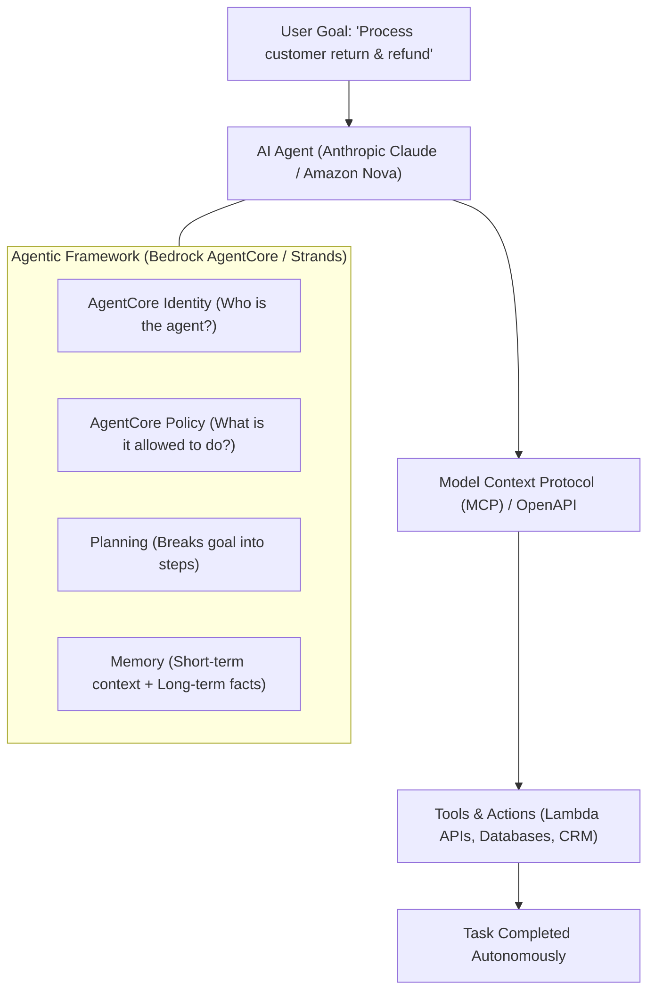
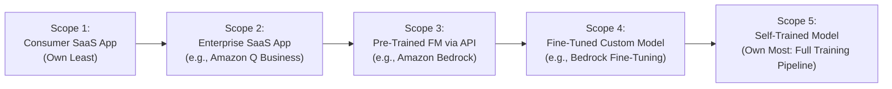

# AIF-C01 Exam Distinction & Memory Cheat Sheet

> **Certification:** [AWS Certified AI Practitioner (AIF-C01)](../01_Syllabus/AIF-C01_Exam_Guide_and_Blueprint.md)  
> **Purpose:** High-yield side-by-side distinction tables to eliminate confusion on tricky exam questions.  
> **Tags:** `#aws/certification` `#aif-c01` `#cheatsheet` `#exam-prep`

---

## 1. Model Adaptation Spectrum: Prompting vs. RAG vs. Fine-Tuning

| Feature | Prompt Engineering | RAG (Bedrock Knowledge Bases) | Fine-Tuning (Custom Models) | Continued Pre-training |
|---|---|---|---|---|
| **Base Model Weights** | Unchanged (Frozen) | Unchanged (Frozen) | **Updated** (Adapters or weights) | **Updated** (Base weights) |
| **Knowledge Source** | Context provided in prompt | Dynamic retrieval from Vector DB | Baked into model weights | Baked into model weights |
| **Knowledge Freshness** | Frozen at model cutoff | **Real-time / Instant** | Frozen at training time | Frozen at training time |
| **Provides Citations?** | No (unless in prompt) | **Yes (Direct source links)** | No | No |
| **Hallucination Risk** | High | **Lowest (Grounded)** | Moderate | Moderate |
| **Typical Data Required** | $0 - 5$ prompt examples | Internal docs (PDF, HTML, TXT) | $100s - 10,000s$ labeled pairs | Millions of unlabeled tokens |
| **Cost & Compute** | Lowest ($\$$) | Low-Moderate ($\$\$$) | Moderate-High ($\$\$\$$) | Very High ($\$\$\$\$$) |

---

## 2. Generative AI Evaluation Metrics Comparison

| Metric | Full Name | Primary Task | Metric Focus | Direction | When to Choose |
|---|---|---|---|---|---|
| **ROUGE-1 / 2** | Recall-Oriented Understudy for Gisting Evaluation | **Text Summarization** | **Recall** ($n$-gram overlap) | Higher is better ($0 - 1$) | Evaluating whether a summary captured key points from source. |
| **ROUGE-L** | ROUGE Longest Common Subsequence | Summarization fluency | Sentence structure & order | Higher is better ($0 - 1$) | Evaluating sentence flow and structural order of summary. |
| **BLEU** | Bilingual Evaluation Understudy | **Machine Translation** | **Precision** + Brevity Penalty | Higher is better ($0 - 1$) | Checking translation accuracy against ground truth sentences. |
| **BERTScore** | BERT Semantic Score | Open-ended text, synonyms | **Semantic Cosine Similarity** | Higher is better ($0 - 1$) | Words differ in phrasing/synonyms but share exact meaning. |
| **Perplexity (PPL)** | Perplexity | Language model fluency | Uncertainty / entropy | **Lower is better** ($1 - \infty$) | Evaluating grammatical fluency and predictability of model output. |

---

## 3. SageMaker Model Deployment Modes

| Mode | Traffic Pattern | Scalability | Max Payload | Max Latency / Duration | Billing Model |
|---|---|---|---|---|---|
| **Real-Time** | Sustained, steady, high volume | Auto-scales instances based on CPU/Inv. | 6 MB | Sub-second (up to 60s) | Billed 24/7 per active instance-hour |
| **Serverless** | Sporadic, spiky, unpredictable | Scales down to **0** when idle | 4 MB | Up to 60s (has cold starts) | Billed per compute second used |
| **Batch Transform** | Bulk offline datasets (periodic) | Runs job and shuts down compute | Gigabytes (splits S3 files) | Hours to Days | Billed only for duration of transform job |
| **Asynchronous** | Large files, long-running processing | Queues requests in Amazon SQS | **1 GB** | **Up to 1 hour** (60 mins) | Scales to zero when SQS queue is empty |

---

## 4. Temperature vs. Top-P vs. Top-K

| Parameter | What it Does | Low Value Example | High Value Example | Best For |
|---|---|---|---|---|
| **Temperature** | Flattens or sharpens token probability curve | `0.0`: Greedy, deterministic | `1.0`: Broad, creative, varied | `0.0` for coding/JSON/facts; `0.8` for brainstorming |
| **Top-P (Nucleus)** | Restricts pool to cumulative probability $P$ | `0.1`: Only top 1-2 words | `0.95`: Includes long-tail words | Alternative to Temperature; tune one or the other |
| **Top-K** | Caps pool to top $K$ most probable tokens | `1`: Greedy decoding | `250`: Rich vocabulary | Restricting candidate tokens to fixed top count |

---

## 5. Amazon Bedrock vs. Amazon SageMaker AI

| Dimension | Amazon Bedrock | Amazon SageMaker AI |
|---|---|---|
| **Target User** | App developers building with GenAI via APIs | Data scientists, ML engineers building custom models |
| **Model Nature** | Ready-to-use Foundation Models (Claude, Titan, Llama) | Custom models (PyTorch, TensorFlow, XGBoost, Scikit) |
| **Infrastructure** | **Serverless** (No servers or GPUs to configure) | Managed compute (EC2 ML instances, clusters, containers) |
| **Customization** | RAG (Knowledge Bases), Fine-tuning (Serverless) | Full training scripts, custom hyperparameter tuning, containers |
| **ML Code** | **Zero ML code**; simple REST/SDK calls | Full Python/Jupyter scripting, MLOps pipelines |

---

## 6. Amazon Q Family Cheat Sheet

| Service | Primary User | Core Capability | Key Feature |
|---|---|---|---|
| **Amazon Q Developer** | Software developers, Cloud architects | AI pair programming in IDE/CLI, code modernization | Migrates **Java 8/11 to Java 17**; security vulnerability scanning |
| **Amazon Q Business** | Corporate business employees | Enterprise question answering across 40+ connectors | Strict Role-Based Access Control (**RBAC**); source citations |
| **Amazon Q in QuickSight** | Business intelligence analysts | Natural language to BI dashboards and reports | Generates executive summaries and charts from prompt |
| **Amazon Q in AWS Glue** | Data engineers | Natural language to ETL pipeline code | Generates PySpark transformations via conversation |

---

## 7. Responsible AI & Governance Tooling

| Capability | AWS Tool | Primary Function | Exam Trigger |
|---|---|---|---|
| **Pre-Training Bias** | SageMaker Clarify | Analyzes raw data for class imbalance | *"Detect demographic bias in training data before modeling"* |
| **Post-Training Bias** | SageMaker Clarify | Analyzes predictions for disparate impact | *"Measure fairness of loan approval predictions across groups"* |
| **Explainability (SHAP)** | SageMaker Clarify | Computes feature attribution scores | *"Explain which features caused a model to reject an application"* |
| **GenAI Safety & PII** | Bedrock Guardrails | Filters toxicity, masks PII, blocks topics | *"Redact customer SSNs and block investment advice in chatbot"* |
| **Hallucination Suppression** | Bedrock Guardrails | Contextual Grounding Check | *"Ensure chatbot answers only come from retrieved reference docs"* |
| **Model Documentation** | SageMaker Model Cards | Auditable PDF record of model lifecycle | *"Produce standardized compliance documentation for auditors"* |
| **Model Drift Monitoring** | SageMaker Model Monitor | Detects data and concept drift in production | *"Alert when production inference inputs deviate from training data"* |

---

## 8. The Top 36 High-Yield Exam Traps (Don't Confuse These!)

> Sourced from official exam blueprints and high-yield review guides:

| # | Topic Trap | Distinction / What to Remember |
|---|---|---|
| 1 | **RAG vs. Fine-Tuning** | RAG hands the model fresh facts at question time without retraining. Fine-tuning bakes style, tone, and domain jargon into model weights. Stale or private facts? **RAG**. |
| 2 | **Bedrock vs. SageMaker AI** | Bedrock uses ready-made FMs via API without managing infrastructure. SageMaker AI builds, trains, and tunes custom models. |
| 3 | **Training vs. Inference** | Building the model is training. Using it to answer requests is inference, even if the question never uses the word. |
| 4 | **Embeddings vs. Tokens** | Tokens are counted and billed. Embeddings are high-dimensional vectors that capture semantic meaning and are compared. |
| 5 | **Temperature vs. Context Window** | Temperature controls output randomness. The context window controls the total token capacity of prompt + response. |
| 6 | **IAM vs. Guardrails** | IAM gates *who* can call AWS APIs. Guardrails controls *what* the model is allowed to say. |
| 7 | **Bias vs. Hallucination** | Unfair output across groups is bias. Confidently fabricated facts is hallucination. Fixing one does not fix the other! |
| 8 | **Explainability vs. Transparency** | Transparency is documentation of how the model was built (Model Cards). Explainability is why a specific prediction was made (SHAP). |
| 9 | **Classification vs. Regression** | Category/discrete label is classification (including Yes/No fraud). Continuous numeric quantity is regression. |
| 10 | **Few-Shot vs. Fine-Tuning** | Few-shot lives entirely inside the prompt (in-context). Fine-tuning modifies model parameters. |
| 11 | **Precision vs. Recall** | When false alarms are costly (blocking good users), maximize **Precision**. When missed real cases are costly (cancer, fraud), maximize **Recall**. |
| 12 | **Overfitting vs. Underfitting** | Overfitting = great on training, poor on unseen data (high variance). Underfitting = poor on both (too simple / high bias). |
| 13 | **Accuracy on Lopsided Data** | On imbalanced data (99.9% legit transactions), accuracy is misleading. Check Precision, Recall, and F1. |
| 14 | **KMS vs. IAM** | KMS creates and controls cryptographic encryption keys. IAM controls which identities have permission to access resources. |
| 15 | **Macie vs. IAM** | Macie uses ML to discover and classify sensitive PII in Amazon S3. IAM grants or denies user access to the bucket. |
| 16 | **CloudTrail vs. CloudWatch** | CloudTrail records *who did what and when* (API audit trail). CloudWatch monitors *how resources are performing* (metrics, alarms). |
| 17 | **AgentCore Identity vs. Policy** | AgentCore Identity defines *who* the agent is. AgentCore Policy defines *what actions* the agent is permitted to execute. |
| 18 | **Agent vs. Chatbot** | A chatbot converses and answers questions. An agent plans, calls external APIs, updates databases, and completes workflows. |
| 19 | **Embedding Model vs. Text Model** | The embedding model generates numerical vectors (e.g. Titan Embeddings). The text model generates conversational answers. |
| 20 | **Responsible AI vs. Security** | Responsible AI governs ethical behavior, fairness, and safety. Security controls access, encryption, and network perimeter. |
| 21 | **Real-Time vs. Batch vs. Serverless** | Real-time = interactive user waiting (< 1s). Batch = offline bulk dataset scoring. Serverless = intermittent/spiky traffic scaling to zero. |
| 22 | **Supervised vs. Unsupervised** | Supervised requires labeled data $(X, Y)$. Unsupervised discovers hidden patterns in unlabeled data $(X)$. |
| 23 | **Vector DB vs. Traditional DB** | Vector DB finds items by geometric semantic closeness (meaning). Traditional DB matches exact scalar values and filters. |
| 24 | **Model Size Tradeoff** | Bigger models provide stronger complex reasoning, but have higher latency and higher cost per token. |
| 25 | **RAG Lowers Risk, Not to Zero** | RAG dramatically reduces hallucinations by grounding answers, but does not completely eliminate the need for human verification. |
| 26 | **Human vs. Automated Evaluation** | Human review evaluates tone, nuance, and brand voice. Automated evaluation (ROUGE/BLEU/LLM-as-a-judge) scales cheaply for regressions. |
| 27 | **Prompt vs. Context Engineering** | Prompt engineering is *how you ask* (wording, format). Context engineering is *what the model gets to see* (system prompt, retrieved docs, memory, tools). |
| 28 | **On-Demand vs. Provisioned Throughput** | On-Demand pays per token processed. Provisioned Throughput commits to dedicated model units for predictable, high-volume production. |
| 29 | **Foundation vs. Fine-Tuned Model** | A Foundation Model is broad and general-purpose. A fine-tuned model is specialized for organizational tone, task, or dialect. |
| 30 | **Lineage vs. Model Card** | Lineage is the full path data and code took to create the model. Model Card is the final descriptive document summarizing model capabilities and limits. |
| 31 | **MemoryDB for Vector Search** | Dropped from the current in-scope list for AIF-C01. Focus on **OpenSearch**, **Aurora**, **RDS PostgreSQL**, and **Neptune**. |
| 32 | **Amazon Q Recognition** | In v1.1/v1.2 scope at recognition level. Don't select Amazon Q when a question asks for accessing multiple 3rd-party FMs (Bedrock). |
| 33 | **ROUGE vs. BLEU** | ROUGE evaluates text **summarization** (recall-focused). BLEU evaluates machine **translation** (precision-focused). |
| 34 | **Model Distillation** | Training a smaller, faster model to imitate the outputs of a larger teacher model to reduce latency and inference cost. |
| 35 | **Pre-Training from Scratch** | Building a new FM on massive unlabeled corpora. Extremely expensive; rarely the right answer unless unprecedented domain or language. |
| 36 | **Shared Responsibility for GenAI** | AWS manages physical datacenters and foundational model hosting. You own your prompts, training data, IAM access, and guardrails. |

---

## 9. Agentic AI & Exam Guide v1.2 Scope Reference

* **Model Context Protocol (MCP):** An open standard for securely connecting AI agents to external tools and enterprise data sources without hand-coding custom integrations for each tool.
* **Bedrock AgentCore:** AWS enterprise platform to build, deploy, manage, and monitor AI agents securely at scale.
* **Strands Agents:** Lightweight open-source agent SDK for building autonomous multi-agent workflows.
* **Kiro:** Spec-driven agentic IDE and CLI where natural language prompts become specifications, then production code.
* **Amazon Nova:** Amazon's new family of frontier multimodal foundation models (Nova Micro, Nova Lite, Nova Pro, Nova Premier) available on Amazon Bedrock.
* **Amazon Quick:** Agentic AI business workspace combining conversational research, Quick Sight (formerly QuickSight), and automation Flows over company data.

---

## 10. Generative AI Security Scoping Matrix

How much security responsibility you own depends directly on how you consume Generative AI:

* **Building on Amazon Bedrock sits at Scope 3 / Scope 4:** AWS manages the model infrastructure and physical security; you own your data, prompts, retrieval permissions, and Guardrail filters.

---

## 11. Final 15-Minute Exam Day Review (Say These Out Loud!)

1. **Bedrock** uses existing FMs via API. **SageMaker AI** builds, trains, and deploys custom ML.
2. Stale or private company facts? $\to$ **RAG**. Custom organizational behavior and tone? $\to$ **Fine-Tuning**.
3. Always escalate in order: **Prompting first**, then **RAG**, then **Fine-Tuning**, and **Pre-Training last**.
4. Low Temperature ($0.0 - 0.2$) = predictable and factual. High Temperature ($0.8 - 1.0$) = creative and varied.
5. Embeddings compare semantic meaning. Tokens get counted for billing and context limits.
6. **Guardrails** control what the model says. **IAM** controls who can invoke the API.
7. **Macie** discovers sensitive PII in S3. **KMS** holds encryption keys.
8. **AgentCore Identity** = who the agent is. **AgentCore Policy** = what the agent is allowed to do.
9. Classification = category (including yes/no fraud). Regression = continuous number.
10. **Recall** for costly missed cases (disease, fraud). **Precision** for costly false alarms (spam, blocking good users).
11. **Hallucination $\neq$ Bias.** Hallucination is made-up output (fix with RAG). Bias is unfair skew across groups (fix with balanced data/Clarify).
12. **Context Engineering:** Controlling the full bundle of system instructions, retrieved documents, chat history, and tool execution results that enter the context window.

