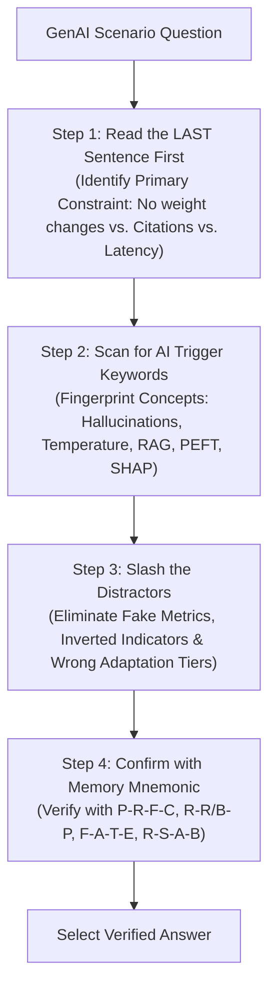

# AWS Certified AI Practitioner (AIF-C01) — Exam Decryption Playbook & Memory Mnemonics

> **Target Exam:** AWS Certified AI Practitioner (`AIF-C01`)  
> **Purpose:** Master question-answering heuristics, fingerprint trigger keywords, memory mnemonics, and distractor elimination tactics for Generative AI and Machine Learning exam scenarios.  
> **Author & Lead Trainer:** Mohamed Fakhruldeen  

---

## ⚡ The 4-Step GenAI Exam Decryption Engine

When taking the AWS Certified AI Practitioner (`AIF-C01`) exam, scenarios frequently blend Machine Learning theory, Generative AI foundation model parameters, and AWS service capabilities. Follow this 4-step decryption algorithm:



### Step 1: The Inverted Read (Read the Last Sentence First)
Identify the primary constraint before getting distracted by the business story:
- *"Without updating the base model weights"* ⇒ Reject Fine-Tuning and Pre-training; look for **Prompt Engineering** or **RAG (Retrieval Augmented Generation)**.
- *"To reduce hallucinations and provide verifiable source citations"* ⇒ Look for **RAG / Amazon Bedrock Knowledge Bases**.
- *"To automate multi-step API actions across backend systems"* ⇒ Look for **Amazon Bedrock Agents**.
- *"To prevent toxic content, mask PII, and block prompt injection"* ⇒ Look for **Amazon Bedrock Guardrails**.
- *"To explain feature importance and model bias"* ⇒ Look for **Amazon SageMaker Clarify (SHAP values)**.

### Step 2: Scan for AI Trigger Keywords (Fingerprinting)
Match the technical scenario cue directly to the correct model technique or AWS service (see the [AIF-C01 Trigger Keyword Master Index](#-the-aif-c01-trigger-keyword-master-index) below).

### Step 3: Slash Distractors (The GenAI Elimination Playbook)
1. **The Inverted Metric Trap:** Remember that for **Perplexity (PPL)**, lower is better! For ROUGE, BLEU, and BERTScore, higher is better. If an option claims *"maximize perplexity to improve fluency"*, eliminate it immediately!
2. **The Fictitious GenAI Service Trap:** AWS often invents plausible-sounding tools (e.g., *"Amazon Bedrock Model Trainer"*, *"AWS Prompt Optimizer"*, *"Amazon GenAI Security Scanner"*). If it's not a real Bedrock or SageMaker feature, cross it off!
3. **The Parameter Direction Trap:** 
   - Raising **Temperature** (e.g., $0.9$) increases randomness and creative variety.
   - Lowering **Temperature** (e.g., $0.1$) makes outputs deterministic, analytical, and factual.
   - If a prompt asks for strict factual code generation, eliminate options that recommend increasing temperature!
4. **The Overkill Adaptation Trap:** If a company wants a chatbot to answer questions about internal HR policy PDFs, choosing *"pre-train a foundation model from scratch"* is a massive overkill anti-pattern. Choose **RAG with Bedrock Knowledge Bases**.

### Step 4: Confirm with Memory Mnemonic
Verify against the memorized mental acronyms detailed below.

---

## 🧠 Master Mnemonics Suite for AIF-C01

### 1. The Model Adaptation Ladder: `P-R-F-C`

$$
\text{Lowest Cost / Frozen Weights} \quad \xrightarrow{\hspace{6cm}} \quad \text{Highest Cost / Heavy Weight Updates}
$$

```
  P ── Prompt Engineering     (0 weight changes, 0 training compute, frozen knowledge)
  R ── RAG (Knowledge Bases)  (0 weight changes, connects to Vector DB, real-time data + citations)
  F ── Fine-Tuning (PEFT/LoRA)(Updates weights/adapters, teaches style/tone, labeled pairs)
  C ── Continued Pre-training (Heavy weight updates, domain vocabulary, millions of unlabeled tokens)
```

* **Memory Peg:** *"**P**lease **R**ead **F**ine **C**ode."*
* **Decision Framework:**
  - Need external/fresh data with source links? ⇒ **RAG**.
  - Need specific tone, syntax, or concise JSON format? ⇒ **Fine-Tuning**.
  - Need deep medical/legal jargon vocabulary? ⇒ **Continued Pre-training**.

---

### 2. Text Generation Evaluation Metrics: `R-R` vs. `B-P`

```
  R ── ROUGE has an R ──> RECALL-Oriented ──> Used for Summarization (Resumés!)
  B ── BLEU has a P   ──> PRECISION-Oriented ──> Used for Machine Translation!
```

* **Memory Peg:**
  - **ROUGE = Recall for Summarization:** Measures how much of the reference summary appears in the generated output ($n$-gram overlap).
  - **BLEU = Precision for Translation:** Measures how many words in the machine-translated sentence are present in the professional human translation.
  - **BERTScore = Semantic Similarity:** Evaluates cosine similarity of word embeddings (detects matching meaning even when different synonyms are used).

---

### 3. Perplexity (PPL): The "Confusion" Metric

* **Mnemonic:** *"The more **perplexed** the model is, the **worse** it performs!"*
* **Mathematical Rule:** Perplexity measures the model's uncertainty.

  $$
  \text{Lower Perplexity} \implies \text{Higher Fluency, Accuracy, and Confidence}
  $$

---

### 4. Responsible AI Dimensions: `F-A-T-E`

```
  F ── Fairness        (Auditing demographic bias, balanced datasets via SageMaker Clarify)
  A ── Accountability  (Governance tracking, Model Cards, CloudTrail API audit logging)
  T ── Transparency   (Explainability, feature importance, SHAP values, Model Dashboards)
  E ── Ethics & Safety (Bedrock Guardrails, toxicity filtering, PII redaction, watermarking)
```

---

### 5. Amazon Bedrock Foundation Model Providers: `A-A-C-M-M-S`

```
  "All AI Can Make Models Smart"

  A ── Anthropic      (Claude 3 / 3.5 ── Best for reasoning, code, nuanced analysis)
  A ── AI21 Labs      (Jurassic-2 ── Multilingual text generation, task completion)
  C ── Cohere         (Command & Embed ── Enterprise search, retrieval, embeddings)
  M ── Meta           (Llama 2 / 3 ── Highly capable open-weights models)
  M ── Mistral AI     (Mistral 7B / Mixtral 8x7B ── Lightweight mixture-of-experts)
  S ── Stability AI   (Stable Diffusion ── Text-to-image and visual media generation)
```
* **Amazon's Own Models:** **Amazon Titan** (Titan Text, Titan Image Generator with invisible watermarking, Titan Multimodal Embeddings).

---

### 6. SageMaker 4 Inference Endpoints: `R-S-A-B`

```
  R ── Real-Time      (Sustained high traffic, sub-second latency, 6 MB payload, 24/7 instances)
  S ── Serverless     (Sporadic/spiky traffic, scales to ZERO when idle, 4 MB payload, pay-per-second)
  A ── Asynchronous   (Queued in SQS, up to 1 GB payload, up to 1 HOUR (60m) processing, scales to 0)
  B ── Batch Transform(Bulk offline datasets, runs on S3 splits to completion, then shuts down)
```

* **Memory Clue:**
  - *"Large payload up to 1 GB or processing takes 20 minutes"* ⇒ **Asynchronous Inference**.
  - *"Intermittent traffic that drops to 0 at night, lowest cost"* ⇒ **Serverless Inference**.

---

## 🔍 The AIF-C01 Trigger Keyword Master Index

### Domain 1: Fundamentals of AI and ML (20%)

| If you see this exact phrase in the question... | The Answer is ALWAYS: |
|:---|:---|
| *"Predict continuous numerical values (e.g., house prices, stock values)"* | **Regression (Supervised Learning)** |
| *"Classify data into discrete categories or labels (e.g., spam vs ham)"* | **Classification (Supervised Learning)** |
| *"Discover hidden patterns, groupings, or clusters without labeled data"* | **Clustering / Unsupervised Learning** |
| *"Agent learns through trial-and-error using rewards and penalties"* | **Reinforcement Learning (RL)** |
| *"Model performs exceptionally well on training data but poorly on test data"* | **Overfitting (High Variance)** |
| *"Model is too simple to capture patterns in both training and test data"* | **Underfitting (High Bias)** |
| *"Technique to prevent overfitting by penalizing complex models"* | **Regularization (L1 Lasso, L2 Ridge, Dropout)** |
| *"Split dataset into K subsets to evaluate model stability"* | **K-Fold Cross-Validation** |
| *"Measure trade-off between True Positive Rate and False Positive Rate"* | **ROC-AUC Curve** |
| *"Prioritize minimizing False Negatives (e.g., cancer detection, fraud)"* | **Recall / Sensitivity** |
| *"Prioritize minimizing False Positives (e.g., spam detection, marking innocent emails)"*| **Precision** |

---

### Domain 2: Fundamentals of Generative AI (24%)

| If you see this exact phrase in the question... | The Answer is ALWAYS: |
|:---|:---|
| *"Model generates plausible-sounding but factually incorrect information"* | **Hallucination** |
| *"Control randomness and creative variation in text generation"* | **Temperature** |
| *"Limit token selection to cumulative probability threshold"* | **Top-P (Nucleus Sampling)** |
| *"Limit token selection to top K highest-probability tokens"* | **Top-K Sampling** |
| *"Penalize repeated words and phrases in generated text"* | **Presence / Frequency Penalty** |
| *"Convert text words, sentences, or images into high-dimensional numerical vectors"*| **Vector Embeddings** |
| *"Measure semantic similarity between two vector embeddings"* | **Cosine Similarity / Euclidean Distance** |
| *"Technique providing 1 to 5 examples within the prompt context"* | **Few-Shot Prompting** |
| *"Prompt technique prompting model to break reasoning down step-by-step"* | **Chain-of-Thought (CoT) Prompting** |
| *"Malicious input designed to bypass safety filters or reveal system prompts"*| **Prompt Injection / Jailbreaking** |

---

### Domain 3: Applications of Foundation Models (28%)

| If you see this exact phrase in the question... | The Answer is ALWAYS: |
|:---|:---|
| *"Ground foundation models in proprietary company documents without retraining"*| **RAG (Amazon Bedrock Knowledge Bases)** |
| *"Break documents into smaller segments with overlap for vector search"* | **Chunking & Chunk Overlap** |
| *"Fully managed serverless vector database in AWS"* | **Amazon OpenSearch Serverless (Vector Engine)** |
| *"Orchestrate multi-step tasks and execute API calls via AWS Lambda"* | **Amazon Bedrock Agents** |
| *"Evaluate and compare multiple foundation models on custom datasets"* | **Amazon Bedrock Model Evaluation** |
| *"Fine-tune model using Low-Rank Adaptation to minimize compute cost"* | **PEFT (Parameter-Efficient Fine-Tuning) / LoRA** |
| *"Reserve dedicated throughput (model units) for guaranteed low latency"*| **Amazon Bedrock Provisioned Throughput** |
| *"Pre-built Generative AI coding companion integrated into IDE"* | **Amazon Q Developer (formerly CodeWhisperer)** |
| *"Generative AI assistant providing insights from business enterprise data"* | **Amazon Q Business** |
| *"Fastest serverless foundation model invocation via unified API"* | **Amazon Bedrock Converse API** |

---

### Domain 4: Guidelines for Responsible AI (14%)

| If you see this exact phrase in the question... | The Answer is ALWAYS: |
|:---|:---|
| *"Detect and mitigate demographic bias across protected attributes"* | **Amazon SageMaker Clarify (Pre-training / Post-training Bias)** |
| *"Explain model predictions using SHAP (Shapley Additive exPlanations) values"*| **Feature Importance / Explainability (SageMaker Clarify)**|
| *"Document model purpose, intended uses, training data, and ethical boundaries"*| **Amazon SageMaker Model Cards** |
| *"Automated filter to mask PII, block profanity, and enforce ethical topics"*| **Amazon Bedrock Guardrails** |
| *"Add invisible cryptographic digital watermark to detect AI-generated imagery"*| **Amazon Titan Image Generator Watermarking** |
| *"Involve human reviewers to validate low-confidence model predictions"* | **Amazon Augmented AI (A2I)** |
| *"Crowdsourced human workforce for data annotation and RLHF labeling"* | **Amazon SageMaker Ground Truth** |

---

### Domain 5: Security, Compliance, and Governance (14%)

| If you see this exact phrase in the question... | The Answer is ALWAYS: |
|:---|:---|
| *"Ensure customer training data and prompts are NEVER used to train AWS base models"*| **Amazon Bedrock Data Privacy Commitment** |
| *"Private network connectivity between VPC and Amazon Bedrock without internet"*| **AWS PrivateLink (Interface VPC Endpoint for Bedrock)** |
| *"Encrypt Bedrock custom models and Knowledge Bases with customer keys"* | **AWS KMS Customer Managed Keys (CMK)** |
| *"Track and audit all Bedrock API invocation requests and caller identity"* | **AWS CloudTrail** |
| *"Centrally manage and enforce governance policies across AI models in organization"*| **AWS Organizations Service Control Policies (SCPs)** |
| *"Ensure compliance with HIPAA, GDPR, and ISO standards for AI workloads"* | **AWS Artifact** |

---

## 🚫 Common AIF-C01 Trap Pairs (Distinction Tables)

### Trap 1: Temperature vs. Top-P
- **Temperature ($0.0 - 1.0$):** Scales the probability distribution logits. Low ($0.2$) = deterministic, analytical, math/code. High ($0.8$) = creative, varied, storytelling.
- **Top-P ($0.0 - 1.0$):** Cumulative probability cutoff (Nucleus sampling). Dynamically cuts off the candidate pool once cumulative probability reaches $P$.
- *Exam Trap:* If the scenario asks for strict, factual, deterministic summaries, choose **Low Temperature** (e.g., $0.0 - 0.2$), NOT high temperature!

### Trap 2: Bedrock Agents vs. Knowledge Bases vs. Guardrails
- **Bedrock Knowledge Bases:** Connects foundation models to data sources (S3 + Vector DB) for **RAG**. Fetches relevant context and provides citations.
- **Bedrock Agents:** Executes actions! Breaks user goals into multi-step workflows, converts natural language into API calls, and triggers AWS Lambda functions.
- **Bedrock Guardrails:** Safety guardrails! Evaluates user input and model output to block restricted topics, redact PII (SSN, credit cards), filter hate speech, and prevent prompt injection attacks.

### Trap 3: PEFT/LoRA vs. Full Fine-Tuning vs. Continued Pre-training
- **PEFT / LoRA:** Freezes the original base model weights and trains small, lightweight low-rank adapter matrices. Requires up to 90% less GPU memory and compute!
- **Full Fine-Tuning:** Updates all parameters across the network. High compute cost, risks *catastrophic forgetting* of general knowledge.
- **Continued Pre-training:** Uses massive volumes of **unlabeled text** to adapt a general model to specialized domain language (e.g., training a model on millions of medical journals).

### Trap 4: ROUGE vs. BLEU vs. BERTScore
- **ROUGE:** Recall-focused $n$-gram overlap. Used for **summarization**.
- **BLEU:** Precision-focused $n$-gram match with brevity penalty. Used for **machine translation**.
- **BERTScore:** Deep contextual embedding semantic similarity. Used when phrasing differs but meaning is identical.
