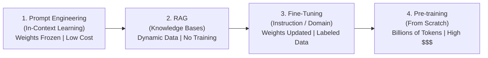
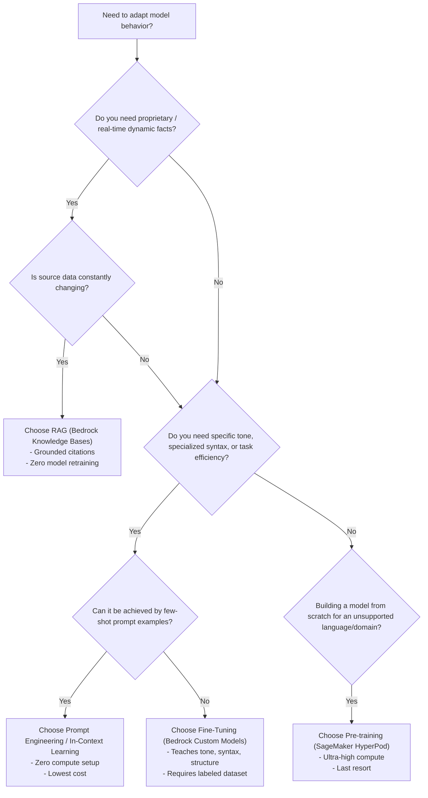

# Distinction Cheat Sheet: Model Adaptation (Prompting vs. RAG vs. Fine-Tuning vs. Pretraining)

> **Role:** High-yield comparison across the foundation model adaptation spectrum.  
> **Course:** AWS Certified AI Practitioner (AIF-C01)  
> **Tags:** `#exam-prep` `#model-adaptation` `#rag` `#fine-tuning` `#aif-c01`

---

## 🎯 The Adaptation Spectrum At a Glance

Adapting foundation models involves balancing **cost, technical complexity, training data requirements, and model weights modification**.

---

## 🔍 Comprehensive Feature Comparison Matrix

| Dimension | Prompt Engineering | Retrieval Augmented Generation (RAG) | Fine-Tuning (Instruction / Domain) | Pre-training (From Scratch) |
|---|---|---|---|---|
| **Weights Modified?** | ❌ No (Frozen) | ❌ No (Frozen) | ✅ Yes (Targeted layers or LoRA adapters) | ✅ Yes (All model weights initialized & trained) |
| **Primary Goal** | Direct behavior, tone, output format via instructions | Inject private, proprietary, real-time facts into prompt context | Teach new domain jargon, task styling, or internal linguistic syntax | Create entirely novel foundation model for proprietary domain/language |
| **Data Requirements** | 0 to a few examples (Zero-shot / Few-shot) | Unstructured knowledge base (PDFs, docs, Wikis) indexed in vector DB | Thousands of high-quality labeled prompt-response pairs (`prompt` + `completion`) | Terabytes to Petabytes of diverse, curated raw text/multimodal data |
| **Cost & Compute** | 💲 Lowest (Token inference pricing only) | 💲💲 Low-Medium (Vector DB storage + retrieval queries) | 💲💲💲 High (Compute instances e.g. GPU p4d/p5 or Bedrock Custom Model units) | 💲💲💲💲 Astronomical (Millions of dollars, massive GPU clusters) |
| **Latency Impact** | Minimal (proportional to prompt tokens) | Additional ~100–300ms for vector search retrieval | Fast inference (no extra context injection needed) | Standard inference latency |
| **Hallucination Control**| Low | 🟢 **Highest** (Ground truth citations & source attribution) | Moderate (can still hallucinate facts confidently) | Low |
| **AWS Service Implementation** | Bedrock Converse API, Bedrock Playground | **Amazon Bedrock Knowledge Bases**, OpenSearch Serverless, Kendra | **Amazon Bedrock Custom Models**, Amazon SageMaker Training Jobs | **Amazon SageMaker HyperPod**, Trainium / Inferentia clusters |

---

## 🧠 Decision Procedure: Which Technique to Choose?

---

## 🎯 Exam Scenario Trigger Matrix

| If the Exam Scenario Mentions... | Correct Choice | Key Reason / Justification |
|---|---|---|
| *"Company needs to provide customer support answers strictly grounded in internal HR handbooks that update daily with document links."* | **RAG (Amazon Bedrock Knowledge Bases)** | RAG retrieves latest facts dynamically and provides verifiable source citations without retraining. |
| *"Customer wants the model to output customer emails strictly adhering to internal legal phrasing and stylistic syntax without injecting new facts."* | **Fine-Tuning** | Fine-tuning alters model weights to specialize in tone, style, and output grammar. |
| *"Need to experiment rapidly with zero model training, minimum cost, and immediately test formatting outputs as JSON."* | **Prompt Engineering** | Zero training cost; few-shot examples guide the model's structural formatting directly. |
| *"Company has millions of unlabeled medical research papers and needs to build a specialized biomedical model from scratch with custom tokenizers."* | **Pre-training (SageMaker HyperPod)** | Requires full training from ground zero due to fundamental domain divergence. |
| *"Model gives confident but incorrect answers (hallucinations) about current company policies."* | **Implement RAG with Bedrock Knowledge Bases** | Directly counters hallucinations by supplying authoritative ground truth context in the prompt. |

---

## ⚠️ Common Traps & Antipatterns

- **Trap:** Believing that Fine-Tuning is the best way to feed a model up-to-date factual documents.  
  *Correction:* Fine-tuning is poor at factual memorization and will cause hallucinations when facts change. **Use RAG for factual knowledge; use Fine-Tuning for style, format, and task adaptation.**
- **Trap:** Assuming RAG requires modifying foundation model weights.  
  *Correction:* RAG leaves model weights 100% frozen. It performs vector similarity lookup and pastes the retrieved chunks into the user's prompt context.
