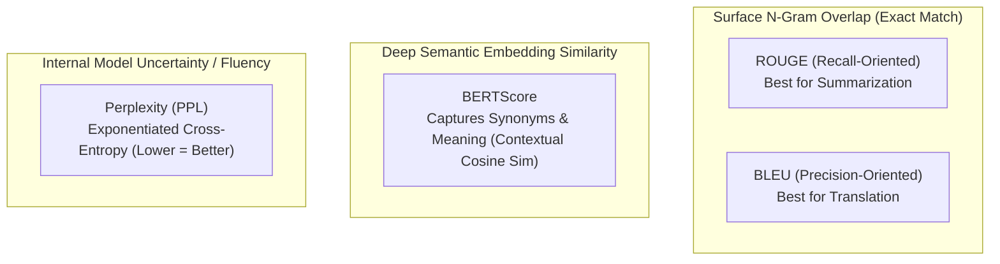

# Distinction Cheat Sheet: Model Evaluation Metrics (ROUGE vs. BLEU vs. Perplexity vs. BERTScore)

> **Role:** High-yield comparison of LLM and NLP evaluation metrics for exam questions.  
> **Course:** AWS Certified AI Practitioner (AIF-C01)  
> **Tags:** `#exam-prep` `#evaluation-metrics` `#rouge` `#bleu` `#perplexity` `#bertscore`

---

## 🎯 The Metrics Landscape At a Glance

Model evaluation requires measuring different dimensions: **precision vs. recall, surface n-gram overlap vs. semantic meaning, and internal predictive certainty**.

---

## 🔍 Comprehensive Comparison Matrix

| Metric | Primary Focus | Calculation Base | Best Suited For | Target Direction | Key Limitation |
|---|---|---|---|---|---|
| **ROUGE** *(Recall-Oriented Understudy for Gisting Evaluation)* | **Recall** (Did the model capture all key points from reference?) | N-gram overlap ($ROUGE-1, ROUGE-2$) & Longest Common Subsequence ($ROUGE-L$) | **Text Summarization** & Abstractive synthesis | **Higher is better** ($0 \to 1$ or $0\% \to 100\%$) | Penalizes paraphrasing and valid synonyms that do not match reference verbatim. |
| **BLEU** *(Bilingual Evaluation Understudy)* | **Precision** (Are generated n-grams genuinely present in reference?) | Modified n-gram precision + **Brevity Penalty** (BP) | **Machine Translation** & Code generation | **Higher is better** ($0 \to 1$ or $0 \to 100$) | Fails when valid translations use alternative vocabulary; vulnerable to word order quirks. |
| **BERTScore** | **Semantic Similarity** | Pairwise cosine similarity between token contextual embeddings | Free-form generation, Q&A, Paraphrasing | **Higher is better** ($0 \to 1$) | Requires computing embeddings using a pretrained BERT model (slower, compute-heavy). |
| **Perplexity (PPL)** | **Model Certainty / Fluency** | Exponential of average cross-entropy loss: $e^{H(p)}$ | Evaluating raw language model fluency & domain adaptation | **Lower is better** ($\downarrow$) | Low perplexity does NOT guarantee factual correctness; an LLM can generate fluent falsehoods. |

---

## 🧮 Mathematical & Operational Insights

### 1. ROUGE Variants Breakdown
- **ROUGE-1:** Unigram (single word) overlap recall:
  $$\text{ROUGE-1 Recall} = \frac{\text{Count of matching unigrams in Reference}}{\text{Total unigrams in Reference}}$$
- **ROUGE-2:** Bigram (two-word sequence) overlap recall: tests local phrasing fluency.
- **ROUGE-L:** Longest Common Subsequence (LCS): captures sentence-level structure without requiring contiguous n-grams.

### 2. BLEU Brevity Penalty
- If a model produces very short output (e.g. 1 word that matches), precision would be 100%. BLEU adds a **Brevity Penalty (BP)** to penalize overly terse candidate responses:
  $$\text{BLEU} = \text{BP} \times \exp\left( \sum_{n=1}^N w_n \ln p_n \right)$$

### 3. Perplexity Intuition
- Perplexity measures how "surprised" the language model is by the test text.
- If perplexity = 50, the model is as confused as if it had to choose uniformly among 50 candidate words at each step.
- **Lower perplexity indicates higher confidence and stronger grammatical mastery.**

---

## 🎯 Exam Scenario Trigger Matrix

| If the Exam Scenario Mentions... | Correct Choice | Key Reason / Justification |
|---|---|---|
| *"Evaluating an AI pipeline that automatically summarizes 50-page financial reports into executive summaries."* | **ROUGE (specifically ROUGE-1 / ROUGE-L)** | ROUGE is recall-focused, verifying that all vital information in reference summaries is captured. |
| *"Measuring the quality of an automated language translation engine translating English user manuals into German."* | **BLEU** | BLEU is the industry-standard precision metric designed specifically for machine translation. |
| *"Candidate response uses completely different words from the reference answer (synonyms) but means the exact same thing."* | **BERTScore** | Surface n-gram metrics (ROUGE/BLEU) score 0, while BERTScore leverages vector cosine similarity to credit semantic equivalence. |
| *"Evaluating the fluency and predictive certainty of a base model before and after domain pre-training on medical text."* | **Perplexity (PPL)** | Measures the statistical uncertainty of token predictions directly on the test distribution (lower = more fluent). |
| *"A team wants to run automated foundation model evaluation on Amazon Bedrock comparing multiple models on accuracy, toxicity, and robustness."* | **Amazon Bedrock Model Evaluation** (Automated with built-in metrics or Human-in-the-loop) | Managed evaluation service supporting algorithmic metrics (ROUGE, BLEU, F1) and human review. |

---

## ⚠️ Common Traps & Antipatterns

- **Trap:** Confusing ROUGE and BLEU directions or use cases.  
  *Memory Hook:* **R**OUGE = **R**ecall = **R**esume/Summarization. **B**LEU = **B**ilingual = Translation.
- **Trap:** Assuming low perplexity means the model doesn't hallucinate.  
  *Correction:* A model can output completely false medical advice with total linguistic certainty (producing very low perplexity).
