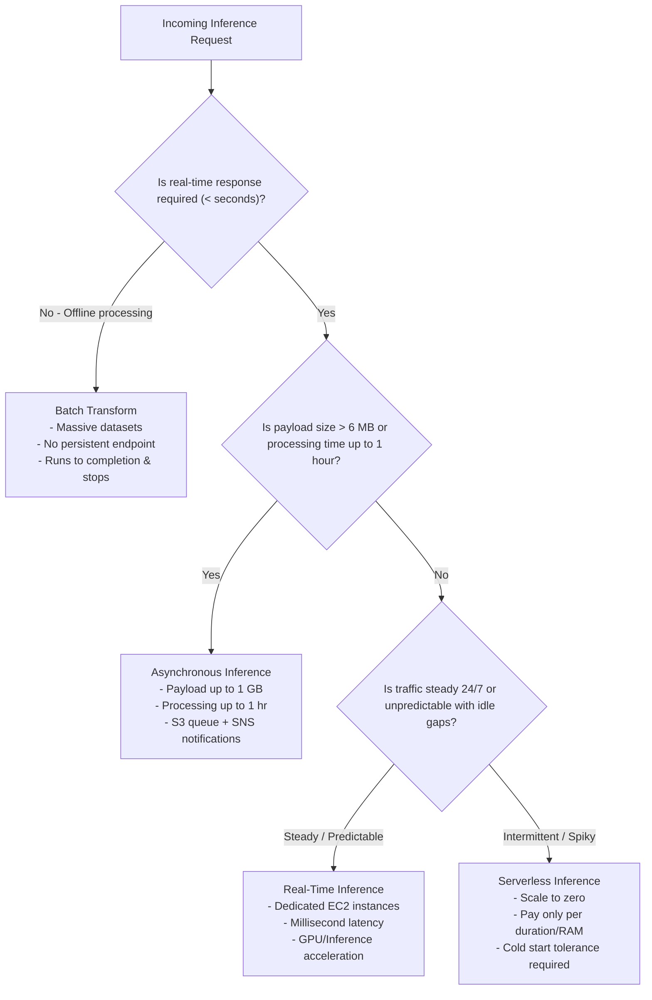

# Distinction Cheat Sheet: Amazon SageMaker Inference Options (Real-Time vs. Serverless vs. Asynchronous vs. Batch Transform)

> **Role:** Master distinction matrix for choosing the right SageMaker inference deployment mode.  
> **Course:** AWS Certified AI Practitioner (AIF-C01)  
> **Tags:** `#exam-prep` `#sagemaker` `#inference` `#cost-optimization` `#aif-c01`

---

## 🎯 The Four Inference Patterns At a Glance

Amazon SageMaker provides four distinct inference options tailored to latency, payload size, traffic predictability, and execution duration.

---

## 🔍 Feature Comparison Matrix

| Feature | Real-Time Inference | Serverless Inference | Asynchronous Inference | Batch Transform |
|---|---|---|---|---|
| **Latency Target** | **Milliseconds** (Immediate sync response) | Sub-second to seconds (subject to **cold starts**) | Minutes to 1 hour (queued asynchronously) | Hours / Days (offline batch jobs) |
| **Payload Size Limit** | Up to **6 MB** | Up to **4 MB** (6 MB API Gateway) | Up to **1 GB** (stored in S3) | **Gigabytes to Terabytes** (S3 datasets) |
| **Processing Duration** | Maximum **60 seconds** | Maximum **60 seconds** | Up to **1 hour (3600s)** | No strict limit (job completes across cluster) |
| **Underlying Compute** | Dedicated EC2 instances (CPU, GPU, AWS Inferentia) | Managed serverless compute (CPU only, up to 6 GB RAM) | Dedicated EC2 instances with **auto-scaling to zero** | Transient managed EC2 cluster (terminates on job finish) |
| **Billing Model** | Pay per instance-hour 24/7 (while active) | Pay strictly per inference duration and memory used | Pay per active instance-hour (scales to 0 when idle) | Pay only for compute time during batch execution |
| **Notification Pattern** | Direct HTTP sync response | Direct HTTP sync response | **Amazon SNS** webhook on completion | S3 output prefix population |
| **Best Used For** | High-traffic web apps, fraud detection, interactive chatbots | Intermittent, dev/test, infrequent internal tools | Large CV models, heavy speech-to-text, large payloads | Nightly billing scoring, bulk historical dataset labeling |

---

## 🎯 Exam Scenario Trigger Matrix

| If the Exam Scenario Mentions... | Correct Choice | Key Reason / Justification |
|---|---|---|
| *"E-commerce checkout fraud detection model requiring synchronous response within 50 milliseconds under high sustained traffic."* | **Real-Time Inference Endpoint** | Guaranteed low-latency dedicated compute with zero cold-start delay. |
| *"Internal HR tool used occasionally during business hours, completely idle nights and weekends; company wants lowest cost."* | **Serverless Inference** | Automatically scales to zero when not in use; no charges during idle hours. |
| *"Medical imaging model analyzing 500 MB high-resolution CT scans that take 15 minutes to process per image."* | **Asynchronous Inference** | Supports payloads up to 1 GB and execution times up to 1 hour via S3 queuing. |
| *"Every Sunday night, the bank must run risk scoring across 50 million customer records stored in S3 and write results back to S3."* | **Batch Transform** | High-throughput offline batch processing across entire datasets without keeping persistent endpoints running. |
| *"Inference requests arrive intermittently, but individual requests take 5 minutes and require notifying a client app upon completion."* | **Asynchronous Inference** | SNS integration delivers webhooks upon completion, while compute scales down to zero when the queue empties. |

---

## ⚠️ Common Traps & Antipatterns

- **Trap:** Selecting Real-Time endpoints for applications with long idle periods where cost must be minimized.  
  *Correction:* Real-time endpoints bill 24/7 as long as the instance runs. Use **Serverless Inference** or **Asynchronous Inference** with scale-to-zero.
- **Trap:** Attempting to send a 50 MB image directly to a Real-Time endpoint.  
  *Correction:* Real-time endpoints have a hard 6 MB payload limit. Use **Asynchronous Inference** (up to 1 GB via S3).
- **Trap:** Confusing Batch Transform with Asynchronous Inference.  
  *Correction:* Batch Transform processes an entire dataset in one scheduled run without creating an endpoint. Asynchronous Inference maintains an API endpoint that ingests individual asynchronous incoming requests into an S3-backed queue.
