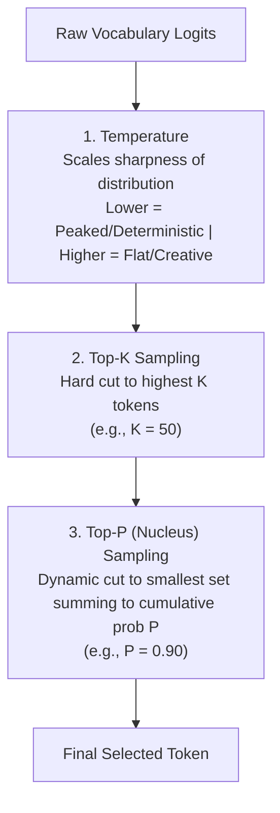

# Distinction Cheat Sheet: LLM Decoding Parameters (Temperature vs. Top-P vs. Top-K)

> **Role:** High-yield reference guide for controlling model randomness, creativity, and determinism.  
> **Course:** AWS Certified AI Practitioner (AIF-C01)  
> **Tags:** `#exam-prep` `#inference-parameters` `#temperature` `#top-p` `#top-k` `#aif-c01`

---

## 🎯 How Decoding Works At a Glance

When an autoregressive LLM generates text, it computes probability scores (logits) across its entire vocabulary for the next token. Decoding parameters govern **how that probability distribution is sampled**.



---

## 🔍 Detailed Parameter Comparison Matrix

| Parameter | Mathematical Mechanism | Value Range | Low Value Impact | High Value Impact | Ideal Use Case |
|---|---|---|---|---|---|
| **Temperature ($T$)** | Divides raw logits prior to Softmax: $P(y_i) = \frac{e^{z_i / T}}{\sum_j e^{z_j / T}}$ | $0.0 \to 1.0$ (or up to $2.0$) | **$0.0 \to 0.2$:** Distribution becomes sharp and peaked. Picks the single highest-probability token (**Greedy Search**). Maximum determinism. | **$0.7 \to 1.0+$:** Flattens distribution, elevating tail tokens. Generates diverse, surprising, and creative outputs (higher hallucination risk). | Low: Fact extraction, SQL/code generation, math.  High: Brainstorming, marketing copy, poetry. |
| **Top-P (Nucleus Sampling)** | Sorts tokens by probability and keeps the smallest dynamic subset whose cumulative sum reaches $P$. | $0.0 \to 1.0$ (typically $0.7 \to 0.95$) | **$0.1 \to 0.5$:** Highly restrictive; only top few candidate tokens are considered. Tight, focused output. | **$0.9 \to 1.0$:** Considers broad vocabulary pool, dynamically expanding when several tokens are equally likely. | Used in tandem with Temperature to dynamically adjust candidate pool width based on context certainty. |
| **Top-K** | Hard cutoff retaining only the fixed $K$ highest-probability tokens; sets probability of all other tokens to zero. | Integer $\ge 1$ (typically $1 \to 250$) | **$K = 1$:** Identical to greedy search (purely deterministic). Low $K$ removes wild hallucinations. | **$K = 100+$:** Allows wider diversity of vocabulary choices. | Filtering out bizarre low-probability tokens without distorting probability ratios of top candidates. |
| **Stop Sequences** | One or more literal text strings that immediately halt token generation. | Array of strings (e.g. `["\n", "User:", "```"]`) | N/A | Halts generation as soon as matched, saving token costs and preventing output run-ons. | Multi-turn dialog turns, stopping code blocks, limiting to single lines. |

---

## 🔬 Temperature vs. Top-P vs. Top-K: The Difference

1. **Top-K is Static:** It always considers exactly $K$ words, regardless of whether the model is 99% certain or completely unsure.
2. **Top-P is Dynamic:** 
   - If the top token has probability $0.92$ and $P=0.90$, **only 1 token is considered**.
   - If 10 tokens each have probability $0.09$, **all 10 tokens are considered**. Top-P adapts dynamically to the model's confidence!
3. **Temperature transforms probabilities:** It does not filter candidate tokens out; it changes their relative weights before sampling.

---

## 🎯 Exam Scenario Trigger Matrix

| If the Exam Scenario Mentions... | Correct Choice | Key Reason / Justification |
|---|---|---|
| *"You need an LLM to generate SQL queries from natural language questions; results must be strictly reproducible, factual, and consistent."* | **Set Temperature = 0.0 (or close to 0.0)** | Eliminates randomness and enforces greedy decoding for deterministic output. |
| *"Creative marketing team wants diverse, varied ad headline variations that don't repeat the same words."* | **Increase Temperature (e.g. 0.8–0.9) and Top-P (e.g. 0.9)** | Flattens distribution and broadens vocabulary diversity to foster creativity. |
| *"You want to ensure the model never selects obscure, nonsensical words from the long tail of the vocabulary, regardless of confidence."* | **Set Top-K (e.g., K = 40 or 50)** | Hard cutoff completely eliminates long-tail junk tokens from sampling. |
| *"You want the model to dynamically expand its choices when multiple words are equally probable, but restrict to 1 choice when certainty is absolute."* | **Adjust Top-P (Nucleus Sampling)** | Top-P adapts dynamically to cumulative confidence curves. |
| *"Chatbot keeps continuing the conversation and inventing the user's responses after answering."* | **Configure Stop Sequences (e.g., `["\nUser:"]`)** | Immediately terminates generation when user prompt delimiter is produced. |

---

## ⚠️ Common Traps & Antipatterns

- **Trap:** Modifying both Temperature and Top-P simultaneously to extreme opposite values.  
  *AWS Best Practice:* Alter **either** Temperature or Top-P first, keeping the other at baseline (e.g. Temperature = 0.7 with Top-P = 1.0, OR Temperature = 1.0 with Top-P = 0.8).
- **Trap:** Thinking Temperature = 0.0 means the model is incapable of hallucination.  
  *Correction:* Temperature = 0.0 guarantees determinism (same prompt produces identical response), but if the model learned false information during training, it will deterministically output that exact hallucination every time.
