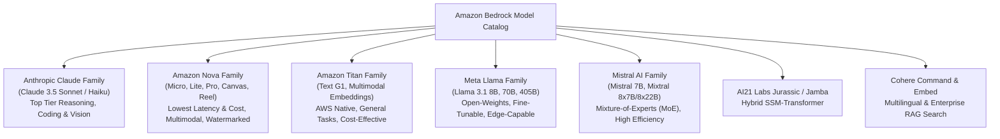
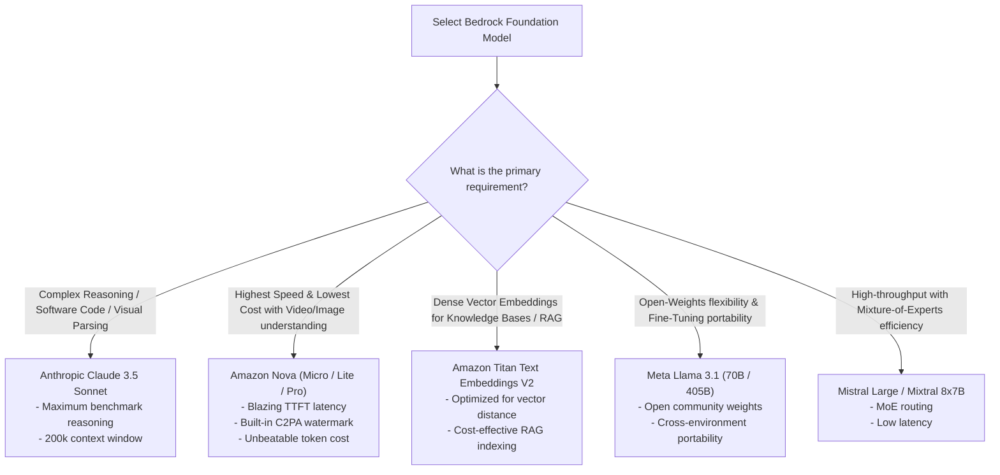

# Distinction Cheat Sheet: Amazon Bedrock Foundation Model Families (Claude vs. Nova vs. Titan vs. Llama vs. Mistral)

> **Role:** Comparative taxonomy of foundation models available on Amazon Bedrock.  
> **Course:** AWS Certified AI Practitioner (AIF-C01)  
> **Tags:** `#exam-prep` `#amazon-bedrock` `#foundation-models` `#claude` `#nova` `#titan` `#aif-c01`

---

## 🎯 Bedrock Model Ecosystem At a Glance

Amazon Bedrock provides a unified serverless API (`InvokeModel` / `Converse`) to access leading proprietary and open-weights foundation model families without managing infrastructure.

---

## 🔍 Model Family Comparison Matrix

| Model Family | Provider | Architecture & Strengths | Modalities | Key Use Cases | Distinguishing Exam Factor |
|---|---|---|---|---|---|
| **Anthropic Claude 3 / 3.5** | Anthropic | Industry-leading multi-step reasoning, advanced Python/software engineering, deep document analysis (200K token window). | Text + Image Vision | Complex analysis, agentic workflows, complex code gen, financial auditing | **Best for complex reasoning, highest benchmark scores, complex coding.** |
| **Amazon Nova** | AWS (Frontier) | Ultra-fast inference, state-of-the-art cost efficiency, multimodal input/output, C2PA digital watermarking. | Text, Image, Video, Audio | High-speed processing, cost-sensitive production apps, studio image/video gen | **AWS-built frontier models (Micro, Lite, Pro, Canvas, Reel) with built-in watermarking.** |
| **Amazon Titan** | AWS | General-purpose enterprise text generation, summarization, and vector embeddings. | Text, Embeddings, Image | Standard enterprise search, generating dense vector embeddings for RAG | **Native AWS models, cost-efficient, core provider for Bedrock Titan Embeddings.** |
| **Meta Llama 3 / 3.1** | Meta | Open-weights, highly customizable, large community support, available in 8B, 70B, and 405B parameters. | Text, Code (Multimodal in 3.2) | Enterprise on-prem/cloud hybrid parity, domain fine-tuning | **Open-source weights champion; fine-tunable on Bedrock and SageMaker.** |
| **Mistral AI** | Mistral AI | Sparse **Mixture-of-Experts (MoE)** architecture; activates subset of parameters per token for blazing speed. | Text, Code | High-throughput parsing, low-latency multilingual apps, cost efficiency | **Pioneer of Mixture of Experts (Mixtral 8x7B); high parameter efficiency.** |
| **Cohere** | Cohere | Tailored for enterprise RAG pipelines, multilingual vector search, and reranking. | Text, Embeddings | RAG chunk retrieval, enterprise search relevance reranking | **Cohere Embed & Rerank are leading choices for high-precision semantic RAG.** |

---

## 🧠 Decision Framework: Which Model to Select?

---

## 🎯 Exam Scenario Trigger Matrix

| If the Exam Scenario Mentions... | Correct Choice | Key Reason / Justification |
|---|---|---|
| *"Application requires extracting structured financial data and complex logic from hundreds of technical PDF charts and code files."* | **Anthropic Claude 3.5 Sonnet** | Recognized as the premier model for deep reasoning, multimodal chart reading, and complex coding. |
| *"Customer wants ultra-low latency, budget-friendly text processing for a massive customer service portal handling millions of requests daily."* | **Amazon Nova Micro / Lite** | Nova Micro is purpose-engineered for sub-second, ultra-cost-efficient text workloads. |
| *"You need to generate dense vector embeddings for company documents to store in OpenSearch Serverless for Bedrock Knowledge Bases."* | **Amazon Titan Text Embeddings V2** | The default, native, and cost-optimized embedding model family on Bedrock. |
| *"Organization has a policy requiring open-weights models that can be fine-tuned on AWS and run on-premises if needed."* | **Meta Llama 3.1** | Open weights permit cross-environment deployment and customization. |
| *"Need to generate promotional studio images and ensure every image contains an invisible, tamper-proof provenance watermark."* | **Amazon Nova Canvas** | Generates photorealistic images with embedded cryptographic C2PA watermarks. |

---

## ⚠️ Common Traps & Antipatterns

- **Trap:** Assuming Bedrock trains proprietary foundation models on customer prompts.  
  *Correction:* Amazon Bedrock guarantees that **zero customer data is used to train base foundation models**, and all prompt/completion data is encrypted in transit and at rest in the customer's AWS account.
- **Trap:** Thinking Claude models can be directly fine-tuned on Bedrock.  
  *Correction:* Fine-tuning on Bedrock is supported for specific model families (such as Amazon Titan, Meta Llama, and Cohere), whereas Claude models are customized primarily via Prompt Engineering and RAG.
