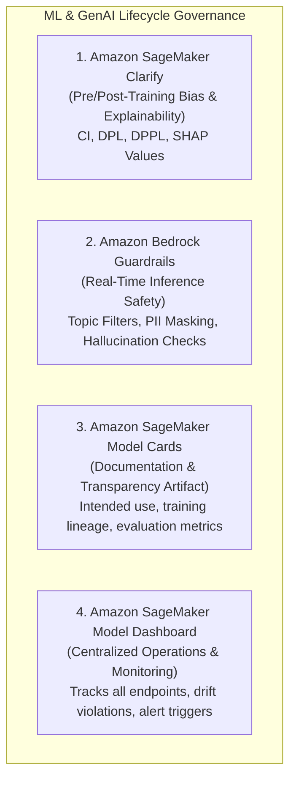

# Distinction Cheat Sheet: Responsible AI & Governance (SageMaker Clarify vs. Bedrock Guardrails vs. Model Cards vs. Model Dashboard)

> **Role:** Master governance and responsible AI distinction matrix for AWS certifications.  
> **Course:** AWS Certified AI Practitioner (AIF-C01)  
> **Tags:** `#exam-prep` `#responsible-ai` `#governance` `#sagemaker-clarify` `#bedrock-guardrails` `#aif-c01`

---

## 🎯 The Four Governance Pillars At a Glance

AWS structures AI Governance, Safety, and Transparency across four specialized services and capabilities covering different stages of the machine learning and generative AI lifecycle.



---

## 🔍 Feature Comparison Matrix

| Governance Dimension | Amazon SageMaker Clarify | Amazon Bedrock Guardrails | SageMaker Model Cards | SageMaker Model Dashboard |
|---|---|---|---|---|
| **Primary Purpose** | **Bias detection** and **model explainability / feature attribution** | **Real-time content moderation, safety filtering, and PII redaction** | Standardized, single-source-of-truth **governance documentation** | Unified **operational monitoring dashboard** for all deployed models |
| **Lifecycle Phase** | Data prep, pre-training, post-training, and endpoint monitoring | Live inference / generation runtime (input prompt & output completion) | Pre-deployment sign-off, compliance auditing, documentation | Production post-deployment operations |
| **Key Metrics / Mechanics** | Class Imbalance (CI), Difference in Positive Proportions (DPPL), Disparate Impact, **SHAP values** | Denied Topics, Content Filters (Hate, Insults, Sexual, Violence), PII filters, **Contextual Grounding Score** | Intended uses, risk ratings, training dataset lineage, evaluation results, approvals | Model Monitor violations, data drift, concept drift, bias drift, endpoint latency |
| **Intervention Type** | Analytical reports (identifies bias, does not block live requests) | **Active blocking or masking** (intervenes in real-time before user sees response) | Informational documentation for compliance & regulators | Operational alerting via Amazon CloudWatch and EventBridge |
| **Applicability** | Tabular ML, NLP, and LLM evaluations via SageMaker / FMEval | Any Amazon Bedrock model, or **any custom model via `ApplyGuardrail` API** | Any SageMaker model or Bedrock foundation model | SageMaker hosted endpoints |

---

## 🧮 Clarify vs. Guardrails: Technical Contrast

```
+-------------------------------------------------------------------+
| Sagemaker Clarify (Analytical Auditing):                          |
|   - Pre-training: Checks if training data favors privileged group |
|   - Post-training: Checks if model predictions show disparate gap |
|   - Explainability: Computes SHAP values (which feature caused y) |
+-------------------------------------------------------------------+
                               VS
+-------------------------------------------------------------------+
| Bedrock Guardrails (Real-Time Runtime Enforcement):               |
|   - Prompt Injection: Blocks jailbreaks ("ignore instructions")   |
|   - Denied Topics: Blocks off-brand advice (e.g. investment tips) |
|   - Sensitive Data: Anonymizes SSNs, credit cards, emails         |
|   - Grounding: Flags outputs not supported by reference context   |
+-------------------------------------------------------------------+
```

---

## 🎯 Exam Scenario Trigger Matrix

| If the Exam Scenario Mentions... | Correct Choice | Key Reason / Justification |
|---|---|---|
| *"Auditing a loan approval model to determine if historical training data unfairly favored one demographic group over another."* | **Amazon SageMaker Clarify** | Specializes in calculating pre-training bias metrics (Class Imbalance, Difference in Proportions). |
| *"Loan applicant was denied credit and legally requests an explanation of which specific features (e.g., income, credit score) led to rejection."* | **Amazon SageMaker Clarify (SHAP Explainability)** | Uses Shapley values to provide feature attribution scores for individual predictions. |
| *"Chatbot application needs to automatically detect and redact Social Security Numbers (SSN) and block prompt injection attacks in real time."* | **Amazon Bedrock Guardrails** | Provides real-time PII redaction and jailbreak protection on both user inputs and model outputs. |
| *"Enterprise risk officers require a standardized compliance document detailing model intended usage, training datasets, limitations, and approvals before production deployment."* | **Amazon SageMaker Model Cards** | Purpose-built artifact for documenting governance metadata and meeting regulatory compliance requirements. |
| *"ML operations team needs a single pane of glass to track model drift, data quality alerts, and endpoint health across 50 production models."* | **Amazon SageMaker Model Dashboard** | Aggregates Model Monitor reports, endpoint status, and drift alerts across all deployed models. |

---

## ⚠️ Common Traps & Antipatterns

- **Trap:** Expecting SageMaker Clarify to intercept and block toxic user prompts in real-time.  
  *Correction:* Clarify is an offline analytical and diagnostic tool. Real-time inference blocking requires **Amazon Bedrock Guardrails**.
- **Trap:** Confusing Model Cards with Model Dashboard.  
  *Memory Hook:* **Model Card** = Birth certificate & passport of a single model (documentation). **Model Dashboard** = Air traffic control room monitoring all active flights (operations).
