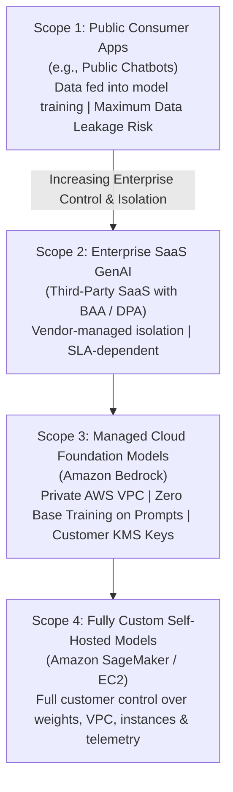

# Distinction Cheat Sheet: Generative AI Security Scopes (Scope 1 vs. Scope 2 vs. Scope 3 vs. Scope 4)

> **Role:** High-yield reference guide for enterprise Generative AI risk and security boundaries.  
> **Course:** AWS Certified AI Practitioner (AIF-C01)  
> **Tags:** `#exam-prep` `#security` `#genai-scopes` `#bedrock` `#sagemaker` `#aif-c01`

---

## 🎯 The Four Generative AI Security Scopes At a Glance

AWS organizes Generative AI enterprise risk and data boundaries into **four distinct operational scopes**, moving from highest risk (public consumer tools) to deepest enterprise control (fully owned, self-hosted infrastructure).

---

## 🔍 Comprehensive Security Scopes Comparison Matrix

| Security Dimension | Scope 1: Consumer Apps | Scope 2: Enterprise SaaS | Scope 3: Managed FM APIs (Amazon Bedrock) | Scope 4: Self-Hosted FMs (Amazon SageMaker / EC2) |
|---|---|---|---|---|
| **Representative Example** | Public free chatbots, web translation portals | Enterprise productivity suites with GenAI add-ons | **Amazon Bedrock** (Converse / InvokeModel) | **Amazon SageMaker JumpStart / HyperPod** |
| **Data Training Risk** | 🚨 **Severe:** Prompts and uploaded documents are frequently stored to train public model iterations. | 🟡 **Low-Moderate:** Covered by enterprise agreements; depends on vendor contract guarantees. | 🟢 **Zero:** **AWS never uses customer prompts or completions to train foundation models.** | 🟢 **Zero:** Infrastructure is completely owned and controlled by customer. |
| **Network Isolation** | Public Internet (no VPC support) | Public SaaS endpoints with optional IP allowlists | **AWS PrivateLink** (VPC Endpoints); zero exposure to the public internet | **Private VPC subnets**, Security Groups, Network ACLs |
| **Encryption & Key Management** | Vendor-managed keys (no customer control) | Vendor-managed; limited BYOK (Bring Your Own Key) | **AWS KMS Customer Managed Keys (CMK)** for prompts, completions, and vector stores | **AWS KMS CMK** for EBS storage, S3 artifacts, and instance volumes |
| **IAM & Governance Access** | Username / Password login | SAML SSO / Okta federation | **AWS IAM** policies, tags, resource-based policies, SCPs, Guardrails | **AWS IAM** role policies, IAM execution roles, VPC endpoints |
| **Operational Overhead** | None | Low (Admin portal configuration) | **Low (Serverless API)**; zero servers or GPUs to manage | **High**; cluster scaling, patching, GPU allocation, health monitoring |

---

## 🛡️ Amazon Bedrock (Scope 3) Enterprise Security Guarantees

When evaluating Scope 3 security questions on the exam, remember AWS's strict Bedrock commitments:
1. **Zero Data Training:** Customer inputs and model outputs are **never** used to train the base foundation models or shared with model providers.
2. **Private Transit:** Requests traverse AWS's secure global backbone. With **AWS PrivateLink (VPC Endpoints)**, traffic never traverses the public internet.
3. **Data Residency:** All data processed by Bedrock remains within the specific AWS Region chosen by the customer.
4. **Data Isolation:** Prompts and completions are isolated per customer account and encrypted in transit (TLS 1.3) and at rest (AWS KMS).

---

## 🎯 Exam Scenario Trigger Matrix

| If the Exam Scenario Mentions... | Correct Choice / Architecture | Key Reason / Justification |
|---|---|---|
| *"Employee pastes proprietary intellectual property into a free online chatbot to format meeting notes."* | **Violates Scope 1 security; poses severe data leakage risk** | Consumer tools routinely retain prompt inputs for retraining. |
| *"Enterprise financial institution must use Claude 3.5 without any possibility of customer banking data leaving their AWS private network."* | **Scope 3: Amazon Bedrock with AWS PrivateLink VPC Endpoints & KMS CMK** | Ensures data stays within AWS VPC, encrypted with customer keys, with zero model training. |
| *"Defense contractor has strict regulatory mandate requiring 100% control over physical server instances, model weights, and custom CUDA kernels."* | **Scope 4: Amazon SageMaker on dedicated accelerated instances in private VPC** | Delivers full infrastructure ownership and deep isolation. |
| *"Company wants to enforce that model output never reaches the client if it contains unauthorized internal credit card data."* | **Amazon Bedrock Guardrails (Sensitive Information Filters)** | Automates real-time PII detection and masking at the managed API layer (Scope 3). |

---

## ⚠️ Common Traps & Antipatterns

- **Trap:** Assuming Amazon Bedrock shares customer prompts with Anthropic, Meta, or Mistral.  
  *Correction:* Third-party model providers on Bedrock **never** receive raw customer prompt data for retention or training; the models are hosted directly in AWS secure infrastructure.
- **Trap:** Believing Scope 4 (SageMaker) is always superior to Scope 3 (Bedrock).  
  *Correction:* Scope 4 incurs massive GPU instance provisioning costs, patch management, and idle overhead. Scope 3 provides identical zero-training data protection with serverless convenience and lower TCO.
