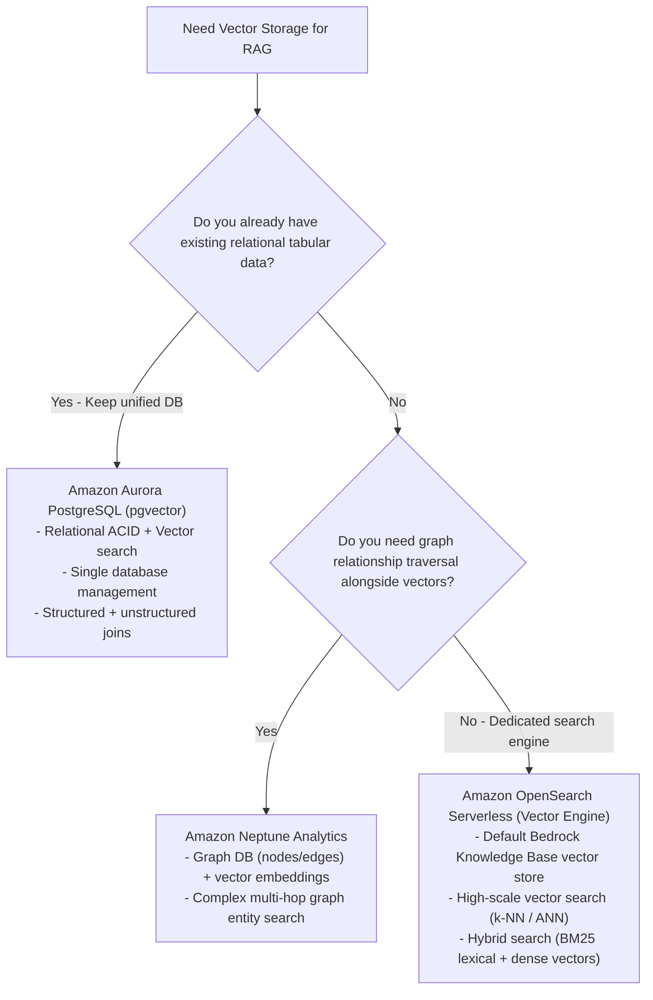

# Distinction Cheat Sheet: AWS Vector Stores & Databases (OpenSearch Serverless vs. Aurora pgvector vs. Neptune Analytics)

> **Role:** High-yield architecture matrix for selecting vector storage in RAG systems.  
> **Course:** AWS Certified AI Practitioner (AIF-C01)  
> **Tags:** `#exam-prep` `#vector-database` `#rag` `#opensearch` `#aurora` `#neptune` `#aif-c01`

---

## 🎯 Vector Database Landscape At a Glance

Retrieval-Augmented Generation (RAG) relies on high-dimensional vector embeddings to perform semantic search. AWS supports vector storage across three distinct database paradigms:

---

## 🔍 Comprehensive Feature Comparison Matrix

| Feature Dimension | Amazon OpenSearch Serverless (Vector Engine) | Amazon Aurora PostgreSQL (`pgvector`) | Amazon Neptune Analytics |
|---|---|---|---|
| **Underlying Engine** | Dedicated distributed search engine (OpenSearch) | Enterprise relational SQL engine (PostgreSQL compatible) | In-memory graph analytics engine (Property Graph / RDF) |
| **Primary Vector Indexing** | Hierarchical Navigable Small World (**HNSW**) & Inverted File (**IVF**) | **HNSW** and **IVFFlat** | Vector index embedded into graph topology |
| **Search Capabilities** | **Hybrid Search:** Combines dense semantic vector search with keyword lexical search (**BM25**) | SQL `SELECT` queries combining vector distance (`<->`, `<=>`) with relational `WHERE` clauses | Graph traversals (e.g. shortest path, community detection) combined with vector similarity |
| **Infrastructure Management** | **Serverless** (auto-scales compute units OCUs); zero cluster administration | Managed database cluster (Serverless v2 or provisioned instances) | Managed graph analytics engine |
| **Native Bedrock Integration** | **Default automated choice** in Amazon Bedrock Knowledge Bases console | Supported vector store in Bedrock Knowledge Bases | Supported vector store in Bedrock Knowledge Bases |
| **Best Used For** | Pure RAG retrieval, massive document corpus search, semantic text search | Applications with existing Aurora databases wishing to avoid managing an extra database | Fraud detection rings, knowledge graph RAG, supply chain relationship reasoning |

---

## 🧮 Vector Distance Metrics: The Math

All vector databases compute similarity using distance metrics in $N$-dimensional space:
1. **Cosine Similarity / Distance:** Measures the angle between two normalized vectors:
   $$\text{Cosine Similarity} = \frac{A \cdot B}{\|A\| \|B\|}$$
   *Best for text embeddings where magnitude varies with sentence length.*
2. **Euclidean Distance ($L2$):** Measures straight-line geometric distance between two points:
   $$d(A, B) = \sqrt{\sum_{i=1}^n (A_i - B_i)^2}$$
3. **Dot Product (Inner Product):** Fastest computation when vectors are strictly unit-normalized ($\|A\| = 1$).

---

## 🎯 Exam Scenario Trigger Matrix

| If the Exam Scenario Mentions... | Correct Choice | Key Reason / Justification |
|---|---|---|
| *"Simplest, default serverless vector store automatically provisioned when creating a Bedrock Knowledge Base."* | **Amazon OpenSearch Serverless (Vector Engine)** | Native, automated default option within the Bedrock Knowledge Bases workflow. |
| *"Company already runs a massive e-commerce relational database on Aurora PostgreSQL and wants to add semantic product search without deploying a new database."* | **Amazon Aurora PostgreSQL with the `pgvector` extension** | Combines transactional SQL operations with vector queries in a single database. |
| *"You need to perform Hybrid Search combining BM25 keyword matching with dense semantic vector retrieval."* | **Amazon OpenSearch Serverless** | OpenSearch natively merges lexical inverted indices (BM25) with dense vector k-NN indices. |
| *"Need to analyze intricate multi-hop relationships between fraud rings, entities, and transactions alongside vector embeddings."* | **Amazon Neptune Analytics** | Specialized graph database engine engineered for high-performance relationship traversal combined with vector search. |

---

## ⚠️ Common Traps & Antipatterns

- **Trap:** Thinking Amazon S3 by itself can act as a vector database.  
  *Correction:* S3 stores raw source files (PDFs, Markdown, audio). An actual vector database (OpenSearch Serverless, Aurora pgvector, or Pinecone) is required to index and query vector embeddings.
- **Trap:** Assuming Aurora requires a complete database overhaul to support vectors.  
  *Correction:* Simply running `CREATE EXTENSION vector;` on an existing Aurora PostgreSQL database enables the `pgvector` extension immediately.
