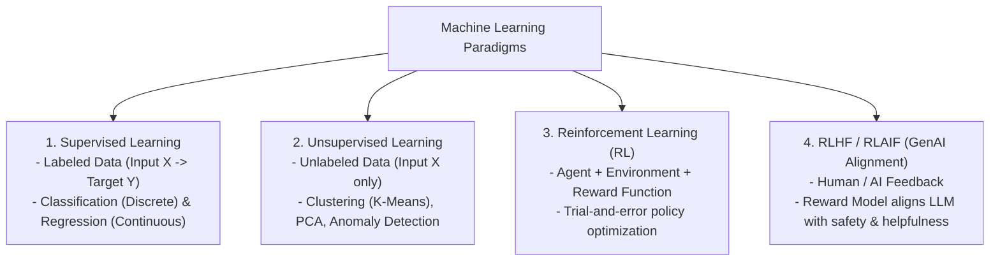

# Distinction Cheat Sheet: Machine Learning Paradigms (Supervised vs. Unsupervised vs. Reinforcement Learning vs. RLHF)

> **Role:** Foundational taxonomy and distinction guide across core machine learning paradigms.  
> **Course:** AWS Certified AI Practitioner (AIF-C01)  
> **Tags:** `#exam-prep` `#ml-fundamentals` `#supervised` `#unsupervised` `#rlhf` `#aif-c01`

---

## 🎯 The ML Paradigms At a Glance

Every AI/ML model operates under one of three primary learning paradigms (or their modern Generative AI hybrid: RLHF/RLAIF).



---

## 🔍 Comprehensive Paradigm Comparison Matrix

| Learning Paradigm | Training Data Nature | Objective / Task | Key Algorithms | AWS Service / Capability |
|---|---|---|---|---|
| **Supervised Learning** | **Labeled Data:** Pairs of $(X, y)$ where true ground truth label $y$ is explicitly provided. | Learn mapping function f(X) ≈ y to predict labels on unseen data. | - **Classification:** Logistic Regression, Random Forest, XGBoost  - **Regression:** Linear Regression, Ridge, Neural Networks | **Amazon SageMaker Autopilot**, SageMaker Built-in Algorithms (XGBoost, Linear Learner) |
| **Unsupervised Learning** | **Unlabeled Data:** Only features $X$ are provided without ground truth outcomes. | Discover hidden patterns, latent structures, groupings, or reduce dimensionality. | - **Clustering:** K-Means  - **Dimensionality Reduction:** PCA, t-SNE  - **Anomaly Detection:** Random Cut Forest (RCF) | SageMaker K-Means, SageMaker Random Cut Forest, Bedrock Embeddings |
| **Reinforcement Learning (RL)** | **Environment State & Reward:** No static dataset; agent interacts via actions and receives scalar rewards ($+1, -1$). | Learn an optimal policy π(s) that maximizes cumulative expected future reward. | Q-Learning, Deep Q-Networks (DQN), Proximal Policy Optimization (PPO) | **AWS DeepRacer**, SageMaker RL (Ray / RLlib) |
| **RLHF / RLAIF** *(Human / AI Feedback)* | Triplet comparisons of model outputs (e.g., Output A preferred over Output B). | Align foundation model behavior to be **Helpful, Honest, and Harmless (3 Hs)**. | Reward Model training, PPO, Direct Preference Optimization (DPO) | **Amazon SageMaker Ground Truth** (Human review for RLHF), Bedrock Custom Models |

---

## 🧮 Classification vs. Regression vs. Clustering

```
+-------------------------------------------------------------------------+
| Supervised -> Classification:                                           |
|   Target is DISCRETE category / class.                                  |
|   Examples: Spam vs Not Spam, Churn vs Retain, Benign vs Malignant.      |
+-------------------------------------------------------------------------+
| Supervised -> Regression:                                               |
|   Target is CONTINUOUS numerical quantity.                              |
|   Examples: House price ($450,000), Stock price, Temperature.           |
+-------------------------------------------------------------------------+
| Unsupervised -> Clustering:                                             |
|   No target provided; algorithm groups similar records automatically.   |
|   Examples: Customer market segmentation, topic grouping.               |
+-------------------------------------------------------------------------+
```

---

## 🎯 Exam Scenario Trigger Matrix

| If the Exam Scenario Mentions... | Correct Paradigm | Key Reason / Justification |
|---|---|---|
| *"Predicting the exact sale price of a used car given mileage, year, engine size, and historical prices."* | **Supervised Learning: Regression** | Target variable is continuous and historical training labels exist. |
| *"Detecting whether an incoming email is fraudulent phishing or legitimate business communication."* | **Supervised Learning: Classification** | Target variable is a discrete category (Phishing vs Legitimate). |
| *"Retailer wants to segment 10 million customer shopping histories into distinct buyer personas without predefined labels."* | **Unsupervised Learning: Clustering (K-Means)** | No target labels exist; model discovers natural customer groupings. |
| *"Autonomous robot learning optimal path navigation through obstacle courses via trial-and-error penalty signals."* | **Reinforcement Learning (RL)** | Agent acts in an environment receiving rewards/penalties to optimize policy. |
| *"Fine-tuning a base foundation model to eliminate toxic responses and improve conversational helpfulness based on human preference rankings."* | **RLHF (Reinforcement Learning from Human Feedback)** | Uses human preference rankings to train a reward model and guide generation. |

---

## ⚠️ Common Traps & Antipatterns

- **Trap:** Confusing Regression with Classification.  
  *Rule of Thumb:* If the output is a **number** on a continuous scale (e.g. dollars, degrees, kilograms), it is **Regression**. If the output is a **bucket or label** (e.g. true/false, cat/dog/bird), it is **Classification**.
- **Trap:** Assuming clustering requires labeled training examples.  
  *Correction:* Clustering is strictly **unsupervised**; providing labels converts the problem into classification.
