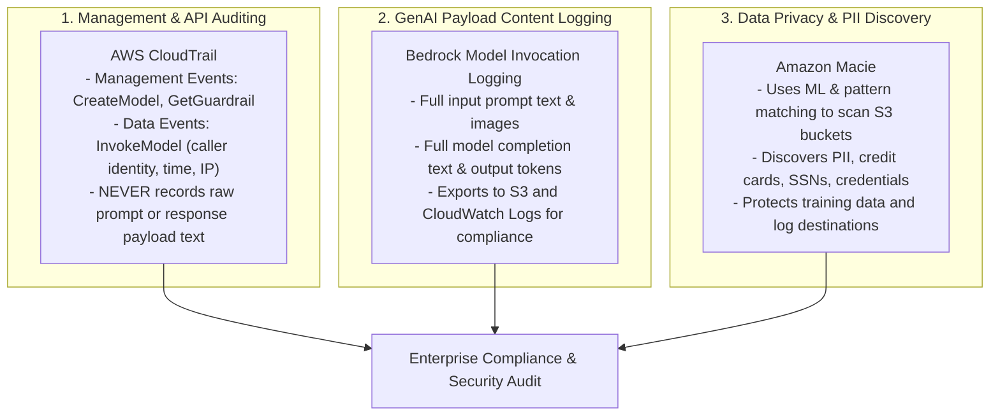

# Distinction Cheat Sheet: AI Auditing & Compliance Trio (CloudTrail Data Events vs. Bedrock Model Invocation Logging vs. Amazon Macie)

> **Role:** High-yield distinction guide for security, data privacy, and auditing in AWS AI architectures.  
> **Course:** AWS Certified AI Practitioner (AIF-C01)  
> **Tags:** `#exam-prep` `#security` `#compliance` `#cloudtrail` `#macie` `#bedrock-logging` `#aif-c01`

---

## 🎯 The AI Auditing Trio At a Glance

Auditing Generative AI workloads requires tracking three completely different operational layers: **API control plane access, raw prompt/response payload contents, and sensitive PII discovery**.



---

## 🔍 Detailed Comparison Matrix

| Dimension | AWS CloudTrail (Data Events) | Bedrock Model Invocation Logging | Amazon Macie |
|---|---|---|---|
| **What It Audits** | **Who** called the API, **when**, from **what IP**, and using **which IAM role** | **What** was actually said: raw **prompt input text** and **model output text** | **Sensitive data & PII** residing in Amazon S3 storage buckets |
| **Payload Visibility** | ❌ **Zero payload text.** Only logs metadata (model ID, timestamps, ARN, status). | ✅ **Full payload content.** Stores full prompt, generated text, image bytes, token counts. | 🔍 **Content inspector.** Scans raw objects in S3 to find and classify PII. |
| **Default State** | Management events ON; **Data events OFF by default** (must enable explicitly for cost control). | **Disabled by default** (must be enabled explicitly in Bedrock Settings). | **Disabled by default** (must be enabled in Macie console). |
| **Destination** | CloudTrail event history, S3 buckets, CloudWatch Logs | Amazon S3 bucket and/or Amazon CloudWatch Logs group | Amazon Macie console, findings published to Security Hub & EventBridge |
| **Encryption Support** | AWS KMS Customer Managed Keys (CMK) | **Mandatory:** S3 bucket / CloudWatch must have KMS encryption configured | AWS KMS CMK |
| **Primary Exam Scenario** | Auditing IAM user actions, investigating API call spikes, incident response attribution | Regulatory review of exact AI conversations, hallucination troubleshooting, legal recordkeeping | Preventing data leaks before training, discovering exposed PII in S3 datasets |

---

## 🔬 CloudTrail vs. Model Invocation Logging: Critical Distinction

```
+---------------------------------------------------------------------------------------+
| CloudTrail Data Event for InvokeModel:                                                |
|   {                                                                                   |
|     "eventName": "InvokeModel",                                                       |
|     "userIdentity": { "arn": "arn:aws:iam::123456789012:user/Alice" },                |
|     "sourceIPAddress": "198.51.100.25",                                               |
|     "requestParameters": { "modelId": "anthropic.claude-3-5-sonnet-20241022-v2:0" }  |
|     <-- NOTE: PROMPT TEXT AND MODEL OUTPUT ARE COMPLETELY ABSENT -->                  |
|   }                                                                                   |
+---------------------------------------------------------------------------------------+
                                        VS
+---------------------------------------------------------------------------------------+
| Bedrock Model Invocation Log:                                                         |
|   {                                                                                   |
|     "input": { "inputBodyJson": { "prompt": "What is company EBITDA for 2024?" } },   |
|     "output": { "outputBodyJson": { "completion": "The EBITDA was $42M..." } },       |
|     "inputTokenCount": 12,                                                            |
|     "outputTokenCount": 24                                                            |
|   }                                                                                   |
+---------------------------------------------------------------------------------------+
```

---

## 🎯 Exam Scenario Trigger Matrix

| If the Exam Scenario Mentions... | Correct Choice | Key Reason / Justification |
|---|---|---|
| *"Security officer needs to know which IAM user made an API call to invoke a foundation model at 3:00 AM."* | **AWS CloudTrail (Data Events for Bedrock)** | Captures user identity, timestamp, source IP, and IAM ARN for every API invocation. |
| *"Legal department mandates that the company must archive every single user prompt and AI-generated response for 7 years."* | **Amazon Bedrock Model Invocation Logging to an Amazon S3 bucket** | Sole mechanism that captures full prompt and completion text payloads. |
| *"Organization wants to scan thousands of PDF documents stored in an S3 bucket to verify no unmasked PII exists before indexing into a RAG knowledge base."* | **Amazon Macie** | Automated data security service using ML to discover and classify sensitive data in S3. |
| *"Investigating why a Bedrock model produced an inaccurate or toxic response to a customer prompt."* | **Bedrock Model Invocation Logging** | Enables developers to inspect the exact input context, parameters, and generated text. |
| *"Finding out who deleted a Bedrock custom model or modified a Guardrail configuration."* | **AWS CloudTrail (Management Events)** | Tracks management API calls (`DeleteCustomModel`, `UpdateGuardrail`) by default. |

---

## ⚠️ Common Traps & Antipatterns

- **Trap:** Assuming CloudTrail records the prompt text sent to an LLM.  
  *Correction:* CloudTrail **never** captures the request or response bodies of `InvokeModel`. Only **Bedrock Model Invocation Logging** captures the actual payload.
- **Trap:** Believing Model Invocation Logging is enabled automatically.  
  *Correction:* It is disabled by default to protect privacy and storage costs. An administrator must explicitly configure it in the Bedrock console and designate an encrypted S3 bucket or CloudWatch log group.
