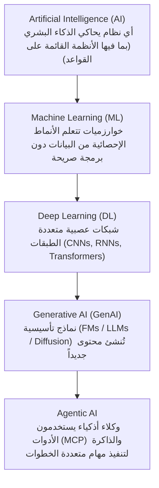

# 00 — الأساسيات التقنية للذكاء الاصطناعي وتعلم الآلة (`Prerequisites`)

> **الهدف من هذا الفصل:** بناء أساس هندسي واضح لفهم الهرمية بين `AI` و `ML` و `Deep Learning` و `GenAI` و `Agentic AI` قبل الدخول في تفاصيل خدمات `AWS`.

---

## 1. الهرمية التقنية للذكاء الاصطناعي

- **Artificial Intelligence (`AI`):** المظلة الكبرى التي تشمل كل تقنية تمكّن الآلات من محاكاة القدرات الإدراكية البشرية.
- **Machine Learning (`ML`):** فرع من `AI` يعتمد على تدريب نماذج إحصائية (`Models`) على بيانات تاريخية لاستخلاص أنماط وتوليد تنبؤات (`Predictions`).
- **Deep Learning (`DL`):** فرع من `ML` يستخدم شبكات عصبية عميقة (`Neural Networks`) تتفوق في البيانات غير المهيكلة مثل الصور والصوت والنصوص.
- **Generative AI (`GenAI`):** نماذج تعلم عميق ضخمة (`Foundation Models`) مدرَّبة على كميات هائلة من البيانات لتوليد نصوص، أكواد، صور، صوت، وفيديو جديد.
- **Agentic AI:** الجيل الأحدث حيث يصبح النموذج التأسيسي «عقل» وكيل مستقل يخطط، يتذكر، ويتفاعل مع الأنظمة الخارجية عبر بروتوكولات معيارية مثل **`Model Context Protocol (MCP)`**.

---

## 2. كيف تتعلم الآلة؟ (أنماط التعلم الثلاثة + التعلم الذاتي)

| نمط التعلم | نوع البيانات | الهدف الأساسي | أمثلة عملية |
| :--- | :--- | :--- | :--- |
| **Supervised Learning** (التعلم الخاضع للإشراف) | بيانات مُصنّفة (`Labeled Data`) | التنبؤ بقيمة أو فئة معروفة مسبقاً | **Classification** (كشف الاحتيال، تصنيف البريد المزعج) • **Regression** (توقع أسعار العقارات) |
| **Unsupervised Learning** (التعلم غير الخاضع للإشراف) | بيانات غير مُصنّفة (`Unlabeled Data`) | اكتشاف أنماط وتجمعات خفية | **Clustering** (`k-means` لتقسيم العملاء) • **Anomaly Detection** • **Dimensionality Reduction** (`PCA`) |
| **Reinforcement Learning (`RL`)** (التعلم المعزز) | تفاعل مع بيئة (`Environment`) | تعظيم المكافآت التراكمية (`Rewards`) وتجنب العقوبات | الروبوتات، الألعاب، وتحسين نماذج اللغة عبر **`RLHF`** |
| **Self-Supervised Learning** | نصوص خام غير مُصنّفة | توليد إشارات التدريب تلقائياً (توقع الكلمة التالية) | التدريب الأولي (`Pre-training`) للنماذج اللغوية الضخمة (`LLMs`) |

---

## 3. البيانات وأنواعها في نماذج الذكاء الاصطناعي
- **Structured Data (بيانات مهيكلة):** جداول ذات صفوف وأعمدة ثابتة (`Tabular`، قواعد بيانات `SQL`) — غالباً ما تتفوق فيها خوارزميات `Traditional ML` مثل `XGBoost`.
- **Unstructured Data (بيانات غير مهيكلة):** نصوص حرة، صور، ملفات `PDF`، مقاطع صوت وفيديو — مجال التفوق الأساسي للتعلم العميق والنماذج التأسيسية (`FMs`).
- **Time-Series Data (سلاسل زمنية):** قياسات مرتبة زمنياً مثل المبيعات اليومية أو قراءات حساسات `IoT` (تُستخدم في التنبؤ `Forecasting`).

---

## 4. مفاهيم أساسية قبل الاختبار: `Training` مقابل `Inferencing`
- **Training (التدريب):** مرحلة تعليم النموذج وضبط أوزانه الداخلية (`Weights / Parameters`) باستخدام بيانات التدريب (مكلفة حسابياً وتحتاج `GPUs` أو رقائق `AWS Trainium`).
- **Inferencing (الاستدلال):** مرحلة استخدام النموذج المدرَّب لإنتاج تنبؤات أو إجابات على بيانات جديدة في بيئة الإنتاج (تعمل على `CPU`/`GPU` أو رقائق `AWS Inferentia` أو عبر `Amazon Bedrock` API).

**الخطوة التالية:** [01_Domain_1_Fundamentals_of_AI_and_ML.md](./01_Domain_1_Fundamentals_of_AI_and_ML.md)

