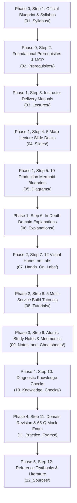

# 🤖 AWS Certified AI Practitioner (AIF-C01) Master Course Portal

> **Domain / Track:** AI / Practitioner  
> **Exam Code:** `AIF-C01` (AWS Certified AI Practitioner)  
> **Course Author & Lead Trainer:** Mohamed Fakhruldeen  
> **Repository Path:** `AI/Practitioner/AIF-C01/`  
> **Official Exam Guide Baseline:** Version 1.2 (October 2026 - incorporating Agentic AI, MCP, Nova, and Ordering/Matching question types)  
> **Status:** 100% Self-Sufficient Enterprise Curriculum  
>
> 🚀 **New to AIF-C01? Start Here:** [**Student Study Dashboard & Fast-Track Plan**](./00_START_HERE.md)

---

## 🎯 Learning Architecture: 10 Comprehensive Curriculum Layers



---

## 📁 Master Directory Structure (Study Roadmap)

```text
AI/Practitioner/AIF-C01/
├── README.md                                             <-- Master Course Portal (This File)
│
├── 01_Syllabus/                              <-- Official Blueprint & Course Syllabus
│   ├── AIF-C01_Course_Syllabus.md                        (Pedagogical outline & timeline)
│   └── AIF-C01_Exam_Guide_and_Blueprint.md               (Official v1.2 Exam Guide & Domains)
│
├── 02_Prerequisites/                         <-- Machine Learning & Data Science Foundations
│   ├── README.md                                         (Prerequisites master index)
│   ├── 01_Machine_Learning_Fundamentals.md               (Supervised/Unsupervised, Metrics, Overfitting)
│   ├── 02_Generative_AI_and_Transformers.md              (Attention, Tokens, Context Windows, Embeddings)
│   └── 03_Agentic_AI_Multi_Agent_Systems_and_Model_Context_Protocol_MCP.md (Agents & MCP)
│
├── 03_Lectures/                              <-- Instructor Delivery Manuals & Talking Points
│   ├── README.md                                         (Classroom delivery syllabus)
│   ├── Lecture_01_AI_ML_Fundamentals_and_AWS_Ecosystem.md (Domain 1)
│   ├── Lecture_02_Generative_AI_and_Amazon_Bedrock.md    (Domain 2)
│   ├── Lecture_03_Prompt_Engineering_and_RAG_Architecture.md (Domain 3)
│   ├── Lecture_04_Responsible_AI_and_Model_Governance.md (Domain 4)
│   └── Lecture_05_Security_Compliance_and_Governance_for_AI.md (Domain 5)
│
├── 04_Slides/                                <-- Student Presentation Slide Decks (Marp Format)
│   ├── README.md                                         (Slide presentation & rendering instructions)
│   ├── Module_01_AI_and_GenAI_Foundations_Slides.md     (Domain 1)
│   ├── Module_02_Amazon_Bedrock_and_RAG_Slides.md        (Domain 2)
│   ├── Module_03_Applications_of_FMs_RAG_and_Agents_Slides.md (Domain 3)
│   ├── Module_04_Responsible_Transparent_and_Explainable_AI_Slides.md (Domain 4)
│   └── Module_05_Security_Compliance_and_Governance_Slides.md (Domain 5)
│
├── 05_Diagrams/                              <-- 10 Standalone Production Mermaid Blueprints
│   ├── README.md                                         (Master visual blueprints catalog)
│   ├── Diagram_01_Traditional_ML_vs_GenAI_Lifecycle.md
│   ├── Diagram_02_Transformer_Architecture_and_Tokenization.md
│   ├── Diagram_03_Amazon_Bedrock_Serverless_Topology_and_Nova_Models.md
│   ├── Diagram_04_Enterprise_RAG_Ingestion_and_Retrieval_Flow.md
│   ├── Diagram_05_Agentic_AI_Workflow_and_Model_Context_Protocol_MCP.md
│   ├── Diagram_06_Model_Customization_Spectrum_Prompt_to_Pretraining.md
│   ├── Diagram_07_Bedrock_Guardrails_Multi_Layered_Perimeter.md
│   ├── Diagram_08_SageMaker_AI_Ecosystem_Canvas_JumpStart_Clarify.md
│   ├── Diagram_09_Generative_AI_Security_Scoping_Matrix.md
│   └── Diagram_10_Enterprise_AI_Security_KMS_and_Audit_Loop.md
│
├── 06_Explanations/                          <-- Comprehensive Domain Deep-Dives
│   ├── README.md                                         (Master domain overview & weighting)
│   ├── 01_Domain_1_Fundamentals_of_AI_and_ML.md          (20% Weight)
│   ├── 02_Domain_2_Fundamentals_of_Generative_AI.md      (24% Weight - Nova & MCP)
│   ├── 03_Domain_3_Applications_of_Foundation_Models.md  (28% Weight - RAG & LoRA)
│   ├── 04_Domain_4_Guidelines_for_Responsible_AI.md      (14% Weight - Clarify & Guardrails)
│   └── 05_Domain_5_Security_Compliance_and_Governance.md (14% Weight - Scoping Matrix)
│
├── 07_Hands_On_Labs/                                  <-- 12 Hands-On Visual Student Labs
│   ├── README.md                                         (Master labs catalog & cost safeguards)
│   ├── BROWSER_AGENT_CAPTURE_PROMPT.md                   (Automated visual screenshot capture runbook)
│   ├── images/                                           (Console screenshots repository)
│   ├── Lab_01_Amazon_Bedrock_Model_Access_Playgrounds_and_Prompt_Engineering.md
│   ├── Lab_02_Multi_Modal_Generation_with_Amazon_Nova_and_Titan_Image.md
│   ├── Lab_03_Enterprise_RAG_with_Bedrock_Knowledge_Bases_and_OpenSearch_Serverless.md
│   ├── Lab_04_Autonomous_AI_Agents_with_Bedrock_AgentCore_Action_Groups_and_MCP.md
│   ├── Lab_05_Responsible_AI_and_PII_Masking_with_Amazon_Bedrock_Guardrails.md
│   ├── Lab_06_No_Code_Predictive_ML_with_Amazon_SageMaker_Canvas.md
│   ├── Lab_07_Data_Preparation_and_Feature_Engineering_with_SageMaker_Data_Wrangler.md
│   ├── Lab_08_Pre_Trained_Foundation_Model_Deployment_with_SageMaker_JumpStart.md
│   ├── Lab_09_Model_Fairness_Bias_Detection_and_SHAP_Explainability_with_SageMaker_Clarify.md
│   ├── Lab_10_Model_Governance_Lineage_Tracking_and_Auditing_with_SageMaker_Model_Cards.md
│   ├── Lab_11_Applied_Document_Intelligence_with_Amazon_Textract_Comprehend_and_Bedrock.md
│   └── Lab_12_Generative_AI_FinOps_Token_Pricing_Quotas_and_Provisioned_Throughput.md
│
├── 08_Tutorials/                             <-- 5 Multi-Service Architectural Build Tutorials
│   ├── README.md                                         (Master build tutorials index)
│   ├── Tutorial_01_Enterprise_RAG_Knowledge_Base_Architecture.md
│   ├── Tutorial_02_Multi_Agent_Autonomous_System_with_Bedrock_AgentCore_and_MCP.md
│   ├── Tutorial_03_Automated_Document_Intelligence_Pipeline.md
│   ├── Tutorial_04_Enterprise_Responsible_AI_and_PII_Governance_Pipeline.md
│   └── Tutorial_05_Complete_Machine_Learning_Lifecycle_with_SageMaker_AI.md
│
├── 09_Notes_and_Cheatsheets/                                 <-- Atomic Study Notes & Exam Cheat Sheets
│   ├── Exam_Decryption_Playbook_and_Mnemonics.md         (Decryption patterns, memory hooks, traps)
│   ├── 01_GenAI_Fundamentals.md                          (Core foundation model concepts)
│   ├── 02_Prompt_Engineering_Guide.md                    (Few-shot, CoT, prompt caching)
│   ├── 03_Amazon_Bedrock_and_RAG.md                      (Knowledge bases & vector search)
│   ├── 04_Amazon_SageMaker_Suite.md                      (Canvas, JumpStart, Clarify, Data Wrangler)
│   ├── 05_Responsible_AI_and_Governance.md               (Fairness, model cards, guardrails)
│   └── 06_AIF-C01_Exam_CheatSheet.md                     (High-yield memory retention tables)
│
├── 10_Knowledge_Checks/                      <-- Modular Diagnostic Retention Quizzes
│   ├── README.md                                         (Quizzes master catalog)
│   ├── Module_01_AI_Foundations_Knowledge_Check.md       (10 Questions + Key)
│   ├── Module_02_Generative_AI_and_Nova_Knowledge_Check.md (10 Questions + Key)
│   ├── Module_03_Applications_of_FMs_and_RAG_Knowledge_Check.md (10 Questions + Key)
│   ├── Module_04_Responsible_AI_Knowledge_Check.md       (10 Questions + Key)
│   └── Module_05_Security_Compliance_and_Governance_Knowledge_Check.md (10 Questions + Key)
│
├── 11_Practice_Exams/                    <-- Revision Questions & Full Mock Exam
│   ├── README.md                                         (Revision suite index)
│   ├── Domain_1_AI_ML_Fundamentals_Revision.md           (15 Questions)
│   ├── Domain_2_Generative_AI_Fundamentals_Revision.md   (15 Questions)
│   ├── Domain_3_Applications_of_Foundation_Models_Revision.md (15 Questions)
│   ├── Domain_4_Responsible_AI_Guidelines_Revision.md    (15 Questions)
│   ├── Domain_5_Security_Compliance_Governance_Revision.md (15 Questions)
│   └── AIF_C01_Full_Length_Mock_Exam.md                  (Official 65-Question Timed Simulation)
│
└── 12_Sources/                               <-- Deep-Dive Reference Textbooks (Offline Literature)
    ├── README.md                                         (Literature citation index & reading guides)
    └── [Authoritative EPUBs & PDFs]                      (Wiley, O'Reilly, Official Guide)
```

---

## 🗺️ Official Exam Blueprint Breakdown (v1.2 - October 2026)

| Domain | Exam Domain Title | Weight | Scored Items |
| :---: | :--- | :---: | :---: |
| **Domain 1** | **Fundamentals of AI and Machine Learning** | **20%** | ~10 Questions |
| **Domain 2** | **Fundamentals of Generative AI** | **24%** | ~12 Questions |
| **Domain 3** | **Applications of Foundation Models** | **28%** | ~14 Questions |
| **Domain 4** | **Guidelines for Responsible AI** | **14%** | ~7 Questions |
| **Domain 5** | **Security, Compliance, and Governance for AI Solutions** | **14%** | ~7 Questions |
| **Total** | **All 5 Domains (Scaled Score: 100 - 1000, Passing: 700)** | **100%** | **50 Scored + 15 Unscored = 65 Total** |
