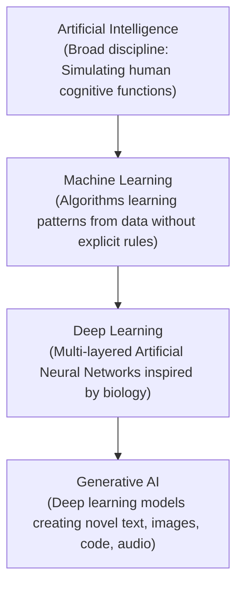
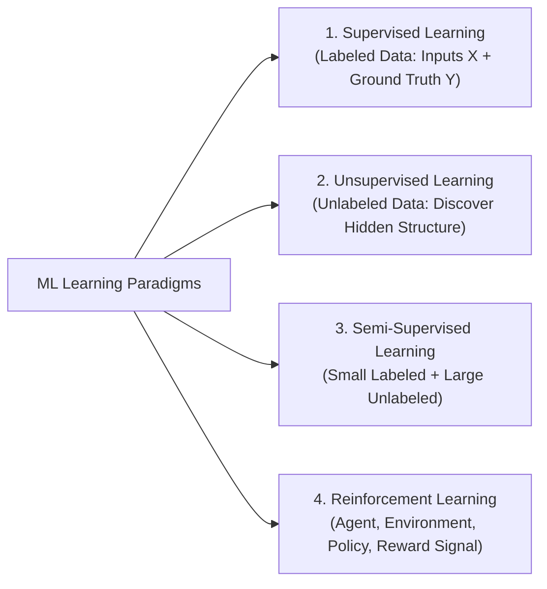
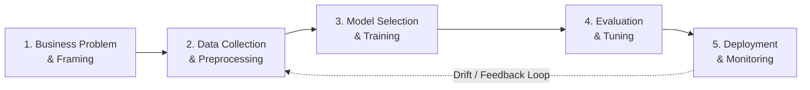
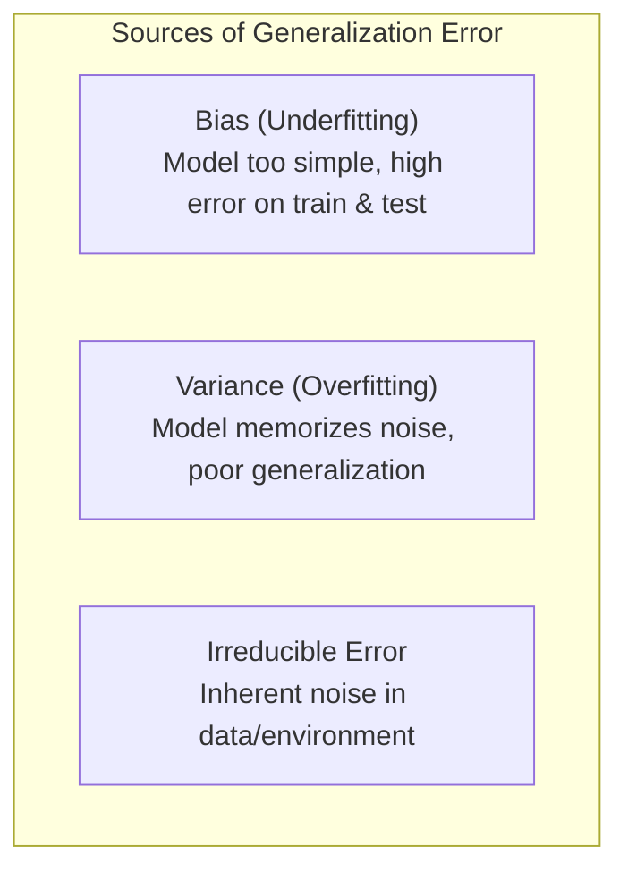
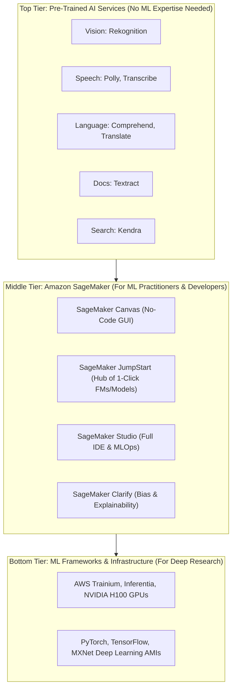

# Domain 1: Fundamentals of AI and Machine Learning

> **Weight:** 20% of Scored Exam Content  
> **Course:** AWS Certified AI Practitioner (`AIF-C01`)  
> **Exam Guide Baseline:** v1.2 (October 2026)  
> **Index:** `AI/Practitioner/AIF-C01/explanations/01_Domain_1_Fundamentals_of_AI_and_ML.md`

---

## 🧭 Domain Overview

Domain 1 tests foundational understanding of core artificial intelligence (AI), machine learning (ML), and deep learning (DL) paradigms, their distinctions, mathematical problem formulations, the end-to-end ML lifecycle, evaluation metrics, and the native AWS service catalog for predictive AI.

---

## 🎯 Task Statement 1.1: Explain basic AI and ML concepts and terminologies

### 1. The Core Taxonomy
* **Artificial Intelligence (AI):** The overarching field of computer science dedicated to building machines capable of performing tasks requiring human intelligence (reasoning, problem-solving, perception, language).
* **Machine Learning (ML):** A subfield of AI focused on developing statistical algorithms that improve performance on a specific task through empirical data rather than rule-based programming.
* **Deep Learning (DL):** A subfield of ML utilizing Artificial Neural Networks (ANNs) with multiple hidden layers (deep architectures) capable of automatic hierarchical feature representation from raw unstructured data.
* **Generative AI (GenAI):** A subset of deep learning focused on synthesizing new content (text, images, audio, video, synthetic tabular data) that mirrors the distribution of its training corpus.

### 2. Machine Learning Paradigms

#### A. Supervised Learning
* **Definition:** Algorithms trained on input features paired with ground-truth target labels $(X, Y)$.
* **Sub-types:**
  * **Classification:** Predicting categorical discrete classes (binary: Spam vs Not Spam; multiclass: Dog vs Cat vs Bird; multilabel: document tagging).
  * **Regression:** Predicting continuous numerical values (house price, stock valuation, temperature, customer lifetime value).
* **Key Algorithms:** Linear Regression, Logistic Regression, Decision Trees, Random Forests, XGBoost/LightGBM, Support Vector Machines (SVM).

#### B. Unsupervised Learning
* **Definition:** Algorithms trained on unlabeled data $(X)$ to find intrinsic patterns, groupings, or compressed representations without explicit targets.
* **Sub-types:**
  * **Clustering:** Grouping similar items together (K-Means, Hierarchical clustering, DBSCAN) for customer segmentation or anomaly grouping.
  * **Dimensionality Reduction:** Compressing high-dimensional feature spaces while preserving variance (Principal Component Analysis - PCA, t-SNE) for visualization and noise reduction.
  * **Anomaly Detection:** Identifying data points that deviate significantly from standard distributions (Isolation Forest, Random Cut Forest in SageMaker).

#### C. Reinforcement Learning (RL)
* **Definition:** An autonomous agent learns an optimal behavior policy $\pi(s)$ by interacting with an environment through trial and error, receiving scalar numerical rewards or penalties.
* **Core Terminology:** Agent, Environment, State ($s$), Action ($a$), Reward ($r$), Policy ($\pi$), Value Function ($V(s)$).
* **AWS Service:** **AWS DeepRacer** (1/18th scale autonomous vehicle using RL to navigate tracks), **Amazon SageMaker RL**.

---

## 🎯 Task Statement 1.2: Identify the phases of the traditional machine learning lifecycle

The traditional MLOps lifecycle consists of five iterative stages:

### 1. Data Preparation & Feature Engineering
* **Data Ingestion:** Aggregating raw structured and unstructured data from Amazon S3, Amazon RDS, or Amazon Redshift.
* **Data Cleaning:** Handling missing values (mean/median imputation, deletion), removing duplicate records, filtering outliers.
* **Feature Engineering:** Transforming raw inputs into informative predictive signals:
  * **Scaling / Normalization:** Standardizing numerical ranges (Min-Max scaling, Z-score standardization).
  * **Encoding:** Converting categorical strings to numerical representations (One-Hot Encoding for nominal variables, Label/Ordinal Encoding for ordered categories).
  * **Feature Selection:** Removing redundant or uninformative features to reduce dimensionality and mitigate the "curse of dimensionality".
* **AWS Service:** **Amazon SageMaker Data Wrangler** (visual data prep with 300+ built-in transformations), **Amazon SageMaker Feature Store** (central repository for storing, discovering, and sharing curated ML features).

### 2. Model Training & Hyperparameter Tuning
* **Training Process:** The mathematical optimization algorithm minimizes a loss function $\mathcal{L}(\theta)$ across training epochs by updating model weights $\theta$ via gradient descent.
* **Parameters vs Hyperparameters:**
  * **Parameters:** Internal variables learned automatically during training (e.g., neural network weights, regression coefficients $\beta$).
  * **Hyperparameters:** External configuration settings set prior to training (e.g., learning rate $\alpha$, batch size, tree depth, number of estimators).
* **AWS Service:** **Amazon SageMaker Training Jobs**, **Amazon SageMaker Automatic Model Tuning (Hyperparameter Optimization - HPO)**.

### 3. Model Evaluation & Error Diagnostics
* **Generalization:** A model's ability to accurately predict on unseen out-of-sample data.
* **The Bias-Variance Tradeoff:**
  * **High Bias (Underfitting):** Model is overly simplistic; fails to capture underlying patterns in both training and test data. *Remedy:* Increase model complexity, add features, decrease regularization.
  * **High Variance (Overfitting):** Model memorizes noise and specifics of training data; performs well on training set but poorly on test set. *Remedy:* Add more training data, apply regularization ($L_1$/$L_2$), use dropout, prune decision trees, simplify architecture.

---

## 🎯 Task Statement 1.3: Select appropriate metrics for predictive model evaluation

### 1. Classification Metrics
The evaluation begins with the **Confusion Matrix**:

| | Predicted Positive | Predicted Negative |
|---|---|---|
| **Actual Positive** | True Positive (TP) | False Negative (FN) - Type II Error |
| **Actual Negative** | False Positive (FP) - Type I Error | True Negative (TN) |

$$\text{Accuracy} = \frac{\text{TP} + \text{TN}}{\text{TP} + \text{TN} + \text{FP} + \text{FN}}$$

$$\text{Precision} = \frac{\text{TP}}{\text{TP} + \text{FP}} \quad \text{(Quality of positive predictions; crucial when False Positives are expensive, e.g., Spam detection)}$$

$$\text{Recall (Sensitivity)} = \frac{\text{TP}}{\text{TP} + \text{FN}} \quad \text{(Completeness of positive predictions; crucial when False Negatives are catastrophic, e.g., Cancer detection)}$$

$$F_1\text{-Score} = 2 \times \frac{\text{Precision} \times \text{Recall}}{\text{Precision} + \text{Recall}} \quad \text{(Harmonic mean balancing precision and recall, especially for imbalanced datasets)}$$

* **AUC-ROC (Area Under Receiver Operating Characteristic Curve):** Measures performance across all classification thresholds, plotting True Positive Rate vs False Positive Rate. An AUC of $1.0$ is perfect; $0.5$ is random guessing.

### 2. Regression Metrics
* **Mean Absolute Error (MAE):** $\frac{1}{n} \sum |y_i - \hat{y}_i|$ (Linear penalty, robust to outliers).
* **Mean Squared Error (MSE):** $\frac{1}{n} \sum (y_i - \hat{y}_i)^2$ (Quadratic penalty, heavily penalizes large errors).
* **Root Mean Squared Error (RMSE):** $\sqrt{\text{MSE}}$ (Interpreted in the original units of the target variable).
* **$R^2$ (Coefficient of Determination):** Proportion of variance in the dependent variable predictable from the independent variables (scale: $-\infty$ to $1.0$).

---

## 🎯 Task Statement 1.4: Map business use cases to AWS Machine Learning Services

AWS provides three tiers of the Machine Learning Stack:

### Specialized AWS AI Services Cheatsheet
| Service | Primary Functionality | Common Exam Scenarios |
|---|---|---|
| **Amazon Rekognition** | Computer vision for images and video | Object detection, facial analysis, celebrity recognition, content moderation (unsafe images). |
| **Amazon Textract** | Optical Character Recognition (OCR) + Document Intelligence | Extracting structured text, tables, and key-value forms from PDFs, scans, and receipts without manual template creation. |
| **Amazon Comprehend** | Natural Language Processing (NLP) | Sentiment analysis, named entity recognition (NER), language detection, PII detection in documents. |
| **Amazon Transcribe** | Automatic Speech Recognition (ASR) | Audio-to-text transcription, subtitles, call center speech analysis. |
| **Amazon Polly** | Text-to-Speech (TTS) | Converting text into natural-sounding speech across multiple voices and neural accents. |
| **Amazon Translate** | Neural Machine Translation | Real-time and batch multilingual language translation. |
| **Amazon Kendra** | Enterprise intelligent semantic search | Natural language internal document search across SharePoint, Confluence, S3 using ML ranking. |
| **Amazon Personalize** | Real-time recommendation engine | Personalized product or content recommendations based on user interaction histories. |
| **Amazon Forecast** | Time-series forecasting | Predicting future inventory demand, financial revenue, or resource utilization. |

---

## ⚖️ High-Yield Exam Distinctions (Domain 1)

1. **SageMaker Canvas vs SageMaker Studio:**
   * *SageMaker Canvas:* Visual, drag-and-drop, no-code environment designed for business analysts to build ML models and generate predictions without writing Python code.
   * *SageMaker Studio:* Fully featured integrated development environment (IDE) for data scientists and ML engineers to write code, configure distributed training, and orchestrate CI/CD pipelines.
2. **Textract vs Rekognition:**
   * Use *Textract* for documents, forms, invoices, and tables containing textual content.
   * Use *Rekognition* for scene images, videos, faces, objects, labels, and inappropriate visual content.
3. **Comprehend vs Bedrock:**
   * Use *Comprehend* for classic analytical NLP: sentiment scores, named entity extraction, language classification.
   * Use *Bedrock* when generative synthesis, creative text generation, or conversational understanding is required.

---

## 🔗 Related Resources
* Next: [Domain 2: Fundamentals of Generative AI](./02_Domain_2_Fundamentals_of_Generative_AI.md)
* Blueprint: [Diagram 01: Traditional ML vs GenAI Lifecycle](../diagrams/Diagram_01_Traditional_ML_vs_GenAI_Lifecycle.md)
* Knowledge Check: [Module 01: AI Foundations Knowledge Check](../knowledge_checks/Module_01_AI_Foundations_Knowledge_Check.md)
