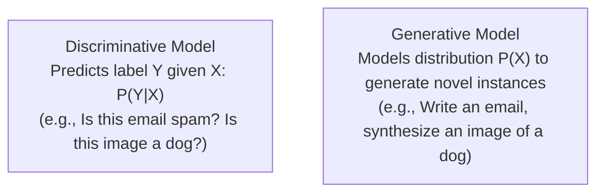
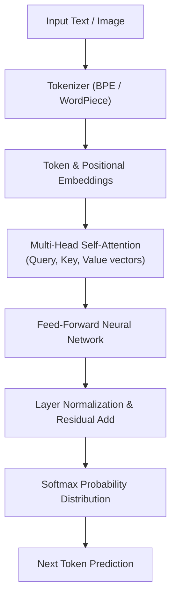
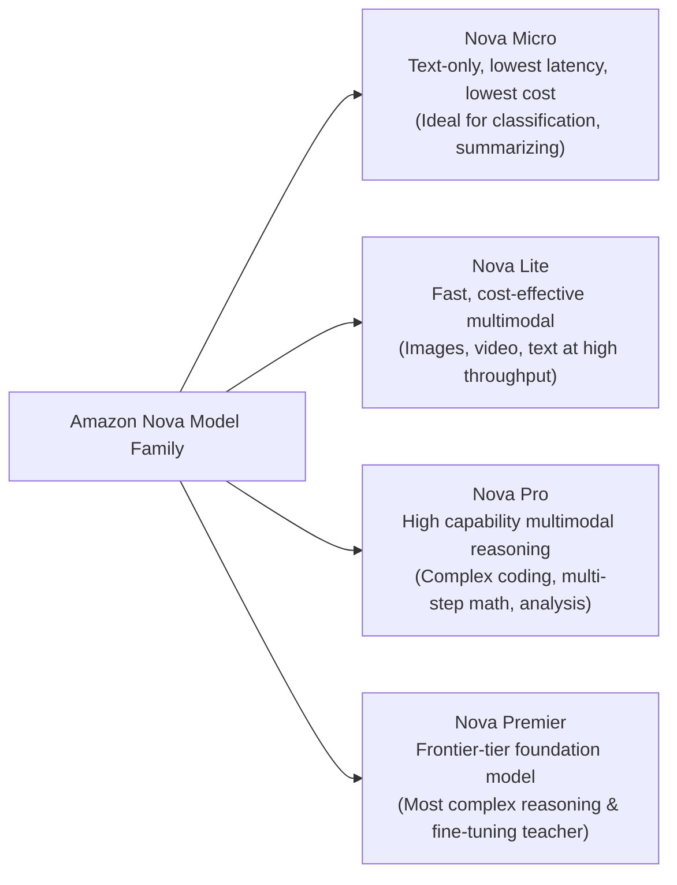
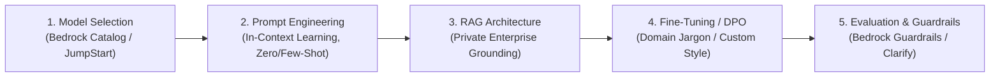

# Domain 2: Fundamentals of Generative AI

> **Weight:** 24% of Scored Exam Content  
> **Course:** AWS Certified AI Practitioner (`AIF-C01`)  
> **Exam Guide Baseline:** v1.2 (October 2026 - incorporating Amazon Nova & MCP updates)  
> **Index:** `AI/Practitioner/AIF-C01/explanations/02_Domain_2_Fundamentals_of_Generative_AI.md`

---

## 🧭 Domain Overview

Domain 2 evaluates understanding of Generative AI architectures, foundation model capabilities, internal token mechanics, multi-modal generation, prompt parameters, the full Generative AI lifecycle, the Amazon Nova foundation model family, and emerging agentic paradigms including the Model Context Protocol (MCP).

---

## 💡 The Real-World Analogy (ELI5)

> **The Art Critic vs. The Master Painter:**
> - **Discriminative Traditional AI (The Art Critic):** An expert who looks at a painting and classifies it: *"This is an authentic Monet with 98% confidence."* Or detects anomalies: *"This brushstroke is counterfeit."* It analyzes, categorizes, and labels existing reality.
> - **Generative AI (The Master Painter):** An artist who spent 20 years studying every brushstroke, color palette, and texture Monet ever used. Handed a blank canvas and a prompt: *"Paint a rainy afternoon in Paris with cherry blossoms in Monet's style,"* the artist synthesizes a completely original, never-before-seen masterpiece that reflects the statistical distribution of Monet's art.
> - **Autocomplete on Steroids:** At its core, a Large Language Model (LLM) is predicting the single next most probable word (token) across billions of possibilities based on context: *"The cat sat on the... [mat / sofa / windowsill]"*.

---

## 🎯 Task Statement 2.1: Explain the concepts and capabilities of generative AI

### 1. What Defines Generative AI?
Unlike discriminative AI models that compute conditional probabilities $P(Y|X)$ to classify inputs or predict numerical targets, generative models model the joint probability distribution $P(X, Y)$ or the probability distribution over sequences $P(X)$ to generate novel data instances resembling their training data.

### 2. Taxonomy of Foundation Models (FMs)
* **Foundation Models (FMs):** Massive deep learning models trained on vast, broad-scale corpora of unlabeled data using self-supervised learning at scale. They serve as generalized base models adaptable to hundreds of downstream tasks.
* **Large Language Models (LLMs):** Text-centric foundation models trained to predict subsequent tokens in sequence (e.g., Amazon Nova, Anthropic Claude, Meta Llama).
* **Multi-Modal Foundation Models:** Models capable of simultaneously processing and synthesizing across multiple input/output modalities (text, high-resolution images, video frames, audio, and documents).
* **Diffusion Models:** Generative architectures trained to invert a gradual Gaussian noise degradation process to generate high-fidelity synthetic images and videos (e.g., Amazon Titan Image Generator G1/v2, Stable Diffusion).

---

## 🎯 Task Statement 2.2: Understand Transformer Architecture and Token Mechanics

### 1. The Transformer Architecture
Introduced in the seminal paper *"Attention Is All You Need"* (Vaswani et al., 2017), the Transformer discarded recurrent sequential processing (RNNs/LSTMs) in favor of **Self-Attention Mechanisms**, enabling massive parallelization during training across GPU clusters.

#### Core Components:
1. **Self-Attention Mechanism:** Computes pairwise relevance between every token in a sequence regardless of distance:
   $$\text{Attention}(Q, K, V) = \text{softmax}\left(\frac{QK^T}{\sqrt{d_k}}\right)V$$
   * $Q$ (Query): What the current token is seeking.
   * $K$ (Key): What each token in the sequence offers.
   * $V$ (Value): The actual information content carried by the token.
   * $\sqrt{d_k}$: Scaling factor preventing softmax gradient vanishing.
2. **Positional Encoding:** Because self-attention evaluates all tokens simultaneously without intrinsic sequential order, sinusoidal or rotary positional encodings (RoPE) are added to input vectors to preserve word order.
3. **Encoder vs. Decoder Architectures:**
   * **Encoder-Only (e.g., BERT):** Bidirectional context; ideal for classification, NER, and text embeddings.
   * **Decoder-Only (e.g., GPT, Amazon Nova, Claude, Llama):** Autoregressive causal masking; generates text token-by-token from left to right; dominant architecture for Generative AI.
   * **Encoder-Decoder (e.g., T5, BART):** Sequence-to-sequence translation and abstractive summarization.

### 2. Tokens, Embeddings, and Context Windows
* **Tokens:** The fundamental unit of text processed by an LLM. On average, $1\text{ token} \approx 0.75\text{ words}$ (or 1,000 tokens $\approx$ 750 words in English).
* **Vector Embeddings:** High-dimensional dense numerical vectors (e.g., 1,536 dimensions for Amazon Titan Text Embeddings v2) where semantic similarity corresponds to geometric proximity (measured via Cosine Similarity or Euclidean Distance).
* **Context Window:** The maximum number of tokens (prompt input + generated output) an LLM can retain and process in a single inference call. Exceeding the context window results in truncation.
* **Hallucination:** An error mode where an LLM generates syntactically convincing, authoritative text that is factually false or ungrounded in source data. Mitigated by low temperature, Grounding via RAG, and Amazon Bedrock Guardrails.

---

## 🎯 Task Statement 2.3: Amazon Nova Foundation Model Family

In the official v1.2 exam guide, Amazon's flagship foundation model generation—the **Amazon Nova** family—is heavily emphasized. Available natively via Amazon Bedrock:

### Amazon Nova Models Breakdown
| Model | Modalities Supported | Primary Characteristics | Target Business Use Case |
|---|---|---|---|
| **Amazon Nova Micro** | Text-to-Text | Ultra-low latency, sub-second TTFT (Time to First Token), lowest cost | Query classification, text extraction, lightweight routing, edge applications |
| **Amazon Nova Lite** | Multimodal (Text, Image, Video) | Very fast, cost-optimized multimodal processing | High-volume document scanning, visual search, fast customer support |
| **Amazon Nova Pro** | Multimodal (Text, Image, Video) | Frontier balance of high accuracy, deep reasoning, agentic planning | Software development, financial reporting, complex multi-modal analysis |
| **Amazon Nova Premier** | Multimodal (Frontier scale) | Top-tier intelligence, advanced reasoning, knowledge synthesis | Complex enterprise research, high-stakes decision synthesis, distillation teacher |

---

## 🎯 Task Statement 2.4: Agentic AI Systems and Model Context Protocol (MCP)

### 1. Agentic AI vs. Standard Generative AI
Standard GenAI operates strictly in a request-response pattern. **Agentic AI** equips foundation models with autonomous reasoning loops (such as ReAct: Reasoning + Acting), persistent memory, and the capability to invoke external tools (APIs, databases, and microservices) to achieve high-level goals.

### 2. Model Context Protocol (MCP) in AWS Environments
* **Purpose:** MCP standardizes how AI agents communicate with external tools, APIs, and file systems, eliminating brittle custom API glue code.
* **Architecture:**
  * **MCP Host:** The orchestration layer (e.g., Amazon Bedrock Agent runtime or local developer assistant).
  * **MCP Server:** A lightweight microservice that publishes capabilities (tools, resources, prompt templates) via JSON-RPC.
  * **MCP Client:** Communicates with servers to dynamically discover available functions and execute them securely.
* **Integration with AWS:** Bedrock Agents utilize Action Groups backed by OpenAPI specifications or MCP server endpoints to interface with AWS Lambda functions, Amazon DynamoDB, and external SaaS platforms.

---

## 🎯 Task Statement 2.5: The Generative AI Lifecycle and Customization Spectrum

### Customization Approaches: Cost vs Effort Spectrum
1. **Prompt Engineering:**
   * Requires zero training data and zero model modifications.
   * Modifies only the input context window.
   * Lowest cost and immediate time-to-value.
2. **Retrieval Augmented Generation (RAG):**
   * Dynamically retrieves relevant text chunks from an external vector index (Amazon OpenSearch Serverless) and appends them to the user prompt.
   * Provides real-time grounding on proprietary data without model retraining.
3. **Fine-Tuning:**
   * Adjusts the internal neural weights of a base foundation model using thousands of labeled $(Prompt, Completion)$ pairs.
   * Best for teaching specific conversational tone, domain nomenclature (medical/legal), or proprietary JSON output formatting.
4. **Pre-training / Continued Pre-training:**
   * Requires billions of tokens and millions in GPU infrastructure compute.
   * Feeds raw unlabeled domain documents to adapt model vocabulary and internal statistical knowledge.

---

## 🎯 Task Statement 2.6: Inference Parameters Demystified

When invoking a Foundation Model via the Amazon Bedrock API (`InvokeModel` or `Converse`), runtime inference parameters control the randomness and output distribution:

| Parameter | Type & Range | Operational Behavior | Exam Use Case |
|---|---|---|---|
| **Temperature** | Float ($0.0$ to $1.0$) | Controls randomness. Lower values ($0.0 - 0.2$) make the output deterministic and focused; higher values ($0.7 - 1.0$) encourage creative divergence. | Use $0.0$ for factual Q&A, code generation, and financial extraction. Use $0.8$ for brainstorming. |
| **Top-P (Nucleus Sampling)** | Float ($0.0$ to $1.0$) | Restricts token selection to the smallest cumulative probability set exceeding threshold $P$. | Top-P of $0.9$ cuts off the long tail of bizarre tokens while preserving natural fluency. |
| **Top-K** | Integer ($\ge 1$) | Restricts selection to the top $K$ most likely next tokens. | Top-K of $1$ is equivalent to Greedy Decoding (argmax). |
| **Max Tokens** | Integer | Caps the maximum number of tokens generated in the output response. | Cost control and preventing infinite runaway generations. |
| **Stop Sequences** | Array of Strings | Specifies characters or strings (e.g., `["\n\n", "User:"]`) that immediately halt token generation. | Formatting chat transcripts and multi-turn turn enforcement. |

---

## 🔗 Related Resources
* Next: [Domain 3: Applications of Foundation Models](./03_Domain_3_Applications_of_Foundation_Models.md)
* Blueprint: [Diagram 02: Transformer Architecture and Tokenization](../diagrams/Diagram_02_Transformer_Architecture_and_Tokenization.md)
* Blueprint: [Diagram 03: Amazon Bedrock Serverless Topology and Nova Models](../diagrams/Diagram_03_Amazon_Bedrock_Serverless_Topology_and_Nova_Models.md)
* Lab: [Lab 01: Amazon Bedrock Model Access, Playgrounds & Prompt Engineering](../labs/Lab_01_Amazon_Bedrock_Model_Access_Playgrounds_and_Prompt_Engineering.md)
---

## 🎯 Exam Traps & 'Clue-to-Answer' Trigger Words

| Exam Question Clue Keyword | Correct Generative AI Concept | Key Distinctions & Constraints |
| :--- | :--- | :--- |
| *'Self-attention mechanism processing tokens in parallel across long sequences'* | **Transformer Architecture** | Replaced sequential RNNs/LSTMs; foundation of modern LLMs. |
| *'Smallest discrete unit of text processed by an LLM (e.g., ~4 characters or 0.75 words)'* | **Token** | Billing and context windows are strictly measured in tokens, not words. |
| *'Controls output randomness/creativity; lower value produces deterministic answers'* | **Temperature** |  = greedy/deterministic (factual tasks);  = creative/divergent. |
| *'Limits token candidate pool to cumulative probability threshold (Nucleus sampling)'* | **Top-P** | Dynamic candidate pool based on sum of probabilities. |
| *'Limits token candidate pool to top K most probable words regardless of probability'* | **Top-K** | Fixed number of top choices. |
| *'Generates synthetic photorealistic images by iteratively removing Gaussian noise'* | **Diffusion Models** | Stability AI Stable Diffusion, Amazon Titan Image Generator. |
| *'Processes and correlates multiple disparate input data types (text, images, audio, video)'* | **Multimodal Foundation Models** | Amazon Nova (Micro, Lite, Pro), Anthropic Claude 3.5 Sonnet. |

---

## 📝 Post-Domain 2 Question Simulation & Retention Check

Test your mastery of Domain 2 with these 10 exam-style practice questions:

### Question 1
**How does Generative AI differ fundamentally from Traditional / Discriminative Machine Learning?**
- A) Discriminative AI creates novel images, while Generative AI only processes tabular numbers.
- B) Discriminative AI learns decision boundaries to classify or predict labels ($P(Y|X)$), whereas Generative AI models data distributions to synthesize new, original content ($P(X)$ or $P(X, Y)$).
- C) Discriminative AI requires GPUs; Generative AI runs strictly on CPUs.
- D) Generative AI does not use deep learning.

<b>Click to View Answer & Explanation</b>

**Correct Answer:** **B) Discriminative AI learns decision boundaries to classify or predict labels ($P(Y|X)$), whereas Generative AI models data distributions to synthesize new, original content ($P(X)$ or $P(X, Y)$).**  
- **Why it's correct:** Discriminative models separate data into classes (e.g. spam/ham), while generative models learn the underlying probability distribution of training data to generate plausible new samples.

### Question 2
**Which revolutionary architectural mechanism enables Transformer models to process all tokens in a sequence in parallel and compute contextual relevance between words regardless of distance?**
- A) Convolutional Pooling
- B) Self-Attention
- C) Recurrent Hidden State Looping
- D) Bag of Words

<b>Click to View Answer & Explanation</b>

**Correct Answer:** **B) Self-Attention**  
- **Why it's correct:** Introduced in *"Attention Is All You Need"* (2017), the Multi-Head Self-Attention mechanism allows every token in an input to attend to all other tokens simultaneously using Query, Key, and Value matrices.

### Question 3
**A customer service chatbot needs to answer technical software documentation questions with factual accuracy, high determinism, and minimal hallucination. Which inference parameter adjustment is most appropriate?**
- A) Increase Temperature to 1.5
- B) Decrease Temperature to 0.0 or 0.2
- C) Increase Top-K to 500
- D) Set Max Generation Length to 10

<b>Click to View Answer & Explanation</b>

**Correct Answer:** **B) Decrease Temperature to 0.0 or 0.2**  
- **Why it's correct:** Lower temperature reduces randomness in token selection, forcing the model to greedily choose the highest-probability, most factual tokens, which minimizes creative embellishments and hallucinations.

### Question 4
**What does the Top-P (Nucleus Sampling) parameter control during foundation model inference?**
- A) The maximum number of tokens generated before stopping
- B) The cumulative probability threshold that dynamically limits the pool of candidate next tokens
- C) The cost per token billed by AWS Bedrock
- D) The learning rate during fine-tuning

<b>Click to View Answer & Explanation</b>

**Correct Answer:** **B) The cumulative probability threshold that dynamically limits the pool of candidate next tokens**  
- **Why it's correct:** Top-P pools the top candidate tokens whose cumulative softmax probability sums to $P$ (e.g. 0.90), dynamically expanding or contracting the candidate pool depending on model confidence.

### Question 5
**Which prompt engineering technique provides the foundation model with several input-output demonstration examples within the prompt before asking it to solve the target task?**
- A) Zero-Shot Prompting
- B) Few-Shot Prompting
- C) Chain-of-Thought Prompting
- D) Prompt Injection

<b>Click to View Answer & Explanation</b>

**Correct Answer:** **B) Few-Shot Prompting**  
- **Why it's correct:** Few-shot prompting provides 2 to 5 exemplary demonstration pairs (input -> output) in-context, teaching the model desired formatting, style, and task constraints without modifying model weights.

### Question 6
**An architect prompts a foundation model: "Think step-by-step to calculate the total shipping cost and explain each calculation before providing the final answer." Which prompt engineering technique is this?**
- A) Directional Stimulus Prompting
- B) Chain-of-Thought (CoT) Prompting
- C) Least-to-Most Prompting
- D) Fine-Tuning

<b>Click to View Answer & Explanation</b>

**Correct Answer:** **B) Chain-of-Thought (CoT) Prompting**  
- **Why it's correct:** Chain-of-Thought prompting encourages the model to break complex reasoning, mathematical, or multi-step deduction problems into intermediate logical steps before generating the final answer.

### Question 7
**What is an "Emergent Capability" in Large Language Models?**
- A) An ability that is explicitly programmed into the software by human developers
- B) A capability (such as multi-step arithmetic, reasoning, or code debugging) that appears spontaneously as model scale crosses certain parameter and compute thresholds
- C) The ability to connect directly to the internet without APIs
- D) A technique for compressing models into 8-bit precision

<b>Click to View Answer & Explanation</b>

**Correct Answer:** **B) A capability (such as multi-step arithmetic, reasoning, or code debugging) that appears spontaneously as model scale crosses certain parameter and compute thresholds**  
- **Why it's correct:** Emergent capabilities are abilities that do not exist in small models but materialize sharply in foundation models once scale (parameters, dataset size, training compute) exceeds a critical threshold.

### Question 8
**Which evaluation metric evaluates automated text summarization by calculating the recall of n-grams (unigrams, bigrams, longest common subsequences) between candidate summaries and reference human summaries?**
- A) BLEU
- B) ROUGE
- C) Perplexity
- D) Mean Absolute Error

<b>Click to View Answer & Explanation</b>

**Correct Answer:** **B) ROUGE**  
- **Why it's correct:** ROUGE (Recall-Oriented Understudy for Gisting Evaluation) is the standard metric for evaluating summarization quality by measuring how many words/phrases from reference human summaries appear in the model summary.

### Question 9
**Which metric measures the quality of machine translation by computing n-gram precision against expert human translations and applying a brevity penalty for short sentences?**
- A) ROUGE
- B) BLEU
- C) F1-Score
- D) Perplexity

<b>Click to View Answer & Explanation</b>

**Correct Answer:** **B) BLEU**  
- **Why it's correct:** BLEU (Bilingual Evaluation Understudy) evaluates machine translation by measuring n-gram precision against reference translations.

### Question 10
**Which free, web-based playground powered by Amazon Bedrock allows students, beginners, and educators to create, experiment with, and remix generative AI applications using plain English without requiring an AWS account?**
- A) Amazon SageMaker Studio Lab
- B) AWS PartyRock
- C) Amazon Q Developer
- D) Amazon Bedrock Console

<b>Click to View Answer & Explanation</b>

**Correct Answer:** **B) AWS PartyRock**  
- **Why it's correct:** AWS PartyRock (partyrock.aws) is a no-code generative AI app-building playground powered by Amazon Bedrock that requires no AWS account or credit card.

