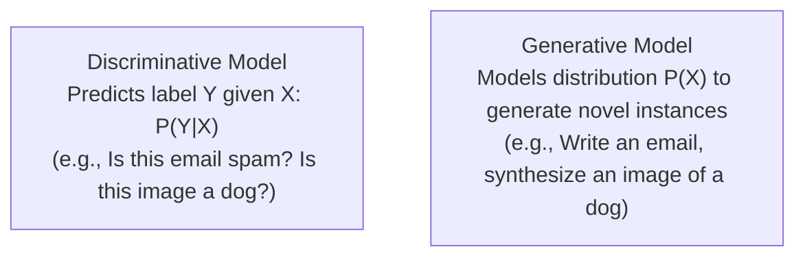
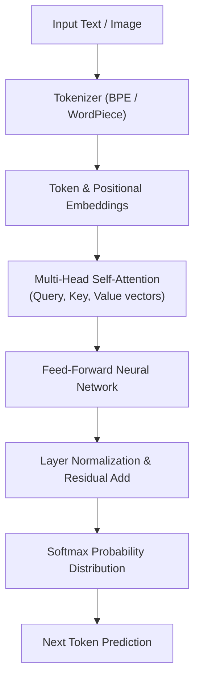
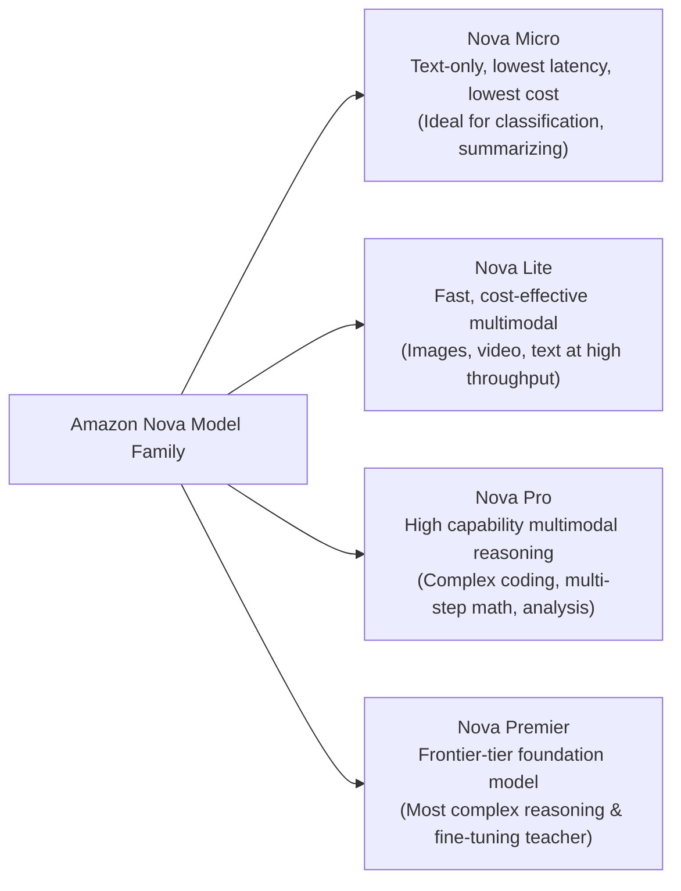
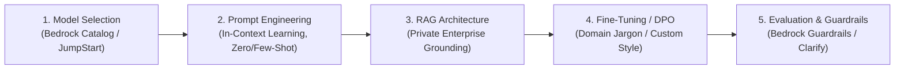

# Domain 2: Fundamentals of Generative AI

> **Weight:** 24% of Scored Exam Content  
> **Course:** AWS Certified AI Practitioner (`AIF-C01`)  
> **Exam Guide Baseline:** v1.2 (October 2026 - incorporating Amazon Nova & MCP updates)  
> **Index:** `AI/Practitioner/AIF-C01/explanations/02_Domain_2_Fundamentals_of_Generative_AI.md`

---

## 🧭 Domain Overview

Domain 2 evaluates understanding of Generative AI architectures, foundation model capabilities, internal token mechanics, multi-modal generation, prompt parameters, the full Generative AI lifecycle, the Amazon Nova foundation model family, and emerging agentic paradigms including the Model Context Protocol (MCP).

---

## 🎯 Task Statement 2.1: Explain the concepts and capabilities of generative AI

### 1. What Defines Generative AI?
Unlike discriminative AI models that compute conditional probabilities $P(Y|X)$ to classify inputs or predict numerical targets, generative models model the joint probability distribution $P(X, Y)$ or the probability distribution over sequences $P(X)$ to generate novel data instances resembling their training data.

### 2. Taxonomy of Foundation Models (FMs)
* **Foundation Models (FMs):** Massive deep learning models trained on vast, broad-scale corpora of unlabeled data using self-supervised learning at scale. They serve as generalized base models adaptable to hundreds of downstream tasks.
* **Large Language Models (LLMs):** Text-centric foundation models trained to predict subsequent tokens in sequence (e.g., Amazon Nova, Anthropic Claude, Meta Llama).
* **Multi-Modal Foundation Models:** Models capable of simultaneously processing and synthesizing across multiple input/output modalities (text, high-resolution images, video frames, audio, and documents).
* **Diffusion Models:** Generative architectures trained to invert a gradual Gaussian noise degradation process to generate high-fidelity synthetic images and videos (e.g., Amazon Titan Image Generator G1/v2, Stable Diffusion).

---

## 🎯 Task Statement 2.2: Understand Transformer Architecture and Token Mechanics

### 1. The Transformer Architecture
Introduced in the seminal paper *"Attention Is All You Need"* (Vaswani et al., 2017), the Transformer discarded recurrent sequential processing (RNNs/LSTMs) in favor of **Self-Attention Mechanisms**, enabling massive parallelization during training across GPU clusters.

#### Core Components:
1. **Self-Attention Mechanism:** Computes pairwise relevance between every token in a sequence regardless of distance:
   $$\text{Attention}(Q, K, V) = \text{softmax}\left(\frac{QK^T}{\sqrt{d_k}}\right)V$$
   * $Q$ (Query): What the current token is seeking.
   * $K$ (Key): What each token in the sequence offers.
   * $V$ (Value): The actual information content carried by the token.
   * $\sqrt{d_k}$: Scaling factor preventing softmax gradient vanishing.
2. **Positional Encoding:** Because self-attention evaluates all tokens simultaneously without intrinsic sequential order, sinusoidal or rotary positional encodings (RoPE) are added to input vectors to preserve word order.
3. **Encoder vs. Decoder Architectures:**
   * **Encoder-Only (e.g., BERT):** Bidirectional context; ideal for classification, NER, and text embeddings.
   * **Decoder-Only (e.g., GPT, Amazon Nova, Claude, Llama):** Autoregressive causal masking; generates text token-by-token from left to right; dominant architecture for Generative AI.
   * **Encoder-Decoder (e.g., T5, BART):** Sequence-to-sequence translation and abstractive summarization.

### 2. Tokens, Embeddings, and Context Windows
* **Tokens:** The fundamental unit of text processed by an LLM. On average, $1\text{ token} \approx 0.75\text{ words}$ (or 1,000 tokens $\approx$ 750 words in English).
* **Vector Embeddings:** High-dimensional dense numerical vectors (e.g., 1,536 dimensions for Amazon Titan Text Embeddings v2) where semantic similarity corresponds to geometric proximity (measured via Cosine Similarity or Euclidean Distance).
* **Context Window:** The maximum number of tokens (prompt input + generated output) an LLM can retain and process in a single inference call. Exceeding the context window results in truncation.
* **Hallucination:** An error mode where an LLM generates syntactically convincing, authoritative text that is factually false or ungrounded in source data. Mitigated by low temperature, Grounding via RAG, and Amazon Bedrock Guardrails.

---

## 🎯 Task Statement 2.3: Amazon Nova Foundation Model Family

In the official v1.2 exam guide, Amazon's flagship foundation model generation—the **Amazon Nova** family—is heavily emphasized. Available natively via Amazon Bedrock:

### Amazon Nova Models Breakdown
| Model | Modalities Supported | Primary Characteristics | Target Business Use Case |
|---|---|---|---|
| **Amazon Nova Micro** | Text-to-Text | Ultra-low latency, sub-second TTFT (Time to First Token), lowest cost | Query classification, text extraction, lightweight routing, edge applications |
| **Amazon Nova Lite** | Multimodal (Text, Image, Video) | Very fast, cost-optimized multimodal processing | High-volume document scanning, visual search, fast customer support |
| **Amazon Nova Pro** | Multimodal (Text, Image, Video) | Frontier balance of high accuracy, deep reasoning, agentic planning | Software development, financial reporting, complex multi-modal analysis |
| **Amazon Nova Premier** | Multimodal (Frontier scale) | Top-tier intelligence, advanced reasoning, knowledge synthesis | Complex enterprise research, high-stakes decision synthesis, distillation teacher |

---

## 🎯 Task Statement 2.4: Agentic AI Systems and Model Context Protocol (MCP)

### 1. Agentic AI vs. Standard Generative AI
Standard GenAI operates strictly in a request-response pattern. **Agentic AI** equips foundation models with autonomous reasoning loops (such as ReAct: Reasoning + Acting), persistent memory, and the capability to invoke external tools (APIs, databases, and microservices) to achieve high-level goals.

### 2. Model Context Protocol (MCP) in AWS Environments
* **Purpose:** MCP standardizes how AI agents communicate with external tools, APIs, and file systems, eliminating brittle custom API glue code.
* **Architecture:**
  * **MCP Host:** The orchestration layer (e.g., Amazon Bedrock Agent runtime or local developer assistant).
  * **MCP Server:** A lightweight microservice that publishes capabilities (tools, resources, prompt templates) via JSON-RPC.
  * **MCP Client:** Communicates with servers to dynamically discover available functions and execute them securely.
* **Integration with AWS:** Bedrock Agents utilize Action Groups backed by OpenAPI specifications or MCP server endpoints to interface with AWS Lambda functions, Amazon DynamoDB, and external SaaS platforms.

---

## 🎯 Task Statement 2.5: The Generative AI Lifecycle and Customization Spectrum

### Customization Approaches: Cost vs Effort Spectrum
1. **Prompt Engineering:**
   * Requires zero training data and zero model modifications.
   * Modifies only the input context window.
   * Lowest cost and immediate time-to-value.
2. **Retrieval Augmented Generation (RAG):**
   * Dynamically retrieves relevant text chunks from an external vector index (Amazon OpenSearch Serverless) and appends them to the user prompt.
   * Provides real-time grounding on proprietary data without model retraining.
3. **Fine-Tuning:**
   * Adjusts the internal neural weights of a base foundation model using thousands of labeled $(Prompt, Completion)$ pairs.
   * Best for teaching specific conversational tone, domain nomenclature (medical/legal), or proprietary JSON output formatting.
4. **Pre-training / Continued Pre-training:**
   * Requires billions of tokens and millions in GPU infrastructure compute.
   * Feeds raw unlabeled domain documents to adapt model vocabulary and internal statistical knowledge.

---

## 🎯 Task Statement 2.6: Inference Parameters Demystified

When invoking a Foundation Model via the Amazon Bedrock API (`InvokeModel` or `Converse`), runtime inference parameters control the randomness and output distribution:

| Parameter | Type & Range | Operational Behavior | Exam Use Case |
|---|---|---|---|
| **Temperature** | Float ($0.0$ to $1.0$) | Controls randomness. Lower values ($0.0 - 0.2$) make the output deterministic and focused; higher values ($0.7 - 1.0$) encourage creative divergence. | Use $0.0$ for factual Q&A, code generation, and financial extraction. Use $0.8$ for brainstorming. |
| **Top-P (Nucleus Sampling)** | Float ($0.0$ to $1.0$) | Restricts token selection to the smallest cumulative probability set exceeding threshold $P$. | Top-P of $0.9$ cuts off the long tail of bizarre tokens while preserving natural fluency. |
| **Top-K** | Integer ($\ge 1$) | Restricts selection to the top $K$ most likely next tokens. | Top-K of $1$ is equivalent to Greedy Decoding (argmax). |
| **Max Tokens** | Integer | Caps the maximum number of tokens generated in the output response. | Cost control and preventing infinite runaway generations. |
| **Stop Sequences** | Array of Strings | Specifies characters or strings (e.g., `["\n\n", "User:"]`) that immediately halt token generation. | Formatting chat transcripts and multi-turn turn enforcement. |

---

## 🔗 Related Resources
* Next: [Domain 3: Applications of Foundation Models](./03_Domain_3_Applications_of_Foundation_Models.md)
* Blueprint: [Diagram 02: Transformer Architecture and Tokenization](../diagrams/Diagram_02_Transformer_Architecture_and_Tokenization.md)
* Blueprint: [Diagram 03: Amazon Bedrock Serverless Topology and Nova Models](../diagrams/Diagram_03_Amazon_Bedrock_Serverless_Topology_and_Nova_Models.md)
* Lab: [Lab 01: Amazon Bedrock Model Access, Playgrounds & Prompt Engineering](../labs/Lab_01_Amazon_Bedrock_Model_Access_Playgrounds_and_Prompt_Engineering.md)
