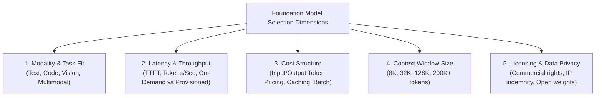
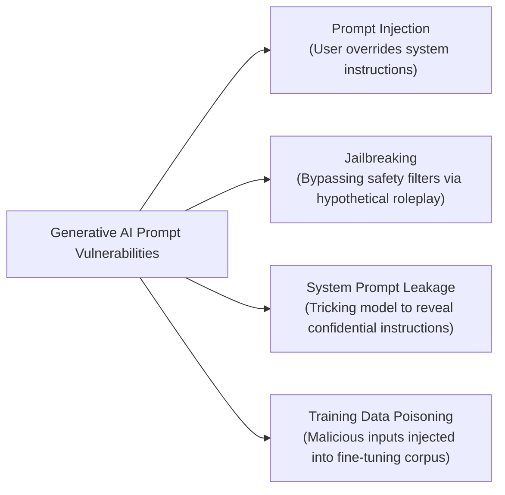
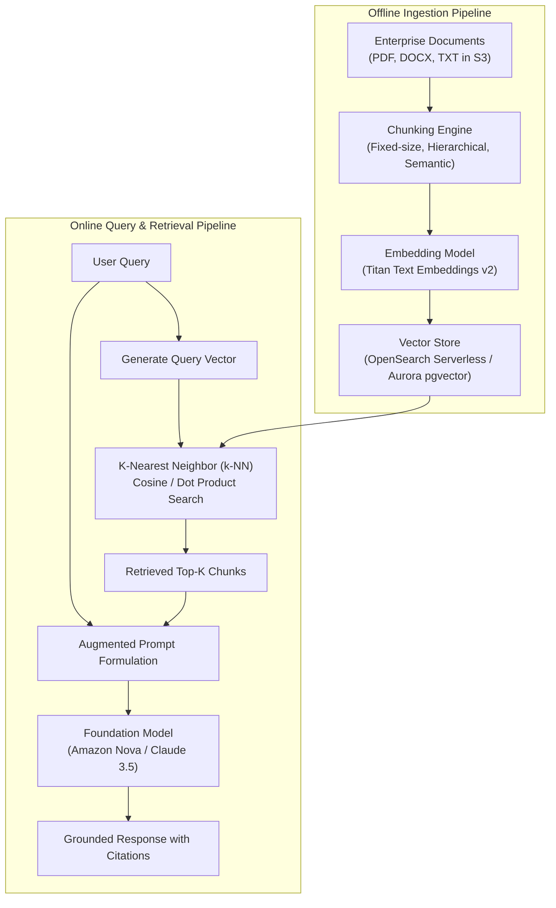
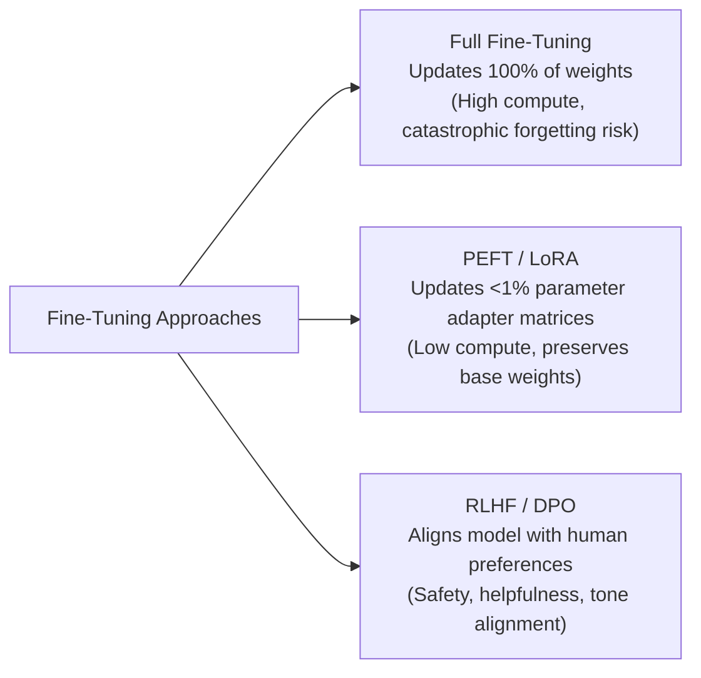
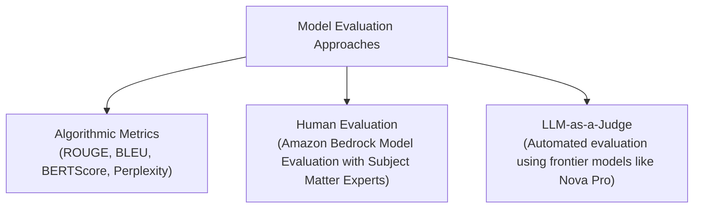

# Domain 3: Applications of Foundation Models

> **Weight:** 28% of Scored Exam Content (Highest Weighted Domain)  
> **Course:** AWS Certified AI Practitioner (`AIF-C01`)  
> **Exam Guide Baseline:** v1.2 (October 2026 - incorporating LLM-as-a-judge, Prompt Caching, and Enterprise RAG)  
> **Index:** `AI/Practitioner/AIF-C01/explanations/03_Domain_3_Applications_of_Foundation_Models.md`

---

## 🧭 Domain Overview

Domain 3 represents the core operational center of the AIF-C01 certification. It tests an architect's ability to select the right foundation model, design robust prompt engineering workflows, implement Retrieval-Augmented Generation (RAG) with vector databases, orchestrate autonomous agents, fine-tune models responsibly, and systematically evaluate generative performance using both quantitative metrics and modern LLM-as-a-judge methodologies.

---

## 🎯 Task Statement 3.1: Determine criteria for foundation model selection

When selecting a Foundation Model in Amazon Bedrock or Amazon SageMaker JumpStart, evaluate five core engineering dimensions:

### Model Selection Decision Guide
| Workload Requirement | Recommended Model | Architectural Rationale |
|---|---|---|
| High-throughput classification, routing, sub-second latency, lowest cost | **Amazon Nova Micro** | Text-optimized, ultra-low TTFT, lowest input/output token price. |
| High-volume document scanning, visual search, image summarization | **Amazon Nova Lite** | Multimodal capabilities with cost-optimized inference economics. |
| Complex enterprise reasoning, code generation, multi-step math, agent planning | **Amazon Nova Pro** or **Anthropic Claude 3.5 Sonnet** | Top-tier reasoning benchmarks, robust tool-use and JSON schema adherence. |
| High-fidelity marketing asset creation, inpainting, background replacement | **Amazon Titan Image Generator G1/v2** | Native diffusion model with automatic invisible watermarking. |
| Low-cost enterprise semantic search and dense embeddings | **Amazon Titan Text Embeddings v2** | Flexible embedding dimensions (256, 512, 1024), optimized vector storage. |
| Self-hosted, private weights with full customization control on EC2/EKS | **Meta Llama 3** (via SageMaker JumpStart) | Open-weights model deployed to dedicated GPU compute instances. |

---

## 🎯 Task Statement 3.2: Design and optimize prompt engineering workflows

Prompt engineering involves crafting inputs to guide foundation models toward desired outputs without altering model weights.

### 1. Core Prompting Techniques
1. **Zero-Shot Prompting:** Providing a prompt without examples, relying solely on pre-trained knowledge.
   * *Example:* `"Classify the sentiment of this review as Positive or Negative: The battery died in 2 hours."`
2. **Few-Shot Prompting (In-Context Learning):** Providing 2–5 structured input/output examples within the prompt context to demonstrate the desired tone, format, and structure.
3. **Chain-of-Thought (CoT) Prompting:** Instructing the model to "think step-by-step" before delivering the final answer, significantly reducing reasoning and arithmetic errors.
4. **Directional Stimulus Prompting:** Providing hints or key keywords to steer the model toward specific topics.
5. **System Prompts / Role Prompting:** Establishing persona, operational boundaries, and formatting instructions at the root level of the conversation (e.g., using Bedrock's Converse API `system` block).

### 2. Bedrock Prompt Management & Prompt Caching
* **Amazon Bedrock Prompt Management:** Allows teams to save, test, version, and share prompt templates containing dynamic variables (e.g., `{{customer_query}}`).
* **Prompt Caching:** Caches static portions of large prompts (such as long system instructions, extensive document context, or few-shot examples) in high-speed GPU memory.
  * **Benefits:** Reduces latency by up to 80% and cuts token costs by up to 50% for repetitive multi-turn dialogues.

### 3. Prompt Vulnerabilities and Security Risks

* **Mitigation:** Enforce strict separation between system instructions and user input delimiters; deploy **Amazon Bedrock Guardrails** to inspect inputs and outputs independently.

---

## 🎯 Task Statement 3.3: Architect Enterprise Retrieval-Augmented Generation (RAG)

Retrieval-Augmented Generation (RAG) grounds foundation models on an organization's proprietary, private, or real-time data without retraining the base model.

### 1. Ingestion & Chunking Strategies
* **Fixed-Size Chunking:** Splitting text into fixed token lengths (e.g., 500 tokens with 50-token overlap). Simple and fast.
* **Hierarchical Chunking (Parent-Child):** Documents are split into parent chunks (broad context) and child chunks (fine-grained sentences). Vector search searches child chunks, but retrieves the parent chunk for the LLM.
* **Semantic Chunking:** Splitting text based on natural semantic boundaries (headers, paragraphs, topic transitions) using embedding distance thresholds.

### 2. Vector Databases in AWS
* **Amazon Bedrock Knowledge Bases (Managed Solution):** Connects S3 buckets directly to automated chunking, embedding, and vector storage in **Amazon OpenSearch Serverless** without managing vector cluster infrastructure.
* **Amazon Aurora PostgreSQL with `pgvector`:** Relational ACID database storing application data and vector embeddings in the same table.
* **Amazon Neptune Analytics:** Graph database with vector search capabilities for complex interconnected entity relationships.

---

## 🎯 Task Statement 3.4: Fine-Tuning & Model Customization

When prompt engineering and RAG are insufficient to achieve domain-specific style, tone, or specialized reasoning:

### Parameter-Efficient Fine-Tuning (PEFT) and LoRA
* **Low-Rank Adaptation (LoRA):** Freezes the pre-trained model weights and injects trainable rank-decomposition matrices into each layer of the Transformer architecture.
* **Advantages:** 
  * Reduces trainable parameters by $>90\%$.
  * Prevents **Catastrophic Forgetting** (where an LLM loses its general reasoning abilities).
  * Drastically reduces GPU memory requirements.
* **Amazon Bedrock Custom Models:** Supports PEFT fine-tuning on labeled training datasets stored in Amazon S3 (JSON Lines format with `prompt` and `completion` keys).

---

## 🎯 Task Statement 3.5: Foundation Model Evaluation

Systematic evaluation is required to measure accuracy, hallucination rates, and linguistic quality before production deployment.

### 1. Algorithmic Evaluation Metrics
* **BLEU (Bilingual Evaluation Understudy):** Measures $n$-gram precision between generated text and reference text. Standard for machine translation.
* **ROUGE (Recall-Oriented Understudy for Gesting Evaluation):** Measures $n$-gram recall. Standard for text summarization:
  * **ROUGE-1:** Unigram overlap.
  * **ROUGE-2:** Bigram overlap.
  * **ROUGE-L:** Longest Common Subsequence (LCS).
* **BERTScore:** Computes semantic similarity between generated and reference sentences using pre-trained contextual embeddings, recognizing synonyms even with zero literal word overlap.
* **Perplexity:** Measures how "surprised" a language model is by a sequence of text. Lower perplexity indicates the model is more confident in predicting the text.

### 2. LLM-as-a-Judge Methodology (v1.2 Addition)
* **Definition:** Using a high-capability frontier model (e.g., Amazon Nova Pro or Claude 3.5 Sonnet) as an automated evaluator to grade the output of a smaller, faster model (e.g., Nova Micro) based on a rubric.
* **Evaluated Criteria:** Helpfulness, faithfulness to context (hallucination scoring), toxicity, correctness, and reasoning coherence.
* **AWS Service:** **Amazon Bedrock Model Evaluation** supports automated evaluation jobs using built-in curated datasets, custom prompt datasets, and LLM-as-a-judge rubrics.

---

## 🔗 Related Resources
* Next: [Domain 4: Guidelines for Responsible AI](./04_Domain_4_Guidelines_for_Responsible_AI.md)
* Blueprint: [Diagram 04: Enterprise RAG Ingestion and Retrieval Flow](../diagrams/Diagram_04_Enterprise_RAG_Ingestion_and_Retrieval_Flow.md)
* Blueprint: [Diagram 06: Model Customization Spectrum](../diagrams/Diagram_06_Model_Customization_Spectrum_Prompt_to_Pretraining.md)
* Lab: [Lab 03: Enterprise RAG with Bedrock Knowledge Bases](../labs/Lab_03_Enterprise_RAG_with_Bedrock_Knowledge_Bases_and_OpenSearch_Serverless.md)
