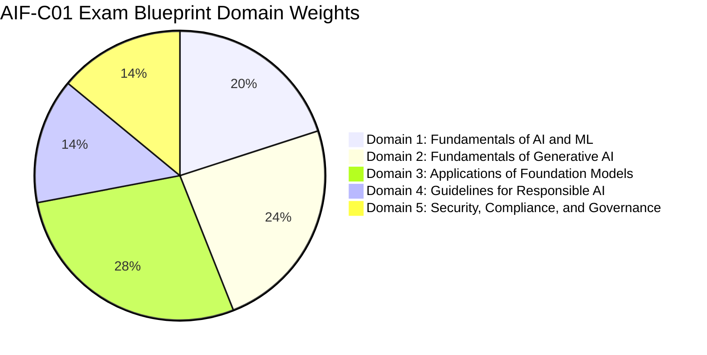
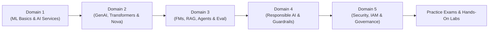

# 📖 AWS Certified AI Practitioner (AIF-C01) Domain Explanations Guide

> **Module:** Comprehensive Domain Deep-Dives  
> **Course:** AWS Certified AI Practitioner (`AIF-C01`)  
> **Exam Version Alignment:** Official v1.2 (October 2026)  
> **Target Audience:** Students, cloud practitioners, and architects preparing for enterprise generative AI workloads on AWS.

---

## 🗺️ Domain Architecture & Weighting

---

## 📚 Master Domain Index

| Domain | Title & Core Coverage | Exam Weight | Key AWS Services & Technologies |
| :--- | :--- | :---: | :--- |
| **[Domain 1](./01_Domain_1_Fundamentals_of_AI_and_ML.md)** | **Fundamentals of AI and Machine Learning** AI/ML/DL/GenAI taxonomy, Supervised/Unsupervised/RL, ML Lifecycle, Overfitting/Underfitting, Confusion Matrix, Classification & Regression Metrics. | **20%** | SageMaker Data Wrangler, Feature Store, Rekognition, Textract, Comprehend, Transcribe, Polly, Translate, Kendra |
| **[Domain 2](./02_Domain_2_Fundamentals_of_Generative_AI.md)** | **Fundamentals of Generative AI** Transformers, Self-Attention, Encoders vs Decoders, Tokens, Embeddings, Context Windows, Amazon Nova Family, Agentic AI, MCP protocol. | **24%** | Amazon Bedrock, Amazon Nova (Micro, Lite, Pro, Premier), Titan Image Generator, Model Context Protocol (MCP) |
| **[Domain 3](./03_Domain_3_Applications_of_Foundation_Models.md)** | **Applications of Foundation Models** Model selection criteria, Prompt Engineering, Prompt Caching, Enterprise RAG, Vector Search, PEFT/LoRA Fine-tuning, ROUGE/BLEU/BERTScore, LLM-as-a-Judge. | **28%** | Bedrock Playgrounds, Knowledge Bases, Agents, Prompt Management, OpenSearch Serverless, SageMaker JumpStart |
| **[Domain 4](./04_Domain_4_Guidelines_for_Responsible_AI.md)** | **Guidelines for Responsible AI** Fairness, Transparency, Explainability, Pre/Post-training bias metrics, SHAP values, Bedrock Guardrails, Model Cards, Model Registry, IP indemnity. | **14%** | Amazon Bedrock Guardrails, SageMaker Clarify, SageMaker Model Cards, SageMaker Model Registry |
| **[Domain 5](./05_Domain_5_Security_Compliance_and_Governance.md)** | **Security, Compliance, and Governance for AI Solutions** Generative AI Security Scoping Matrix, Data privacy & residency, IAM policies, PrivateLink, Macie, CloudTrail data events, KMS encryption. | **14%** | AWS IAM, AWS PrivateLink, Amazon Macie, AWS CloudTrail, Amazon CloudWatch, AWS KMS |

---

## 🧭 Recommended Learning Path

