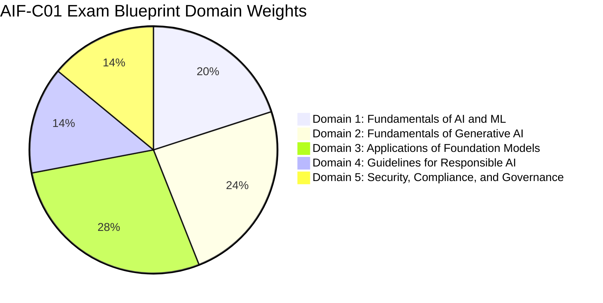
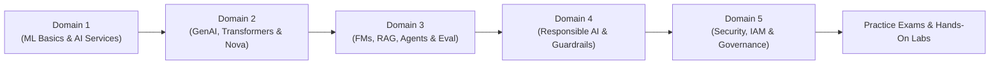

# 📖 AWS Certified AI Practitioner (AIF-C01) Domain Explanations Guide

> **Module:** Comprehensive Domain Deep-Dives  
> **Course:** AWS Certified AI Practitioner (`AIF-C01`)  
> **Exam Version Alignment:** Official v1.2 (October 2026)  
> **Textbook Grounding:** Vikram Elango et al. (*Wiley 2025*), Tom Taulli (*O'Reilly 2025*), CloudExamPro (*2026*), Notezio (*2026*)  
> **Target Audience:** Students, cloud practitioners, and architects preparing for enterprise generative AI workloads on AWS.

---

## 🗺️ Domain Architecture & Weighting

---

## 📚 Master Domain Index & Revision Question Bank Alignment

| Domain | Title & Core Coverage | Exam Weight | Key AWS Services & Technologies | Master Unique Practice Bank |
| :--- | :--- | :---: | :--- | :---: |
| **[Domain 1](./01_Domain_1_Fundamentals_of_AI_and_ML.md)** | **Fundamentals of AI and Machine Learning** AI/ML/DL/GenAI taxonomy, Supervised/Unsupervised/RL, ML Lifecycle, Overfitting/Underfitting, Confusion Matrix, Classification & Regression Metrics. | **20%** | SageMaker Data Wrangler, Feature Store, Rekognition, Textract, Comprehend, Transcribe, Polly, Translate, Kendra | [**363 Unique Questions**](../../../Documents/Obsidian%20Vault/Brain/AWS/Questions_Bank/Unique_Revision_Banks/AI_Practitioner_AIF-C01/Domain_1_Fundamentals_of_AI_and_ML_Unique_Questions.md) |
| **[Domain 2](./02_Domain_2_Fundamentals_of_Generative_AI.md)** | **Fundamentals of Generative AI** Transformers, Self-Attention, Encoders vs Decoders, Tokens, Embeddings, Context Windows, Amazon Nova Family, Agentic AI, MCP protocol. | **24%** | Amazon Bedrock, Amazon Nova (Micro, Lite, Pro, Premier), Titan Image Generator, Model Context Protocol (MCP) | [**529 Unique Questions**](../../../Documents/Obsidian%20Vault/Brain/AWS/Questions_Bank/Unique_Revision_Banks/AI_Practitioner_AIF-C01/Domain_2_Fundamentals_of_Generative_AI_Unique_Questions.md) |
| **[Domain 3](./03_Domain_3_Applications_of_Foundation_Models.md)** | **Applications of Foundation Models** Model selection criteria, Prompt Engineering, Prompt Caching, Enterprise RAG, Vector Search, PEFT/LoRA Fine-tuning, ROUGE/BLEU/BERTScore, LLM-as-a-Judge. | **28%** | Bedrock Playgrounds, Knowledge Bases, Agents, Prompt Management, OpenSearch Serverless, SageMaker JumpStart | [**510 Unique Questions**](../../../Documents/Obsidian%20Vault/Brain/AWS/Questions_Bank/Unique_Revision_Banks/AI_Practitioner_AIF-C01/Domain_3_Applications_of_Foundation_Models_Unique_Questions.md) |
| **[Domain 4](./04_Domain_4_Guidelines_for_Responsible_AI.md)** | **Guidelines for Responsible AI** Fairness, Transparency, Explainability, Pre/Post-training bias metrics, SHAP values, Bedrock Guardrails, Model Cards, Model Registry, IP indemnity. | **14%** | Amazon Bedrock Guardrails, SageMaker Clarify, SageMaker Model Cards, SageMaker Model Registry | [**241 Unique Questions**](../../../Documents/Obsidian%20Vault/Brain/AWS/Questions_Bank/Unique_Revision_Banks/AI_Practitioner_AIF-C01/Domain_4_Guidelines_for_Responsible_AI_Unique_Questions.md) |
| **[Domain 5](./05_Domain_5_Security_Compliance_and_Governance.md)** | **Security, Compliance, and Governance for AI Solutions** Generative AI Security Scoping Matrix, Data privacy & residency, IAM policies, PrivateLink, Macie, CloudTrail data events, KMS encryption. | **14%** | AWS IAM, AWS PrivateLink, Amazon Macie, AWS CloudTrail, Amazon CloudWatch, AWS KMS | [**171 Unique Questions**](../../../Documents/Obsidian%20Vault/Brain/AWS/Questions_Bank/Unique_Revision_Banks/AI_Practitioner_AIF-C01/Domain_5_Security_Compliance_and_Governance_Unique_Questions.md) |

---

## ⚖️ Dedicated Pairwise Distinction Guides (`notes/distinctions/`)

For eliminating close exam distractor traps, review our 10 focused pairwise comparison guides:
1. [Prompting vs. RAG vs. Fine-Tuning vs. Pretraining](../notes/distinctions/01_Model_Adaptation_Prompting_vs_RAG_vs_FineTuning_vs_Pretraining.md)
2. [ROUGE vs. BLEU vs. Perplexity vs. BERTScore](../notes/distinctions/02_Evaluation_Metrics_ROUGE_vs_BLEU_vs_Perplexity_vs_BERTScore.md)
3. [SageMaker Real-Time vs. Serverless vs. Async vs. Batch Transform](../notes/distinctions/03_SageMaker_Deployment_Modes_RealTime_vs_Serverless_vs_Async_vs_Batch.md)
4. [Temperature vs. Top-P vs. Top-K](../notes/distinctions/04_Inference_Parameters_Temperature_vs_TopP_vs_TopK.md)
5. [Claude 3.5 vs. Amazon Nova vs. Titan vs. Llama vs. Mistral](../notes/distinctions/05_Bedrock_Model_Families_Claude_vs_Titan_vs_Nova_vs_Llama_vs_Mistral.md)
6. [SageMaker Clarify vs. Bedrock Guardrails vs. Model Cards vs. Model Dashboard](../notes/distinctions/06_Responsible_AI_Clarify_vs_Guardrails_vs_ModelCards_vs_ModelDashboard.md)
7. [Generative AI Security Scopes 1, 2, 3, and 4](../notes/distinctions/07_Generative_AI_Security_Scopes_1_vs_2_vs_3_vs_4.md)
8. [OpenSearch Serverless vs. Aurora pgvector vs. Neptune Analytics](../notes/distinctions/08_Vector_Databases_OpenSearch_Serverless_vs_Aurora_pgvector_vs_Neptune.md)
9. [Supervised vs. Unsupervised vs. Reinforcement Learning vs. RLHF](../notes/distinctions/09_Learning_Paradigms_Supervised_vs_Unsupervised_vs_Reinforcement_Learning.md)
10. [CloudTrail Data Events vs. Bedrock Invocation Logs vs. Amazon Macie](../notes/distinctions/10_Auditing_Trio_CloudTrail_Data_Events_vs_Bedrock_Invocation_Logs_vs_Macie.md)

---

## 🧭 Recommended Learning Path

