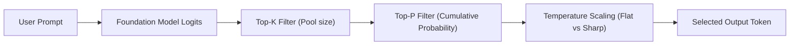
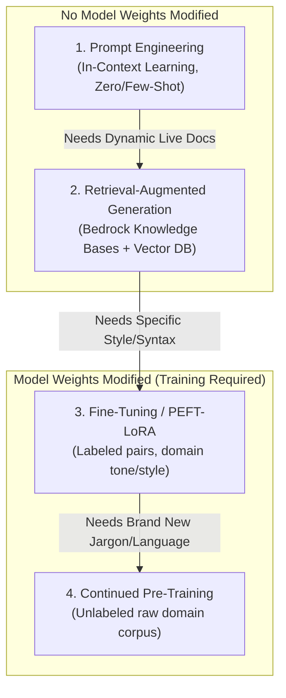

# Lecture 02: Generative AI & Amazon Bedrock Architecture

> **Course Track:** AWS Certified AI Practitioner (`AIF-C01`)  
> **Target Exam Domain:** Domain 2: Fundamentals of Generative AI (24% of Exam Blueprint)  
> **Estimated Delivery Duration:** 90 Minutes  
> **Associated Slide Deck:** `slides/Module_02_Amazon_Bedrock_and_RAG_Slides.md` (Part 1)  
> **Target Hands-On Labs:** `labs/Lab_01_Amazon_Bedrock_Playground_and_Prompt_Engineering.md` & `labs/Lab_08_Multimodal_Generative_AI_with_Amazon_Titan.md`  
> **Student Explanations:** `explanations/02_Domain_2_Fundamentals_of_Generative_AI.md`

---

## 📚 Prescribed Textbook Reading & Literature Grounding

Before delivering or attending this lecture, review the assigned chapters:
* **Vikram Elango, Vivek Gangasani, Shreyas Subramanian (*Wiley / Sybex 2025*):**
  * Chapter 3: *Generative AI Foundations & Architectures* (pp. 69–110)
    * Transformer architecture (Vaswani et al., 2017), self-attention mechanisms, positional encodings.
    * Encoder-only (BERT), Decoder-only (GPT, Llama), and Encoder-Decoder (T5) model typologies.
    * Autoregressive token generation, next-token prediction, and probability distributions.
  * Chapter 4: *Amazon Bedrock & Foundation Models* (pp. 111–160)
    * Serverless architecture, unified API abstractions (`InvokeModel`, `InvokeModelWithResponseStream`, `Converse`).
    * Foundation Model (FM) provider landscape: Amazon Titan, Anthropic Claude, Meta Llama, Mistral AI, Cohere, AI21 Labs, Stability AI.
    * Pricing models: On-Demand token consumption vs. Provisioned Throughput (Model Units - MUs).
* **Tom Taulli (*O'Reilly 2025*):**
  * Chapter 3: *Amazon Bedrock & Model Selection* (pp. 39–66)
    * Evaluating foundational models based on latency, context window size, modality, and pricing.
    * The Bedrock data privacy pledge: strict isolation of customer data from base model training.
* **CloudExamPro AIF-C01 Master Cheat Sheet (2026 Edition):**
  * Section 2: *Generative AI Foundations, Transformer Architecture, and Foundation Models* (pp. 6–10)
* **Notezio AIF-C01 Master Guide (2026):**
  * Chapters 4, 5, 6, 7, 8: *Transformers, Attention Mechanism, Bedrock Ecosystem, Model Families, and Decoding Hyperparameters*.

---

## ⏱️ Detailed 90-Minute Delivery Schedule & Pacing

```
00:00 - 00:15 | Generative AI Core Mechanics: The Transformer Revolution & Self-Attention
00:15 - 00:35 | The Amazon Bedrock Serverless Architecture & The AWS Data Privacy Guarantee
00:35 - 00:55 | The Model Family Landscape: Claude, Titan, Nova, Llama, Mistral, Command & SDXL
00:55 - 01:15 | Decoding Hyperparameters: Temperature, Top-P, Top-K, Max Tokens & Stop Sequences
01:15 - 01:25 | The Model Customization Spectrum: Prompting vs RAG vs Fine-Tuning vs Pre-Training
01:25 - 01:30 | Socratic Q&A & Transition to Lab 01 (Bedrock Playground & Parameter Tuning)
```

---

## 🗣️ Instructor Delivery Talking Points & Storytelling

### 1. The Core Generative AI Paradigm: Predicting the Next Word
* **The Analogy (The Autocomplete Prodigy):**
  * Generative AI models do not "think" or "understand" in a human sense; they are master probability engines.
  * When given a sequence of tokens (*"The capital of France is..."*), the transformer computes the probability distribution over its entire vocabulary and predicts the next most probable token (*"Paris"*).
* **Tokens vs. Words:**
  * 1 token $\approx$ 0.75 English words (or 1,000 tokens $\approx$ 750 words).
  * Words are broken into subword units (e.g., "unbreakable" $\rightarrow$ `un`, `break`, `able`).
* **The Transformer Architecture (Vaswani et al., 2017):**
  * *Self-Attention:* Computes the contextual relationship between every word in a sentence simultaneously, overcoming the memory bottlenecks of legacy Recurrent Neural Networks (RNNs) and LSTMs.
  * *Positional Encoding:* Injects token position vectors because transformers process words in parallel rather than sequentially.
  * *Architectural Variants:*
    * **Encoder-Only:** Bi-directional attention. Ideal for text classification, sentiment analysis, NER (e.g., BERT).
    * **Decoder-Only:** Causal (left-to-right) attention. Ideal for open-ended text generation, conversational AI (e.g., GPT, Llama, Claude, Titan Text).
    * **Encoder-Decoder:** Sequence-to-sequence translation, summarization (e.g., T5, Amazon Titan Text G1 - Express).

---

### 2. Amazon Bedrock: The Serverless Foundation Model Hub
* **What is Amazon Bedrock?**
  * A fully managed, serverless service that offers choice of high-performing Foundation Models (FMs) from leading AI companies (Anthropic, Meta, Mistral, AI21, Cohere, Stability AI, and Amazon) via a single unified API.
* **Why Bedrock over Self-Hosting on EC2 / SageMaker?**
  * Zero infrastructure management (no GPUs to provision, patch, or scale).
  * Pay-as-you-go pricing (pay per input and output token).
  * Native enterprise security and governance integrations (KMS encryption, CloudTrail logging, IAM SigV4, PrivateLink, Bedrock Guardrails).
* **The AWS Data Privacy Guarantee (CRITICAL EXAM POINT):**
  * *AWS NEVER uses your proprietary prompts, completions, or fine-tuning data to train or improve the underlying base foundation models.*
  * Customer data is encrypted in transit (TLS 1.2/1.3) and at rest (AWS KMS Customer Managed Keys).
  * Inferences execute entirely within the customer's chosen AWS Region (or designated cross-region inference profiles).

---

### 3. Foundation Model Provider Landscape & Selection Criteria

| Model Family | Key Strengths & Sweet Spot | Typical Use Cases |
| :--- | :--- | :--- |
| **Anthropic Claude (3.5 Sonnet, 3 Haiku, Opus)** | Industry-leading complex reasoning, nuanced code generation, deep context analysis (200k context window), vision capabilities. | Complex legal analysis, software engineering, enterprise orchestration. |
| **Amazon Titan (Text, Multimodal, Image)** | Cost-effective, general-purpose text generation, high-fidelity embeddings, strict enterprise safety. | Internal chatbots, semantic search embeddings, content summarization. |
| **Amazon Nova (Micro, Lite, Pro, Reel, Canvas)** | Next-generation multimodal frontier models with ultra-fast latency, low cost, and native video/image generation. | High-throughput agent workflows, multimedia generation, cost-critical enterprise apps. |
| **Meta Llama (Llama 3 8B, 70B)** | Open-weights foundation models, highly customizable, strong multilingual capabilities. | General conversational AI, open-source compatibility. |
| **Mistral AI (Mistral 7B, Mixtral 8x7B, Mistral Large)** | Sparse Mixture-of-Experts (MoE) architecture, incredible inference speed, efficient multilingual math/coding. | Code assistant tools, low-latency microservices. |
| **Cohere (Command, Embed)** | Enterprise search, highly calibrated retrieval embeddings, customer support dialog. | RAG retrieval pipelines, enterprise search ranking. |
| **AI21 Labs (Jurassic-2, Jamba)** | Advanced multilingual support, structured document generation, hybrid Mamba-Transformer architecture. | Long-document parsing, enterprise writing assistance. |
| **Stability AI (Stable Diffusion SDXL)** | High-resolution image synthesis, artistic rendering, in-painting/out-painting. | Marketing asset generation, digital media creation. |

---

### 4. Decoding Hyperparameters: Controlling the Generation Mechanics

Instructors must visually demonstrate these parameters in the Bedrock Console Playground:



* **Temperature ($0.0 \le T \le 1.0$):**
  * Controls the randomness/flatness of the probability distribution.
  * *Low Temperature ($0.0 - 0.2$):* Deterministic, focused, analytical. Use for financial analysis, code generation, mathematical extraction.
  * *High Temperature ($0.7 - 1.0$):* Diverse, creative, unexpected. Use for marketing brainstorming, fiction writing, poem generation.
* **Top-P (Nucleus Sampling):**
  * Dynamically cuts off the vocabulary pool once the cumulative probability reaches threshold $P$ (e.g., $P = 0.90$).
  * Adapts to the distribution: if one word has 95% probability, only that 1 word is considered; if 20 words share equal small probabilities, all 20 are evaluated.
* **Top-K:**
  * Statically limits sampling to the top $K$ most probable tokens (e.g., $K = 50$).
* **Stop Sequences:**
  * Strings that tell the model to cease generating output immediately (e.g., `User:`, `\n\n`, `Observation:`).
* **Max Generation Length:**
  * Hard upper bound on the number of tokens the model can produce in its completion.

---

### 5. The Model Customization Spectrum



* **Rule of Thumb for the Exam:**
  * If the question asks for **frequently changing live enterprise data** with **zero model training**: $\rightarrow$ **RAG (Amazon Bedrock Knowledge Bases)**.
  * If the question asks to make the model adopt a **specialized medical terminology, tone, or specific JSON schema**: $\rightarrow$ **Fine-Tuning**.
  * If the question asks to train a model on **vast unlabelled proprietary internal documents**: $\rightarrow$ **Continued Pre-Training**.

---

## 🏗️ Production Scenario: Nova Retail Media Content Engine

* **Client:** *OmniCommerce Global*, a retail marketplace with 5 million product SKUs.
* **Challenge:** Generate personalized, SEO-optimized product descriptions and localized marketing banners in 12 languages while maintaining strict brand safety and minimal inference costs.
* **Architecture Solution:**
  1. **Text & Summarization:** Amazon Nova Lite / Micro for high-throughput, low-latency bulk description generation at 1/10th the cost of frontier models.
  2. **Image Generation:** Amazon Nova Canvas / Stable Diffusion XL for photorealistic product staging banners.
  3. **Complex Multimodal Review:** Anthropic Claude 3.5 Sonnet for checking visual compliance and cross-lingual sentiment nuances.
  4. **Cost Optimization:** Provisioned Throughput with 1-month commitment for peak Black Friday traffic; On-Demand tokens during steady state.

---

## ❓ Socratic Discussion Questions & Classroom Engagement

1. **Question:** *"If a model is hallucinating citations in legal summaries, should we lower the Temperature to 0.0 or implement RAG?"*
   * *Answer:* Lowering the Temperature to 0.0 makes the output deterministic, but the model can still confidently hallucinate the same fake citation every time! The real solution is **Retrieval-Augmented Generation (RAG)** to ground the model in authoritative legal statutes.
2. **Question:** *"Can we fine-tune Anthropic Claude 3.5 Sonnet on our private customer service logs directly inside Amazon Bedrock?"*
   * *Answer:* No. Certain proprietary models (like Claude) do not support direct weight fine-tuning in Bedrock; instead, custom fine-tuning is supported for Amazon Titan, Meta Llama, and Cohere. For Claude, few-shot prompting, prompt caching, or RAG is used.
3. **Question:** *"How does Amazon Bedrock ensure an employee cannot prompt-inject the model into revealing payroll data?"*
   * *Answer:* By applying **Amazon Bedrock Guardrails** (Denied Topics and PII Masking) paired with IAM role segregation and vector database access policies.

---

## ⚠️ Exam Traps & "Watch Out For..."

> [!WARNING]
> **Trap 1: Assuming Bedrock Trains on Customer Prompts**  
> Any exam choice stating *"AWS logs user prompts to retrain the foundation model"* is **100% FALSE**. AWS maintains a strict zero-retention policy for base model training.

> [!IMPORTANT]
> **Trap 2: Temperature vs RAG for Hallucination Prevention**  
> Lowering Temperature does **not** inject external knowledge; it only suppresses probabilistic randomness. To inject private enterprise truth, use **RAG**.

> [!TIP]
> **Trap 3: On-Demand vs Provisioned Throughput**  
> On-Demand is priced per token and subject to service quotas. If an enterprise requires **guaranteed sustained TPS (transactions per second)** for mission-critical production or runs a **custom fine-tuned model**, they must purchase **Provisioned Throughput (Model Units)**.

---

## 📋 Post-Lecture Student Checklist & Lab Transition

- [ ] Complete **Lab 01:** `labs/Lab_01_Amazon_Bedrock_Playground_and_Prompt_Engineering.md`.
- [ ] Experiment with Temperature ($0.1$ vs $0.9$) and Top-P in the Amazon Bedrock Console.
- [ ] Review `explanations/02_Domain_2_Fundamentals_of_Generative_AI.md`.
- [ ] Complete the Module 2 review quiz in `slides/Module_02_Amazon_Bedrock_and_RAG_Slides.md`.
