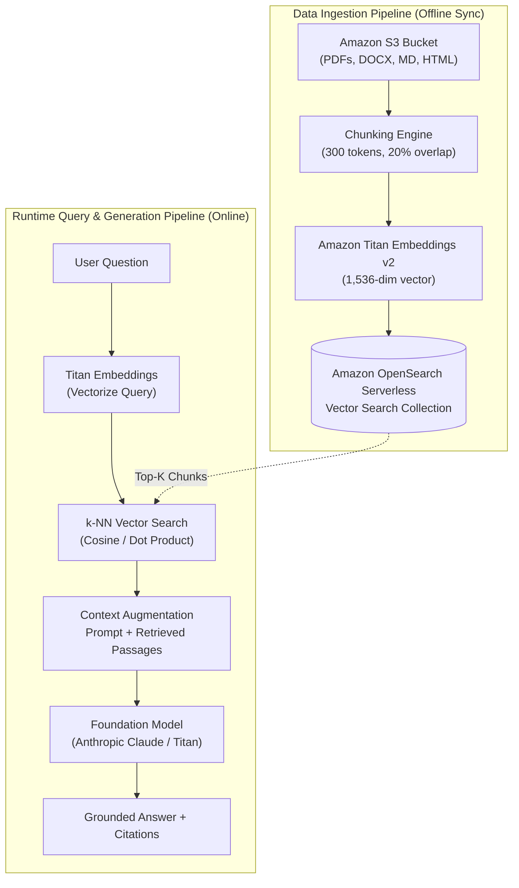

# Lecture 03: Prompt Engineering, RAG Architecture & Autonomous Agents

> **Course Track:** AWS Certified AI Practitioner (`AIF-C01`)  
> **Target Exam Domain:** Domain 3: Applications of Foundation Models (28% of Exam Blueprint - *Highest Weight Domain*)  
> **Estimated Delivery Duration:** 120 Minutes  
> **Associated Slide Deck:** `slides/Module_02_Amazon_Bedrock_and_RAG_Slides.md` (Part 2)  
> **Target Hands-On Labs:** `labs/Lab_02_Building_RAG_with_Bedrock_Knowledge_Bases.md` & `labs/Lab_04_Autonomous_AI_Agents_with_Amazon_Bedrock.md`  
> **Student Explanations:** `explanations/03_Domain_3_Applications_of_Foundation_Models.md`

---

## 📚 Prescribed Textbook Reading & Literature Grounding

Before delivering or attending this lecture, review the assigned chapters:
* **Vikram Elango, Vivek Gangasani, Shreyas Subramanian (*Wiley / Sybex 2025*):**
  * Chapter 5: *Prompt Engineering Techniques* (pp. 161–210)
    * Anatomy of a prompt: instructions, contextual grounding, few-shot exemplars, delimiters, output format schemas.
    * Prompt techniques: Zero-shot, Few-shot (in-context learning), Chain-of-Thought (CoT), Step-Back prompting, ReAct.
  * Chapter 6: *Retrieval-Augmented Generation (RAG) & Vector Databases* (pp. 211–268)
    * The RAG Triad: Ingestion, Retrieval, and Generation.
    * Chunking strategies: Fixed-size, hierarchical, semantic, overlapping windows.
    * Vector embeddings and distance metrics: Cosine similarity, Euclidean (L2) distance, Dot product.
    * Vector store landscape: Amazon OpenSearch Serverless, Amazon Aurora PostgreSQL (`pgvector`), Amazon Neptune Analytics.
  * Chapter 7: *Bedrock Knowledge Bases & Agents* (pp. 269–318)
    * Managed Knowledge Bases synchronization with Amazon S3.
    * Multi-step autonomous planning: ReAct loop, OpenAPI 3.0 schemas, and AWS Lambda Action Groups.
  * Chapter 11: *Generative AI Model Evaluation* (pp. 439–460)
    * ROUGE (1, 2, L), BLEU, Perplexity, BERTScore, and LLM-as-a-Judge evaluation pipelines.
* **Tom Taulli (*O'Reilly 2025*):**
  * Chapter 4: *Prompt Engineering & Optimization* (pp. 67–92)
  * Chapter 5: *RAG and Enterprise Knowledge Integration* (pp. 93–122)
* **CloudExamPro AIF-C01 Master Cheat Sheet (2026 Edition):**
  * Section 3: *Prompt Engineering Taxonomy, RAG Architecture, and Agent Workflows* (pp. 11–16)
* **Notezio AIF-C01 Master Guide (2026):**
  * Chapters 9–14: *Prompting Techniques, Embeddings, Bedrock Knowledge Bases, Vector Databases, Agents for Bedrock, and Action Groups*.

---

## ⏱️ Detailed 120-Minute Delivery Schedule & Pacing

```
00:00 - 00:25 | Prompt Engineering Fundamentals: Anatomy, Delimiters, System Directives & Formatting
00:25 - 00:50 | Advanced Prompting: Zero-Shot, Few-Shot In-Context Learning, Chain-of-Thought (CoT) & ReAct
00:50 - 01:25 | Architecture of RAG: S3 Ingestion -> Chunking -> Vector Embeddings -> OpenSearch Serverless
01:25 - 01:45 | Autonomous Agents for Bedrock: Reasoning Engine, OpenAPI Schemas & Lambda Action Groups
01:45 - 01:55 | GenAI Evaluation Metrics: ROUGE (1, 2, L), BLEU, Perplexity, BERTScore & LLM-as-a-Judge
01:55 - 02:00 | Socratic Q&A & Transition to Lab 02 (Knowledge Bases) and Lab 04 (Bedrock Agents)
```

---

## 🗣️ Instructor Delivery Talking Points & Storytelling

### 1. The Art & Science of Prompt Engineering
* **Anatomy of an Enterprise Prompt:**
  1. **Role / System Prompt:** Assigns persona, authority, and boundaries (*"You are a Senior Cloud Compliance Auditor..."*).
  2. **Instruction / Task:** Explicit, unambiguous action verb (*"Extract all HIPAA violations and categorize them..."*).
  3. **Context / Grounding Data:** External text wrapped in clear delimiters (`"""`, `###`, `<context></context>`) to prevent prompt injection.
  4. **Output Constraints:** Exact desired structure (*"Return strictly valid JSON conforming to this schema..."*).

* **Prompt Engineering Taxonomy:**
  * **Zero-Shot Prompting:** Providing a prompt with zero example completions. Relies entirely on pre-trained parametric knowledge.
  * **Few-Shot Prompting (In-Context Learning):** Providing 2–5 high-quality input-output pairs inside the prompt before asking the target question. Guides formatting, tone, and reasoning style without updating model weights.
  * **Chain-of-Thought (CoT) Prompting:** Instructing the model to break down complex multi-step reasoning into intermediate steps (*"Think step by step before answering"*). Dramatically reduces arithmetic and logical errors.
  * **Step-Back Prompting:** Prompting the model to first identify high-level principles or governing laws before solving a specific edge case.
  * **ReAct Prompting (Reason + Act):** Interleaving reasoning traces (*Thought*) with concrete tool executions (*Action*) and sensory feedback (*Observation*). The foundational framework powering Bedrock Agents.

---

### 2. Retrieval-Augmented Generation (RAG): The Open-Book Exam
* **The Analogy:**
  * Base Foundation Model = A brilliant student taking a closed-book exam. They have great reasoning skills, but their knowledge cutoff was last year, and they know nothing about your company's private HR policies.
  * RAG = Giving that brilliant student an open-book library. Before answering any question, they search the library, find the exact relevant page, read it, and cite it in their answer.



* **Chunking Strategies:**
  * *Fixed-Size Chunking:* Splitting by token count (e.g., 300 tokens with 50-token overlap). Simple, fast, but can split sentences mid-thought.
  * *Hierarchical Chunking:* Small child chunks for high-precision retrieval linked to parent chunks for rich LLM context.
  * *Semantic Chunking:* Splitting based on semantic natural breaks (headers, paragraph themes).
* **Distance / Similarity Metrics:**
  * **Cosine Similarity:** Measures the cosine of the angle between two vectors. Normalized between -1 and 1 (1 = identical direction). Most common for text embeddings.
  * **Dot Product:** Considers both angle and vector magnitude.
  * **Euclidean Distance (L2):** Measures straight-line distance between vector coordinates (lower distance = higher similarity).
* **AWS Vector Store Options:**
  * *Amazon OpenSearch Serverless:* Fully serverless vector engine, native integration with Bedrock Knowledge Bases.
  * *Amazon Aurora PostgreSQL (`pgvector`):* Relational database with vector similarity extension; ideal if operational transactional data is already in Aurora.
  * *Amazon Neptune Analytics:* Graph vector database for knowledge graphs and connected entity search.

---

### 3. Autonomous AI Agents for Amazon Bedrock
* **What is an Agent?**
  * An autonomous system that uses an LLM as its reasoning brain to execute multi-step workflows, orchestrate tools, query knowledge bases, and make decisions dynamically.
* **Core Architecture Components:**
  1. **Foundation Model (The Brain):** Analyzes user intent, develops an execution plan, and decides which tools to invoke.
  2. **Knowledge Base (The Memory):** Access to private enterprise documentation for factual context retrieval.
  3. **Action Groups (The Hands):** The tools the agent can execute. Composed of:
     * *OpenAPI 3.0 Schema:* Defines available API endpoints, parameters, and return types in standard JSON/YAML.
     * *AWS Lambda Function:* The serverless compute that executes the actual business logic (e.g., querying DynamoDB, creating a Jira ticket, calling Stripe API).
* **The ReAct Execution Loop:**
  * User asks: *"Cancel flight FL-409 for customer C-902 and refund the ticket."*
  * Agent iterates:
    * **Thought 1:** I need to check the flight status and cancellation policy.
    * **Action 1:** Query Knowledge Base for flight cancellation guidelines.
    * **Observation 1:** Cancellations within 24 hours are eligible for 100% refund.
    * **Thought 2:** I need to call the flight cancellation API.
    * **Action 2:** Invoke Lambda function `CancelBooking(flightId="FL-409", customerId="C-902")`.
    * **Observation 2:** Booking successfully cancelled, refund ID `RF-881` generated.
    * **Thought 3:** I have fulfilled the user request.
    * **Final Answer:** Flight FL-409 cancelled and refund of \$450 issued (Ref: RF-881).

---

### 4. Generative AI Model Evaluation Metrics

| Metric | Measurement Focus | How It Works | Primary Use Case |
| :--- | :--- | :--- | :--- |
| **ROUGE-1** | Word / Unigram overlap | Measures overlap of individual words between generated text and reference text. | Text summarization baseline. |
| **ROUGE-2** | Bigram (2-word pair) overlap | Measures overlap of consecutive word pairs, assessing fluency and phrasal coherence. | Summary readability and cohesion. |
| **ROUGE-L** | Longest Common Subsequence | Measures the longest common string of words without requiring consecutive matches. | Sentence structure preservation in summarization. |
| **BLEU** | n-gram Precision | Precision-focused metric calculating how many candidate n-grams appear in reference translations. | Machine translation evaluation. |
| **Perplexity** | Uncertainty / Surprise | Exponential of negative log-likelihood. Lower perplexity = model is more confident in predicting the text. | Language model pre-training quality. |
| **BERTScore** | Semantic Similarity | Computes pairwise cosine similarity of contextual token embeddings (captures synonyms). | Abstractive rewriting where exact words differ. |
| **LLM-as-a-Judge** | Multi-dimensional scoring | Using a frontier model (Claude 3.5 Sonnet) with a structured rubric to score answers for Groundedness, Relevance, and Tone. | Bedrock Model Evaluation jobs and RAG pipelines. |

---

## 🏗️ Production Scenario: Global Telco Automated Customer Support Agent

* **Client:** *Apex Wireless*, servicing 20 million mobile subscribers.
* **Business Challenge:** Customers wait 45 minutes on hold to troubleshoot SIM card issues, check billing charges, or upgrade data plans.
* **Architecture Solution:**
  1. **Omnichannel Interface:** Amazon Lex conversational bot connected to customer mobile app and phone lines.
  2. **Bedrock Agent:** Orchestrates customer intent using Anthropic Claude 3.5 Sonnet.
  3. **Knowledge Base:** Bedrock Knowledge Base connected to Amazon S3 holding 5,000 PDF device troubleshooting manuals and plan terms indexed in OpenSearch Serverless.
  4. **Action Group 1 (Billing):** OpenAPI schema connected to AWS Lambda `FetchAccountBalance(phone_number)`.
  5. **Action Group 2 (SIM Reset):** OpenAPI schema connected to AWS Lambda `SendNetworkResetSignal(iccid)`.
  6. **Security & Guardrails:** Bedrock Guardrails masking all 16-digit credit card numbers and denying discussions about competitor pricing.

---

## ❓ Socratic Discussion Questions & Classroom Engagement

1. **Question:** *"If a model answers arithmetic word problems incorrectly despite knowing the formulas, what prompt engineering technique should you apply first?"*
   * *Answer:* **Chain-of-Thought (CoT) prompting** (e.g., adding *"Let's think step by step"*), which forces the model to generate intermediate reasoning tokens, vastly improving math accuracy.
2. **Question:** *"Why do we need vector embeddings for RAG instead of standard keyword search like SQL `LIKE '%query%'`?"*
   * *Answer:* Vector embeddings capture **semantic meaning and conceptual intent**. A user searching for *"How do I fix a flat tire?"* will match a document explaining *"Replacing a punctured wheel"*, even though they share zero identical keywords.
3. **Question:** *"In an Amazon Bedrock Agent, who writes the business logic that updates an order in DynamoDB?"*
   * *Answer:* The developer writes it inside an **AWS Lambda function**, which is referenced by the agent's **Action Group** via an OpenAPI 3.0 specification. The agent formulates the parameters; Lambda executes the action.

---

## ⚠️ Exam Traps & "Watch Out For..."

> [!WARNING]
> **Trap 1: ROUGE vs BLEU Selection**  
> Remember the mnemonic: **B**LEU = **B**ilingual / Translation (Precision-oriented). **R**OUGE = **R**ecall / Summarization (Overlap-oriented). If an exam question asks to evaluate automated summaries of financial earnings calls, choose **ROUGE**.

> [!IMPORTANT]
> **Trap 2: OpenSearch Serverless Cost Alert**  
> OpenSearch Serverless Vector Collections mandate a minimum of 2 OpenSearch Compute Units (OCUs) for search and 2 for indexing (or 1+1 minimum), costing ~$0.48/hr ($350/mo). For exam questions, it is the primary serverless vector store for Bedrock Knowledge Bases; for student labs, it must be deleted immediately after testing!

> [!TIP]
> **Trap 3: RAG vs Fine-Tuning Decision**  
> If proprietary data changes hourly/daily $\rightarrow$ **RAG**. Fine-tuning cannot keep up with rapidly changing data and requires costly recurring retraining runs.

---

## 📋 Post-Lecture Student Checklist & Lab Transition

- [ ] Complete **Lab 02:** `labs/Lab_02_Building_RAG_with_Bedrock_Knowledge_Bases.md`.
- [ ] Complete **Lab 04:** `labs/Lab_04_Autonomous_AI_Agents_with_Amazon_Bedrock.md`.
- [ ] Review `explanations/03_Domain_3_Applications_of_Foundation_Models.md`.
- [ ] Practice the ROUGE vs BLEU vs Perplexity distinction table.
- [ ] Run the Module 3 review quiz in `slides/Module_03_Prompt_Engineering_and_Applications_Slides.md`.
