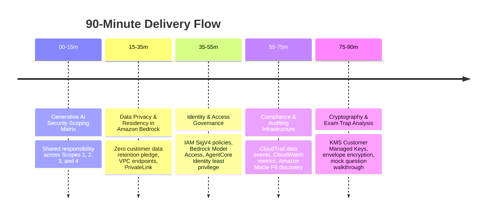

# Lecture 05: Security, Compliance, and Governance for AI Solutions

> **Course:** AWS Certified AI Practitioner (`AIF-C01`)  
> **Domain Alignment:** Domain 5: Security, Compliance, and Governance (14% Exam Weight)  
> **Duration:** 90 Minutes  
> **Slide Deck:** `slides/Module_05_Security_Compliance_and_Governance_Slides.md`  
> **Associated Labs:** Lab 05, Lab 10, Lab 12  
> **Target Audience:** Enterprise architects, compliance officers, and cloud developers

---

## ⏱️ Lecture Agenda & Timing Breakdown

---

## 🎯 Core Learning Objectives
By the end of this lecture, students will be able to:
1. Explain the **Generative AI Security Scoping Matrix** and assign security responsibilities accurately.
2. Articulate Amazon Bedrock's data privacy guarantees (zero model training on customer prompts).
3. Architect network isolation for Generative AI using **AWS PrivateLink** and VPC Endpoint Policies.
4. Enforce least-privilege access using **AWS IAM** and **Bedrock AgentCore Identity**.
5. Implement end-to-end auditability using **AWS CloudTrail**, **Amazon Macie**, and **AWS KMS**.

---

## 🗣️ Instructor Delivery Guide & Key Talking Points

### 1. The Generative AI Security Scoping Matrix (00–15m)
* **The Paradigm:** Draw the 4 scopes on the whiteboard. Emphasize that security responsibility is not static in Generative AI—it slides based on architectural ownership:
  * *Scope 1 (Consumer SaaS):* Customer has no control over underlying training data; highest risk of proprietary data leakage.
  * *Scope 2 (Enterprise Managed Services):* Amazon Bedrock and Amazon Q. AWS owns the model weights and physical safety; customer owns IAM policies and Guardrails.
  * *Scope 3 (Fine-Tuning & RAG):* Customer becomes responsible for curating, sanitizing, and access-controlling the private documents and vector embeddings.
  * *Scope 4 (Pre-training from scratch):* Complete customer ownership of ethics, copyright, and hardware infrastructure.
* **Exam Tip:** Whenever an exam scenario asks who is responsible for preventing prompt injection in an application built on Amazon Bedrock, the answer is the **Customer** (via Amazon Bedrock Guardrails).

### 2. Bedrock Data Privacy & Network Isolation (15–35m)
* **AWS Zero-Training Guarantee:** Reiterate forcefully that AWS does **not** use customer prompts or completions to train base foundation models, nor are they shared with third-party model providers (Anthropic, Meta).
* **Network Isolation:** Explain why public internet traversal is unacceptable for healthcare or financial data. Show how **AWS PrivateLink** provisions VPC Interface Endpoints (`com.amazonaws.<region>.bedrock-runtime`), keeping all inference calls on AWS's private global fiber network.

### 3. Identity & AgentCore Governance (35–55m)
* **Model Access Controls:** In Bedrock, models are disabled by default. Administrators must explicitly request model access per account and region.
* **AgentCore Least Privilege:** When an agent invokes AWS Lambda functions to query databases, it must assume an execution role limited strictly to that function ARN. Never grant `AdministratorAccess` to an autonomous agent.

### 4. Continuous Auditing with Macie, CloudTrail & KMS (55–75m)
* **Amazon Macie:** Acts as the data lake bouncer. Before synchronizing documents into a Bedrock Knowledge Base vector index, Macie scans the S3 bucket to flag unmasked credit cards or passport numbers.
* **CloudTrail Data Events:** Highlight that standard CloudTrail management events record who modified a guardrail, but **Data Events** must be specifically enabled to record individual model invocation calls (`InvokeModel`).
* **KMS CMK:** Explain envelope encryption for custom model weights and OpenSearch vector storage.

---

## ⚠️ Common Student Misconceptions to Clarify
1. *Misconception:* "Amazon Bedrock sends my company data to Anthropic servers when I use Claude 3.5 Sonnet."
   * *Correction:* False. Anthropic models in Amazon Bedrock run entirely on AWS infrastructure in the customer's selected AWS region. No data ever leaves AWS.
2. *Misconception:* "CloudTrail automatically logs the full prompt text and response text of every Bedrock call."
   * *Correction:* False. CloudTrail records the API call metadata (who, when, which model ARN, client IP). To log invocation inputs/outputs, Model Invocation Logging must be enabled directly in Amazon Bedrock targeting S3 or CloudWatch Logs.

---

## ❓ Rapid Classroom Diagnostic Questions
1. *"An insurance company wants to ensure employees cannot send sensitive claims data across the public internet when querying Amazon Bedrock. What should the architect deploy?"*
   * **Answer:** An AWS PrivateLink VPC Interface Endpoint for the Bedrock Runtime.
2. *"A healthcare provider must audit whether any S3 buckets intended for a RAG knowledge base contain exposed patient health identifiers. Which service is optimal?"*
   * **Answer:** Amazon Macie.
