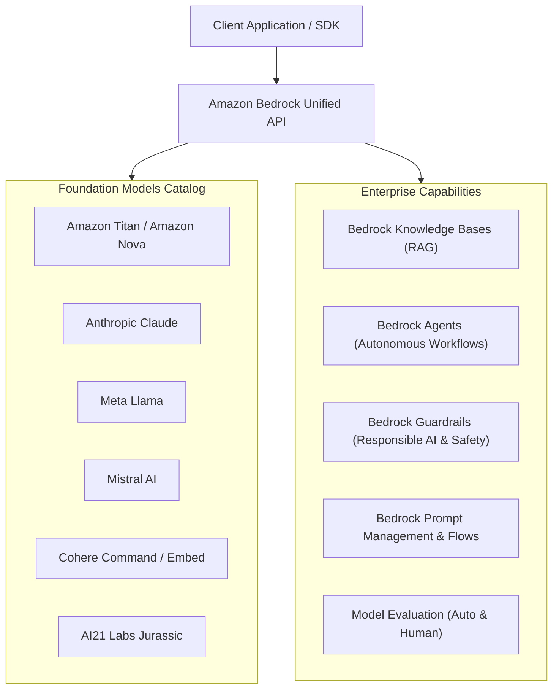
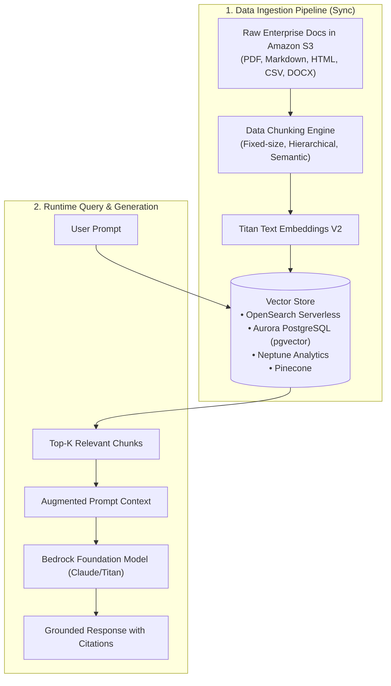
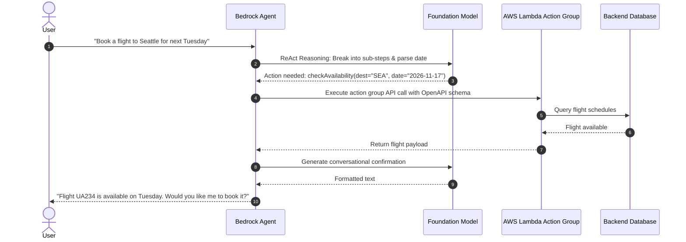
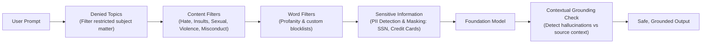

# Amazon Bedrock Deep Dive

> **Service Category:** AI / ML & Generative AI  
> **Relevant Certifications:** [[01_Certifications/AI_Practitioner_AIF-C01/AIF-C01_Master_Blueprint|AIF-C01]], [[01_Certifications/Cloud_Practitioner_CLF-C02/CLF-C02_Master_Blueprint|CLF-C02]]  
> **Tags:** `#aws/services` `#aws/genai` `#bedrock` `#rag` `#aif-c01`

---

## 1. Overview & Core Value Proposition

**Amazon Bedrock** is a fully managed, serverless service that provides access to leading Foundation Models (FMs) from Amazon and top AI startups through a **single unified API**, alongside a broad set of capabilities to build generative AI applications with security, privacy, and responsible AI.

### Key Architectural Tenets:
* **Serverless & Managed:** Zero infrastructure, cluster provisioning, or GPU management.
* **Data Isolation & Privacy:** 
  * **AWS never uses customer prompts, completions, or fine-tuning data to train base models.**
  * All customer data stays isolated within your AWS account and designated AWS Region.
* **Enterprise Security:**
  * Encryption at rest using **AWS KMS** (supports Customer Managed Keys - CMK).
  * Encryption in transit using **TLS 1.2+**.
  * Private connectivity using **AWS PrivateLink** (VPC Endpoints) so traffic never traverses the public internet.

---

## 2. Choosing Foundation Models on Bedrock

| Model Family | Provider | Strengths & Primary Use Cases |
|---|---|---|
| **Anthropic Claude (3.5 Sonnet, 3 Haiku, Opus)** | Anthropic | Complex reasoning, coding, deep analysis, multimodal vision, long context windows (up to 200k tokens). High safety alignment. |
| **Amazon Titan (Text, Image, Multimodal)** | Amazon | Cost-effective text generation, high-dimensional vector embeddings (Titan Embeddings V2), image generation (Titan Image Generator). Built-in watermarking. |
| **Amazon Nova (Micro, Lite, Pro, Premier)** | Amazon | High-speed, cost-optimized next-generation foundation models for multimodal tasks, reasoning, and document intelligence. |
| **Meta Llama (3.1 / 3.2)** | Meta | Open-weight foundation models offering high efficiency, broad community fine-tuning, multilingual text generation, and reasoning. |
| **Mistral (Mistral 7B, Mixtral 8x7B, Large)** | Mistral AI | Fast inference, strong multilingual processing, compact mixture-of-experts (MoE) efficiency. |
| **Cohere (Command, Embed)** | Cohere | Enterprise text generation, high-performance multilingual text embeddings, retrieval and re-ranking for search. |
| **AI21 Labs (Jurassic-2)** | AI21 | Specialized natural language generation, summarization, and paraphrasing across multiple languages. |

---

## 3. Bedrock Knowledge Bases (Managed RAG)

Amazon Bedrock Knowledge Bases automates the entire end-to-end Retrieval-Augmented Generation (RAG) pipeline:

### Chunking Strategies in Bedrock:
1. **Fixed-Size Chunking:** Splits text into uniform chunks based on maximum token count with an overlap percentage (default: 300 tokens, 20% overlap).
2. **Hierarchical Chunking:** Breaks documents into nested parent and child chunks. Searches against small child chunks for accuracy, but returns the larger parent chunk to the LLM for broader context.
3. **Semantic Chunking:** Detects natural topic boundaries and splits paragraphs accordingly.
4. **No Chunking:** Treats each file as a single chunk (ideal for short FAQ items).

### Supported Vector Databases for Bedrock Knowledge Bases:

| Vector Database Solution | Type / Engine | Scalability & Performance | Primary Exam Use Case |
| :--- | :--- | :--- | :--- |
| **Amazon OpenSearch Serverless** | Managed serverless k-NN search | Auto-scales compute and storage independently; sub-second search | Enterprise-grade RAG; millions of embeddings; production search |
| **Amazon Aurora (PostgreSQL with `pgvector`)** | Relational ACID database with vector extension | High performance alongside transactional application tables | Embeddings must co-locate with existing transactional relational data |
| **Amazon Neptune Analytics (GraphRAG)** | Managed graph database + vector indexing | Graph traversals combined with vector similarity | Knowledge graphs, complex relational reasoning, fraud, entity linking |
| **Pinecone / Redis Enterprise** | Managed 3rd-party vector native stores | Ultra-low latency specialized vector indexing | Existing cloud-native vector store adoption |

---

## 3.1 Model Adaptation Spectrum & Cost Analysis

Choosing how to adapt a Foundation Model involves balancing performance, customization depth, computational expense, and engineering effort:

| Adaptation Strategy | Relative Cost | Compute Requirement | Labeled Data Needed | Primary Purpose & Trigger |
| :--- | :---: | :--- | :--- | :--- |
| **Prompt Engineering** | **Very Low ($)** | Zero training compute; standard token invocation | Zero samples (or 1–5 in-context examples) | Formatting, task instruction, simple reasoning |
| **Retrieval-Augmented Generation (RAG)** | **Moderate ($$)** | Embedding inference + vector store storage | External unstructured knowledge files (PDFs, docs) | Dynamic external knowledge, live proprietary data, citations |
| **Instruction-Based Fine-Tuning** | **Medium ($$$)** | SageMaker / Bedrock training cluster (hours) | Hundreds to thousands of labeled prompt-response pairs | Style, domain vocabulary, formatting, task specialization |
| **Continued Pre-training** | **High ($$$$)** | Multi-GPU / Trainium clusters (days) | Millions of tokens of unlabeled domain text | Deep technical jargon (medical, legal, financial) |
| **Pre-training from Scratch** | **Extreme ($$$$$)** | Massive distributed clusters (months) | Trillions of tokens; massive multi-terabyte corpus | Creating brand new proprietary foundation models |

---

## 3.2 RAG vs. Fine-Tuning Decision Guide

| Dimension | Retrieval-Augmented Generation (RAG) | Fine-Tuning |
| :--- | :--- | :--- |
| **Knowledge Source** | External vector database / document store | Internalized within model weights |
| **Data Freshness** | **Real-Time:** Updates immediately when docs sync to S3/Vector DB | **Static:** Requires new training run to absorb new facts |
| **Hallucination Risk** | **Low:** Grounded in retrieved facts with source citations | **Moderate:** Can hallucinate or suffer catastrophic forgetting |
| **Auditability & Provenance** | **High:** Returns exact chunk, page, and S3 URI | **Low:** Black-box parametric memory |
| **Best For** | *"Answer customer questions using our latest return policy"* | *"Ensure customer support replies adopt our corporate brand tone"* |

---

## 4. Bedrock Agents (Autonomous Multi-Step Workflows)

**Amazon Bedrock Agents** break down user requests, formulate multi-step plans, and independently invoke external business APIs to fulfill tasks:

* **Core Components:**
  * **Foundation Model:** Drives reasoning and intent decomposition.
  * **Action Groups:** Connect the agent to external systems via **AWS Lambda** functions defined by **OpenAPI 3.0 schemas**.
  * **Knowledge Bases:** Ground agent answers in enterprise documents.
  * **Memory:** Retains conversational context across sessions for multi-turn interactions.

---

## 5. Amazon Bedrock Guardrails (Responsible AI & Safety)

Bedrock Guardrails enforce strict organizational safety policies and content moderation across models:

### Key Guardrail Mechanisms:
1. **Denied Topics:** Block prompts or responses about out-of-scope subjects using plain English descriptions (e.g., *"Investment advice"* for a retail shopping bot).
2. **Content Filters:** Configurable thresholds (None, Low, Medium, High) across categories: *Hate, Insults, Sexual, Violence, Misconduct*.
3. **Word Filters:** Pre-built profanity filters and custom banned word/phrase lists.
4. **Sensitive Information Filters:** Detect and redact/mask Personally Identifiable Information (PII) like Social Security Numbers, phone numbers, email addresses, or custom regex patterns.
5. **Contextual Grounding Check:** Specifically built for RAG applications. Evaluates whether the generated response is factually grounded in the retrieved source documents and relevant to the user's query, suppressing hallucinations before they reach the user.

---

## 6. Amazon Bedrock Prompt Management & Prompt Flows

* **Prompt Management:**
  * Centrally catalog, test, and version prompt templates.
  * Define dynamic variables using `{{variable}}` syntax for runtime interpolation.
* **Bedrock Prompt Flows:**
  * Drag-and-drop visual workflow canvas.
  * Node types: *Prompt Node, Model Node, Knowledge Base Node, Lambda Node, Condition / Router Node*.
  * Enables chaining multiple LLM calls, RAG lookups, and conditional branching without boilerplate glue code.

---

## 7. Monitoring, Auditing & Operational Governance

* **Amazon CloudWatch Metrics:**
  * `Invocations`: Total number of model calls.
  * `InvocationLatency`: Time taken for the model to generate tokens.
  * `InvocationClientErrors` (4xx) & `InvocationServerErrors` (5xx).
* **Model Invocation Logging:**
  * Capture full input prompts and output responses for auditing.
  * Destinations: **Amazon S3** (for long-term storage/compliance) and/or **Amazon CloudWatch Logs** (for active monitoring and searching).
  * Can be encrypted with KMS.
* **AWS CloudTrail:**
  * Records all management and administrative API calls (e.g., `CreateModelCustomizationJob`, `CreateGuardrail`, `InvokeModel`).
