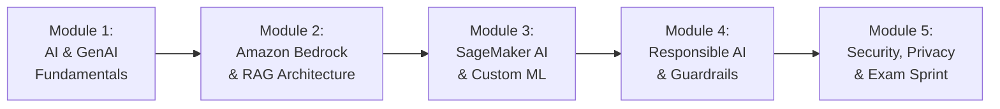

# AWS Certified AI Practitioner (AIF-C01) Course Syllabus

> **Instructor:** Mohamed Fakhruldeen  
> **Course Track:** AI Foundation  
> **Target Certification:** AWS Certified AI Practitioner (`AIF-C01`)  
> **Repository:** `fakhruldeen/AWS` -> `AI/Practitioner/AIF-C01/`

---

## 📚 Prescribed Textbooks & Primary Sources

All lectures, slide decks, labs, and question banks in this course are strictly grounded in published 2025/2026 literature:
1. **Vikram Elango, Vivek Gangasani, Shreyas Subramanian (*Wiley / Sybex 2025*):**  
   *AWS Certified AI Practitioner Study Guide: Foundational (AIF-C01)* (ISBN: 978-1-394-32820-8).  
   *Core focus: AI/ML taxonomy, mathematical embeddings, RAG pipelines, SageMaker Clarify bias metrics, and model governance.*
2. **Tom Taulli (*O'Reilly Media 2025*):**  
   *AWS Certified AI Practitioner (AIF-C01) Study Guide* (ISBN: 978-8-341-62233-4).  
   *Core focus: Generative AI mechanics, Amazon Bedrock model selection, prompt engineering patterns, and Responsible AI ethics.*
3. **CloudExamPro (*2026 Edition*):**  
   *AIF-C01 Master Cheat Sheet & Exam Blueprint Guide*.  
   *Core focus: Metric selection clue tables, Generative AI Security Scoping Matrix, and high-yield exam traps.*
4. **Notezio (*2026 Edition*):**  
   *AWS Certified AI Practitioner Exam Prep & Architecture Guide*.  
   *Core focus: Multi-modal Nova model architectures, Agentic AI, MCP, vector search algorithms, and 350-question deep dive.*
5. **Valentina Galeote (*2025*):**  
   *Generative AI on AWS & Bedrock Architecture Reference Guide*.  
   *Core focus: Enterprise RAG implementations, OpenSearch Serverless sizing, and autonomous agent orchestration.*

---

## Course Architecture & Teaching Roadmap

This comprehensive course prepares students for the **AWS Certified AI Practitioner (AIF-C01)** certification while providing hands-on proficiency in building generative AI applications using **Amazon Bedrock**, **Amazon SageMaker AI**, and the **Amazon Q** ecosystem.

---

## Detailed Module Breakdown

### Module 1: Artificial Intelligence & Machine Learning Foundations
* **Domain Alignment:** Domain 1: Fundamentals of AI and Machine Learning (20% Exam Weight)
* **Prescribed Reading:** Elango et al. Ch 1 & 2; Taulli Ch 1 & 2; Notezio Ch 1–3.
* **Lecture Delivery:** `lectures/Lecture_01_AI_ML_Fundamentals_and_AWS_Ecosystem.md`
* **Slides:** `slides/Module_01_AI_and_GenAI_Foundations_Slides.md`
* **Student Explanations:** `explanations/01_Domain_1_Fundamentals_of_AI_and_ML.md`
* **Core Topics:**
  * The Russian Doll Hierarchy: Artificial Intelligence vs. Machine Learning vs. Deep Learning vs. Generative AI.
  * Learning Paradigms: Supervised (Classification, Regression), Unsupervised (Clustering, Dimensionality Reduction), Reinforcement Learning.
  * The 6-Stage Machine Learning Lifecycle: Ingestion $\rightarrow$ Feature Engineering $\rightarrow$ Training $\rightarrow$ Hyperparameter Tuning $\rightarrow$ Deployment $\rightarrow$ MLOps Monitoring.
  * Overfitting vs Underfitting, Bias-Variance Tradeoff, Regularization ($L_1/L_2$), Validation Splitting.
  * Classical Evaluation Metrics: Confusion Matrix, Precision, Recall, $F_1$-Score, Specificity, ROC-AUC, RMSE, MAE, $R^2$.
  * AWS Pre-Trained AI Services: Rekognition, Polly, Transcribe, Translate, Comprehend, Textract, Lex, Personalize, Forecast.
* **Target Hands-On Labs:**
  * `labs/Lab_06_No_Code_Predictive_ML_with_Amazon_SageMaker_Canvas.md`
  * `labs/Lab_07_Data_Preparation_and_Feature_Engineering_with_SageMaker_Data_Wrangler.md`

### Module 2: Fundamentals of Generative AI & Amazon Bedrock
* **Domain Alignment:** Domain 2: Fundamentals of Generative AI (24% Exam Weight)
* **Prescribed Reading:** Elango et al. Ch 3 & 4; Taulli Ch 3; Notezio Ch 4–8.
* **Lecture Delivery:** `lectures/Lecture_02_Generative_AI_and_Amazon_Bedrock.md`
* **Slides:** `slides/Module_02_Amazon_Bedrock_and_RAG_Slides.md` (Part 1)
* **Student Explanations:** `explanations/02_Domain_2_Fundamentals_of_Generative_AI.md`
* **Core Topics:**
  * The Transformer Revolution (Vaswani et al. 2017): Self-Attention, Positional Encoding, Multi-Head Attention.
  * Model Architectures: Encoder-Only (BERT), Decoder-Only (GPT, Llama, Claude), Encoder-Decoder (T5, Titan Text Express).
  * Tokens, Tokenization (subword units, BPE), Context Windows, and KV Caching.
  * Foundation Model Families: Amazon Titan, Amazon Nova (Micro, Lite, Pro, Reel, Canvas), Anthropic Claude, Meta Llama, Mistral AI, Cohere, AI21 Labs, Stability AI.
  * Decoding Hyperparameters: Temperature ($0.0 \le T \le 1.0$), Top-P (Nucleus Sampling), Top-K, Max Tokens, Stop Sequences.
  * Amazon Bedrock Serverless Architecture: Unified API (`InvokeModel`, `Converse`), zero-retention data privacy guarantee, KMS encryption.
  * Pricing Models: On-Demand token consumption vs. Provisioned Throughput (Model Units - MUs).
* **Target Hands-On Labs:**
  * `labs/Lab_01_Amazon_Bedrock_Playground_and_Prompt_Engineering.md`
  * `labs/Lab_08_Multimodal_Generative_AI_with_Amazon_Titan.md`

### Module 3: Applications of Foundation Models, Prompting & RAG
* **Domain Alignment:** Domain 3: Applications of Foundation Models (28% Exam Weight - *Highest Weight*)
* **Prescribed Reading:** Elango et al. Ch 5, 6, 7 & 11; Taulli Ch 4 & 5; Notezio Ch 9–14.
* **Lecture Delivery:** `lectures/Lecture_03_Prompt_Engineering_and_RAG_Architecture.md`
* **Slides:** `slides/Module_03_Prompt_Engineering_and_Applications_Slides.md`
* **Student Explanations:** `explanations/03_Domain_3_Applications_of_Foundation_Models.md`
* **Core Topics:**
  * Prompt Engineering Anatomy: Role/Persona, Task Directives, Contextual Grounding, Delimiters, Schema Constraints.
  * Prompting Techniques: Zero-Shot, Few-Shot (In-Context Learning), Chain-of-Thought (CoT), Step-Back, ReAct.
  * Retrieval-Augmented Generation (RAG): S3 Ingestion $\rightarrow$ Chunking (Fixed, Hierarchical, Semantic) $\rightarrow$ Titan Embeddings $\rightarrow$ Vector DB.
  * Vector Databases: Amazon OpenSearch Serverless Vector Search, Aurora PostgreSQL (`pgvector`), Neptune Analytics.
  * Distance Metrics: Cosine Similarity, Dot Product, Euclidean ($L_2$) Distance, Hybrid Search (Vector + BM25).
  * Autonomous Agents for Bedrock: ReAct reasoning engine, OpenAPI 3.0 schemas, AWS Lambda Action Groups, Knowledge Base sync.
  * Model Customization Spectrum: Prompting vs RAG vs Fine-Tuning (Full vs PEFT/LoRA) vs Continued Pre-Training.
  * GenAI Evaluation Metrics: ROUGE (1, 2, L), BLEU, Perplexity, BERTScore, LLM-as-a-Judge.
* **Target Hands-On Labs:**
  * `labs/Lab_02_Building_RAG_with_Bedrock_Knowledge_Bases.md`
  * `labs/Lab_04_Autonomous_AI_Agents_with_Amazon_Bedrock.md`

### Module 4: Responsible AI, Bias Mitigation & Governance
* **Domain Alignment:** Domain 4: Guidelines for Responsible AI (14% Exam Weight)
* **Prescribed Reading:** Elango et al. Ch 8 & 9; Taulli Ch 6; Notezio Ch 17–20.
* **Lecture Delivery:** `lectures/Lecture_04_Responsible_AI_and_Model_Governance.md`
* **Slides:** `slides/Module_04_Responsible_AI_and_Governance_Slides.md`
* **Student Explanations:** `explanations/04_Domain_4_Guidelines_for_Responsible_AI.md`
* **Core Topics:**
  * The 6 Core Pillars of Responsible AI (NIST AI RMF / AWS Framework): Fairness, Explainability, Robustness, Privacy, Transparency, Governance.
  * Bias Sources & Lifecycle: Historical, Representation, Measurement, Aggregation, Evaluation bias.
  * Amazon SageMaker Clarify: Pre-training bias (Class Imbalance, DPL) vs Post-training bias (DPPL, Disparate Impact).
  * Explainability & Feature Attribution: SHAP (Shapley Additive exPlanations) values (Global vs Local importance).
  * Amazon Bedrock Guardrails: Denied Topics, Content Moderation (Hate, Insults, Sexual, Violence), Sensitive Information Filters (PII Masking vs Blocking), Contextual Grounding Checks (Hallucinations).
  * Model Governance Artifacts: SageMaker Model Cards (fact sheets) and SageMaker Model Dashboard (drift monitoring).
* **Target Hands-On Labs:**
  * `labs/Lab_03_Responsible_AI_Bedrock_Guardrails.md`
  * `labs/Lab_11_Model_Bias_and_Explainability_with_SageMaker_Clarify.md`

### Module 5: Security, Compliance, Governance & Exam Sprint
* **Domain Alignment:** Domain 5: Security, Compliance, and Governance (14% Exam Weight)
* **Prescribed Reading:** Elango et al. Ch 10; CloudExamPro Sec 5; Notezio Ch 21–23.
* **Lecture Delivery:** `lectures/Lecture_05_Security_Compliance_and_Governance_for_AI.md`
* **Slides:** `slides/Module_05_Security_Compliance_and_Governance_Slides.md`
* **Student Explanations:** `explanations/05_Domain_5_Security_Compliance_and_Governance.md`
* **Core Topics:**
  * The Generative AI Security Scoping Matrix: Scopes 1, 2, 3, and 4.
  * Data Privacy Guarantee: AWS never trains base models on customer prompts/completions; cross-tenant virtual enclaves.
  * Network Isolation: AWS PrivateLink (VPC Interface Endpoints to `bedrock-runtime`), VPC Endpoint Policies.
  * Identity & Access Management: IAM SigV4, Bedrock Model Access requests, least-privilege Agent execution roles.
  * Data Sanitation & Auditing: Amazon Macie (S3 PII scanning), AWS CloudTrail (Management vs Data Events), Bedrock Model Invocation Logging.
  * Cryptography & Compliance: AWS KMS Customer Managed Keys (envelope encryption) and AWS Artifact compliance downloads.
* **Target Hands-On Labs:**
  * `labs/Lab_05_Securing_Bedrock_with_PrivateLink_and_IAM.md`
  * `labs/Lab_10_Data_Privacy_Auditing_with_Amazon_Macie.md`
  * `labs/Lab_12_AI_Security_Auditing_with_AWS_CloudTrail.md`

---

## 🔬 Complete Hands-On Lab Catalog (12 Guided Labs)

All labs are designed to run within Free Tier or minimal pay-per-use token budgets (<$0.50 per lab run), accompanied by the safety runbook `labs/LAB_SAFETY_AND_VERIFICATION_GUIDE.md`:

| Lab ID | Lab Title & Target Architecture | Primary Services | Est. Duration | Free Tier / Cost Profile |
|:---:|:--- |:--- |:---:|:--- |
| **Lab 01** | Prompt Engineering in Amazon Bedrock Playground | Bedrock, Claude, Nova, Titan | 45 mins | Pay-per-token (~$0.02) |
| **Lab 02** | Building a Serverless RAG Knowledge Base | Bedrock Knowledge Bases, S3, OpenSearch Serverless | 60 mins | Pay-per-use (⚠️ Delete OpenSearch collection post-lab) |
| **Lab 03** | Responsible AI & PII Masking with Bedrock Guardrails | Bedrock Guardrails, Contextual Grounding | 45 mins | Pay-per-token (~$0.05) |
| **Lab 04** | Autonomous AI Agents with Action Groups & AWS Lambda | Bedrock Agents, OpenAPI 3.0, Lambda | 60 mins | Pay-per-token / Free Tier Lambda |
| **Lab 05** | Securing Bedrock Runtime with AWS PrivateLink & IAM | PrivateLink, VPC Endpoints, IAM Policies | 45 mins | Free Tier VPC Endpoints |
| **Lab 06** | No-Code Predictive ML with Amazon SageMaker Canvas | SageMaker Canvas, AutoML, Tabular ML | 60 mins | Free Tier 2 months (⚠️ Log off session immediately) |
| **Lab 07** | Data Prep & Feature Engineering with Data Wrangler | SageMaker Data Wrangler, S3 | 45 mins | Free Tier eligible |
| **Lab 08** | Multimodal Generative AI with Amazon Titan & Nova | Amazon Titan Multimodal, Nova Canvas | 45 mins | Pay-per-token (~$0.10) |
| **Lab 09** | Automated GenAI Model Evaluation in Bedrock | Bedrock Model Evaluation, Titan, Nova | 45 mins | Pay-per-token (~$0.15) |
| **Lab 10** | Data Privacy & Sensitive PII Auditing with Macie | Amazon Macie, Amazon S3 | 30 mins | Free Tier 30-day trial |
| **Lab 11** | Model Bias & Explainability with SageMaker Clarify | SageMaker Clarify, SHAP values, S3 | 60 mins | Free Tier compute hours |
| **Lab 12** | AI Security Auditing & Governance with CloudTrail | AWS CloudTrail Data Events, CloudWatch | 30 mins | Free Tier 90-day event history |

---

## 🏆 Student Certification Readiness Checklist

Before taking the official AWS Certified AI Practitioner (AIF-C01) exam:
- [ ] Read all 5 Domain Explanations in `phase1_step06_explanations/`.
- [ ] Review the Marp slide decks and complete all embedded review quizzes in `phase1_step04_slides/`.
- [ ] Complete the 12 hands-on labs and follow `labs/LAB_SAFETY_AND_VERIFICATION_GUIDE.md` for teardown.
- [ ] Complete all 5 Module Diagnostic Knowledge Checks (10 questions each) in `phase4_step10_knowledge_checks/` with $\ge 80\%$.
- [ ] Complete all 5 Domain Revision Question sets (15 questions each) in `phase4_step11_revision_questions/`.
- [ ] Complete the 65-question timed mock exam `revision_questions/AIF_C01_Full_Length_Mock_Exam.md` scoring $\ge 700$ scaled score ($\ge 46/65$).
- [ ] Review the high-yield distinction tables in `notes/06_AIF-C01_Exam_CheatSheet.md`.
- [ ] Review all 10 pairwise comparison guides in `notes/distinctions/` (Prompting vs. RAG vs. Fine-Tuning, ROUGE vs. BLEU, 4 SageMaker Deployment Modes, Decoding Parameters, etc.).
- [ ] Drill with the **Master Unique Revision Question Banks** (1,814 vetted, deduplicated questions across all 5 domains in the Vault at `Questions_Bank/Unique_Revision_Banks/AI_Practitioner_AIF-C01/`).

