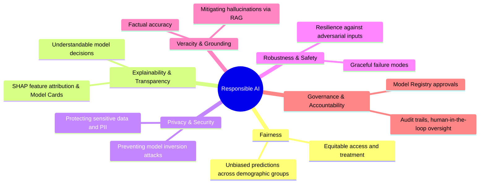
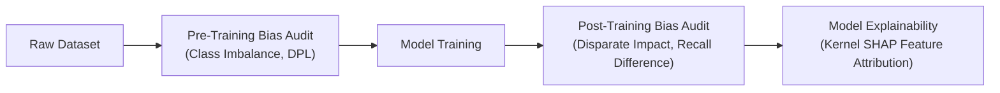
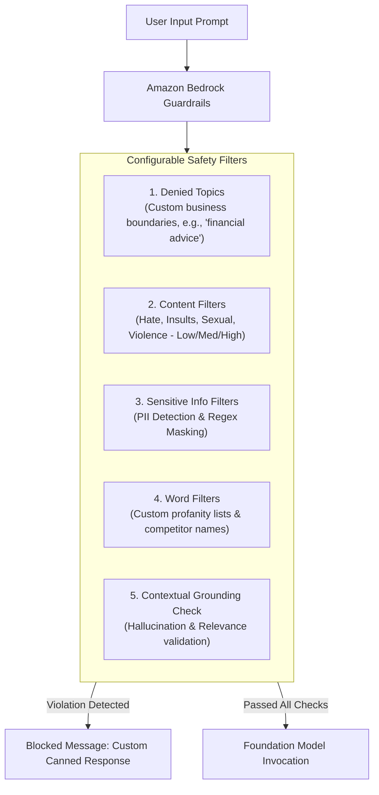
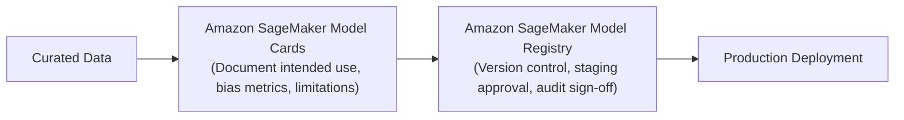

# Domain 4: Guidelines for Responsible AI

> **Weight:** 14% of Scored Exam Content  
> **Course:** AWS Certified AI Practitioner (`AIF-C01`)  
> **Exam Guide Baseline:** v1.2 (October 2026 - incorporating Bedrock Guardrails & Model Governance)  
> **Index:** `AI/Practitioner/AIF-C01/phase1_step06_explanations/04_Domain_4_Guidelines_for_Responsible_AI.md`

---

## 🧭 Domain Overview

Domain 4 assesses the practitioner's understanding of ethics, bias, fairness, transparency, and safety in AI systems. It covers the core pillars of Responsible AI, bias detection across data and models using **Amazon SageMaker Clarify**, model governance and auditing with **SageMaker Model Cards**, multi-layered content safety and PII masking with **Amazon Bedrock Guardrails**, and legal and intellectual property implications.

---

## 💡 The Real-World Analogy (ELI5)

> **The Transparent Self-Driving Car:**
> - **Explainability (SHAP Values):** When an autonomous car swerves to the left, the black box telemetry must prove *why*: *"70% weight given to pedestrian detected on right curb, 30% weight given to clear lane on left."* (SageMaker Clarify feature attributions).
> - **Fairness & Bias Detection:** Proving through empirical testing that the car detects pedestrians wearing dark winter coats just as reliably as pedestrians in bright summer clothes across all demographic zip codes (SageMaker Clarify pre/post-training bias metrics).
> - **Privacy & Protection:** The car's in-cabin dashcam automatically blurs passenger faces, credit card numbers, and house addresses before uploading footage to the cloud (Bedrock Guardrails PII masking).
> - **Transparency & Accountability:** A clear, published owner's manual detailing the car's operational design domain, speed limits, sensor limitations, and verified crash-test safety scores (SageMaker Model Cards).

---

## 🎯 Task Statement 4.1: Explain the core pillars of Responsible AI

AWS defines Responsible AI through eight fundamental dimensions:

1. **Fairness:** Ensuring models do not disproportionately disadvantage protected demographic classes (e.g., gender, race, age, religion).
2. **Explainability & Interpretability:** Providing stakeholders and regulators with clear rationales for why a specific prediction or output was generated.
3. **Transparency:** Documenting the provenance of training data, model limitations, intended use cases, and operating assumptions.
4. **Privacy & Data Protection:** Safeguarding Personally Identifiable Information (PII) throughout the data ingestion, training, and inference lifecycle.
5. **Robustness & Reliability:** Ensuring consistent, predictable behavior when exposed to adversarial perturbations, out-of-distribution inputs, or system latency spikes.
6. **Controllability & Safety:** Implementing guardrails to prevent harmful, violent, abusive, or unauthorized content generation.
7. **Veracity (Truthfulness):** Preventing fabricated information, hallucinated legal citations, or inaccurate mathematical claims.
8. **Accountability:** Establishing clear human ownership, operational escalation paths, and comprehensive audit trails.

---

## 🎯 Task Statement 4.2: Detect and mitigate bias with Amazon SageMaker Clarify

Bias can enter an AI system at any phase: historical societal biases, biased sampling during data collection, or algorithmic reinforcement during training.

### 1. Pre-Training Bias Metrics (Data Level)
Before training occurs, SageMaker Clarify evaluates the training dataset for statistical imbalances:
* **Class Imbalance (CI):** Measures the proportional disparity between the favored facet (group $a$) and the disfavored facet (group $d$). Values range from $-1$ to $1$; values near $0$ indicate balanced representation.
* **Difference in Positive Proportions in Labels (DPL):** Measures the difference in the proportion of positive target labels assigned to the favored group versus the disfavored group.
  $$\text{DPL} = q_a - q_d$$
  A high DPL indicates that historical labeling favored one demographic group over another.

### 2. Post-Training Bias Metrics (Model Prediction Level)
Evaluates whether model inferences demonstrate disparate impact across groups:
* **Disparate Impact (DI):** The ratio between the proportion of positive predictions for the disfavored group versus the favored group.
  $$\text{DI} = \frac{P(\hat{Y}=1 | D)}{P(\hat{Y}=1 | A)}$$
  In employment lending standards (the "80% rule"), a DI below $0.8$ often indicates legal bias.
* **Difference in Recall / False Positive Rates:** Detects if a model generates higher error rates for specific demographic subsets.

### 3. Model Explainability with SHAP (Shapley Additive exPlanations)
* Based on cooperative game theory, **SHAP values** quantify the exact marginal contribution of each input feature toward a specific prediction.
* **Global Feature Importance:** Identifies which features overall drive the model's behavior across the entire population.
* **Local Feature Attribution:** Explains a single individual prediction (e.g., `"Loan applicant #1042 was rejected primarily due to Debt-to-Income Ratio (+0.45 SHAP impact) and Credit Score (-0.32 SHAP impact)"`).

---

## 🎯 Task Statement 4.3: Implement multi-layered safety with Amazon Bedrock Guardrails

**Amazon Bedrock Guardrails** provides an independent, centralized safety layer applicable across all Foundation Models in Amazon Bedrock (as well as custom models or external LLMs via the Guardrail Apply API).

### Bedrock Guardrail Filtering Policies
1. **Denied Topics:** Uses natural language descriptions to define prohibited conversational domains (e.g., blocking an insurance chatbot from offering investment advice).
2. **Content Filters:** Detects and blocks harmful content across four categories: **Hate, Insults, Sexual, and Violence**. Configured across 4 severity thresholds (None, Low, Medium, High) independently for inputs and outputs.
3. **Sensitive Information Filters (PII):**
   * Predefined PII entity detection (Social Security Numbers, Credit Cards, Names, Email Addresses, Phone Numbers).
   * Supports **Masking** (replacing with `[SSN]`) or **Blocking** (terminating generation).
   * Custom Regular Expressions (Regex) for proprietary customer IDs or internal employee badges.
4. **Word Filters:** Blocks specific blacklisted keywords, slurs, or competitor brand names.
5. **Contextual Grounding Check (v1.2 Addition):**
   * Detects hallucinations in RAG applications by evaluating:
     1. **Grounding Score:** Does the model's response derive strictly from the retrieved reference documents?
     2. **Relevance Score:** Does the model's response actually address the user's original query?

---

## 🎯 Task Statement 4.4: Model Governance, Lineage, and Auditing

Enterprise regulatory compliance requires end-to-end documentation of model origins, data dependencies, and approval lifecycles.

* **Amazon SageMaker Model Cards:** Standardized digital artifacts that document critical model details:
  * Intended use cases and unsupported out-of-scope uses.
  * Training dataset parameters, preprocessing, and demographic distributions.
  * Evaluation benchmarks, Clarify bias metrics, and explainability charts.
  * Risk ratings, sign-off status, and owner contact details.
* **Amazon SageMaker Model Registry:** A central catalog for versioning models, managing approval statuses (`Approved`, `PendingManualApproval`, `Rejected`), and enforcing staging-to-production deployment gates.

---

## ⚖️ Intellectual Property and Legal Considerations
* **Training Data Copyright:** Models trained on copyrighted data can unintentionally reproduce copyrighted text or imagery.
* **Amazon Bedrock IP Indemnity:** AWS provides intellectual property indemnification for customers using Amazon Titan foundation models, protecting them against third-party copyright infringement claims.
* **Watermarking:** Amazon Titan Image Generator automatically embeds invisible, tamper-resistant digital watermarks into synthesized images to verify provenance and mitigate deepfakes.

---

## 🔗 Related Resources
* Next: [Domain 5: Security, Compliance, and Governance](./05_Domain_5_Security_Compliance_and_Governance.md)
* Blueprint: [Diagram 07: Bedrock Guardrails Multi-Layered Perimeter](../phase1_step05_diagrams/Diagram_07_Bedrock_Guardrails_Multi_Layered_Perimeter.md)
* Lab: [Lab 05: Responsible AI & PII Masking with Amazon Bedrock Guardrails](../phase2_step07_labs/Lab_05_Responsible_AI_and_PII_Masking_with_Amazon_Bedrock_Guardrails.md)
* Lab: [Lab 09: Model Fairness, Bias Detection & SHAP with SageMaker Clarify](../phase2_step07_labs/Lab_09_Model_Fairness_Bias_Detection_and_SHAP_Explainability_with_SageMaker_Clarify.md)
---

## 🎯 Exam Traps & 'Clue-to-Answer' Trigger Words

| Responsible AI Objective | Correct AWS Tool / Feature | Exam Trap Distractor |
| :--- | :--- | :--- |
| *'Detect pre-training bias in training data and post-training bias in model predictions'* | **Amazon SageMaker Clarify** | Amazon Inspector (scans for software CVEs, not statistical bias). |
| *'Explain individual predictions using SHAP (Shapley Additive exPlanations) values'* | **Amazon SageMaker Clarify** | Amazon CloudWatch (monitors system metrics, not feature attribution). |
| *'Standardized fact sheets documenting intended use, limitations, and evaluation metrics'* | **Amazon SageMaker Model Cards** | Amazon QuickSight (BI dashboard, not model governance metadata). |
| *'Continuously monitor production deployed models for data drift and concept drift'* | **Amazon SageMaker Model Monitor** | AWS CloudTrail (audits API actions, not ML model statistical drift). |
| *'Filter hate speech, profanity, PII, and custom denied topics across LLM inputs & outputs'* | **Amazon Bedrock Guardrails** | AWS WAF (WAF inspects HTTP headers/SQLi; cannot parse LLM semantic toxicity). |

---

## 📝 Post-Domain 4 Question Simulation & Retention Check

Test your mastery of Domain 4 with these 10 exam-style practice questions:

### Question 1
**Which of the following is considered a core pillar of Responsible AI?**
- A) Maximizing model parameter count
- B) Fairness, Explainability, Robustness, Privacy, and Transparency
- C) Eliminating human review completely
- D) Overclocking GPU clusters

<b>Click to View Answer & Explanation</b>

**Correct Answer:** **B) Fairness, Explainability, Robustness, Privacy, and Transparency**  
- **Why it's correct:** Responsible AI frameworks establish governance around fairness (avoiding unfair bias), explainability (understanding predictions), robustness (security against adversarial inputs), privacy, and transparency.

### Question 2
**Which AWS service allows organizations to implement custom responsible AI safeguards, block prompt injection attacks, deny prohibited conversational topics, and automatically mask PII across foundation models?**
- A) Amazon GuardDuty
- B) Amazon Bedrock Guardrails
- C) AWS WAF
- D) AWS Shield

<b>Click to View Answer & Explanation</b>

**Correct Answer:** **B) Amazon Bedrock Guardrails**  
- **Why it's correct:** Amazon Bedrock Guardrails evaluates both user prompts and model responses against custom safety policies (Denied Topics, Content Filters, Sensitive Information Filters for PII, Contextual Grounding Checks).

### Question 3
**Which Amazon SageMaker AI feature detects pre-training bias in datasets, post-training bias in model predictions, and explains feature importance using SHAP (Shapley values)?**
- A) SageMaker Canvas
- B) SageMaker Clarify
- C) SageMaker Feature Store
- D) SageMaker Model Cards

<b>Click to View Answer & Explanation</b>

**Correct Answer:** **B) SageMaker Clarify**  
- **Why it's correct:** SageMaker Clarify detects statistical bias across demographic groups (pre-training Class Imbalance and post-training Disparate Impact) and provides local and global feature attribution using KernelSHAP.

### Question 4
**In a mortgage loan approval model, a customer asks why their application was rejected. Which type of explainability is required to explain this single applicant's decision?**
- A) Global Explainability
- B) Local Explainability (Feature Attribution)
- C) Dimensionality Reduction
- D) Batch Transform

<b>Click to View Answer & Explanation</b>

**Correct Answer:** **B) Local Explainability (Feature Attribution)**  
- **Why it's correct:** Local explainability explains the specific score for an individual instance, showing exactly how each input feature (e.g. debt-to-income ratio) pushed the model's prediction higher or lower relative to the baseline.

### Question 5
**What pre-training bias metric in SageMaker Clarify measures whether a protected demographic group is significantly underrepresented in the training dataset?**
- A) Disparate Impact (DI)
- B) Class Imbalance (CI)
- C) Mean Squared Error (MSE)
- D) Accuracy Difference

<b>Click to View Answer & Explanation</b>

**Correct Answer:** **B) Class Imbalance (CI)**  
- **Why it's correct:** Class Imbalance (CI) evaluates whether the proportion of samples from a sensitive demographic group in the training data deviates from equal representation.

### Question 6
**A company wants to automatically redact customer Social Security Numbers, credit cards, and email addresses from chat transcripts before logging data. Which feature in Amazon Bedrock Guardrails performs this?**
- A) Denied Topics
- B) Sensitive Information Filters (PII Redaction/Masking)
- C) Word Filters
- D) Grounding Checks

<b>Click to View Answer & Explanation</b>

**Correct Answer:** **B) Sensitive Information Filters (PII Redaction/Masking)**  
- **Why it's correct:** Bedrock Guardrails Sensitive Information Filters can identify and either block or replace PII entities with generic masking tokens (e.g. `[SSN_REDACTED]`).

### Question 7
**Which alignment technique trains a reward model based on human preference rankings and uses Proximal Policy Optimization (PPO) to align a foundation model with human values?**
- A) K-Means Clustering
- B) Reinforcement Learning from Human Feedback (RLHF)
- C) Principal Component Analysis (PCA)
- D) Unsupervised Pre-training

<b>Click to View Answer & Explanation</b>

**Correct Answer:** **B) Reinforcement Learning from Human Feedback (RLHF)**  
- **Why it's correct:** RLHF aligns foundation models to be helpful, honest, and harmless by incorporating human preference feedback into reinforcement learning policy optimization.

### Question 8
**How does Constitutional AI (RLAIF) improve the efficiency of aligning foundation models compared to traditional RLHF?**
- A) It eliminates the need for foundation models.
- B) It replaces manual human feedback with automated AI-generated feedback guided by a predefined "Constitution" of ethical principles.
- C) It makes model training free of charge.
- D) It guarantees 100% accuracy on mathematical problems.

<b>Click to View Answer & Explanation</b>

**Correct Answer:** **B) It replaces manual human feedback with automated AI-generated feedback guided by a predefined "Constitution" of ethical principles.**  
- **Why it's correct:** Constitutional AI uses a model to critique and revise its own responses based on structured ethical rules, drastically reducing the time, cost, and human labor required for alignment.

### Question 9
**What is the purpose of a Contextual Grounding Check in Amazon Bedrock Guardrails?**
- A) To detect if the user is using a VPN
- B) To detect and block model hallucinations by measuring factual overlap between the generated response and reference source documents
- C) To measure token billing rates
- D) To translate responses into Spanish

<b>Click to View Answer & Explanation</b>

**Correct Answer:** **B) To detect and block model hallucinations by measuring factual overlap between the generated response and reference source documents**  
- **Why it's correct:** Contextual Grounding calculates a Grounding Score (is the answer substantiated by the source text?) and Relevance Score (does it answer the prompt?), filtering out ungrounded hallucinations.

### Question 10
**Which service allows easily incorporating human review workflows into automated ML predictions when model confidence falls below a defined threshold?**
- A) Amazon Augmented AI (Amazon A2I)
- B) Amazon Rekognition
- C) AWS Step Functions
- D) AWS IAM

<b>Click to View Answer & Explanation</b>

**Correct Answer:** **A) Amazon Augmented AI (Amazon A2I)**  
- **Why it's correct:** Amazon A2I provides built-in human-in-the-loop review workflows for Amazon Textract, Rekognition, and custom ML models to ensure human oversight on sensitive or low-confidence predictions.

