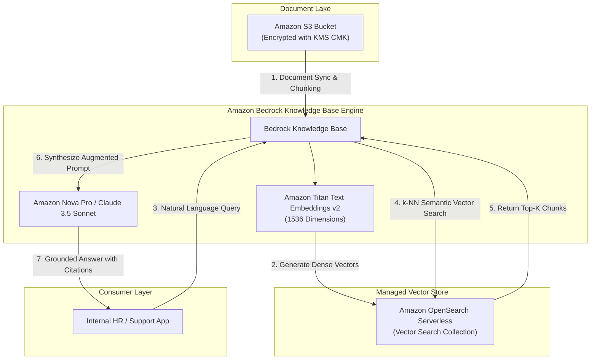

# Tutorial 01: Enterprise RAG Knowledge Base Architecture

> **Architecture Build Tutorial:** `Tutorial_01_Enterprise_RAG_Knowledge_Base_Architecture.md`  
> **Course:** AWS Certified AI Practitioner (`AIF-C01`)  
> **Services Integrated:** Amazon S3, Amazon Bedrock Knowledge Bases, Amazon Titan Text Embeddings v2, Amazon OpenSearch Serverless, AWS IAM, AWS KMS  
> **Level:** Advanced Multi-Service Production Implementation

---

## 🏛️ Architecture Overview

Retrieval-Augmented Generation (RAG) grounds foundation models on proprietary organizational data without model retraining. This tutorial builds a production-grade, secure RAG architecture using **Amazon Bedrock Knowledge Bases** backed by a vector index in **Amazon OpenSearch Serverless**.



---

## 🛠️ Step-by-Step Implementation Guide

### Step 1: Provision the Encrypted S3 Document Bucket
Create a private S3 bucket to store company policy PDFs:
```bash
aws s3api create-bucket \
    --bucket enterprise-rag-knowledge-base-corp \
    --region eu-north-1 \
    --create-bucket-configuration LocationConstraint=eu-north-1

# Enforce default server-side encryption with KMS
aws s3api put-bucket-encryption \
    --bucket enterprise-rag-knowledge-base-corp \
    --server-side-encryption-configuration '{
        "Rules": [{
            "ApplyServerSideEncryptionByDefault": {
                "SSEAlgorithm": "aws:kms"
            }
        }]
    }'
```

### Step 2: Configure OpenSearch Serverless Vector Collection
1. In the AWS Management Console, navigate to **Amazon OpenSearch Service** > **Serverless collections**.
2. Click **Create collection**:
   * **Name:** `bedrock-knowledge-base-collection`
   * **Collection type:** `Vector search`
   * **Encryption:** AWS owned key or Customer Managed Key (KMS).
3. Define the Network Policy: Allow private access or select VPC endpoints.
4. Define the Data Access Policy: Grant permissions (`aoss:*`) to the Bedrock execution role.

### Step 3: Create the Bedrock Knowledge Base Service Role
Create an IAM role (`BedrockKnowledgeBaseRole`) with the trust policy:
```json
{
  "Version": "2012-10-17",
  "Statement": [
    {
      "Effect": "Allow",
      "Principal": {
        "Service": "bedrock.amazonaws.com"
      },
      "Action": "sts:AssumeRole"
    }
  ]
}
```

Attach policies granting:
* `s3:GetObject`, `s3:ListBucket` on `arn:aws:s3:::enterprise-rag-knowledge-base-corp/*`
* `bedrock:InvokeModel` on `arn:aws:bedrock:eu-north-1::foundation-model/amazon.titan-embed-text-v2:0`
* `aoss:APIAccessAll` on the OpenSearch collection ARN.

### Step 4: Configure the Knowledge Base in Bedrock
1. Navigate to **Amazon Bedrock** > **Knowledge bases** > **Create knowledge base**.
2. **Knowledge base details:**
   * Name: `Corp-HR-Policies-KB`
   * IAM role: Use existing role (`BedrockKnowledgeBaseRole`).
3. **Data source:**
   * Point to S3 URI: `s3://enterprise-rag-knowledge-base-corp/`
   * Chunking strategy: Choose **Default chunking** (300 tokens, 20% overlap) or **Hierarchical chunking**.
4. **Select embeddings model:**
   * Select **Titan Text Embeddings v2** (1,536 dimensions).
5. **Vector database:**
   * Select the OpenSearch Serverless collection created in Step 2.
6. Click **Create knowledge base** and then click **Sync** to begin document ingestion.

### Step 5: Test Retrieval and Grounding via AWS CLI
```bash
aws bedrock-agent-runtime retrieve-and-generate \
    --input '{"text": "What is the annual corporate leave rollover policy?"}' \
    --retrieve-and-generate-configuration '{
        "type": "KNOWLEDGE_BASE",
        "knowledgeBaseConfiguration": {
            "knowledgeBaseId": "YOUR_KB_ID",
            "modelArn": "arn:aws:bedrock:eu-north-1::foundation-model/amazon.nova-pro-v1:0"
        }
    }'
```

---

## 🔒 Enterprise Production Considerations

1. **Incremental Syncing:** Re-sync the knowledge base whenever S3 documents are added, updated, or removed.
2. **Contextual Grounding Check:** Attach **Amazon Bedrock Guardrails** to the knowledge base to inspect retrieved chunks and verify factual adherence before answering the user.
3. **Auditability:** Enable AWS CloudTrail Data Events for `RetrieveAndGenerate` to track query sources and ensure compliance.
