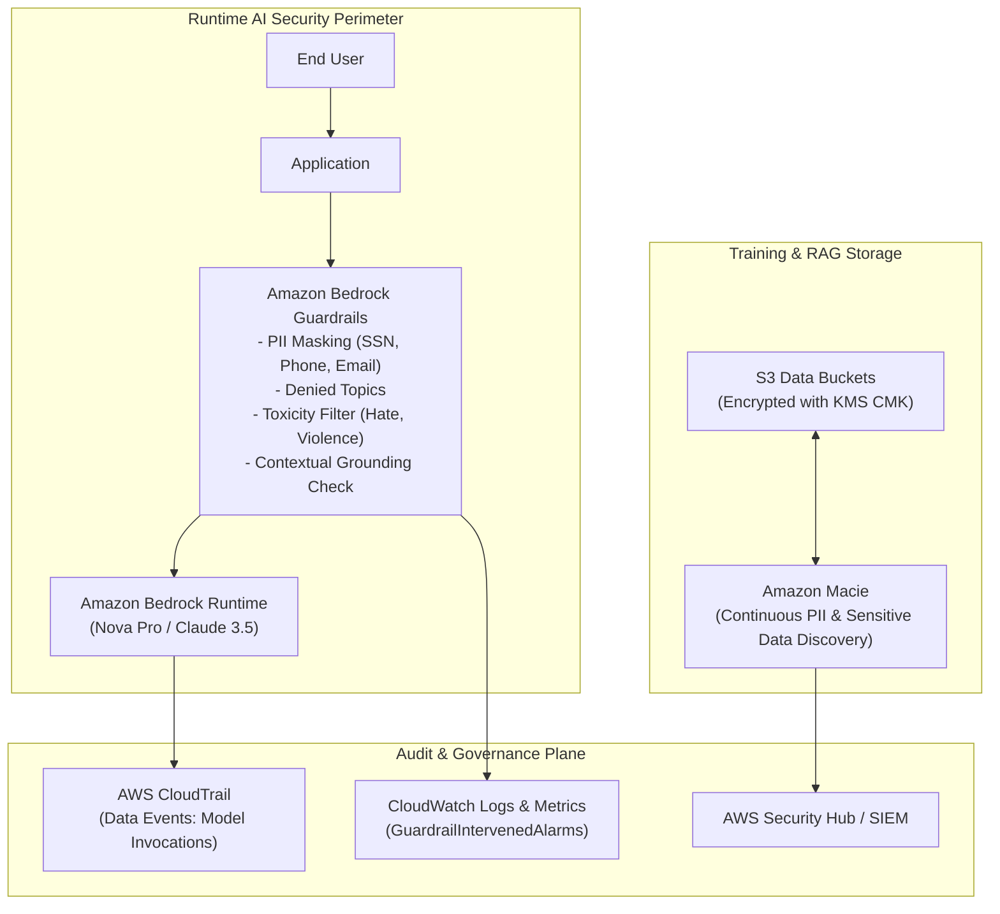

# Tutorial 04: Enterprise Responsible AI & PII Governance Pipeline

> **Architecture Build Tutorial:** `Tutorial_04_Enterprise_Responsible_AI_and_PII_Governance_Pipeline.md`  
> **Course:** AWS Certified AI Practitioner (`AIF-C01`)  
> **Services Integrated:** Amazon Bedrock Guardrails, Amazon Macie, AWS KMS, AWS CloudTrail, Amazon CloudWatch  
> **Level:** Enterprise Security, Compliance & Governance

---

## 🏛️ Architecture Overview

Enterprise deployments of Generative AI require rigorous guardrails against toxic content, hallucinations, and accidental leaks of Personally Identifiable Information (PII). This tutorial builds an automated Responsible AI governance pipeline combining **Amazon Bedrock Guardrails**, sensitive data discovery with **Amazon Macie**, cryptographic enforcement with **AWS KMS**, and continuous audit logging with **AWS CloudTrail**.



---

## 🛠️ Step-by-Step Implementation Guide

### Step 1: Create a KMS Customer Managed Key (CMK)
```bash
aws kms create-key \
    --description "Key for Bedrock Guardrails & Model Governance" \
    --region eu-north-1
```
Record the resulting Key ARN (e.g., `arn:aws:kms:eu-north-1:123456789012:key/abcd-1234`).

### Step 2: Configure Amazon Bedrock Guardrail
Create the guardrail configuration file `guardrail_policy.json`:
```json
{
  "name": "EnterpriseEnterpriseCustomerServiceGuardrail",
  "description": "Enforces strict PII masking and blocks off-topic advice and toxic content.",
  "topicPolicyConfig": {
    "topicsConfig": [
      {
        "name": "FinancialAndLegalAdvice",
        "definition": "Providing binding financial planning, investment suggestions, or formal legal advice.",
        "examples": [
          "Which mutual fund should I invest my pension in?",
          "Can you write a legal waiver for my business contract?"
        ],
        "type": "DENY"
      }
    ]
  },
  "contentPolicyConfig": {
    "filtersConfig": [
      {"type": "HATE", "inputStrength": "HIGH", "outputStrength": "HIGH"},
      {"type": "INSULTS", "inputStrength": "MEDIUM", "outputStrength": "HIGH"},
      {"type": "SEXUAL", "inputStrength": "HIGH", "outputStrength": "HIGH"},
      {"type": "VIOLENCE", "inputStrength": "HIGH", "outputStrength": "HIGH"}
    ]
  },
  "sensitiveInformationPolicyConfig": {
    "piiEntitiesConfig": [
      {"type": "NAME", "action": "ANONYMIZE"},
      {"type": "EMAIL", "action": "ANONYMIZE"},
      {"type": "PHONE", "action": "ANONYMIZE"},
      {"type": "US_SOCIAL_SECURITY_NUMBER", "action": "BLOCK"},
      {"type": "CREDIT_DEBIT_CARD_NUMBER", "action": "BLOCK"}
    ],
    "regexesConfig": [
      {
        "name": "CorpEmployeeBadgeID",
        "description": "Internal employee badge formatted as EMP-XXXXX",
        "pattern": "EMP-\\d{5}",
        "action": "ANONYMIZE"
      }
    ]
  },
  "contextualGroundingPolicyConfig": {
    "filtersConfig": [
      {"type": "GROUNDING", "threshold": 0.75},
      {"type": "RELEVANCE", "threshold": 0.70}
    ]
  },
  "blockedInputMessaging": "Your request violates corporate acceptable use policies and cannot be processed.",
  "blockedOutputsMessaging": "The generated response was withheld due to compliance restrictions."
}
```

Deploy the guardrail via the AWS CLI:
```bash
aws bedrock create-guardrail \
    --cli-input-json file://guardrail_policy.json \
    --region eu-north-1

# Create a published version of the guardrail
aws bedrock create-guardrail-version \
    --guardrail-identifier YOUR_GUARDRAIL_ID \
    --description "v1.0 Production Guardrail" \
    --region eu-north-1
```

### Step 3: Test Runtime Invocation with Guardrail Enforcement
Use the Bedrock Converse API with the Guardrail configuration attached:
```bash
aws bedrock-runtime converse \
    --model-id arn:aws:bedrock:eu-north-1::foundation-model/amazon.nova-pro-v1:0 \
    --guardrail-config '{"guardrailIdentifier": "YOUR_GUARDRAIL_ID", "guardrailVersion": "1", "trace": "ENABLED"}' \
    --messages '[
        {
            "role": "user",
            "content": [{"text": "Hello, my name is John Doe and my badge is EMP-94812. Can you suggest which stocks to buy?"}]
        }
    ]' \
    --region eu-north-1
```
*Expected Behavior:*
1. The **FinancialAndLegalAdvice** topic filter triggers immediately.
2. The model returns the `blockedInputMessaging` string.
3. The names and badge IDs are scrubbed from telemetry traces.

### Step 4: Configure Amazon Macie Automated Discovery
1. Enable Amazon Macie in `eu-north-1`.
2. Configure a Sensitive Data Discovery Job targeting S3 RAG document buckets.
3. Set alert notifications to route findings to AWS Security Hub if unmasked credit cards or passport numbers are detected in raw source files.

### Step 5: Enable CloudTrail Data Event Auditing
```bash
aws cloudtrail put-event-selectors \
    --trail-name BedrockGovernanceAuditTrail \
    --event-selectors '[{
        "ReadWriteType": "All",
        "IncludeManagementEvents": true,
        "DataResources": [{
            "Type": "AWS::Bedrock::Guardrail",
            "Values": ["arn:aws:bedrock:eu-north-1:123456789012:guardrail/*"]
        }]
    }]' \
    --region eu-north-1
```

---

## 🔒 Production Security Takeaways
* **Independent Defense:** Guardrails prevent prompt injection and data leaks even if an attacker attempts sophisticated hypothetical roleplay.
* **Contextual Grounding:** Eliminates hallucinations in customer-facing support portals by validating responses against reference sources.
