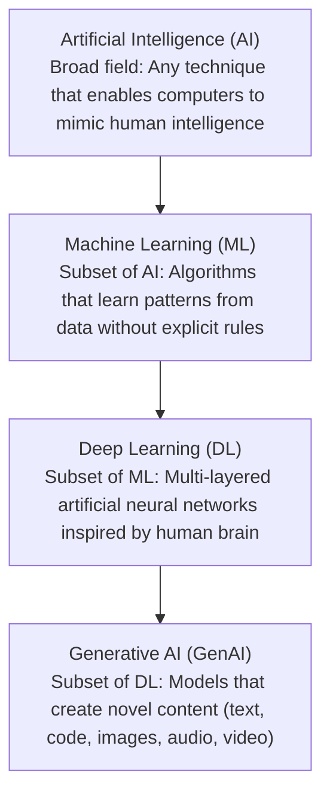
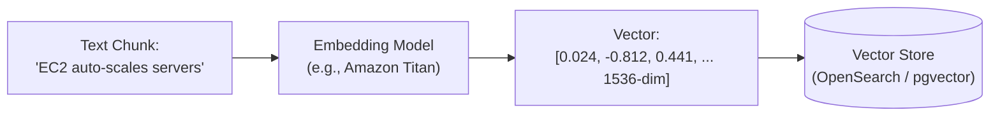
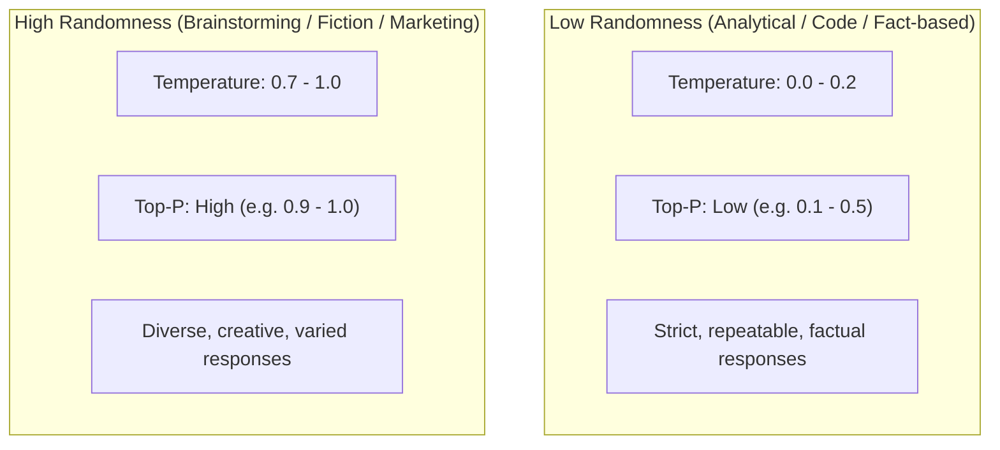

# Generative AI Core Concepts & Mechanics

> **Category:** [Conceptual Architecture](../../../../Cloud/Practitioner/CLF-C02/phase3_step09_notes/README.md)  
> **Relevant Certifications:** [AIF-C01](../phase0_step01_syllabus/AIF-C01_Exam_Guide_and_Blueprint.md), [CLF-C02](../../../../Cloud/Practitioner/CLF-C02/phase0_step01_syllabus/CLF-C02_Master_Blueprint.md), AWS Machine Learning Specialty  
> **Tags:** `#aws/concepts` `#aws/genai` `#aif-c01`

---

## 1. Traditional AI vs. Machine Learning vs. Deep Learning vs. Generative AI

Understanding the nested relationship among these terms is critical for the exam:

| Dimension | Traditional (Discriminative) AI/ML | Generative AI |
|---|---|---|
| **Primary Goal** | Classify, predict a label, categorize, or detect anomalies ($P(Y \mid X)$). | Generate brand new, coherent content conditioned on input ($P(X, Y)$ or $P(X)$). |
| **Example Outputs** | "Spam / Not Spam", Fraud probability (0.94), House price ($450,000). | Synthesized articles, code functions, synthesized images, conversational answers. |
| **Model Types** | Logistic Regression, Random Forests, XGBoost, CNNs for classification. | Transformers, Diffusion Models, Variational Autoencoders (VAEs), GANs. |
| **AWS Services** | SageMaker (built-in algorithms), Rekognition, Comprehend. | Amazon Bedrock, Amazon Q, SageMaker JumpStart. |

---

## 2. Core Building Blocks of Generative AI

### 2.1 Tokens & Tokenization
* **Definition:** The fundamental atomic unit of text that a Large Language Model (LLM) reads, processes, and outputs.
* **Mechanism:** Rather than reading full words or single characters, models use subword tokenization (e.g., Byte-Pair Encoding).
* **Rule of Thumb (English):**
  * $1 \text{ token} \approx 0.75 \text{ words}$ (or $\approx 4 \text{ characters}$).
  * $1,000 \text{ tokens} \approx 750 \text{ words}$.
* **Exam Relevance:**
  * Context limits and API pricing in Amazon Bedrock are measured and billed in **input and output tokens**.
  * Input tokens and output tokens frequently have different pricing tiers (output tokens are typically more expensive because generation is auto-regressive).

### 2.2 Context Window
* **Definition:** The maximum number of tokens a model can accept and retain in memory simultaneously across a single prompt and completion cycle.
* **Working Analogy:** The model's *working short-term memory*.
* **Implications:**
  * If a prompt exceeds the context window, text must be truncated.
  * Larger context windows (e.g., Claude 3.5 Sonnet with 200,000 tokens) allow processing entire codebases, financial reports, or books in a single call.
  * Very long contexts can suffer from the *"Lost in the Middle"* phenomenon, where models recall information at the very beginning and very end better than in the center.

### 2.3 Embeddings & Vector Space
* **Definition:** Mathematical vector representations (arrays of floating-point numbers) of unstructured data (text, images, audio) in high-dimensional space.
* **Core Property:** Semantic proximity: Concepts with similar meanings map close together in vector space (e.g., the vector for *"King"* - *"Man"* + *"Woman"* $\approx$ *"Queen"*).
* **AWS Implementation:**
  * **Amazon Titan Text Embeddings / Titan Multimodal Embeddings:** Convert text and images into vectors for storage in vector databases.
  * **Vector Databases:** Amazon OpenSearch Serverless, Amazon Aurora PostgreSQL (`pgvector`), Amazon Neptune Analytics.

---

## 3. Inference Parameters (Controlling Model Behavior)

When sending requests to foundation models (e.g., via the Bedrock Playground or API), inference parameters control randomness, creativity, and length:

### Deep Dive: Parameter Breakdown

| Parameter | Function | Range | Low Value Impact | High Value Impact | Exam Scenario |
|---|---|---|---|---|---|
| **Temperature** | Controls the shape of the probability distribution over candidate next tokens. | `0.0` to `1.0` (some models up to `2.0`) | Highly deterministic, predictable, repetitive. Best for extraction, math, coding. | Creative, imaginative, diverse, higher risk of hallucinations. | *"You need consistent JSON output extraction from invoices"* $\rightarrow$ **Set Temperature to 0.0**. |
| **Top-P (Nucleus Sampling)** | Considers only the pool of tokens whose cumulative probability exceeds threshold $P$. | `0.0` to `1.0` | Restricts pool to only the most probable words. | Expands pool to include less likely, diverse words. | Alternative to Temperature for controlling randomness. |
| **Top-K** | Truncates candidate pool to the top $K$ most probable next tokens. | Integer (e.g., `1` to `500`) | Strictest selection (if $K=1$, greedy decoding). | Broad selection of potential candidate tokens. | Used when fine-grained control over vocabulary variety is needed. |
| **Max Generation Length / Max Tokens** | Sets an upper bound on the number of tokens the model generates in output. | Integer (e.g., `1` to `4096`) | Forces concise summaries; may cut off mid-sentence if too low. | Allows long-form answers; consumes more tokens/budget. | Preventing runaway billing or overly verbose answers. |
| **Stop Sequences** | Specific strings that instruct the model to immediately halt token generation. | Array of strings (e.g., `["\n\n", "User:", "###"]`) | Model halts output upon generating the specified sequence. | Model continues until `Max Tokens` or natural `<EOS>` token. | Formatting chat dialogues to prevent the model from role-playing as the user. |

> [!IMPORTANT]
> **Temperature vs. Top-P:** Both alter randomness. AWS best practice recommends adjusting **either** Temperature **or** Top-P, not both aggressively at the same time, to avoid unpredictable outputs.

---

## 4. Model Hallucinations & Risks

* **Hallucination:** When a foundation model generates plausible-sounding but factually incorrect or fabricated statements with high confidence.
* **Root Cause:** LLMs are probabilistic sequence predictors ($P(w_{t} \mid w_{<t})$), not relational knowledge databases.
* **Mitigations in AWS:**
  1. **Grounding via RAG:** Connect model to verified enterprise data via **Amazon Bedrock Knowledge Bases**.
  2. **Guardrails:** Apply **Amazon Bedrock Guardrails** with Contextual Grounding Check to detect hallucinations against source documents.
  3. **Low Temperature:** Lower the inference temperature to $0.0$.
  4. **System Prompting:** Explicitly instruct the model: *"If you do not find the answer in the provided context, state that you do not know. Do not speculate."*
