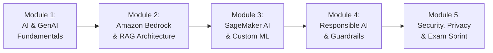

# AWS Certified AI Practitioner (AIF-C01) Course Syllabus

> **Instructor:** Mohamed Fakhruldeen  
> **Course Track:** AI Foundation  
> **Target Certification:** AWS Certified AI Practitioner (AIF-C01)  
> **Repository:** `fakhruldeen/AWS` -> `AI/Practitioner/AIF-C01/`

---

## Course Architecture & Teaching Roadmap

This comprehensive course prepares students for the **AWS Certified AI Practitioner (AIF-C01)** certification while providing hands-on proficiency in building generative AI applications using **Amazon Bedrock**, **Amazon SageMaker AI**, and the **Amazon Q** ecosystem.

---

## Detailed Module Breakdown

### Module 1: Artificial Intelligence & Generative AI Foundations
* **Lecture Topics:**
  * Artificial Intelligence vs. Machine Learning vs. Deep Learning vs. Generative AI.
  * Generative modalities: Text, Image (Diffusion), Audio, Code, Multimodal.
  * Deep dive into Tokens, Tokenization, and Context Windows.
  * Mathematical Embeddings and High-Dimensional Vector Spaces.
  * Inference Hyperparameters: Temperature, Top-P (Nucleus Sampling), Top-K, Max Tokens, Stop Sequences.
  * Prompt Engineering: Zero-shot, Few-shot, Chain-of-Thought (CoT), System Prompts.
* **Slides:** `slides/Module_01_AI_and_GenAI_Foundations_Slides.md`
* **Student Lab:** `labs/Lab_01_Amazon_Bedrock_Playground_and_Prompt_Engineering.md`

### Module 2: Applications of Foundation Models & Amazon Bedrock
* **Lecture Topics:**
  * Amazon Bedrock serverless architecture and unified API.
  * Model selection trade-offs: Latency, Cost, Context Window, and Accuracy (Claude, Titan, Nova, Llama).
  * The Model Customization Spectrum: Prompt Engineering vs. RAG vs. Fine-Tuning vs. Pre-training.
  * Retrieval-Augmented Generation (RAG) architecture: Amazon S3, Titan Embeddings, and OpenSearch Serverless.
  * Autonomous Bedrock Agents: ReAct reasoning, OpenAPI schemas, and AWS Lambda action groups.
  * Amazon Bedrock Prompt Management and visual Prompt Flows.
  * Automated Model Evaluation metrics: ROUGE, BLEU, BERTScore, and Perplexity.
* **Slides:** `slides/Module_02_Amazon_Bedrock_and_RAG_Slides.md`
* **Student Lab:** `labs/Lab_02_Building_RAG_with_Bedrock_Knowledge_Bases.md`

### Module 3: Amazon SageMaker AI Ecosystem & MLOps
* **Lecture Topics:**
  * The End-to-End Machine Learning Lifecycle on AWS.
  * Data Preparation: SageMaker Data Wrangler, Ground Truth (Private, Vendor, MTurk), Feature Store.
  * Model Building: SageMaker Studio, Canvas (No-Code ML), Autopilot (AutoML), JumpStart.
  * Model Deployment Modes: Real-Time vs. Serverless vs. Batch Transform vs. Asynchronous.
  * MLOps & Model Monitoring: SageMaker Pipelines and Model Monitor (Data & Concept drift).
  * Pre-trained AI APIs: Rekognition, Polly, Transcribe, Translate, Comprehend, Textract, Lex, Personalize.

### Module 4: Responsible AI, Bias & Ethics
* **Lecture Topics:**
  * Six Pillars of Responsible AI: Fairness, Explainability, Privacy, Robustness, Governance, Veracity.
  * Bias Types: Sampling, Measurement, Observer, Confirmation, Historical, Algorithmic bias.
  * SageMaker Clarify: Pre-training bias (Class Imbalance, DPL) vs. Post-training bias (Disparate Impact, DIR).
  * Explainability & Interpretability: SHAP (SHapley Additive exPlanations) values.
  * Amazon Bedrock Guardrails: Denied Topics, Content Moderation, PII Redaction, and Contextual Grounding.
  * SageMaker Model Cards and Model Dashboard.
* **Student Lab:** `labs/Lab_03_Responsible_AI_Bedrock_Guardrails.md`

### Module 5: Security, Compliance, Governance & Exam Sprint
* **Lecture Topics:**
  * Shared Responsibility Model for Generative AI.
  * Enterprise Data Privacy: AWS guarantees regarding customer data isolation.
  * Network & Cryptographic Security: AWS PrivateLink (VPC Endpoints), AWS KMS (CMK).
  * Access Control: IAM least privilege, Service Control Policies (SCPs).
  * Auditing: Amazon Bedrock Model Invocation Logging (S3/CloudWatch), AWS CloudTrail.
  * Exam Sprint: Distinction Cheat Sheets and Practice Questions.

---

## Lab Directory Index

| Lab | Name | Core Technology | Duration | Free Tier Status |
|---|---|---|---|---|
| **Lab 01** | Prompt Engineering in Bedrock Playground | Amazon Bedrock, Claude / Nova | 45 mins | Low-cost / Pay-per-token ($0.05) |
| **Lab 02** | Building a RAG Knowledge Base | Bedrock Knowledge Bases, S3, OpenSearch | 60 mins | Pay-per-use |
| **Lab 03** | Responsible AI & PII Masking with Guardrails | Bedrock Guardrails, Contextual Grounding | 45 mins | Pay-per-token |
