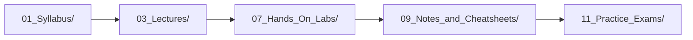

# 🏛️ AWS Certified Solutions Architect - Associate (SAA-C03) — Student Dashboard

> **Target Exam:** AWS Certified Solutions Architect - Associate (`SAA-C03`)  
> **Passing Score:** `720 / 1000` (Scaled Scoring)  
> **Exam Format:** 65 Scenario Questions | 130 Minutes  
> **Course Mission:** Enterprise-grade distributed systems design covering Security, Resilience, Performance, and Cost Optimization.

---

## 🧭 Your Study Roadmap

---

## ⚡ Recommended 4-Week Study Schedule

| Week | Focus Area | 📖 Study Materials | 💻 Practice Command |
|:---:|:---|:---|:---|
| **Week 1** | **Domain 1: Design Secure Architectures (30%)** | [Lecture 01](./03_Lectures/Lecture_01_Designing_Secure_AWS_Architectures.md) [Lab 01: Multi-Tier Resilient VPC](./07_Hands_On_Labs/lab_01_multi_tier_resilient_vpc_architecture.md) | `python3 scripts/aws_revision_runner.py --cert SAA --mode practice --domain 1 -n 20 --tricks` |
| **Week 2** | **Domain 2: Design Resilient Architectures (26%)** | [Lecture 02](./03_Lectures/Lecture_02_Designing_Resilient_and_High_Availability_Systems.md) [Lab 02: Scalable ASG & ALB](./07_Hands_On_Labs/lab_02_ha_scalable_web_tier_asg_alb.md) [Lab 03: Fault-Tolerant Aurora](./07_Hands_On_Labs/lab_03_aurora_fault_tolerant_relational_database.md) | `python3 scripts/aws_revision_runner.py --cert SAA --mode practice --domain 2 -n 20 --tricks` |
| **Week 3** | **Domain 3: High-Performing Architectures (24%)** | [Lecture 03](./03_Lectures/Lecture_03_High_Performance_Storage_Compute_and_Databases.md) [Lab 04: Decoupled SQS/SNS](./07_Hands_On_Labs/lab_04_decoupled_asynchronous_microservices_sqs_sns.md) | `python3 scripts/aws_revision_runner.py --cert SAA --mode practice --domain 3 -n 20 --tricks` |
| **Week 4** | **Domain 4: Cost-Optimized & Timed Mocks (20%)** | [Lecture 04](./03_Lectures/Lecture_04_Cost_Optimization_FinOps_and_Exam_Strategy.md) [Storage Decision Matrix](./09_Notes_and_Cheatsheets/Storage_Architecture_Decision_Matrix.md) | `python3 scripts/aws_revision_runner.py --cert SAA --community --mode practice -n 25` `python3 scripts/aws_revision_runner.py --cert SAA --mode mock` |

---

## 🎯 Progress Checklist

- [ ] **Domain 1 (Security):** Completed Lecture 01 & Lab 01 (VPC)
- [ ] **Domain 2 (Resilience):** Completed Lecture 02, Lab 02 (ASG/ALB) & Lab 03 (Aurora)
- [ ] **Domain 3 (Performance):** Completed Lecture 03 & Lab 04 (SQS/SNS Decoupling)
- [ ] **Domain 4 (Cost Optimization):** Completed Lecture 04 & Storage/DB Decision Matrices
- [ ] **1,019Q Community Pool:** Drilled 100+ questions with `--community`
- [ ] **Full Timed Mock Simulation:** Scored $\ge 80\%$ on the 65-question timed mock exam (`--mode mock`)
