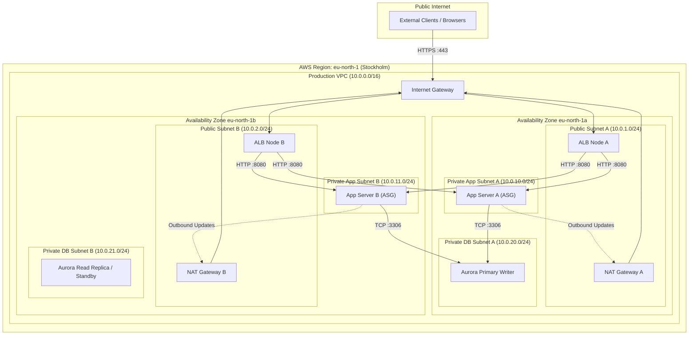

# Lab 01: Multi-Tier Resilient VPC Architecture with Public/Private Subnets, NAT Gateways & ALB

> **Track:** AWS Certified Solutions Architect - Associate (SAA-C03)  
> **Domain:** Domain 1: Design Secure Architectures & Domain 2: Design Resilient Architectures  
> **Level:** Associate (Hands-on Architecture Lab)  
> **Estimated Time:** 45 minutes  
> **Cost Profile:** Low Cost / Free-Tier Eligible (Remember to terminate NAT Gateways and ALBs after lab)

---

## 🏗️ 1. Architecture Overview

In enterprise production architectures, workloads are separated into tiered network layers across multiple Availability Zones to ensure zero single point of failure (SPOF) and enforce strict security isolation.



### Key Architectural Tenets:
1. **Public Web / Ingress Tier:** Hosts the internet-facing Application Load Balancer and NAT Gateways. Only the ALB receives public traffic directly.
2. **Private Application Tier:** Hosts backend microservices on compute instances without public IPv4 addresses. Outbound internet access (for OS patches and package downloads) routes through Multi-AZ NAT Gateways.
3. **Private Database Tier:** Strictly isolated storage subnets with no route to the Internet Gateway or NAT Gateways, accessible exclusively from the Application Tier security group.

---

## 📋 2. Prerequisites & Environment Setup

- AWS CLI v2 configured with appropriate credentials.
- Target Region: `eu-north-1` (or your assigned active project region).
- IAM permissions: `ec2:*`, `elasticloadbalancing:*`.

---

## 🛠️ 3. Step-by-Step Guided Implementation

### Step 3.1: Create the Multi-Tier VPC and Subnets

1. **Create the VPC:**
   - In the **VPC Console** (`Services > VPC > Your VPCs`), click **Create VPC**.
   - Select **VPC and more** (or build manually).
   - **Name tag:** `production-vpc`
   - **IPv4 CIDR block:** `10.0.0.0/16`
   - **Tenancy:** Default

2. **Configure 6 Subnets across 2 Availability Zones:**
   - **Public Subnet 1 (AZ A):** `10.0.1.0/24` in `eu-north-1a`
   - **Public Subnet 2 (AZ B):** `10.0.2.0/24` in `eu-north-1b`
   - **Private App Subnet 1 (AZ A):** `10.0.10.0/24` in `eu-north-1a`
   - **Private App Subnet 2 (AZ B):** `10.0.11.0/24` in `eu-north-1b`
   - **Private DB Subnet 1 (AZ A):** `10.0.20.0/24` in `eu-north-1a`
   - **Private DB Subnet 2 (AZ B):** `10.0.21.0/24` in `eu-north-1b`

3. **Attach Internet Gateway:**
   - Attach an Internet Gateway (`production-igw`) to `production-vpc`.

---

### Step 3.2: Configure Route Tables and Multi-AZ NAT Gateways

1. **Deploy Multi-AZ NAT Gateways:**
   - Under **Virtual private cloud > NAT gateways**, click **Create NAT gateway**.
   - **NAT Gateway 1:** Name `nat-gw-a`, Subnet: `Public Subnet 1 (10.0.1.0/24)`, allocate Elastic IP.
   - **NAT Gateway 2:** Name `nat-gw-b`, Subnet: `Public Subnet 2 (10.0.2.0/24)`, allocate Elastic IP.
   > **Exam Note:** In production high-availability architectures, deploying a NAT Gateway in **each** AZ ensures that an AZ outage in AZ-A does not sever outbound internet access for private instances in AZ-B.

2. **Configure 4 Route Tables:**
   - **Public Route Table:** Associated with Public Subnet 1 & 2.
     - Route: `0.0.0.0/0` $\rightarrow$ Target: `production-igw`
   - **Private App Route Table A:** Associated with Private App Subnet 1.
     - Route: `0.0.0.0/0` $\rightarrow$ Target: `nat-gw-a`
   - **Private App Route Table B:** Associated with Private App Subnet 2.
     - Route: `0.0.0.0/0` $\rightarrow$ Target: `nat-gw-b`
   - **Private DB Route Table:** Associated with Private DB Subnet 1 & 2.
     - Local route only (`10.0.0.0/16` $\rightarrow$ `local`). Zero routes to IGW or NAT.

---

### Step 3.3: Configure Tiered Security Groups (Least Privilege)

Create three chained security groups:

1. **ALB Security Group (`alb-sg`):**
   - Inbound: HTTP (80) and HTTPS (443) from `0.0.0.0/0`.
   - Outbound: All traffic.

2. **App Tier Security Group (`app-tier-sg`):**
   - Inbound: Custom TCP (8080) from Source: `alb-sg` (Security Group reference!).
   - Inbound: SSH (22) from internal bastion or AWS Systems Manager Session Manager.
   - Outbound: All traffic (for NAT access).

3. **Database Security Group (`db-tier-sg`):**
   - Inbound: MySQL/Aurora (3306) from Source: `app-tier-sg` exclusively.
   - Outbound: None.

---

### Step 3.4: Deploy Application Load Balancer (ALB)

1. Navigate to **EC2 Console > Load Balancers > Create Load Balancer**.
2. Select **Application Load Balancer (ALB)**.
3. **Scheme:** Internet-facing.
4. **VPC:** Select `production-vpc`.
5. **Mappings:** Select both `eu-north-1a` (Public Subnet 1) and `eu-north-1b` (Public Subnet 2).
6. **Security Groups:** Select `alb-sg`.
7. **Listeners:** HTTP :80 (or HTTPS :443). Forward to Target Group `app-tg` (Target Type: Instances, Port 8080).

---

## 💻 4. AWS CLI v2 Executable Runbook

### Step 4.1: Create VPC, Subnets, and IGW via CLI
```bash
# 1. Create VPC
VPC_ID=$(aws ec2 create-vpc \
  --cidr-block 10.0.0.0/16 \
  --tag-specifications 'ResourceType=vpc,Tags=[{Key=Name,Value=production-vpc}]' \
  --query 'Vpc.VpcId' --output text)
echo "Created VPC: $VPC_ID"

# 2. Enable DNS hostnames
aws ec2 modify-vpc-attribute --vpc-id $VPC_ID --enable-dns-hostnames "{\"Value\":true}"

# 3. Create Internet Gateway
IGW_ID=$(aws ec2 create-internet-gateway \
  --tag-specifications 'ResourceType=internet-gateway,Tags=[{Key=Name,Value=production-igw}]' \
  --query 'InternetGateway.InternetGatewayId' --output text)
aws ec2 attach-internet-gateway --vpc-id $VPC_ID --internet-gateway-id $IGW_ID
echo "Attached IGW: $IGW_ID"

# 4. Create Public Subnet 1 (AZ A)
PUB_SUB_A=$(aws ec2 create-subnet \
  --vpc-id $VPC_ID --cidr-block 10.0.1.0/24 --availability-zone eu-north-1a \
  --tag-specifications 'ResourceType=subnet,Tags=[{Key=Name,Value=public-1a}]' \
  --query 'Subnet.SubnetId' --output text)

# 5. Create Public Subnet 2 (AZ B)
PUB_SUB_B=$(aws ec2 create-subnet \
  --vpc-id $VPC_ID --cidr-block 10.0.2.0/24 --availability-zone eu-north-1b \
  --tag-specifications 'ResourceType=subnet,Tags=[{Key=Name,Value=public-1b}]' \
  --query 'Subnet.SubnetId' --output text)

# 6. Create App Subnet 1 (AZ A)
APP_SUB_A=$(aws ec2 create-subnet \
  --vpc-id $VPC_ID --cidr-block 10.0.10.0/24 --availability-zone eu-north-1a \
  --tag-specifications 'ResourceType=subnet,Tags=[{Key=Name,Value=private-app-1a}]' \
  --query 'Subnet.SubnetId' --output text)

# 7. Create App Subnet 2 (AZ B)
APP_SUB_B=$(aws ec2 create-subnet \
  --vpc-id $VPC_ID --cidr-block 10.0.11.0/24 --availability-zone eu-north-1b \
  --tag-specifications 'ResourceType=subnet,Tags=[{Key=Name,Value=private-app-1b}]' \
  --query 'Subnet.SubnetId' --output text)
```

### Step 4.2: Configure Route Tables via CLI
```bash
# Create Public Route Table
PUB_RT=$(aws ec2 create-route-table --vpc-id $VPC_ID \
  --tag-specifications 'ResourceType=route-table,Tags=[{Key=Name,Value=public-rt}]' \
  --query 'RouteTable.RouteTableId' --output text)

# Add 0.0.0.0/0 route to IGW
aws ec2 create-route --route-table-id $PUB_RT --destination-cidr-block 0.0.0.0/0 --gateway-id $IGW_ID

# Associate with public subnets
aws ec2 associate-route-table --subnet-id $PUB_SUB_A --route-table-id $PUB_RT
aws ec2 associate-route-table --subnet-id $PUB_SUB_B --route-table-id $PUB_RT
echo "Public routing configured successfully."
```

---

## 🎯 5. Exam Practice: Scenarios & Traps (SAA-C03)

| Scenario / Exam Trap | What the Exam Asks | Architecturally Correct Decision | Why Alternatives Are Traps |
|---|---|---|---|
| **Trap 1: Single NAT Gateway in Multi-AZ VPC** | *"A company runs an EC2 Auto Scaling group across 3 AZs in private subnets. To minimize cost, they create 1 NAT Gateway in AZ-A. An AZ outage occurs in AZ-A."* | Deploy **one NAT Gateway per Availability Zone**. A single NAT Gateway is an architecture failure point; if AZ-A goes down, private instances in AZ-B and AZ-C lose outbound internet access. | Using 1 NAT Gateway saves money but violates the **Resilient Architecture** pillar (SPOF). |
| **Trap 2: Public vs Private Subnet Definition** | *"What technically differentiates a public subnet from a private subnet in an AWS VPC?"* | A subnet is **public** if and only if its associated route table contains a route to an **Internet Gateway** (`0.0.0.0/0` $\rightarrow$ `igw-xxxx`). | IP address range does not determine public status; the presence of an IGW route in the route table is the sole determinant. |
| **Trap 3: Database Direct Ingress** | *"A database needs to be updated with security patches from an external repository while remaining secure."* | Place the database in private subnets with **no route to the internet**. Download patches to a private repository or use VPC Endpoints. If outbound access is mandatory, route through a NAT Gateway, **never** give the database a public IP. | Giving a database a public IP or assigning it to an IGW route table creates severe compliance and security failure. |
| **Trap 4: Security Group Chaining vs IP CIDRs** | *"How should backend application instances allow traffic only from the Application Load Balancer?"* | Configure the application security group to allow inbound traffic from the **ALB's Security Group ID** (`sg-xxxx`), NOT an IP CIDR block. | ALB IP addresses are dynamic and scale continuously. Hardcoding ALB IPs in security groups will break traffic routing. |
| **Trap 5: NAT Gateway vs Gateway Endpoints for S3** | *"An application in a private subnet uploads gigabytes of image files to Amazon S3 daily. NAT Gateway data transfer costs are high."* | Create a **VPC Gateway Endpoint for Amazon S3**. Gateway Endpoints for S3 and DynamoDB are **completely free** and route traffic over the private AWS backbone without touching the NAT Gateway. | Increasing NAT Gateway size increases cost; NAT Gateways bill per GB processed. |

---

## 🧹 6. Resource Cleanup

```bash
# Delete NAT Gateways and release Elastic IPs (NAT Gateways incur hourly charges)
# Terminate EC2 instances and delete Application Load Balancer
# Delete Subnets and VPC
aws ec2 detach-internet-gateway --internet-gateway-id $IGW_ID --vpc-id $VPC_ID
aws ec2 delete-internet-gateway --internet-gateway-id $IGW_ID
aws ec2 delete-vpc --vpc-id $VPC_ID
echo "VPC cleanup complete."
```
