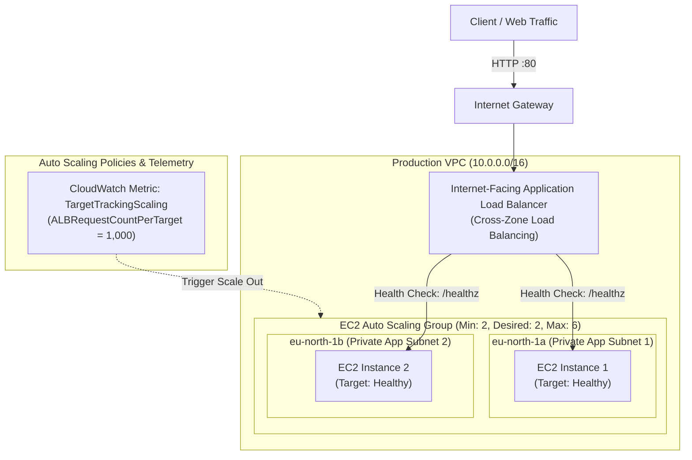

# Lab 02: High-Availability Scalable Web Tier with Auto Scaling Groups & Application Load Balancers

> **Track:** AWS Certified Solutions Architect - Associate (SAA-C03)  
> **Domain:** Domain 2: Design Resilient Architectures & Domain 3: Design High-Performing Architectures  
> **Level:** Associate (Hands-on Architecture Lab)  
> **Estimated Time:** 45 minutes  
> **Cost Profile:** Low Cost / Free-Tier Eligible

---

## 🏗️ 1. Architecture Overview

This lab demonstrates how to design a resilient, fault-tolerant web application tier capable of automatically scaling compute capacity in response to dynamic traffic spikes while self-healing from hardware failures.



### Key Architectural Tenets:
1. **EC2 Launch Templates:** Decouples instance configuration (AMI, instance type, IAM instance profile, user data bootstrap script, security groups, EBS volume settings) from scaling policies.
2. **Auto Scaling Group (ASG):** Enforces minimum, desired, and maximum instance counts across multiple Availability Zones, automatically replacing failed instances.
3. **Target Tracking Scaling:** Proactively adjusts instance counts to maintain a specific target metric (e.g., average CPU utilization at 60% or ALB request count per target at 1,000).
4. **ALB Health Checks:** Routes requests only to instances that return HTTP 200 on `/healthz`. Automatically deregisters failing instances and coordinates with ASG for instance replacement.

---

## 📋 2. Prerequisites & Environment Setup

- Existing VPC with Public and Private App Subnets (from Lab 01).
- Target Region: `eu-north-1`.
- AMI: Latest Amazon Linux 2023.

---

## 🛠️ 3. Step-by-Step Guided Implementation

### Step 3.1: Create an EC2 Launch Template with User Data Bootstrap

1. Navigate to **EC2 Console > Launch Templates > Create launch template**.
2. **Launch template name:** `web-tier-template-v1`
3. **Application and OS Images:** Amazon Linux 2023 AMI (HVM, SSD Volume Type).
4. **Instance type:** `t3.micro` (or `t4g.micro` for Graviton).
5. **Key pair:** Proceed without key pair (access via AWS Systems Manager Session Manager).
6. **Network settings:**
   - Security Group: `app-tier-sg` (allows HTTP 8080 from `alb-sg`).
7. **Advanced Details > User Data Script:**
   ```bash
   #!/bin/bash
   dnf update -y
   dnf install -y httpd
   systemctl start httpd
   systemctl enable httpd
   
   # Retrieve instance metadata using IMDSv2 token
   TOKEN=$(curl -s -X PUT "http://169.254.169.254/latest/api/token" -H "X-aws-ec2-metadata-token-ttl-seconds: 21600")
   AZ=$(curl -s -H "X-aws-ec2-metadata-token: $TOKEN" http://169.254.169.254/latest/meta-data/placement/availability-zone)
   INSTANCE_ID=$(curl -s -H "X-aws-ec2-metadata-token: $TOKEN" http://169.254.169.254/latest/meta-data/instance-id)
   
   cat <<EOF > /var/www/html/index.html
   <!DOCTYPE html>
   <html>
   <body style="font-family: Arial; text-align: center; margin-top: 50px;">
     <h1>Production Web Tier — Auto Scaling Group</h1>
     <p><b>Instance ID:</b> $INSTANCE_ID</p>
     <p><b>Availability Zone:</b> $AZ</p>
     <p><b>Status:</b> HEALTHY</p>
   </body>
   </html>
   EOF
   
   # Health check endpoint
   echo "OK" > /var/www/html/healthz
   ```

---

### Step 3.2: Create ALB Target Group & Application Load Balancer

1. Under **Load Balancing > Target groups**, click **Create target group**.
   - **Target type:** Instances.
   - **Target group name:** `web-app-tg`
   - **Protocol:** HTTP :80
   - **VPC:** `production-vpc`
   - **Health check path:** `/healthz`
   - **Health check thresholds:** Healthy threshold: 2; Unhealthy threshold: 3; Timeout: 5s; Interval: 15s.
2. Under **Load Balancers > Create Load Balancer**:
   - Type: Application Load Balancer (ALB).
   - Scheme: Internet-facing.
   - VPC: `production-vpc`, subnets: Public Subnet 1a and Public Subnet 1b.
   - Security group: `alb-sg` (inbound HTTP 80 from `0.0.0.0/0`).
   - Listeners: HTTP :80 $\rightarrow$ Forward to `web-app-tg`.

---

### Step 3.3: Configure the Auto Scaling Group (ASG)

1. Under **Auto Scaling > Auto Scaling Groups**, click **Create Auto Scaling group**.
2. **Name:** `web-tier-asg`
3. **Launch template:** Select `web-tier-template-v1`.
4. **VPC & Subnets:** Select `production-vpc` and choose **Private App Subnet 1a** and **Private App Subnet 1b**.
5. **Load balancing:**
   - Attach to an existing load balancer: Select Target Group `web-app-tg`.
   - **Health check grace period:** 300 seconds.
   - **Additional health check types:** Enable **Turn on Elastic Load Balancing health checks**.
   > **Exam Trap:** By default, ASG only checks EC2 hardware hypervisor health. Enabling ELB health checks ensures that if the Apache web service crashes inside the OS, the ASG marks the instance unhealthy and replaces it!
6. **Group size & scaling limits:**
   - Desired capacity: `2`
   - Minimum capacity: `2`
   - Maximum capacity: `6`
7. **Scaling policies:**
   - Policy type: **Target tracking scaling policy**.
   - Metric type: **Average CPU utilization**.
   - Target value: `50`% (or ALB Request Count per target: `1000`).

---

## 💻 4. AWS CLI v2 Executable Runbook

### Step 4.1: Create Launch Template via CLI
```bash
# Encode user-data script to base64
USER_DATA_B64=$(base64 -w 0 << 'EOF'
#!/bin/bash
dnf update -y
dnf install -y httpd
systemctl start httpd
systemctl enable httpd
TOKEN=$(curl -s -X PUT "http://169.254.169.254/latest/api/token" -H "X-aws-ec2-metadata-token-ttl-seconds: 21600")
AZ=$(curl -s -H "X-aws-ec2-metadata-token: $TOKEN" http://169.254.169.254/latest/meta-data/placement/availability-zone)
INSTANCE_ID=$(curl -s -H "X-aws-ec2-metadata-token: $TOKEN" http://169.254.169.254/latest/meta-data/instance-id)
echo "<h1>Instance $INSTANCE_ID in $AZ</h1>" > /var/www/html/index.html
echo "OK" > /var/www/html/healthz
EOF
)

# Create Launch Template
LT_ID=$(aws ec2 create-launch-template \
  --launch-template-name web-tier-template \
  --version-description "v1-production" \
  --launch-template-data "{
    \"ImageId\": \"ami-0c55b159cbfafe1f0\",
    \"InstanceType\": \"t3.micro\",
    \"SecurityGroupIds\": [\"$APP_SG_ID\"],
    \"UserData\": \"$USER_DATA_B64\"
  }" \
  --query 'LaunchTemplate.LaunchTemplateId' --output text)
echo "Created Launch Template: $LT_ID"
```

### Step 4.2: Create Target Group and Auto Scaling Group
```bash
# 1. Create Target Group
TG_ARN=$(aws elbv2 create-target-group \
  --name web-app-tg \
  --protocol HTTP \
  --port 80 \
  --vpc-id $VPC_ID \
  --health-check-path /healthz \
  --query 'TargetGroups[0].TargetGroupArn' --output text)

# 2. Create Auto Scaling Group across private subnets
aws autoscaling create-auto-scaling-group \
  --auto-scaling-group-name web-tier-asg \
  --launch-template "LaunchTemplateId=$LT_ID,Version=1" \
  --min-size 2 \
  --max-size 6 \
  --desired-capacity 2 \
  --vpc-zone-identifier "$APP_SUB_A,$APP_SUB_B" \
  --target-group-arns $TG_ARN \
  --health-check-type ELB \
  --health-check-grace-period 300

# 3. Attach Target Tracking Scaling Policy (50% CPU Utilization)
aws autoscaling put-scaling-policy \
  --auto-scaling-group-name web-tier-asg \
  --policy-name target-tracking-cpu-50 \
  --policy-type TargetTrackingScaling \
  --target-tracking-configuration '{
    "PredefinedMetricSpecification": {
      "PredefinedMetricType": "ASGAverageCPUUtilization"
    },
    "TargetValue": 50.0
  }'
echo "ASG and Target Tracking Policy configured successfully."
```

---

## 🎯 5. Exam Practice: Scenarios & Traps (SAA-C03)

| Scenario / Exam Trap | What the Exam Asks | Architecturally Correct Decision | Why Alternatives Are Traps |
|---|---|---|---|
| **Trap 1: ASG Health Check Type (EC2 vs ELB)** | *"An EC2 instance in an ASG fails to serve HTTP requests because Nginx crashed, but the ASG never terminates or replaces the instance."* | Configure the Auto Scaling Group **Health Check Type to `ELB`** (instead of the default `EC2`). | Default `EC2` health checks only detect hypervisor or hardware crashes; they cannot detect application or web server failure. |
| **Trap 2: Health Check Grace Period Too Short** | *"New instances launched by an ASG are prematurely terminated and replaced in an infinite reboot loop before application startup finishes."* | Increase the **Health Check Grace Period** (e.g., from 30 seconds to 300 seconds) to give application bootstrap scripts time to complete before health probes begin. | If grace period is shorter than initialization time, the load balancer reports the target unhealthy, triggering unnecessary terminations. |
| **Trap 3: Target Tracking vs Step Scaling** | *"An application experiences sudden, violent traffic spikes every morning at 09:00 AM. Target tracking reacts too slowly."* | Use **Scheduled Scaling** combined with **Step Scaling**. Target tracking calculates moving averages, whereas Scheduled Scaling proactively scales capacity *before* the traffic spike hits. | Target tracking is reactive and takes several minutes of sustained metrics to trigger scale-out events. |
| **Trap 4: Cross-Zone Load Balancing on ALB vs NLB** | *"Does an Application Load Balancer distribute traffic evenly across instances located in different Availability Zones?"* | Yes, **Cross-Zone Load Balancing is enabled by default on ALB** (and free of cross-AZ data transfer charges). On Network Load Balancers (NLB), it is disabled by default. | Disabling cross-zone load balancing results in uneven traffic distribution when one AZ receives more DNS requests than another. |
| **Trap 5: Launch Template Versioning vs Launch Configuration** | *"A team needs to update the AMI used by an existing Auto Scaling Group without downtime."* | Create a **new version of the Launch Template** and update the ASG to point to the new version (or `$Latest`). Execute an **ASG Instance Refresh**. | Launch Configurations are deprecated and cannot be updated once created; they require creating an entirely new configuration. |

---

## 🧹 6. Resource Cleanup

```bash
# 1. Update ASG min/desired to 0 to terminate all running EC2 instances
aws autoscaling update-auto-scaling-group --auto-scaling-group-name web-tier-asg --min-size 0 --desired-capacity 0
# 2. Wait for instances to terminate, then delete ASG
aws autoscaling delete-auto-scaling-group --auto-scaling-group-name web-tier-asg --force-delete
# 3. Delete Target Group and Load Balancer
aws elbv2 delete-target-group --target-group-arn $TG_ARN
aws ec2 delete-launch-template --launch-template-id $LT_ID
echo "Lab 02 cleanup complete."
```
