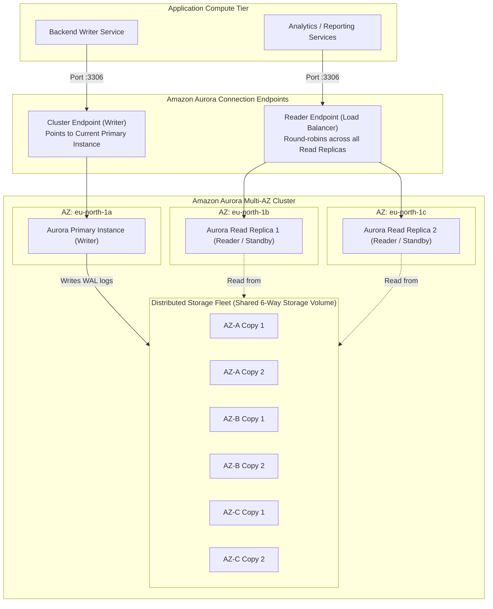

# Lab 03: Fault-Tolerant Relational Database with Amazon Aurora Multi-AZ & Read Replicas

> **Track:** AWS Certified Solutions Architect - Associate (SAA-C03)  
> **Domain:** Domain 2: Design Resilient Architectures & Domain 3: Design High-Performing Architectures  
> **Level:** Associate (Hands-on Architecture Lab)  
> **Estimated Time:** 45 minutes  
> **Cost Profile:** Low Cost / Free-Tier Eligible (Delete DB Cluster upon completion)

---

## 🏗️ 1. Architecture Overview

This lab guides the deployment of **Amazon Aurora**, AWS's cloud-native relational database engine engineered for high availability, fault tolerance, and massive read throughput.



### Key Architectural Tenets:
1. **Shared Distributed Storage:** Storage is completely decoupled from compute. Aurora automatically replicates storage **6 ways across 3 Availability Zones** in 10 GB chunks.
2. **Survives AZ Outages:** Aurora can tolerate the **loss of an entire Availability Zone plus 1 additional storage node (3 failures)** without losing write availability, and can tolerate 4 failures without losing read availability.
3. **Sub-second Failover:** Read replicas share the underlying storage volume directly via Write-Ahead Log (WAL) streaming. Failover takes typically <30 seconds without data loss.
4. **Auto-scaling Read Replicas:** Automatically adds up to 15 Aurora Replicas based on CPU utilization or connection count.

---

## 📋 2. Prerequisites & Environment Setup

- Existing VPC with Private Database Subnets in at least 2 (preferably 3) Availability Zones.
- IAM permissions: `rds:*`.
- Target Region: `eu-north-1`.

---

## 🛠️ 3. Step-by-Step Guided Implementation

### Step 3.1: Create a DB Subnet Group

1. Navigate to **RDS Console > Subnet groups > Create DB Subnet Group**.
2. **Name:** `aurora-db-subnet-group`
3. **Description:** `Private database subnets across 2 AZs`
4. **VPC:** Select `production-vpc`.
5. **Add Subnets:**
   - Select Availability Zones: `eu-north-1a` and `eu-north-1b` (and `eu-north-1c` if available).
   - Select Subnets: `Private DB Subnet 1 (10.0.20.0/24)` and `Private DB Subnet 2 (10.0.21.0/24)`.
6. Click **Create**.

---

### Step 3.2: Create the Amazon Aurora Cluster

1. Navigate to **RDS Console > Databases > Create database**.
2. **Engine options:**
   - Select **Amazon Aurora**.
   - Edition: **Amazon Aurora MySQL-Compatible Edition** (or PostgreSQL-Compatible).
3. **Templates:** Select **Dev/Test** (or Free tier eligible if available).
4. **Settings:**
   - **DB cluster identifier:** `production-aurora-cluster`
   - **Master username:** `admin`
   - **Master password:** `EnterpriseSecurePass2026!`
5. **Cluster storage configuration:**
   - Select **Aurora Standard**.
6. **Instance configuration:**
   - **DB instance class:** Serverless v2 (or `db.t3.medium` / `db.t4g.medium`).
7. **Availability & durability:**
   - **Multi-AZ deployment:** Select **Create an Aurora Replica or Reader node in a different AZ**.
8. **Connectivity:**
   - **VPC:** `production-vpc`
   - **DB Subnet Group:** `aurora-db-subnet-group`
   - **Public access:** No (Strictly Private!).
   - **VPC security group:** Select `db-tier-sg` (inbound TCP 3306 from `app-tier-sg` only).
9. Click **Create database**.

---

### Step 3.3: Inspect Endpoints and Test Read/Write Splitting

1. Once the cluster status shows **Available**, click on `production-aurora-cluster`.
2. Locate the **Endpoints tab**:
   - **Writer Instance Endpoint:** `production-aurora-cluster.cluster-xxxx.eu-north-1.rds.amazonaws.com`
     - Use this for write operations (INSERT, UPDATE, DELETE). Always points to the current primary writer.
   - **Reader Instance Endpoint:** `production-aurora-cluster.cluster-ro-xxxx.eu-north-1.rds.amazonaws.com`
     - Use this for read queries (SELECT). Automatically balances read traffic across all reader instances.
3. **Test Automatic Failover:**
   - Select the primary writer instance.
   - Click **Actions > Failover**.
   - Confirm failover. Within 15–30 seconds, the previous read replica is promoted to the new writer, and the Cluster Endpoint seamlessly updates its DNS alias to point to the promoted instance.

---

## 💻 4. AWS CLI v2 Executable Runbook

### Step 4.1: Create DB Subnet Group and Aurora Cluster via CLI
```bash
# 1. Create DB Subnet Group
aws rds create-db-subnet-group \
  --db-subnet-group-name aurora-db-subnet-group \
  --db-subnet-group-description "Private DB Subnets" \
  --subnet-ids "$DB_SUB_A" "$DB_SUB_B"

# 2. Create Aurora DB Cluster (MySQL 8.0)
aws rds create-db-cluster \
  --db-cluster-identifier production-aurora-cluster \
  --engine aurora-mysql \
  --engine-version 8.0.mysql_aurora.3.05.2 \
  --master-username admin \
  --master-user-password "EnterpriseSecurePass2026!" \
  --db-subnet-group-name aurora-db-subnet-group \
  --vpc-security-group-ids "$DB_SG_ID" \
  --backup-retention-period 7 \
  --storage-encrypted

# 3. Create Primary Writer Instance
aws rds create-db-instance \
  --db-instance-identifier aurora-instance-1 \
  --db-cluster-identifier production-aurora-cluster \
  --db-instance-class db.t4g.medium \
  --engine aurora-mysql

# 4. Create Read Replica Instance in second AZ
aws rds create-db-instance \
  --db-instance-identifier aurora-instance-2 \
  --db-cluster-identifier production-aurora-cluster \
  --db-instance-class db.t4g.medium \
  --engine aurora-mysql
```

### Step 4.2: Retrieve Endpoints & Trigger Failover
```bash
# Retrieve Writer and Reader Endpoints
aws rds describe-db-clusters \
  --db-cluster-identifier production-aurora-cluster \
  --query 'DBClusters[0].{Endpoint:Endpoint,ReaderEndpoint:ReaderEndpoint,Status:Status}' \
  --output table

# Trigger simulated failover to test resilience
aws rds failover-db-cluster \
  --db-cluster-identifier production-aurora-cluster
echo "Triggered Aurora failover test."
```

---

## 🎯 5. Exam Practice: Scenarios & Traps (SAA-C03)

| Scenario / Exam Trap | What the Exam Asks | Architecturally Correct Decision | Why Alternatives Are Traps |
|---|---|---|---|
| **Trap 1: Aurora vs Standard RDS Multi-AZ Failover Speed** | *"A high-traffic e-commerce database requires failover within 30 seconds with minimal data lag."* | Choose **Amazon Aurora Multi-AZ**. Aurora failover takes typically under 30 seconds because replicas share the underlying distributed storage volume. Standard RDS Multi-AZ synchronous replication takes 60–120 seconds. | Traditional RDS must sync caches and replay transactions during failover; Aurora's storage engine already has the writes committed. |
| **Trap 2: Read Replica Promotion for Disaster Recovery** | *"In Amazon RDS (PostgreSQL/MySQL), what happens when you promote a Read Replica to a standalone database?"* | The Read Replica becomes a **standalone, independent database** and completely breaks replication ties with the original master. | A promoted replica does not automatically sync back to the original database; it forks into a separate database. |
| **Trap 3: Read-Heavy Application Scaling** | *"An application experiences 90% read queries and 10% writes. The primary database CPU is pegged at 95%."* | Direct read queries to the **Aurora Reader Endpoint** and add **Aurora Auto Scaling Read Replicas** (up to 15 replicas). | Upgrading the primary instance size (vertical scaling) costs more and does not solve the fundamental architectural bottleneck of combining reads and writes. |
| **Trap 4: Global Multi-Region Low-Latency Reads** | *"A company requires cross-region disaster recovery (RPO < 1 second) and fast local read performance for global users in Europe, Asia, and North America."* | Deploy **Amazon Aurora Global Database**. Replicates dedicated storage across up to 5 secondary AWS regions in under 1 second without impacting primary instance compute. | Cross-Region RDS Read Replicas incur substantial replication lag and require manual cluster rebuilding during regional outages. |
| **Trap 5: Storage Auto-Scaling Limit** | *"A database administrator worries about running out of disk space on an Amazon Aurora database over the next 3 years."* | **Amazon Aurora automatically scales storage up to 128 TiB** in 10 GB increments without downtime or manual allocation. | Traditional RDS requires configuring storage auto-scaling with specific maximum limits and can experience storage expansion delays. |

---

## 🧹 6. Resource Cleanup

```bash
# Delete DB instances first, then the cluster
aws rds delete-db-instance --db-instance-identifier aurora-instance-1 --skip-final-snapshot
aws rds delete-db-instance --db-instance-identifier aurora-instance-2 --skip-final-snapshot
aws rds delete-db-cluster --db-cluster-identifier production-aurora-cluster --skip-final-snapshot
aws rds delete-db-subnet-group --db-subnet-group-name aurora-db-subnet-group
echo "Aurora cleanup complete."
```
