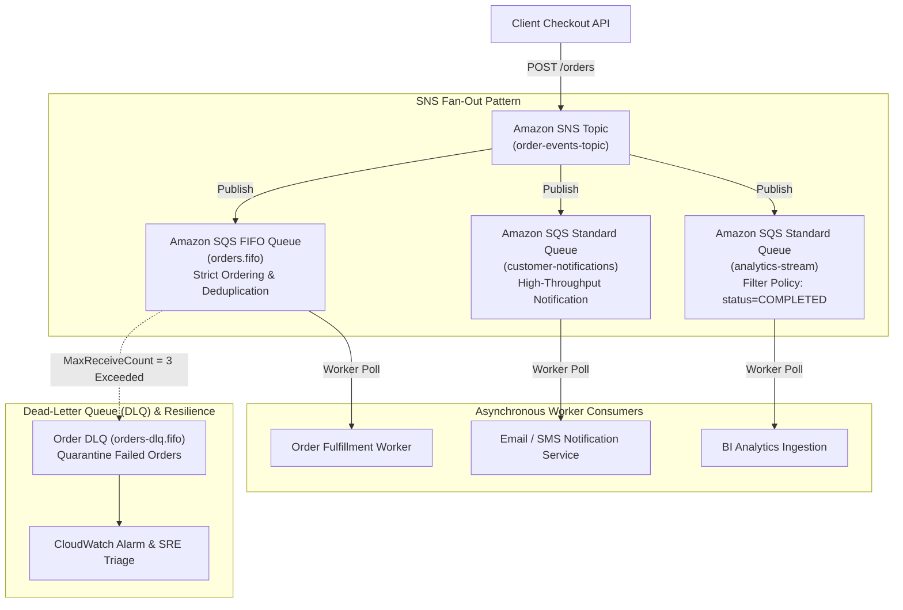

# Lab 04: Decoupled Asynchronous Microservices with Amazon SQS FIFO, SNS Fan-Out & Dead-Letter Queues

> **Track:** AWS Certified Solutions Architect - Associate (SAA-C03)  
> **Domain:** Domain 2: Design Resilient Architectures & Domain 3: Design High-Performing Architectures  
> **Level:** Associate (Hands-on Architecture Lab)  
> **Estimated Time:** 45 minutes  
> **Cost Profile:** 100% Free-Tier Eligible

---

## 🏗️ 1. Architecture Overview

This lab demonstrates how to design a loosely coupled, event-driven microservices architecture using the **SNS Publish-Subscribe Fan-Out** pattern coupled with **Amazon SQS Queues** and **Dead-Letter Queues (DLQs)** to ensure reliable, ordered, and fault-tolerant message processing.



### Key Architectural Tenets:
1. **Decoupling Producer from Consumers:** The frontend checkout API publishes an event to an SNS topic once and returns an immediate HTTP 202 Accepted response to the customer. Downstream worker services consume events at their own pace without overwhelming downstream databases.
2. **Fan-Out Pattern:** A single SNS message is concurrently replicated into multiple independent SQS queues serving distinct business services (Order Fulfillment, Email Notifications, Analytics).
3. **FIFO Queues (First-In, First-Out):** Guarantees strict ordering and **exactly-once processing** (via `MessageGroupId` and `MessageDeduplicationId`), critical for financial ledger and inventory transactions.
4. **Dead-Letter Queues (DLQ):** Isolates problematic ("poison-pill") messages after a configurable number of retry attempts (`maxReceiveCount`), preventing infinite retry loops from blocking valid queue traffic.

---

## 📋 2. Prerequisites & Environment Setup

- AWS CLI v2 configured.
- IAM permissions: `sns:*`, `sqs:*`.
- Target Region: `eu-north-1`.

---

## 🛠️ 3. Step-by-Step Guided Implementation

### Step 3.1: Create Amazon SQS Dead-Letter Queue (DLQ) & Main FIFO Queue

1. Navigate to **SQS Console > Create queue**.
2. **Create Dead-Letter Queue First:**
   - Type: **FIFO**.
   - Name: `orders-dlq.fifo` (FIFO queue names must end in `.fifo`!).
   - Content-based deduplication: Enabled.
   - Message retention period: `14 days` (gives engineers ample time to debug poison pills).
   - Click **Create queue**.
3. **Create Primary Processing FIFO Queue:**
   - Type: **FIFO**.
   - Name: `orders.fifo`.
   - Content-based deduplication: Enabled.
   - **Dead-letter queue settings:**
     - Enable Dead-letter queue: Enabled.
     - Choose DLQ: `orders-dlq.fifo`.
     - **Maximum receives:** `3` (after 3 failed processing attempts, message moves to DLQ).
   - Click **Create queue**.

---

### Step 3.2: Create Amazon SNS Topic

1. Navigate to **SNS Console > Topics > Create topic**.
2. **Type:** FIFO (or Standard for high-throughput broadcast).
   - *Select FIFO* to preserve strict end-to-end message ordering.
3. **Name:** `order-events-topic.fifo` (FIFO topic names must end in `.fifo`!).
4. **Content-based deduplication:** Enabled.
5. Click **Create topic**.

---

### Step 3.3: Subscribe SQS Queues to the SNS Topic (Fan-Out)

1. Open `order-events-topic.fifo`.
2. Under **Subscriptions**, click **Create subscription**.
   - **Protocol:** Amazon SQS.
   - **Endpoint:** ARN of `orders.fifo`.
   - Click **Create subscription**.
3. **Configure SQS Access Policy:**
   - Ensure the SQS queue policy allows `sns.amazonaws.com` to execute `sqs:SendMessage` into `orders.fifo`.
   ```json
   {
     "Effect": "Allow",
     "Principal": {"Service": "sns.amazonaws.com"},
     "Action": "sqs:SendMessage",
     "Resource": "arn:aws:sqs:eu-north-1:ACCOUNT_ID:orders.fifo",
     "Condition": {
       "ArnEquals": {"aws:SourceArn": "arn:aws:sns:eu-north-1:ACCOUNT_ID:order-events-topic.fifo"}
     }
   }
   ```

---

### Step 3.4: Test Fan-Out, Message Deduplication, and Poison-Pill DLQ Routing

1. **Publish an Order Message:**
   - Publish to `order-events-topic.fifo`:
     - Message Group ID: `customer-account-1001`
     - Message Body: `{"order_id": "ORD-9901", "amount": 149.99, "status": "PENDING"}`
2. **Verify Queue Ingestion:**
   - In SQS Console, open `orders.fifo` and click **Send and receive messages > Poll for messages**.
   - Verify that the message was received intact with proper headers.
3. **Simulate Poison-Pill Failure:**
   - Receive the message and simulate an application crash (do not delete the message).
   - Wait for the **Visibility Timeout** (default 30s) to expire.
   - Repeat polling 3 times until the receive count exceeds 3.
   - Observe the message automatically vanish from `orders.fifo` and appear in `orders-dlq.fifo`!

---

## 💻 4. AWS CLI v2 Executable Runbook

### Step 4.1: Create DLQ, Main Queue, and SNS Topic via CLI
```bash
# 1. Create Dead-Letter Queue (DLQ)
DLQ_URL=$(aws sqs create-queue \
  --queue-name orders-dlq.fifo \
  --attributes FifoQueue=true,ContentBasedDeduplication=true,MessageRetentionPeriod=1209600 \
  --query 'QueueUrl' --output text)
DLQ_ARN=$(aws sqs get-queue-attributes --queue-url $DLQ_URL --attribute-names QueueArn --query 'Attributes.QueueArn' --output text)

# 2. Create Main FIFO Queue with Redrive Policy pointing to DLQ
REDRIVE_POLICY="{\"deadLetterTargetArn\":\"$DLQ_ARN\",\"maxReceiveCount\":3}"
MAIN_Q_URL=$(aws sqs create-queue \
  --queue-name orders.fifo \
  --attributes "FifoQueue=true,ContentBasedDeduplication=true,VisibilityTimeout=30,RedrivePolicy='$REDRIVE_POLICY'" \
  --query 'QueueUrl' --output text)
MAIN_Q_ARN=$(aws sqs get-queue-attributes --queue-url $MAIN_Q_URL --attribute-names QueueArn --query 'Attributes.QueueArn' --output text)

# 3. Create SNS FIFO Topic
SNS_TOPIC_ARN=$(aws sns create-topic \
  --name order-events-topic.fifo \
  --attributes FifoTopic=true,ContentBasedDeduplication=true \
  --query 'TopicArn' --output text)

echo "SNS Topic: $SNS_TOPIC_ARN"
echo "Main Queue: $MAIN_Q_URL"
echo "DLQ: $DLQ_URL"
```

### Step 4.2: Subscribe Queue to Topic and Publish Test Message
```bash
# Subscribe SQS to SNS Topic
aws sns subscribe \
  --topic-arn $SNS_TOPIC_ARN \
  --protocol sqs \
  --notification-endpoint $MAIN_Q_ARN

# Publish test message to SNS topic
aws sns publish \
  --topic-arn $SNS_TOPIC_ARN \
  --message '{"orderId":"ORD-5001","customer":"Alice","total":250.00}' \
  --message-group-id "cust-alice"

# Receive message from SQS queue to verify delivery
aws sqs receive-message \
  --queue-url $MAIN_Q_URL \
  --attribute-names All \
  --max-number-of-messages 1 \
  --output json
```

---

## 🎯 5. Exam Practice: Scenarios & Traps (SAA-C03)

| Scenario / Exam Trap | What the Exam Asks | Architecturally Correct Decision | Why Alternatives Are Traps |
|---|---|---|---|
| **Trap 1: Standard vs FIFO Queue Requirements** | *"An application requires processing customer banking deposits where messages must strictly maintain order and zero duplicate deposits can occur."* | Use **Amazon SQS FIFO Queue**. SQS FIFO guarantees First-In-First-Out ordering and strictly **exactly-once processing** (via 300 ms deduplication window). | Amazon SQS Standard provides **best-effort ordering** and **at-least-once delivery**, which can result in out-of-order execution and duplicate deposits. |
| **Trap 2: High Throughput Scaling with FIFO Queues** | *"A company uses SQS FIFO, but throughput is capped at 300 messages per second. How can they achieve 3,000+ messages per second while preserving ordering?"* | Enable **High Throughput mode for FIFO queues** and use distinct **`MessageGroupId`** values for different customers. Throughput scales per message group. | Switching to SQS Standard destroys strict order guarantees; a single message group forces sequential processing. |
| **Trap 3: SQS Visibility Timeout Configuration** | *"A backend worker takes 45 seconds to process a large image from an SQS queue. Every 30 seconds, another worker picks up the exact same image, resulting in duplicate processing."* | Increase the **SQS Visibility Timeout** to greater than the maximum processing time (e.g., 60–90 seconds), or have the worker call `ChangeMessageVisibility` dynamically. | Visibility timeout is the duration during which a message is hidden from other workers while being processed. If it is shorter than processing time, duplicate reads occur. |
| **Trap 4: SNS Filter Policies vs Multiple Topics** | *"An enterprise publishes all transaction events to an SNS topic. Different microservices need to receive only specific types (e.g., Fraud needs only transactions > \$10,000)."* | Use **Amazon SNS Subscription Filter Policies**. Filter policies evaluate JSON message attributes at zero compute cost, routing messages only to matching subscribers. | Creating separate SNS topics for every transaction type creates administrative sprawl and forces producers to write routing logic. |
| **Trap 5: Decoupled Polling Efficiency (Short vs Long Polling)** | *"How should an application configure SQS polling to minimize empty responses and reduce API costs?"* | Enable **SQS Long Polling** by setting `WaitTimeSeconds` between 1 and 20 seconds. | Short polling returns immediately even if the queue is empty, racking up high `ReceiveMessage` API request costs and wasting compute cycles. |

---

## 🧹 6. Resource Cleanup

```bash
# Delete SNS Topic and SQS Queues
aws sns delete-topic --topic-arn $SNS_TOPIC_ARN
aws sqs delete-queue --queue-url $MAIN_Q_URL
aws sqs delete-queue --queue-url $DLQ_URL
echo "Lab 04 cleanup complete."
```
