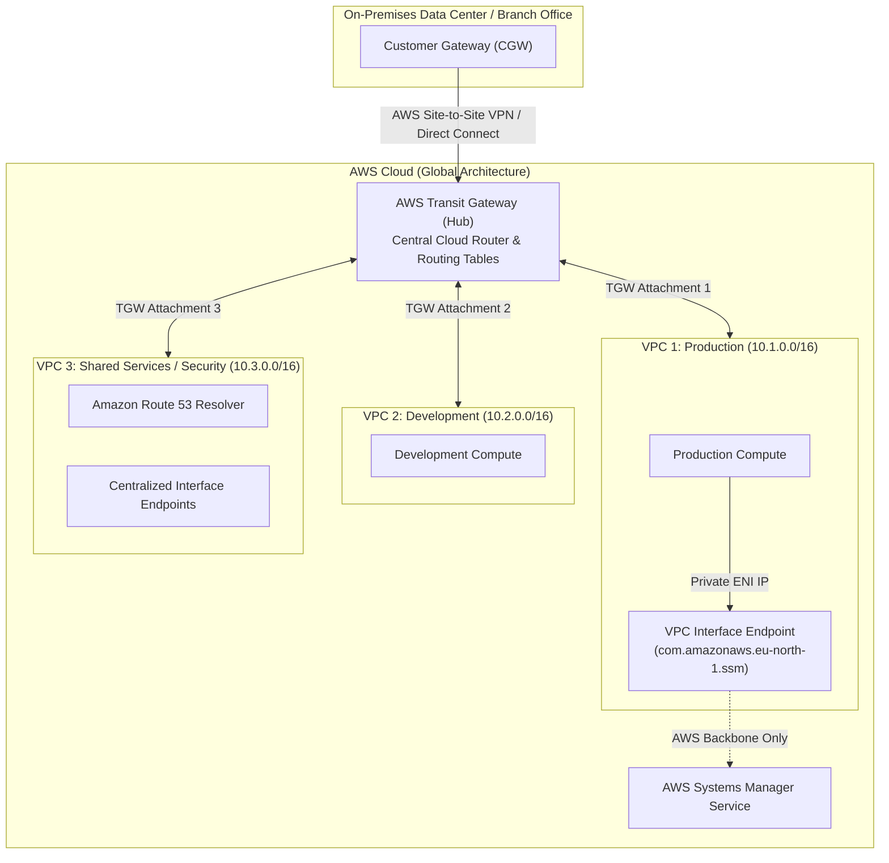

# Lab 05: Hybrid & Private Network Connectivity with AWS Transit Gateway & VPC Interface Endpoints

> **Track:** AWS Certified Solutions Architect - Associate (SAA-C03)  
> **Domain:** Domain 1: Design Secure Architectures & Domain 3: Design High-Performing Architectures  
> **Level:** Associate (Hands-on Architecture Lab)  
> **Estimated Time:** 45 minutes  
> **Cost Profile:** Low Cost / Free-Tier Eligible

---

## 🏗️ 1. Architecture Overview

This lab demonstrates how to architect a modern, scalable multi-VPC hub-and-spoke enterprise network using **AWS Transit Gateway (TGW)** and **VPC Interface Endpoints (AWS PrivateLink)**, eliminating the complex mess of full-mesh VPC peering while keeping all AWS service traffic off the public internet.



### Key Architectural Tenets:
1. **Hub-and-Spoke Topology:** Instead of configuring $N(N-1)/2$ complex, point-to-point VPC Peering connections, Transit Gateway acts as a central regional cloud router, simplifying network management to $N$ attachments.
2. **Network Segmentation via TGW Route Tables:** Enforces strict isolation (e.g., Development VPC cannot reach Production VPC, but both can communicate with the Shared Services VPC and On-Premises).
3. **AWS PrivateLink (VPC Interface Endpoints):** Deploys Elastic Network Interfaces (ENIs) with private IP addresses in your private subnets, enabling private communication with AWS services (KMS, SSM, Secrets Manager, Bedrock) without requiring an Internet Gateway, NAT Gateway, or public IP addresses.

---

## 📋 2. Prerequisites & Environment Setup

- Two VPCs created: `vpc-prod` (`10.1.0.0/16`) and `vpc-dev` (`10.2.0.0/16`).
- IAM permissions: `ec2:*transit-gateway*`, `ec2:*vpc-endpoint*`.
- Target Region: `eu-north-1`.

---

## 🛠️ 3. Step-by-Step Guided Implementation

### Step 3.1: Create AWS Transit Gateway

1. Navigate to **VPC Console > Transit gateways > Create transit gateway**.
2. **Name tag:** `enterprise-transit-gateway`
3. **Amazon side ASN:** `64512` (Private Autonomous System Number for BGP routing).
4. **DNS support:** Enable.
5. **VPN ECMP support:** Enable (Equal-Cost Multi-Path routing across multiple VPN tunnels).
6. **Default route table association / propagation:** Enable (or disable for custom segment isolation).
7. Click **Create transit gateway** (takes ~2 minutes to become `available`).

---

### Step 3.2: Create Transit Gateway Attachments

1. Navigate to **Transit gateway attachments > Create transit gateway attachment**.
   - **Transit gateway ID:** Select `enterprise-transit-gateway`.
   - **Attachment type:** VPC.
   - **Attachment name:** `tgw-attachment-prod`.
   - **VPC ID:** Select `vpc-prod`.
   - **Subnet IDs:** Select private subnets in at least two AZs.
2. Repeat for the second VPC:
   - **Attachment name:** `tgw-attachment-dev`.
   - **VPC ID:** Select `vpc-dev`.

---

### Step 3.3: Configure VPC Route Tables to Route via Transit Gateway

1. Open the Route Table for `vpc-prod`:
   - Add Route: Destination `10.2.0.0/16` (Dev VPC CIDR) → Target: **Transit Gateway** (`tgw-xxxx`).
2. Open the Route Table for `vpc-dev`:
   - Add Route: Destination `10.1.0.0/16` (Prod VPC CIDR) → Target: **Transit Gateway** (`tgw-xxxx`).
   > Traffic between instances in `vpc-prod` and `vpc-dev` now traverses the high-speed AWS internal network fabric via Transit Gateway!

---

### Step 3.4: Deploy a VPC Interface Endpoint (AWS PrivateLink)

To allow private compute instances to access AWS Systems Manager (SSM) without an Internet Gateway or NAT Gateway:

1. Navigate to **VPC Console > Endpoints > Create endpoint**.
2. **Name tag:** `ssm-interface-endpoint`
3. **Service category:** AWS services.
4. **Services:** Search for `com.amazonaws.eu-north-1.ssm` (Type: Interface).
5. **VPC:** Select `vpc-prod`.
6. **Subnets:** Select Private App Subnet 1a and 1b.
7. **Security Groups:** Select an endpoint security group allowing inbound HTTPS (443) from `app-tier-sg`.
8. **Enable Private DNS name:** **Checked** (resolves `ssm.eu-north-1.amazonaws.com` to the private ENI IP address inside the VPC).
9. Click **Create endpoint**.

---

## 💻 4. AWS CLI v2 Executable Runbook

### Step 4.1: Create Transit Gateway and Attachments via CLI
```bash
# 1. Create Transit Gateway
TGW_ID=$(aws ec2 create-transit-gateway \
  --description "Enterprise Central Hub" \
  --options AmazonSideAsn=64512,AutoAcceptSharedAttachments=enable \
  --tag-specifications 'ResourceType=transit-gateway,Tags=[{Key=Name,Value=enterprise-tgw}]' \
  --query 'TransitGateway.TransitGatewayId' --output text)
echo "Created Transit Gateway: $TGW_ID"

# 2. Attach VPC Prod
ATT_PROD=$(aws ec2 create-transit-gateway-vpc-attachment \
  --transit-gateway-id $TGW_ID \
  --vpc-id $VPC_PROD_ID \
  --subnet-ids "$PROD_SUB_A" "$PROD_SUB_B" \
  --tag-specifications 'ResourceType=transit-gateway-attachment,Tags=[{Key=Name,Value=att-prod}]' \
  --query 'TransitGatewayVpcAttachment.TransitGatewayAttachmentId' --output text)

# 3. Attach VPC Dev
ATT_DEV=$(aws ec2 create-transit-gateway-vpc-attachment \
  --transit-gateway-id $TGW_ID \
  --vpc-id $VPC_DEV_ID \
  --subnet-ids "$DEV_SUB_A" "$DEV_SUB_B" \
  --tag-specifications 'ResourceType=transit-gateway-attachment,Tags=[{Key=Name,Value=att-dev}]' \
  --query 'TransitGatewayVpcAttachment.TransitGatewayAttachmentId' --output text)
```

### Step 4.2: Create VPC Interface Endpoint (PrivateLink)
```bash
# Create Interface Endpoint for Systems Manager (SSM)
VPCE_ID=$(aws ec2 create-vpc-endpoint \
  --vpc-id $VPC_PROD_ID \
  --vpc-endpoint-type Interface \
  --service-name com.amazonaws.eu-north-1.ssm \
  --subnet-ids "$PROD_SUB_A" "$PROD_SUB_B" \
  --security-group-ids "$VPCE_SG_ID" \
  --private-dns-enabled \
  --tag-specifications 'ResourceType=vpc-endpoint,Tags=[{Key=Name,Value=ssm-endpoint}]' \
  --query 'VpcEndpoint.VpcEndpointId' --output text)
echo "Created Interface Endpoint: $VPCE_ID"
```

---

## 🎯 5. Exam Practice: Scenarios & Traps (SAA-C03)

| Scenario / Exam Trap | What the Exam Asks | Architecturally Correct Decision | Why Alternatives Are Traps |
|---|---|---|---|
| **Trap 1: Transitive Routing in VPC Peering** | *"VPC-A is peered with VPC-B, and VPC-B is peered with VPC-C. Can an instance in VPC-A ping an instance in VPC-C?"* | **No.** VPC Peering does **not support edge-to-edge routing (transitive routing)**. To achieve transitive routing across multiple VPCs, you must deploy **AWS Transit Gateway**. | Expecting VPC Peering to route through intermediary VPCs is one of the most common exam traps on SAA-C03. |
| **Trap 2: Gateway Endpoints vs Interface Endpoints** | *"Which two AWS services support free Gateway Endpoints, and what endpoint type is required for all other AWS services?"* | **Amazon S3 and Amazon DynamoDB** support **Gateway Endpoints** (which edit route tables and are 100% free). All other services (KMS, SQS, SNS, SSM, Bedrock) require **Interface Endpoints (AWS PrivateLink)**, which deploy ENIs and charge an hourly fee plus per-GB data processing. | Trying to create a Gateway Endpoint for SQS or SSM will fail; only S3 and DynamoDB have Gateway Endpoints. |
| **Trap 3: Interface Endpoint Private DNS** | *"After creating an Interface Endpoint for Amazon S3, private EC2 instances still route out to the public internet endpoint."* | Enable **Private DNS** on the Interface Endpoint. When enabled, standard SDK calls to `s3.eu-north-1.amazonaws.com` automatically resolve to the private IP address of the endpoint's ENI. | If Private DNS is not enabled, applications must be manually configured to use the custom endpoint URL. |
| **Trap 4: Multi-Account Network Hub Architecture** | *"An organization has 50 AWS accounts, each with its own VPC. Security policy requires centralized internet egress filtering and on-premises connectivity."* | Deploy **AWS Transit Gateway in a dedicated Network/Hub AWS account**, share it across the organization using **AWS Resource Access Manager (RAM)**, and attach all spoke VPCs. | Managing 1,225 individual VPC Peering connections across 50 accounts is operational madness and hits AWS service limits. |
| **Trap 5: Transit Gateway Inter-Region Peering** | *"Can a Transit Gateway in eu-north-1 route traffic to a Transit Gateway in us-east-1?"* | Yes, **Transit Gateway Peering** supports cross-region interconnection over the global AWS private fiber network with built-in encryption. | Setting up manual IPsec VPN connections between regions wastes throughput and introduces unnecessary encryption overhead. |

---

## 🧹 6. Resource Cleanup

```bash
# Delete VPC Endpoint, TGW Attachments, and Transit Gateway
aws ec2 delete-vpc-endpoints --vpc-endpoint-ids $VPCE_ID
aws ec2 delete-transit-gateway-vpc-attachment --transit-gateway-attachment-id $ATT_PROD
aws ec2 delete-transit-gateway-vpc-attachment --transit-gateway-attachment-id $ATT_DEV
aws ec2 delete-transit-gateway --transit-gateway-id $TGW_ID
echo "Lab 05 cleanup complete."
```
