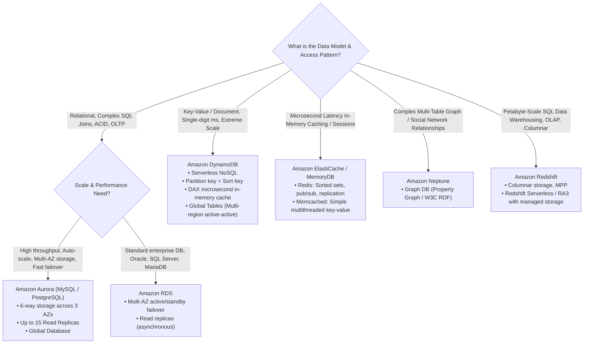

# Database Architecture Decision Matrix (SAA-C03)

> **Track:** AWS Certified Solutions Architect - Associate (SAA-C03)  
> **Topic:** Database Selection & Architecture (Relational vs NoSQL vs In-Memory vs Analytics)

---

## 🧭 Executive Decision Framework

---

## 📊 Comprehensive Database Comparison Matrix

| Service | Data Model | Scaling Characteristics | High Availability (HA) Mechanism | Failover Time | Typical Exam Scenario |
|---|---|---|---|---|---|
| **Amazon Aurora** | Relational (MySQL / Postgres) | Auto-scales storage up to 128 TiB; up to 15 Read Replicas; Serverless v2 | 6 storage copies across 3 AZs; automated replica promotion | **< 30 seconds** | High-traffic e-commerce transactional database with rapid failover and heavy read scaling. |
| **Amazon RDS** | Relational (6 engines) | Manual or automated storage scaling up to 64 TiB; up to 15 Read Replicas | Multi-AZ synchronous standby replica in secondary AZ | 60–120 seconds | Legacy enterprise application migrating existing Oracle or SQL Server licenses to AWS. |
| **Amazon DynamoDB** | Key-Value & Document | Auto-scales to millions of read/write requests per second; On-Demand or Provisioned | Built-in synchronous 3-AZ replication; Global Tables (multi-region active-active) | **Instantaneous (Zero failover downtime)** | Mobile gaming leaderboards, shopping cart sessions, IoT telemetry ingestion at massive scale. |
| **Amazon ElastiCache** | In-Memory (Redis / Memcached) | In-memory cluster scaling; Redis supports Multi-AZ with auto-failover | Redis: Primary/Replica with Multi-AZ failover; Memcached: Pure cache (no HA) | Sub-minute (Redis) | Caching frequent database read queries to reduce RDS/DynamoDB load and provide microsecond latency. |
| **Amazon Redshift** | Columnar OLAP Data Warehouse | Multi-node cluster with RA3 nodes; Redshift Serverless auto-scales compute | Multi-AZ deployments; automated S3 snapshots | Cluster migration / Serverless | Running complex analytical aggregate queries across billions of historical sales rows. |

---

## ⚡ High-Yield Exam Traps & Distinctions

1. **RDS Multi-AZ vs Read Replicas:**
   - **Multi-AZ:** Designed for **High Availability & Disaster Recovery**. Uses **synchronous replication** to a standby instance in another AZ. You **cannot read from the standby** (it has no endpoint).
   - **Read Replicas:** Designed for **Read Scalability**. Uses **asynchronous replication**. You **can read from read replicas** (each has its own endpoint).
2. **Aurora Global Database vs Multi-Region RDS Replicas:**
   - Aurora Global Database replicates storage at the physical storage layer with latency typically $< 1$ second, with zero compute impact on the primary writer. Failover takes $< 1$ minute.
   - RDS cross-region replicas replicate asynchronously over the network, incurring higher replication lag and requiring manual database promotion during outages.
3. **DynamoDB Accelerator (DAX) vs ElastiCache Redis:**
   - **DAX:** In-memory write-through cache designed **specifically and exclusively for DynamoDB**. Seamlessly integrates with zero application code changes (just update SDK endpoint to DAX). Delivers microsecond read latency for read-heavy workloads.
   - **ElastiCache:** General-purpose in-memory cache supporting complex data structures (sets, hashes, pub/sub) that can cache any database (RDS, DynamoDB, MongoDB), but requires writing explicit cache application logic (cache-aside pattern).
4. **DynamoDB Consistency (Strong vs Eventual):**
   - By default, DynamoDB reads are **Eventually Consistent** (costs 0.5 Read Capacity Unit for up to 4 KB).
   - **Strongly Consistent Reads** return the latest committed write (costs 1.0 Read Capacity Unit for up to 4 KB).
   - Strong consistency is NOT supported across Global Tables or on Local/Global Secondary Indexes.
