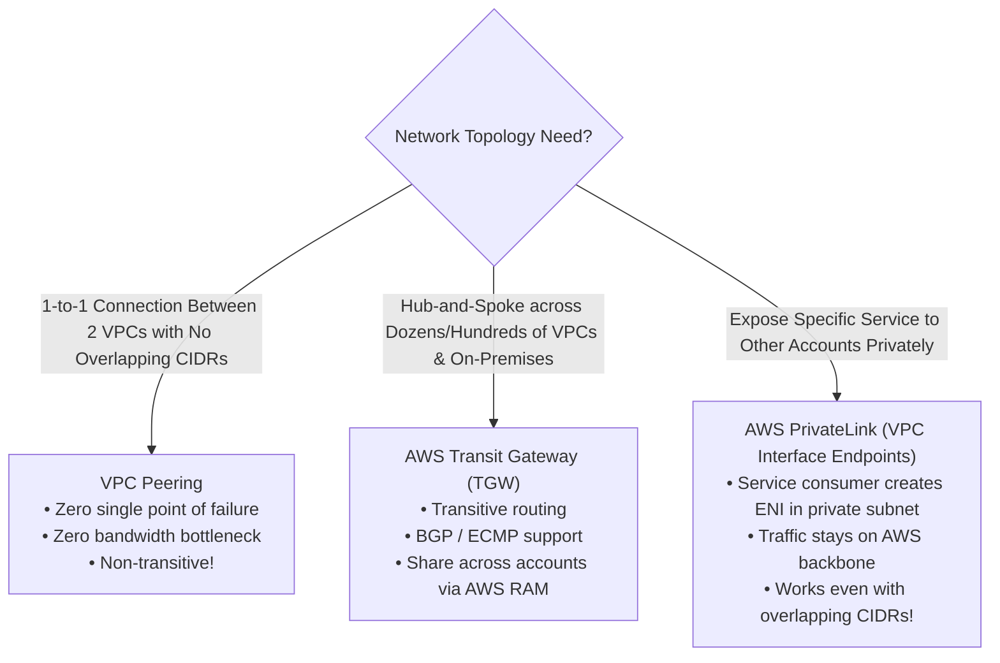

# Networking & Decoupling Architecture Cheat Sheet (SAA-C03)

> **Track:** AWS Certified Solutions Architect - Associate (SAA-C03)  
> **Topic:** Advanced Networking, Load Balancing & Event-Driven Decoupling

---

## 🌐 Part 1: Elastic Load Balancing (ALB vs. NLB vs. GLB)

| Feature | Application Load Balancer (ALB) | Network Load Balancer (NLB) | Gateway Load Balancer (GLB) |
|---|---|---|---|
| **OSI Layer** | **Layer 7 (Application)** | **Layer 4 (Transport)** | **Layer 3 / 4 (Network & Transport)** |
| **Protocols Supported** | HTTP, HTTPS, gRPC, WebSockets | TCP, UDP, TLS | IP Packets (GENEVE encapsulation on port 6081) |
| **Target Types** | EC2 Instances, IP addresses, Lambda, ALB | EC2 Instances, IP addresses, ALB | Third-party Virtual Appliances (Firewalls, IDS/IPS) |
| **Static / Elastic IP** | **No** (Dynamic IP addresses, access via DNS alias) | **Yes** (One static IP / Elastic IP per AZ) | Transparent bump-in-the-wire |
| **Routing Decisions** | Path-based (`/api`), Host-based (`app.example.com`), Query parameters, HTTP headers | Port and IP protocol | Route table redirection |
| **Latency Profile** | ~Single-digit milliseconds | **Ultra-low (Sub-millisecond)** | Sub-millisecond |
| **Typical Exam Use Case** | Microservices routing, containerized web apps, redirecting HTTP to HTTPS. | Extreme throughput, real-time gaming, financial trading, static IP requirements. | Inspecting all inbound and outbound enterprise traffic with third-party security firewalls. |

---

## 🔌 Part 2: Multi-VPC & Hybrid Interconnection

### Key Networking Rules:
1. **Transitive Routing Rule:** VPC Peering **never** supports transitive routing. If A ↔ B and B ↔ C, $A$ cannot communicate with $C$ through $B$. You must use **Transit Gateway** or create a direct peering link between $A$ and $C$.
2. **Overlapping CIDR Blocks:** You **cannot** peer two VPCs that have overlapping IPv4 CIDR blocks (e.g., both use `10.0.0.0/16`). To connect services across overlapping CIDRs, you must use **AWS PrivateLink** (which operates at the service level via ENIs).
3. **Gateway Endpoints vs Interface Endpoints:**
   - **Gateway Endpoints:** Free, edits route tables, supported **only** for **Amazon S3** and **Amazon DynamoDB**.
   - **Interface Endpoints (PrivateLink):** Hourly charge + per-GB processing fee, provisions an ENI with a private IP, supported for all other AWS services (KMS, SQS, SNS, SSM, Bedrock, etc.).

---

## 📨 Part 3: Asynchronous Decoupling & Messaging (SQS vs. SNS vs. EventBridge)

| Service | Architecture Pattern | Delivery Paradigm | Consumer Mechanics | Typical SAA-C03 Use Case |
|---|---|---|---|---|
| **Amazon SQS** | Point-to-Point Queue | **Pull (Polling)** | Consumers actively poll messages from queue (Short or Long Polling). | Decoupling slow backend workers from fast web producers; absorbing traffic spikes; buffering. |
| **Amazon SNS** | Publish-Subscribe (Pub/Sub) | **Push (Broadcast)** | Pushes messages immediately to all subscribers (SQS, Lambda, HTTPS, SMS, Email). | Fan-out pattern (1 event replicated to 5 queues); alerting; mobile notifications. |
| **Amazon EventBridge** | Event Bus | **Push (Content-based filtering)** | Routes JSON events to 20+ AWS targets based on declarative event patterns. | Serverless event-driven architectures, SaaS integration (Datadog, Zendesk, Auth0), AWS service state changes. |
| **AWS Step Functions** | State Machine Workflow | **Orchestrated Workflow** | Manages multi-step distributed logic with branching, retries, and human approvals. | Complex multi-step business transactions (e.g., Order Processing: Charge Card → Check Inventory → Ship). |

---

## ⚡ High-Yield Exam Traps & Distinctions

1. **SQS FIFO vs Standard:**
   - Standard: Unlimited throughput, best-effort ordering, at-least-once delivery (duplicates possible).
   - FIFO: 300 msg/sec (up to 3,000 with high throughput mode), First-In-First-Out strict ordering, exactly-once processing (no duplicates).
2. **Kinesis Data Streams vs SQS:**
   - SQS: Messages are deleted by consumers once processed. Messages do not persist after acknowledgment.
   - Kinesis: Data stream records are retained for 24 hours to 365 days. Multiple consumers can read the exact same data stream independently at different offsets (ideal for big data analytics and stream processing).
3. **EventBridge vs SNS:**
   - Use **SNS** when you need simple topic fan-out to millions of endpoints or high-throughput push messaging.
   - Use **EventBridge** when you need **advanced content-based filtering on JSON payloads**, integration with third-party SaaS applications, or a centralized enterprise event bus.
