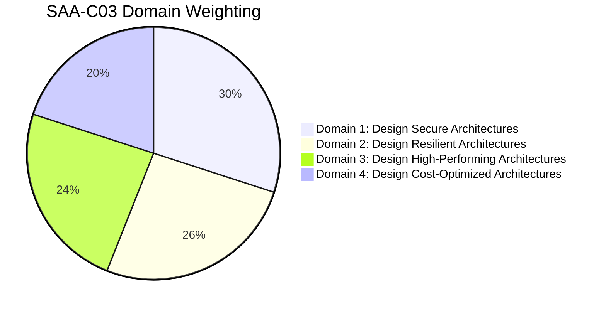

# AWS Certified Solutions Architect - Associate (SAA-C03) Training Suite

> **Exam Code:** `SAA-C03`  
> **Level:** Associate (Cloud Architecture)  
> **Passing Score:** `720 / 1000` (Scaled scoring)  
> **Questions:** 65 scenario-based questions, 130 minutes.  
>
> 🚀 **New to SAA-C03? Start Here:** [**Student Study Dashboard & Architecture Roadmap**](./00_START_HERE.md)

---

## 📂 Pedagogical Phase Architecture (12 Steps)

```
Cloud/Associate/SAA-C03/
├── 01_Syllabus/             # Official blueprint, domain weighting, study schedules
├── 02_Prerequisites/          # Core networking, compute, storage, security foundations
├── 03_Lectures/               # Instructor delivery lesson plans and classroom talking points
├── 04_Slides/                 # Marp slide decks for classroom delivery
├── 05_Diagrams/               # Standalone production Mermaid architecture blueprints
├── 06_Explanations/           # In-depth architectural mechanics & trade-off breakdowns
├── 07_Hands_On_Labs/                   # Guided architectural hands-on labs with CLI runbooks
├── 08_Tutorials/              # Production multi-service architectural build tutorials
├── 09_Notes_and_Cheatsheets/                  # High-yield architectural trade-off cheat sheets
├── 10_Knowledge_Checks/       # Rapid diagnostic retention quizzes per domain
├── 11_Practice_Exams/     # Curated scenario questions + 1,019Q Community Practice Pool
└── 12_Sources/                # Academic references, whitepapers, documentation indexes
```

---

## 🎯 Exam Domains & Weightings



1. **[Domain 1: Design Secure Architectures (30%)](01_Syllabus/SAA-C03_Official_Blueprint.md#domain-1-design-secure-architectures-30):** Secure access to AWS resources, secure workload/applications, data security (KMS, Secrets Manager).
2. **[Domain 2: Design Resilient Architectures (26%)](01_Syllabus/SAA-C03_Official_Blueprint.md#domain-2-design-resilient-architectures-26):** Scalable, loosely coupled architectures (SQS, EventBridge), high-availability / fault-tolerant multi-AZ architectures (ALB, Auto Scaling, Aurora).
3. **[Domain 3: Design High-Performing Architectures (24%)](01_Syllabus/SAA-C03_Official_Blueprint.md#domain-3-design-high-performing-architectures-24):** High-performing compute, storage (EFS, FSx, EBS io2), databases (DynamoDB DAX, ElastiCache), and networks (CloudFront, Global Accelerator).
4. **[Domain 4: Design Cost-Optimized Architectures (20%)](01_Syllabus/SAA-C03_Official_Blueprint.md#domain-4-design-cost-optimized-architectures-20):** Cost-effective storage (S3 tiers), compute (Savings Plans, Spot, Serverless), and database licensing.

---

## 🛠️ Interactive Tools

- **CLI Revision Engine:** Run interactive drills, practice pools, and simulated exams:
  ```bash
  # Practice by domain
  python3 scripts/aws_revision_runner.py --cert SAA --mode practice --domain 1

  # Practice authentic Community Practice Pool (1,019 questions)
  python3 scripts/aws_revision_runner.py --cert SAA --community --mode practice -n 20 --tricks

  # Timed 65-question mock exam
  python3 scripts/aws_revision_runner.py --cert SAA --mode mock
  ```
- **Integrity Validation:** Run test suite across repositories:
  ```bash
  python3 tests/verify_ecosystem_integrity.py
  ```
