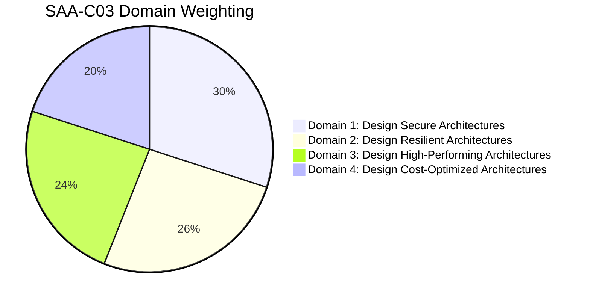

# AWS Certified Solutions Architect - Associate (SAA-C03) Training Suite

> **Exam Code:** `SAA-C03`  
> **Level:** Associate (Cloud Architecture)  
> **Passing Score:** `720 / 1000` (Scaled scoring)  
> **Questions:** 65 scenario-based questions, 130 minutes.

---

## 📂 Suite Directory Structure

```
Cloud/Associate/SAA-C03/
├── syllabus/              # Official blueprint, domain weighting, study schedules
├── notes/                 # High-yield architectural trade-off cheat sheets
├── labs/                  # 100% written guided architectural labs (no screenshot dependencies)
├── lectures/              # Instructor delivery lesson plans and classroom talking points
├── diagrams/              # Standalone production Mermaid architecture blueprints
├── revision_questions/    # Curated scenario-based revision questions
└── knowledge_checks/      # Rapid diagnostic retention quizzes per domain
```

---

## 🎯 Exam Domains & Weightings



1. **[Domain 1: Design Secure Architectures (30%)](phase0_step01_syllabus/SAA-C03_Official_Blueprint.md#domain-1-design-secure-architectures-30):** Secure access to AWS resources, secure workload/applications, data security (KMS, Secrets Manager).
2. **[Domain 2: Design Resilient Architectures (26%)](phase0_step01_syllabus/SAA-C03_Official_Blueprint.md#domain-2-design-resilient-architectures-26):** Scalable, loosely coupled architectures (SQS, EventBridge), high-availability / fault-tolerant multi-AZ architectures (ALB, Auto Scaling, Aurora).
3. **[Domain 3: Design High-Performing Architectures (24%)](phase0_step01_syllabus/SAA-C03_Official_Blueprint.md#domain-3-design-high-performing-architectures-24):** High-performing compute, storage (EFS, FSx, EBS io2), databases (DynamoDB DAX, ElastiCache), and networks (CloudFront, Global Accelerator).
4. **[Domain 4: Design Cost-Optimized Architectures (20%)](phase0_step01_syllabus/SAA-C03_Official_Blueprint.md#domain-4-design-cost-optimized-architectures-20):** Cost-effective storage (S3 tiers), compute (Savings Plans, Spot, Serverless), and database licensing.

---

## 🛠️ Interactive Tools

- **CLI Revision Engine:** Run interactive drills and simulated exams via:
  ```bash
  python3 scripts/aws_revision_runner.py --cert CLF --mode practice
  ```
- **Integrity Validation:** Run test suite across repositories:
  ```bash
  python3 tests/verify_ecosystem_integrity.py
  ```
