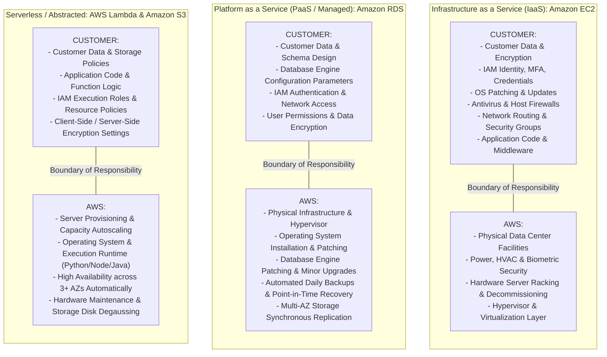

# Master Architecture Blueprint: Shared Responsibility Model Shift

> **Category:** Security, Governance & Compliance  
> **Course:** AWS Certified Cloud Practitioner (CLF-C02)  
> **Tags:** `#diagram` `#security` `#shared-responsibility`

### Golden Rules:
1. **Customer Data:** Always 100% the customer responsibility across all services.
2. **Identity & Access Management:** Always 100% the customer responsibility.
3. **Physical Security OF the Cloud:** Always 100% AWS responsibility.
